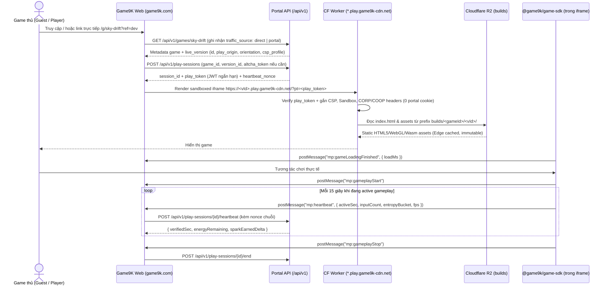
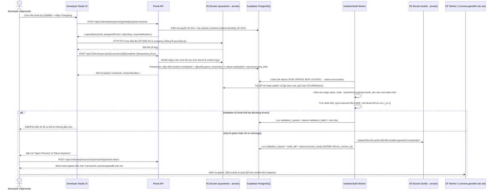
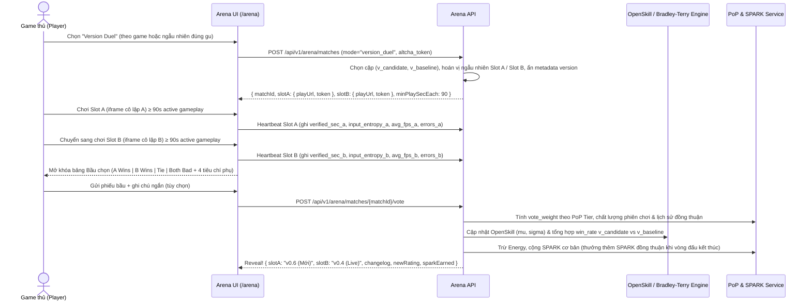
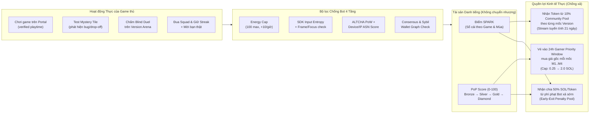
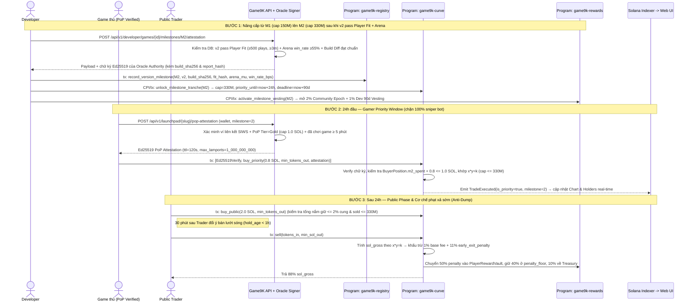
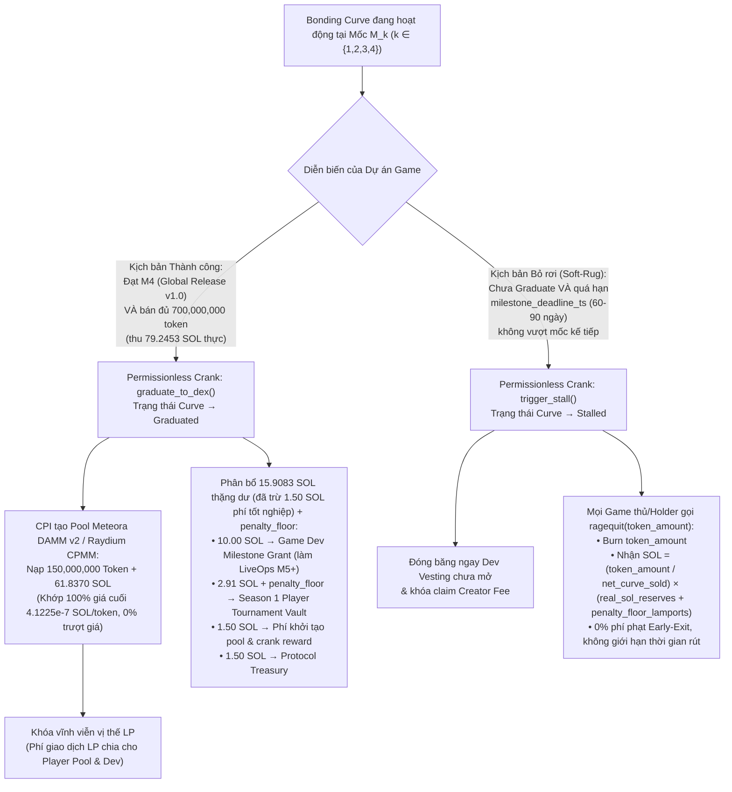

# P02 — Luồng Người Dùng & Kiến trúc Giao diện (User Flows & UX Specs)

> **Tài liệu sống (Living Documentation):** `docs/01-user-flows-and-ux.md`  
> **Giai đoạn AI-Agile:** `P02 — Frontend UX Agreement Loop` → Đầu vào trực tiếp cho `P03` (OpenAPI & Data Model)  
> **HITL Gate:** `G2` — Product Owner & Lead Designer phê duyệt toàn bộ luồng màn hình desktop/mobile trước khi chốt backend.

---

## 1. Kiến trúc Thông tin (Information Architecture — Sitemap)

```mermaid
flowchart TB
    Root["Game9K Web App (game9k.com)"]

    Root --> P1["1. Play Portal (Poki UX)"]
    Root --> P2["2. Version Arena (Arena UX)"]
    Root --> P3["3. Community & SPARK (Notcoin UX)"]
    Root --> P4["4. Version Launchpad (Pump.fun UX)"]
    Root --> P5["5. Developer Studio & Inspector"]
    Root --> P6["6. Curator & Admin Console"]

    P1 --> P1a["/ — Lưới Game động + Mystery Tile"]
    P1 --> P1b["/c/[category] — Danh mục & Bộ lọc"]
    P1 --> P1c["/g/[slug] — Chơi tức thì + Chọn Version + SDK Bar"]
    P1 --> P1d["/mystery — Phiên Playtest có Consent"]

    P2 --> P2a["/arena — Blind Duel (Version vs Version / Game vs Game)"]
    P2 --> P2b["/arena/game/[slug] — Lịch sử Elo & So sánh các Version"]
    P2 --> P2c["/arena/leaderboard — Bảng xếp hạng OpenSkill + 95% CI"]

    P3 --> P3a["/quests — Nhiệm vụ Version, Streak & Energy"]
    P3 --> P3b["/squads — Bang hội & Đua Top Tuần"]
    P3 --> P3c["/profile — Hồ sơ, PoP Tier, Sổ cái SPARK, Liên kết Ví SIWS"]

    P4 --> P4a["/launch — Khám phá Token theo Mốc M1..M4 & Sắp Graduate"]
    P4 --> P4b["/launch/[slug] — Chart + Mốc Version + Priority Buy/Sell + Top Holders"]
    P4 --> P4c["/portfolio — Vị thế nắm giữ, Stream Rewards 21d, Ragequit"]

    P5 --> P5a["/developers — Đăng ký & Tổng quan Studio"]
    P5 --> P5b["/developers/games — Danh sách Game & Tạo mới"]
    P5 --> P5c["/developers/games/[id] — Upload ZIP, Timeline Version, Fit Reports, Launchpad"]
    P5 --> P5d["/developers/inspector/[versionId] — QA Checklist, Event Log, Mobile QR"]

    P6 --> P6a["/admin/reviews — Duyệt Developer, Final QA & Mở khóa Mốc M3/M4"]
    P6 --> P6b["/admin/security — Anti-Bot/Sybil Queue, Audit Logs, Worker DLQ"]
```

### Danh mục Màn hình Cốt lõi & Trạng thái UI bắt buộc (Screen Contract)

| Mã màn hình | Route | Vai trò truy cập | Các thành phần & trạng thái bắt buộc (Empty / Loading / Error / Success) |
|---|---|---|---|
| **SCR-01** | `/` | Mọi người | Lưới masonry thẻ game như Poki (ảnh tĩnh WebP + hover WebM 3s), dải thể loại nhanh, ô **Mystery Tile** (chỉ hiện khi user đủ điều kiện playtest), thanh tìm kiếm tức thì `< 100ms`, badge version hiện tại (`v1.2`). **Chip trên mỗi thẻ** *(lấy từ `docs/09-xwg-portal-teardown.md` D1–D2)*: mốc `M0–M4` + trạng thái **chỉ 6 giá trị enum** `draft/in_testing/soft_launch/published/archived/suspended` — **không nhãn tự do** — kèm chip thiết bị (`mobile_supported`, `orientation`) và tối đa 2 thể loại phụ. Trang danh mục `/c/[category]` có facet lọc theo các chip này; bộ lọc nằm trong URL để chia sẻ được. |
| **SCR-02** | `/g/[slug]` | Mọi người | Khung iframe cô lập `<version-id>.play.<game-domain>`, nút Fullscreen/Mute/Báo lỗi, thanh Energy + bộ đếm thời gian chơi hợp lệ (cho user đăng nhập), nút chuyển sang "Đấu thử bản mới trên Arena" nếu game đang có bản ứng viên, tab liên kết mềm sang `/launch/[slug]` nếu có token. **Ngoài khung chơi** có 2 khối: *(a)* **Hồ sơ kiểm chứng** — bảng thông số **lấy từ dữ liệu thật, không phải mô tả marketing**: mốc hiện tại + ngày đạt, số phiên Playtest/Fit Test, điểm Web Fit (CTR / Time-on-Page / C2P) so benchmark thể loại, tỷ lệ thắng Version Arena + 95% CI, SHA-256 build đang chạy, link Solscan tới PDA; *(b)* **Tài sản của game** — danh sách bộ sưu tập/token theo loại (nhân vật, thẻ, vật phẩm, đất, pass…) kèm link sang `/launch/[slug]`; mỗi bộ sưu tập link ngược về đây. Cả hai khối **ẩn/hiện theo trạng thái**: game chưa qua mốc nào thì hiển thị "chưa có dữ liệu kiểm định", không hiển thị số 0 gây hiểu nhầm. *(Nguồn: `docs/09-xwg-portal-teardown.md` D3–D4.)* |
| **SCR-03** | `/arena` | `guest` (thử), `player` (tính điểm) | Hai khung/tab chuyển nhanh **Build A** vs **Build B** (ẩn số version), đồng hồ tiến độ `90s/90s` mỗi bản, bảng chấm 4 tiêu chí + 4 nút kết quả (*A Hay hơn / B Hay hơn / Ngang nhau / Cả hai tệ*), màn hình Reveal hé lộ số version, changelog, điểm OpenSkill và lượng `SPARK` nhận được. |
| **SCR-04** | `/quests` & `/squads` | `player` | Thanh **Energy (`70/100`, +10/h)**, huy hiệu **PoP Tier** (Bronze/Silver/Gold/Diamond + thanh tiến trình điểm 0–100), chuỗi Streak 7 ngày, danh sách nhiệm vụ trải nghiệm version mới, bảng xếp hạng Squad tuần, link mời bạn có ghi rõ điều kiện chống bot. |
| **SCR-05** | `/launch/[slug]` | Mọi người (xem), `player`+ví (trade) | Biểu đồ nến `lightweight-charts` kèm cờ mốc `M1..M4`, **Milestone Stepper** (hiển thị % tranche đã bán + tiến độ Fit Test/Arena của version kế tiếp + đồng hồ đếm ngược `milestone_deadline`), bảng **Buy/Sell** (hiển thị trạng thái *24h Gamer Priority Window*, hạn mức SOL của PoP Tier, và cảnh báo rõ mức phí *Early-Exit 12%/6%/3%/1%* trước khi ký ví), **Real-time Trade Feed**, **Top Holders & Cluster Badges**, link kiểm chứng SHA-256 build & PDA trên Solscan. |
| **SCR-06** | `/developers/games/[id]` | `developer` (chủ game) | 5 Tab: *(1) Overview & Metadata*, *(2) Versions & Upload ZIP* (progress bar, cancel/retry, validation JSON, change_ratio, nút Preview & Inspector), *(3) Playtest & Fit Funnel* (video playtest + histogram 500 lượt + so sánh 2 version + điểm CTR/Time/C2P), *(4) Arena Analytics* (win rate `v(n)` vs `v(n-1)`, heatmap điểm phụ), *(5) Launchpad & Revenue* (đăng ký M1, xin nâng mốc M2–M4, lịch Dev Vesting 90 ngày, doanh thu Ads 100% direct / 50-50 portal). |
| **SCR-07** | `/developers/inspector/[versionId]` | `developer` (chủ), `curator`, `admin` | Khung chạy preview cô lập, cột trái **QA Checklist**, cột phải **Live SDK Event Log** (`gameLoadingFinished`, `gameplayStart`, `gameplayStop`, `commercialBreak`, `rewardedBreak`, console errors), thanh dưới **Scaling Presets** (iPhone SE, Pixel, iPad, 16:9, 9:16), nút bật **Mobile QR Code**, tab **Warnings** (external URLs, ảnh chưa nén, thiếu index/SDK). |
| **SCR-08** | `/admin/*` | `curator`, `admin` | Hàng đợi duyệt Developer, hàng đợi kiểm định M1/M3/M4 (so sánh bản build, báo cáo chống bot, nút ký duyệt HITL), bảng điều tra Sybil/bot, nhật ký bất biến `audit_logs`, quản lý dead-letter jobs. |

---

## 2. Tám Luồng Người Dùng End-to-End (Mermaid Diagrams)

### Luồng 1 — Game thủ khám phá & chơi game tức thì chuẩn Poki (Web2-First + PoP Heartbeat)

---

### Luồng 2 — Developer tải lên bản Build ZIP, Kiểm định bảo mật & Inspector (Poki Dev Flow)

---

### Luồng 3 — Phễu Kiểm định 3 Chặng chuẩn Poki (Playtest → Player Fit → Web Fit)

```mermaid
flowchart TD
    Start(["Version đạt preview_ready + pass Inspector"]) --> ReqPT["Dev gửi yêu cầu Chặng 1: Mystery Tile Playtest<br/>(chọn thể loại mục tiêu + thiết bị)"]
    ReqPT --> Mystery["Hệ thống phân phối Mystery Tile cho người chơi đúng thể loại<br/>(yêu cầu người chơi bấm đồng ý ghi phiên chơi)"]
    Mystery --> Rec10{"Đủ 10 bản ghi hợp lệ?<br/>(canvas video + phím bấm + console log)"}
    Rec10 -- "Chưa" --> Mystery
    Rec10 -- "Đủ 10" --> DevWatch["Dev xem tối thiểu 10 bản ghi trên Studio<br/>& kiểm tra lỗi console"]
    DevWatch --> GateM1{"Đạt chuẩn an toàn &<br/>không lỗi chặn?"}
    GateM1 -- "Cần sửa" --> Iter1["Dev sửa onboarding/bug → Upload v(n+1)"] --> Start
    GateM1 -- "Đạt" --> M1Pass["ĐẠT MỐC M1 (Playtest Verified)<br/>Đủ điều kiện mở Launchpad Tranche 1 (15% cung)"]

    M1Pass --> ReqPFT["Dev ship bản cải tiến & yêu cầu Chặng 2: Player Fit Test<br/>(tối đa 2 lần/ngày, yêu cầu có thumbnail)"]
    ReqPFT --> Sample500["Phân phối tự động tới 500 người chơi thật (lọc bot PoP)<br/>Vẽ Histogram: 0-1m | 1-2m | 2-3m | 3-5m | 5m+"]
    Sample500 --> GatePFT{"Avg Playtime ≥ 3.0 phút<br/>VÀ ≥ 25% phiên > 3 phút<br/>VÀ thắng Arena Duel vs M1?"}
    GatePFT -- "Chưa đạt" --> Iter2["Hiển thị chẩn đoán drop-off + so sánh 2 version<br/>Dev tối ưu gameplay → Upload version mới"] --> ReqPFT
    GatePFT -- "Đạt" --> M2Pass["ĐẠT MỐC M2 (Player Fit Verified)<br/>Mở khóa Launchpad Tranche 2 (lũy kế 33% cung) + Dev Vest 1%"]

    M2Pass --> ReqWFT["Dev ship bản mở rộng & yêu cầu Chặng 3: Web Fit Test<br/>(chạy 3-5 ngày trong các category phù hợp, ≥2,000 phiên)"]
    ReqWFT --> Measure3["Đo 3 chỉ số chấm thang 0-5 so với benchmark thể loại:<br/>1. CTR | 2. Avg Time on Page | 3. Conversion-to-Play (C2P)"]
    Measure3 --> GateWFT{"Điểm TB ≥ 3.0/5 (không chỉ số nào < 2.5)<br/>VÀ thắng Arena Duel vs M2?"}
    GateWFT -- "Chưa đạt" --> Iter3["Gửi playbook cải thiện thumbnail/load/depth<br/>Dev upload version mới"] --> ReqWFT
    GateWFT -- "Đạt" --> M3Pass["ĐẠT MỐC M3 (Arena & Web Fit Verified)<br/>Mở khóa Launchpad Tranche 3 (lũy kế 53% cung) + Dev Vest +1%"]

    M3Pass --> FinalQA["Dev gửi bản v1.0 vào Final Curator Review (HITL)<br/>Kiểm tra mobile/desktop, quảng cáo SDK, bản quyền"]
    FinalQA --> GateM4{"Curator ký duyệt<br/>phát hành toàn cầu?"}
    GateM4 -- "Yêu cầu chỉnh sửa" --> FinalQA
    GateM4 -- "Approved" --> M4Pass["ĐẠT MỐC M4 (Global Curated Release)<br/>Lên trang chủ Portal + Mở Tranche 4 (70% cung) → Sẵn sàng DEX Graduation"]
```

---

### Luồng 4 — Đấu giá trị Phiên bản Mù trên Game9K Arena (Arena Flow)

---

### Luồng 5 — Vòng lặp Cộng đồng & Chống Bot kiểu Notcoin (Play → SPARK → PoP Tier → Allocation)

---

### Luồng 6 — Mở khóa Mốc Version & Giao dịch trên Version-Gated Bonding Curve (Pump.fun × Anti-Bot)

---

### Luồng 7 — DEX Graduation (Khi đạt M4) vs. Fair Ragequit (Khi dự án bị bỏ rơi)

---

### Luồng 8 — Curator / Admin kiểm định HITL & Xử lý vi phạm

1. **Duyệt Developer (`S0-05`):** Người dùng nộp hồ sơ studio/portfolio tại `/developers/apply` → Admin xem xét tại `/admin/reviews/developers` → duyệt `approved` (hoặc `rejected` kèm lý do) → ghi `audit_logs`.
2. **Duyệt Cột mốc M3 / M4 & Curated Release:** Hệ thống tự động tổng hợp bảng điểm *(Validation JSON + Build Diff + Player Fit Histogram + Web Fit CTR/Time/C2P + Arena Win-Rate & 95% CI + Báo cáo tỷ lệ phiên sạch Anti-Bot)*. Curator mở **Game9K Inspector** test thực tế trên desktop & mobile → bấm `Approve Milestone` → ghi `audit_logs` và mở quyền xin chữ ký Oracle nâng mốc on-chain.
3. **Phản ứng sự cố khẩn cấp (Kill-Switch):** Nếu phát hiện bản build vi phạm bản quyền, chứa mã độc lọt lưới hoặc dev gian lận wash-play: Admin gọi `suspend_version` / `revoke_preview` → Cloudflare Worker chặn phân phối trong `< 10 giây`, ngừng cấp chữ ký nâng mốc và ghi đầy đủ vào `audit_logs`.
