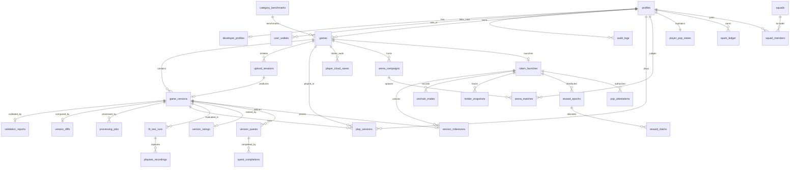
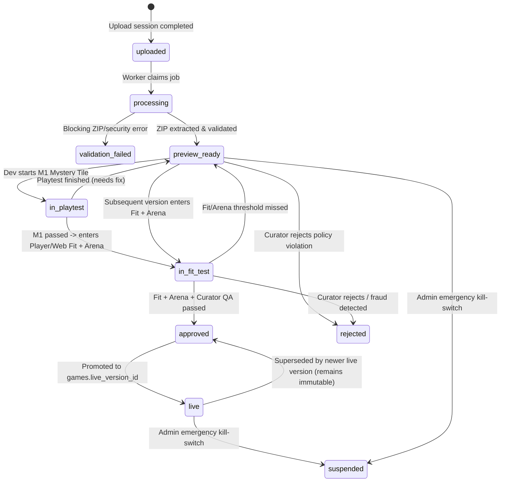

# P03-A — Thiết kế Cơ sở Dữ liệu (Database Schema, ERD & RLS)

> **Tài liệu sống (Living Documentation):** `docs/02-database-schema.md`  
> **Hệ quản trị CSDL:** Supabase PostgreSQL 16+ (quản lý 100% qua `supabase/migrations/*.sql` + kiểm thử `supabase/tests/*.sql` với `pgTAP`)  
> **Nguyên tắc thiết kế:** Kế thừa đầy đủ schema Sprint 0–1 (`profiles`, `developer_profiles`, `audit_logs`, `games`, `upload_sessions`, `processing_jobs`, `game_versions`, `validation_reports`) và mở rộng chuẩn hóa 3NF cho **Poki Portal/Fit Pipeline**, **Version Arena**, **Notcoin Proof-of-Play (`SPARK`)** và **Solana Version Launchpad Projection**.

---

## 1. Sơ đồ Thực thể Liên kết Tổng thể (ERD — 31 Bảng / 6 Bounded Contexts)



---

## 2. Đặc tả Chi tiết Bảng & SQL Schema theo 6 Bounded Contexts

> **Quy ước chung:** Mọi bảng dùng khóa chính `UUID DEFAULT gen_random_uuid()`, cột thời gian `TIMESTAMPTZ NOT NULL DEFAULT now()`, trigger tự động cập nhật `updated_at`, và **bật `ENABLE ROW LEVEL SECURITY` + `FORCE ROW LEVEL SECURITY`** ngay trong cùng migration tạo bảng. Số lượng token base unit (6 decimals) và lamports (9 decimals) lưu bằng `BIGINT` hoặc `NUMERIC(20,0)` — **tuyệt đối không dùng `FLOAT` cho tiền tệ**.

---

### 2.1. Context 1 — Identity, RBAC, SIWS Wallets & Audit (`S0-04`..`S0-07`, `S4`)

```sql
-- Vai trò hệ thống (chỉ server/admin được thay đổi, client không bao giờ tự gán)
CREATE TYPE app_role AS ENUM ('player', 'developer', 'curator', 'admin');
CREATE TYPE dev_application_status AS ENUM ('pending', 'approved', 'rejected', 'suspended');
CREATE TYPE account_status AS ENUM ('active', 'restricted', 'suspended');

-- 1. profiles: liên kết 1-1 với auth.users của Supabase
CREATE TABLE public.profiles (
    id                UUID PRIMARY KEY REFERENCES auth.users(id) ON DELETE CASCADE,
    username          CITEXT NOT NULL UNIQUE CHECK (username ~ '^[a-z0-9_]{3,24}$'),
    display_name      TEXT NOT NULL CHECK (char_length(display_name) BETWEEN 1 AND 50),
    avatar_key        TEXT,
    role              app_role NOT NULL DEFAULT 'player',
    status            account_status NOT NULL DEFAULT 'active',
    referred_by       UUID REFERENCES public.profiles(id) ON DELETE SET NULL,
    referral_verified BOOLEAN NOT NULL DEFAULT false, -- Chỉ true khi người được mời đạt PoP Tier >= bronze
    locale            TEXT NOT NULL DEFAULT 'vi',
    created_at        TIMESTAMPTZ NOT NULL DEFAULT now(),
    updated_at        TIMESTAMPTZ NOT NULL DEFAULT now()
);

-- 2. developer_profiles: hồ sơ & trạng thái xét duyệt nhà phát triển game
CREATE TABLE public.developer_profiles (
    user_id           UUID PRIMARY KEY REFERENCES public.profiles(id) ON DELETE CASCADE,
    studio_name       TEXT NOT NULL CHECK (char_length(studio_name) BETWEEN 2 AND 80),
    studio_slug       CITEXT NOT NULL UNIQUE CHECK (studio_slug ~ '^[a-z0-9-]{2,40}$'),
    website_url       TEXT,
    portfolio_links   JSONB NOT NULL DEFAULT '[]'::jsonb,
    payout_wallet     TEXT CHECK (payout_wallet IS NULL OR char_length(payout_wallet) BETWEEN 32 AND 44),
    status            dev_application_status NOT NULL DEFAULT 'pending',
    reviewed_by       UUID REFERENCES public.profiles(id),
    reviewed_at       TIMESTAMPTZ,
    review_note       TEXT,
    created_at        TIMESTAMPTZ NOT NULL DEFAULT now(),
    updated_at        TIMESTAMPTZ NOT NULL DEFAULT now()
);

-- 3. user_wallets: liên kết ví Solana qua Sign-In With Solana (SIWS) chống đa tài khoản dùng chung 1 ví
CREATE TABLE public.user_wallets (
    id                UUID PRIMARY KEY DEFAULT gen_random_uuid(),
    user_id           UUID NOT NULL REFERENCES public.profiles(id) ON DELETE CASCADE,
    wallet_address    TEXT NOT NULL UNIQUE CHECK (char_length(wallet_address) BETWEEN 32 AND 44),
    is_primary        BOOLEAN NOT NULL DEFAULT true,
    siws_nonce        TEXT NOT NULL,
    verified_at       TIMESTAMPTZ NOT NULL DEFAULT now(),
    cooldown_until    TIMESTAMPTZ NOT NULL DEFAULT (now() + INTERVAL '7 days'), -- Chống gỡ ví xoay vòng farm Priority Window
    sybil_cluster_id  TEXT, -- Gắn bởi indexer nếu phát hiện chung nguồn nạp SOL với cụm bot
    created_at        TIMESTAMPTZ NOT NULL DEFAULT now()
);
CREATE UNIQUE INDEX idx_user_wallets_one_primary ON public.user_wallets(user_id) WHERE is_primary = true;

-- 4. audit_logs: nhật ký bất biến (append-only) cho mọi hành động nhạy cảm (S0-07)
CREATE TABLE public.audit_logs (
    id                BIGSERIAL PRIMARY KEY,
    actor_id          UUID REFERENCES public.profiles(id) ON DELETE SET NULL,
    actor_role        TEXT NOT NULL,
    action            TEXT NOT NULL,          -- vd: 'role.updated', 'version.promoted', 'milestone.attested', 'preview.revoked'
    resource_type     TEXT NOT NULL,          -- vd: 'game', 'game_version', 'token_launch', 'profile'
    resource_id       TEXT NOT NULL,
    correlation_id    TEXT NOT NULL,
    ip_hash           TEXT,                   -- HMAC-SHA256 của IP, không lưu IP thô vô thời hạn
    metadata          JSONB NOT NULL DEFAULT '{}'::jsonb, -- Đã qua bộ lọc cấm secret/token/presigned URL
    created_at        TIMESTAMPTZ NOT NULL DEFAULT now()
);
CREATE INDEX idx_audit_logs_resource ON public.audit_logs(resource_type, resource_id, created_at DESC);
CREATE INDEX idx_audit_logs_actor ON public.audit_logs(actor_id, created_at DESC);
-- Trigger chặn tuyệt đối UPDATE và DELETE trên audit_logs kể cả với privileged role ứng dụng.
```

---

### 2.2. Context 2 — Game Catalog, Secure Upload & Immutable Versions (`S1-01`..`S1-08`, `S2`)

```sql
CREATE TYPE game_lifecycle_status AS ENUM (
    'draft', 'in_testing', 'soft_launch', 'published', 'archived', 'suspended'
);
CREATE TYPE game_visibility AS ENUM ('private', 'unlisted_test', 'public');
CREATE TYPE game_orientation AS ENUM ('landscape', 'portrait', 'any');
CREATE TYPE upload_session_status AS ENUM ('pending', 'completed', 'expired', 'aborted', 'failed');
CREATE TYPE version_status AS ENUM (
    'uploaded', 'processing', 'validation_failed', 'preview_ready',
    'in_playtest', 'in_fit_test', 'approved', 'live', 'rejected', 'suspended'
);
CREATE TYPE job_status AS ENUM ('queued', 'running', 'retry_scheduled', 'succeeded', 'dead_letter');

-- 5. category_benchmarks: chuẩn đối chiếu cho Poki Player Fit & Web Fit Test theo từng thể loại
CREATE TABLE public.category_benchmarks (
    slug                  TEXT PRIMARY KEY, -- 'action', 'puzzle', 'arcade', 'roguelike', 'io-multiplayer', 'simulation'...
    display_name          TEXT NOT NULL,
    min_fit_avg_sec       INT NOT NULL DEFAULT 180,     -- Mặc định 3 phút (360s cho simulation)
    min_fit_over_3m_bps   INT NOT NULL DEFAULT 2500,    -- 25.00%
    bench_ctr_bps         INT NOT NULL DEFAULT 150,     -- 1.50% = điểm 3.0/5
    bench_time_on_page_s  INT NOT NULL DEFAULT 240,     -- 4 phút = điểm 3.0/5
    bench_c2p_bps         INT NOT NULL DEFAULT 7000,    -- 70.00% = điểm 3.0/5
    updated_at            TIMESTAMPTZ NOT NULL DEFAULT now()
);

-- 6. games: danh tính ổn định của trò chơi, tách rời khỏi từng bản build (S1-01)
CREATE TABLE public.games (
    id                    UUID PRIMARY KEY DEFAULT gen_random_uuid(),
    owner_id              UUID NOT NULL REFERENCES public.profiles(id) ON DELETE RESTRICT,
    slug                  CITEXT NOT NULL UNIQUE CHECK (slug ~ '^[a-z0-9]+(?:-[a-z0-9]+)*$' AND char_length(slug) BETWEEN 2 AND 60),
    title                 TEXT NOT NULL CHECK (char_length(title) BETWEEN 2 AND 80),
    short_description     TEXT NOT NULL CHECK (char_length(short_description) <= 160),
    full_description      TEXT NOT NULL DEFAULT '' CHECK (char_length(full_description) <= 5000),
    primary_category      TEXT NOT NULL REFERENCES public.category_benchmarks(slug),
    secondary_categories  TEXT[] NOT NULL DEFAULT '{}',
    tags                  TEXT[] NOT NULL DEFAULT '{}',
    default_language      TEXT NOT NULL DEFAULT 'en',
    orientation           game_orientation NOT NULL DEFAULT 'any',
    mobile_supported      BOOLEAN NOT NULL DEFAULT true,
    cover_image_key       TEXT,
    hover_video_key       TEXT,                         -- Clip WebM 3s khi hover trên Portal kiểu Poki
    visibility            game_visibility NOT NULL DEFAULT 'private',
    lifecycle_status      game_lifecycle_status NOT NULL DEFAULT 'draft',
    live_version_id       UUID,                         -- FK thêm sau tới game_versions(id); KHÔNG tự đổi khi upload bản mới
    current_milestone     SMALLINT NOT NULL DEFAULT 0 CHECK (current_milestone BETWEEN 0 AND 10), -- 0=M0, 1=M1..4=M4, 5+=LiveOps
    launchpad_enabled     BOOLEAN NOT NULL DEFAULT false,
    web_exclusive         BOOLEAN NOT NULL DEFAULT false, -- Tham chiếu chính sách độc quyền web của Poki
    created_at            TIMESTAMPTZ NOT NULL DEFAULT now(),
    updated_at            TIMESTAMPTZ NOT NULL DEFAULT now()
);
CREATE INDEX idx_games_portal_listing ON public.games(primary_category, lifecycle_status, visibility)
    WHERE lifecycle_status = 'published' AND visibility = 'public';
CREATE INDEX idx_games_owner ON public.games(owner_id, created_at DESC);

-- 7. upload_sessions: vòng đời upload ZIP trực tiếp từ trình duyệt lên R2 quarantine (S1-03)
CREATE TABLE public.upload_sessions (
    id                    UUID PRIMARY KEY DEFAULT gen_random_uuid(),
    game_id               UUID NOT NULL REFERENCES public.games(id) ON DELETE RESTRICT,
    created_by            UUID NOT NULL REFERENCES public.profiles(id) ON DELETE RESTRICT,
    quarantine_key        TEXT NOT NULL UNIQUE,         -- Khóa ngẫu nhiên không đoán được, không chứa tên file gốc
    original_filename     TEXT NOT NULL CHECK (char_length(original_filename) <= 255),
    changelog             TEXT NOT NULL CHECK (char_length(changelog) BETWEEN 10 AND 4000),
    semantic_label        TEXT CHECK (semantic_label IS NULL OR semantic_label ~ '^v?[0-9]+\.[0-9]+\.[0-9]+(-[a-z0-9.]+)?$'),
    expected_bytes        BIGINT NOT NULL CHECK (expected_bytes > 0 AND expected_bytes <= 52428800), -- 50 MB mặc định
    actual_bytes          BIGINT,
    r2_etag               TEXT,
    status                upload_session_status NOT NULL DEFAULT 'pending',
    expires_at            TIMESTAMPTZ NOT NULL,         -- now() + 15 phút
    completed_at          TIMESTAMPTZ,
    created_at            TIMESTAMPTZ NOT NULL DEFAULT now()
);
CREATE INDEX idx_upload_sessions_game ON public.upload_sessions(game_id, created_at DESC);

-- 8. game_versions: bản ghi phiên bản BẤT BIẾN (S1-06)
CREATE TABLE public.game_versions (
    id                    UUID PRIMARY KEY DEFAULT gen_random_uuid(),
    game_id               UUID NOT NULL REFERENCES public.games(id) ON DELETE RESTRICT,
    upload_session_id     UUID NOT NULL UNIQUE REFERENCES public.upload_sessions(id) ON DELETE RESTRICT,
    version_number        INT NOT NULL CHECK (version_number >= 1), -- Cấp phát tuần tự trong transaction theo game_id
    semantic_label        TEXT NOT NULL,                -- vd: 'v0.1.0', 'v0.4.2', 'v1.0.0'
    changelog             TEXT NOT NULL,
    storage_prefix        TEXT NOT NULL UNIQUE,         -- vd: 'builds/<game_id>/<version_id>/' (không bao giờ tái sử dụng)
    entrypoint_path       TEXT NOT NULL DEFAULT 'index.html',
    zip_sha256            CHAR(64),                     -- Hex SHA-256 của file ZIP gốc (ghi cả lên Solana)
    manifest_sha256       CHAR(64),                     -- Merkle/SHA-256 của toàn bộ cây file đã giải nén
    compressed_bytes      BIGINT,
    extracted_bytes       BIGINT CHECK (extracted_bytes IS NULL OR extracted_bytes <= 209715200), -- 200 MB
    file_count            INT CHECK (file_count IS NULL OR file_count <= 5000),
    sdk_detected          BOOLEAN NOT NULL DEFAULT false,
    sdk_version           TEXT,
    status                version_status NOT NULL DEFAULT 'uploaded',
    preview_enabled       BOOLEAN NOT NULL DEFAULT false,
    preview_token_version INT NOT NULL DEFAULT 1,       -- Tăng +1 để thu hồi tức thì mọi preview JWT đã cấp (S1-08)
    processed_at          TIMESTAMPTZ,
    published_at          TIMESTAMPTZ,
    created_at            TIMESTAMPTZ NOT NULL DEFAULT now(),
    updated_at            TIMESTAMPTZ NOT NULL DEFAULT now(),
    UNIQUE (game_id, version_number)
);
-- Trigger bất biến: sau khi processed_at IS NOT NULL, cấm sửa zip_sha256, manifest_sha256, storage_prefix,
-- entrypoint_path, compressed_bytes, extracted_bytes, file_count, version_number.

ALTER TABLE public.games
    ADD CONSTRAINT fk_games_live_version FOREIGN KEY (live_version_id) REFERENCES public.game_versions(id);

-- 9. validation_reports: báo cáo kiểm định kỹ thuật & bảo mật có cấu trúc (S1-07)
CREATE TABLE public.validation_reports (
    version_id            UUID PRIMARY KEY REFERENCES public.game_versions(id) ON DELETE CASCADE,
    passed                BOOLEAN NOT NULL,
    blocking_count        INT NOT NULL DEFAULT 0,
    warning_count         INT NOT NULL DEFAULT 0,
    checks                JSONB NOT NULL,               -- [{code, severity: 'pass'|'warn'|'block', message, hint}]
    external_domains      TEXT[] NOT NULL DEFAULT '{}', -- Cảnh báo tài nguyên ngoài như Poki Inspector
    unoptimized_assets    JSONB NOT NULL DEFAULT '[]'::jsonb,
    file_manifest_key     TEXT,                         -- Lưu manifest đầy đủ trên R2 nếu lớn
    inspector_qa_state    JSONB NOT NULL DEFAULT '{}'::jsonb, -- Trạng thái checklist QA của dev/curator
    created_at            TIMESTAMPTZ NOT NULL DEFAULT now()
);

-- 10. version_diffs: đo mức độ thay đổi thực chất giữa v(n) và v(n-1) chống upload giả để mở khóa token
CREATE TABLE public.version_diffs (
    version_id            UUID PRIMARY KEY REFERENCES public.game_versions(id) ON DELETE CASCADE,
    base_version_id       UUID NOT NULL REFERENCES public.game_versions(id) ON DELETE RESTRICT,
    files_added           INT NOT NULL DEFAULT 0,
    files_modified        INT NOT NULL DEFAULT 0,
    files_removed         INT NOT NULL DEFAULT 0,
    code_delta_ratio      NUMERIC(5,4) NOT NULL,        -- Tỷ lệ thay đổi JS/Wasm bundle (0.0000 - 1.0000)
    asset_delta_ratio     NUMERIC(5,4) NOT NULL,        -- Tỷ lệ thay đổi đồ họa/âm thanh/level data
    substantive_update    BOOLEAN NOT NULL,             -- True nếu vượt ngưỡng thay đổi thực chất
    created_at            TIMESTAMPTZ NOT NULL DEFAULT now()
);

-- 11. processing_jobs: hàng đợi xử lý nền bền vững với FOR UPDATE SKIP LOCKED (S1-04)
CREATE TABLE public.processing_jobs (
    id                    UUID PRIMARY KEY DEFAULT gen_random_uuid(),
    job_type              TEXT NOT NULL,                -- 'validate_extract_zip', 'compute_build_diff', 'aggregate_fit_test', 'build_merkle_epoch'
    idempotency_key       TEXT NOT NULL UNIQUE,         -- vd: 'zip:<version_id>' chống tạo trùng job
    version_id            UUID REFERENCES public.game_versions(id) ON DELETE CASCADE,
    payload               JSONB NOT NULL DEFAULT '{}'::jsonb,
    status                job_status NOT NULL DEFAULT 'queued',
    attempts              INT NOT NULL DEFAULT 0,
    max_attempts          INT NOT NULL DEFAULT 3,
    run_after             TIMESTAMPTZ NOT NULL DEFAULT now(),
    locked_by             TEXT,
    locked_until          TIMESTAMPTZ,
    correlation_id        TEXT NOT NULL,
    last_error_code       TEXT,
    last_error_safe       TEXT,
    created_at            TIMESTAMPTZ NOT NULL DEFAULT now(),
    updated_at            TIMESTAMPTZ NOT NULL DEFAULT now()
);
CREATE INDEX idx_processing_jobs_claim ON public.processing_jobs(run_after, created_at)
    WHERE status IN ('queued', 'retry_scheduled');
```

---

### 2.3. Context 3 — Portal Sessions, Cloud Save & Poki 3-Stage Fit Pipeline (`S2`, `S3`)

```sql
CREATE TYPE traffic_source_type AS ENUM ('direct_dev', 'portal_organic', 'portal_mystery', 'portal_arena', 'portal_campaign');
CREATE TYPE fit_test_stage AS ENUM ('playtest_10', 'player_fit_500', 'web_fit');
CREATE TYPE fit_test_status AS ENUM ('queued', 'running', 'passed', 'failed', 'cancelled');

-- 12. play_sessions: đo lường chơi thực tế, C2P, doanh thu quảng cáo & Proof-of-Play
CREATE TABLE public.play_sessions (
    id                    UUID PRIMARY KEY DEFAULT gen_random_uuid(),
    game_id               UUID NOT NULL REFERENCES public.games(id) ON DELETE CASCADE,
    version_id            UUID NOT NULL REFERENCES public.game_versions(id) ON DELETE CASCADE,
    user_id               UUID REFERENCES public.profiles(id) ON DELETE SET NULL, -- NULL cho guest
    fit_test_id           UUID,                         -- Gắn nếu thuộc phiên Playtest / Fit Test
    arena_match_id        UUID,                         -- Gắn nếu thuộc phiên đấu Arena
    traffic_source        traffic_source_type NOT NULL DEFAULT 'portal_organic', -- Quyết định chia 100% vs 50/50
    device_type           TEXT NOT NULL CHECK (device_type IN ('desktop', 'mobile', 'tablet')),
    country_code          CHAR(2),
    load_finished_ms      INT,                          -- Từ SDK gameLoadingFinished()
    converted_to_play     BOOLEAN NOT NULL DEFAULT false, -- True khi nhận gameplayStart() đầu tiên (C2P)
    page_duration_sec     INT NOT NULL DEFAULT 0,
    active_gameplay_sec   INT NOT NULL DEFAULT 0,       -- Chỉ tính giữa gameplayStart() và gameplayStop() có heartbeat hợp lệ
    input_entropy_score   NUMERIC(4,3),                 -- 0.000 - 1.000 (lọc auto-clicker / tab treo)
    console_error_count   INT NOT NULL DEFAULT 0,
    commercial_breaks     SMALLINT NOT NULL DEFAULT 0,
    rewarded_breaks       SMALLINT NOT NULL DEFAULT 0,
    is_pop_verified       BOOLEAN NOT NULL DEFAULT false, -- Phiên sạch vượt qua bộ lọc anti-bot
    device_fp_hash        TEXT,
    started_at            TIMESTAMPTZ NOT NULL DEFAULT now(),
    last_heartbeat_at     TIMESTAMPTZ NOT NULL DEFAULT now(),
    ended_at              TIMESTAMPTZ
);
CREATE INDEX idx_play_sessions_version_pop ON public.play_sessions(version_id, is_pop_verified, started_at DESC);
CREATE INDEX idx_play_sessions_user_game ON public.play_sessions(user_id, game_id) WHERE is_pop_verified = true;

-- 13. player_cloud_saves: tương đương Poki AUDS (Arbitrary User Data Store) cho từng người chơi/game
CREATE TABLE public.player_cloud_saves (
    user_id               UUID NOT NULL REFERENCES public.profiles(id) ON DELETE CASCADE,
    game_id               UUID NOT NULL REFERENCES public.games(id) ON DELETE CASCADE,
    slot_key              TEXT NOT NULL DEFAULT 'default' CHECK (char_length(slot_key) <= 32),
    data                  JSONB NOT NULL,               -- Giới hạn kích thước <= 128 KB ở tầng API
    byte_size             INT NOT NULL CHECK (byte_size <= 131072),
    updated_at            TIMESTAMPTZ NOT NULL DEFAULT now(),
    PRIMARY KEY (user_id, game_id, slot_key)
);

-- 14. fit_test_runs: quản lý 3 vòng Playtest (10) -> Player Fit (500) -> Web Fit (CTR/Time/C2P) chuẩn Poki
CREATE TABLE public.fit_test_runs (
    id                    UUID PRIMARY KEY DEFAULT gen_random_uuid(),
    game_id               UUID NOT NULL REFERENCES public.games(id) ON DELETE CASCADE,
    version_id            UUID NOT NULL REFERENCES public.game_versions(id) ON DELETE CASCADE,
    stage                 fit_test_stage NOT NULL,
    status                fit_test_status NOT NULL DEFAULT 'queued',
    target_categories     TEXT[] NOT NULL,
    target_sample_size    INT NOT NULL,                 -- 10 cho playtest, 500 cho player_fit, 2000+ cho web_fit
    current_sample_size   INT NOT NULL DEFAULT 0,
    impressions_count     BIGINT NOT NULL DEFAULT 0,    -- Phục vụ tính CTR ở Web Fit
    clicks_count          BIGINT NOT NULL DEFAULT 0,
    avg_playtime_sec      NUMERIC(8,2),
    pct_over_3m_bps       INT,                          -- Basis points (vd 2850 = 28.50%)
    c2p_bps               INT,                          -- Conversion to play bps
    playtime_histogram    JSONB NOT NULL DEFAULT '{}'::jsonb, -- {"0_1m":110,"1_2m":95,"2_3m":120,"3_5m":105,"5m_plus":70}
    score_ctr             NUMERIC(3,2),                 -- Thang 0.00 - 5.00 (Web Fit)
    score_time            NUMERIC(3,2),
    score_c2p             NUMERIC(3,2),
    report_sha256         CHAR(64),                     -- Hash báo cáo bất biến để ghi lên Solana VersionMilestone
    started_at            TIMESTAMPTZ,
    completed_at          TIMESTAMPTZ,
    created_at            TIMESTAMPTZ NOT NULL DEFAULT now()
);

-- 15. playtest_recordings: lưu 10 bản ghi phiên chơi Mystery Tile (chỉ khi người chơi bật consent)
CREATE TABLE public.playtest_recordings (
    id                    UUID PRIMARY KEY DEFAULT gen_random_uuid(),
    fit_test_id           UUID NOT NULL REFERENCES public.fit_test_runs(id) ON DELETE CASCADE,
    play_session_id       UUID NOT NULL UNIQUE REFERENCES public.play_sessions(id) ON DELETE CASCADE,
    consent_granted_at    TIMESTAMPTZ NOT NULL,
    video_r2_key          TEXT NOT NULL,                -- Private R2 object, tự xóa theo chính sách retention 30 ngày
    input_log_r2_key      TEXT,
    console_errors        JSONB NOT NULL DEFAULT '[]'::jsonb,
    duration_sec          INT NOT NULL,
    watched_by_dev_at     TIMESTAMPTZ,                  -- Phải xem đủ 10 bản ghi mới mở khóa Player Fit Test (chuẩn Poki)
    created_at            TIMESTAMPTZ NOT NULL DEFAULT now()
);
```

---

### 2.4. Context 4 — Game9K Version Arena (`S3`)

```sql
CREATE TYPE arena_mode AS ENUM ('version_duel', 'category_duel');
CREATE TYPE arena_outcome AS ENUM ('slot_a', 'slot_b', 'tie', 'both_bad');

-- 16. arena_campaigns: đợt đấu đối kháng mù kiểm chứng v(n) thắng v(n-1)
CREATE TABLE public.arena_campaigns (
    id                    UUID PRIMARY KEY DEFAULT gen_random_uuid(),
    game_id               UUID NOT NULL REFERENCES public.games(id) ON DELETE CASCADE,
    candidate_version_id  UUID NOT NULL REFERENCES public.game_versions(id) ON DELETE CASCADE,
    baseline_version_id   UUID NOT NULL REFERENCES public.game_versions(id) ON DELETE CASCADE,
    target_milestone      SMALLINT NOT NULL CHECK (target_milestone BETWEEN 2 AND 10),
    min_valid_matches     INT NOT NULL DEFAULT 50,
    valid_matches_count   INT NOT NULL DEFAULT 0,
    candidate_win_bps     INT,                          -- (wins + 0.5*ties) / (wins + losses + ties) * 10000
    status                TEXT NOT NULL DEFAULT 'active' CHECK (status IN ('active', 'passed', 'failed', 'closed')),
    completed_at          TIMESTAMPTZ,
    created_at            TIMESTAMPTZ NOT NULL DEFAULT now(),
    CHECK (candidate_version_id <> baseline_version_id)
);

-- 17. arena_matches: từng trận Blind A/B Pairwise Battle
CREATE TABLE public.arena_matches (
    id                    UUID PRIMARY KEY DEFAULT gen_random_uuid(),
    mode                  arena_mode NOT NULL,
    campaign_id           UUID REFERENCES public.arena_campaigns(id) ON DELETE SET NULL,
    category_slug         TEXT NOT NULL REFERENCES public.category_benchmarks(slug),
    voter_id              UUID NOT NULL REFERENCES public.profiles(id) ON DELETE CASCADE,
    slot_a_version_id     UUID NOT NULL REFERENCES public.game_versions(id), -- Chỉ trả về client SAU KHI vote!
    slot_b_version_id     UUID NOT NULL REFERENCES public.game_versions(id),
    slot_a_play_sec       INT NOT NULL DEFAULT 0,
    slot_b_play_sec       INT NOT NULL DEFAULT 0,
    outcome               arena_outcome,
    subscores             JSONB,                        -- {"fun":"a","controls":"tie","visuals":"a","performance":"b"}
    feedback_note         TEXT CHECK (feedback_note IS NULL OR char_length(feedback_note) <= 500),
    vote_weight           NUMERIC(4,3) NOT NULL DEFAULT 0, -- 0.000 (shadow/bot) tới 1.500 (Diamond high-consensus gamer)
    consensus_aligned     BOOLEAN,                      -- Đánh giá hậu kiểm khi campaign kết thúc để thưởng thêm SPARK
    voted_at              TIMESTAMPTZ,
    expires_at            TIMESTAMPTZ NOT NULL,
    created_at            TIMESTAMPTZ NOT NULL DEFAULT now()
);
CREATE INDEX idx_arena_matches_campaign ON public.arena_matches(campaign_id) WHERE outcome IS NOT NULL AND vote_weight > 0;
CREATE UNIQUE INDEX idx_arena_one_vote_per_campaign ON public.arena_matches(campaign_id, voter_id)
    WHERE campaign_id IS NOT NULL AND outcome IS NOT NULL;

-- 18. version_ratings: điểm xếp hạng OpenSkill & Bradley-Terry 95% CI cho từng version
CREATE TABLE public.version_ratings (
    version_id            UUID PRIMARY KEY REFERENCES public.game_versions(id) ON DELETE CASCADE,
    game_id               UUID NOT NULL REFERENCES public.games(id) ON DELETE CASCADE,
    category_slug         TEXT NOT NULL REFERENCES public.category_benchmarks(slug),
    openskill_mu          NUMERIC(8,4) NOT NULL DEFAULT 25.0000,
    openskill_sigma       NUMERIC(8,4) NOT NULL DEFAULT 8.3333,
    conservative_score    NUMERIC(8,4) NOT NULL DEFAULT 0.0000, -- mu - 3 * sigma
    bt_elo                INT NOT NULL DEFAULT 1200,
    bt_ci_low             INT NOT NULL DEFAULT 1050,
    bt_ci_high            INT NOT NULL DEFAULT 1350,
    dim_fun_elo           INT NOT NULL DEFAULT 1200,
    dim_controls_elo      INT NOT NULL DEFAULT 1200,
    dim_visuals_elo       INT NOT NULL DEFAULT 1200,
    dim_perf_elo          INT NOT NULL DEFAULT 1200,
    rated_matches         INT NOT NULL DEFAULT 0,
    updated_at            TIMESTAMPTZ NOT NULL DEFAULT now()
);
CREATE INDEX idx_version_ratings_leaderboard ON public.version_ratings(category_slug, bt_elo DESC) WHERE rated_matches >= 20;
```

---

### 2.5. Context 5 — Notcoin Community Loop, `SPARK` Ledger & Proof-of-Play (`S4`)

```sql
CREATE TYPE pop_tier AS ENUM ('unverified', 'bronze', 'silver', 'gold', 'diamond');

-- 19. player_pop_states: năng lượng (Energy), chuỗi ngày chơi (Streak), điểm PoP & Tier chống bot
CREATE TABLE public.player_pop_states (
    user_id               UUID PRIMARY KEY REFERENCES public.profiles(id) ON DELETE CASCADE,
    energy_current        SMALLINT NOT NULL DEFAULT 100 CHECK (energy_current BETWEEN 0 AND 200),
    energy_max            SMALLINT NOT NULL DEFAULT 100,
    energy_updated_at     TIMESTAMPTZ NOT NULL DEFAULT now(), -- Hồi phục tuyến tính +10/giờ khi đọc/ghi
    streak_days           INT NOT NULL DEFAULT 0,
    last_active_date      DATE,
    total_verified_min    INT NOT NULL DEFAULT 0,
    distinct_games_played INT NOT NULL DEFAULT 0,
    arena_votes_valid     INT NOT NULL DEFAULT 0,
    arena_consensus_rate  NUMERIC(4,3) NOT NULL DEFAULT 0.500,
    sybil_risk_score      NUMERIC(4,3) NOT NULL DEFAULT 0.000, -- 0=sạch, >0.7=khóa Priority Window & gắn cờ review
    pop_score             NUMERIC(5,2) NOT NULL DEFAULT 0.00 CHECK (pop_score BETWEEN 0 AND 100),
    tier                  pop_tier NOT NULL DEFAULT 'unverified',
    spark_balance         BIGINT NOT NULL DEFAULT 0 CHECK (spark_balance >= 0),
    spark_lifetime        BIGINT NOT NULL DEFAULT 0,
    updated_at            TIMESTAMPTZ NOT NULL DEFAULT now()
);

-- 20. spark_ledger: sổ cái điểm SPARK bất biến (phân tách được đóng góp theo từng game để chia Community Pool)
CREATE TABLE public.spark_ledger (
    id                    BIGSERIAL PRIMARY KEY,
    user_id               UUID NOT NULL REFERENCES public.profiles(id) ON DELETE CASCADE,
    game_id               UUID REFERENCES public.games(id) ON DELETE SET NULL,
    version_id            UUID REFERENCES public.game_versions(id) ON DELETE SET NULL,
    reason                TEXT NOT NULL, -- 'verified_play', 'mystery_playtest', 'arena_vote', 'arena_consensus', 'quest', 'squad_bonus', 'referral', 'epoch_snapshot'
    idempotency_key       TEXT NOT NULL UNIQUE,
    delta                 BIGINT NOT NULL,
    energy_spent          SMALLINT NOT NULL DEFAULT 0,
    created_at            TIMESTAMPTZ NOT NULL DEFAULT now()
);
CREATE INDEX idx_spark_ledger_user_game ON public.spark_ledger(game_id, user_id, created_at DESC);

-- 21..24. squads, squad_members, version_quests & quest_completions (tương tác cộng đồng kiểu Notcoin)
CREATE TABLE public.squads (
    id                    UUID PRIMARY KEY DEFAULT gen_random_uuid(),
    slug                  CITEXT NOT NULL UNIQUE,
    name                  TEXT NOT NULL CHECK (char_length(name) BETWEEN 2 AND 50),
    avatar_key            TEXT,
    leader_id             UUID NOT NULL REFERENCES public.profiles(id),
    member_count          INT NOT NULL DEFAULT 1,
    weekly_spark          BIGINT NOT NULL DEFAULT 0,
    created_at            TIMESTAMPTZ NOT NULL DEFAULT now()
);

CREATE TABLE public.squad_members (
    squad_id              UUID NOT NULL REFERENCES public.squads(id) ON DELETE CASCADE,
    user_id               UUID NOT NULL UNIQUE REFERENCES public.profiles(id) ON DELETE CASCADE, -- 1 người thuộc tối đa 1 squad tại 1 thời điểm
    role                  TEXT NOT NULL DEFAULT 'member' CHECK (role IN ('leader', 'officer', 'member')),
    joined_at             TIMESTAMPTZ NOT NULL DEFAULT now(),
    PRIMARY KEY (squad_id, user_id)
);

CREATE TABLE public.version_quests (
    id                    UUID PRIMARY KEY DEFAULT gen_random_uuid(),
    game_id               UUID NOT NULL REFERENCES public.games(id) ON DELETE CASCADE,
    version_id            UUID NOT NULL REFERENCES public.game_versions(id) ON DELETE CASCADE,
    title                 TEXT NOT NULL,
    rule_type             TEXT NOT NULL CHECK (rule_type IN ('play_minutes', 'arena_duel', 'reach_sdk_milestone', 'playtest_feedback')),
    rule_params           JSONB NOT NULL,               -- vd: {"min_verified_sec": 300}
    spark_reward          INT NOT NULL CHECK (spark_reward BETWEEN 10 AND 5000),
    max_completions       INT,
    starts_at             TIMESTAMPTZ NOT NULL,
    ends_at               TIMESTAMPTZ NOT NULL
);

CREATE TABLE public.quest_completions (
    quest_id              UUID NOT NULL REFERENCES public.version_quests(id) ON DELETE CASCADE,
    user_id               UUID NOT NULL REFERENCES public.profiles(id) ON DELETE CASCADE,
    completed_at          TIMESTAMPTZ NOT NULL DEFAULT now(),
    PRIMARY KEY (quest_id, user_id)
);
```

---

### 2.6. Context 6 — Solana Version Launchpad Projection & Attestations (`S5`, `S6`)

> **Nguồn sự thật (Source of Truth):** Số dư SOL, lượng token đã bán, trạng thái curve (`Active | Graduated | Stalled | Paused`) và vị thế ví đều lấy **mạng Solana làm chuẩn tuyệt đối**. Các bảng dưới đây là bản chiếu (read-projection) do `apps/indexer` cập nhật theo slot có xử lý reorg, cộng với nhật ký cấp chữ ký `pop_attestations`.

```sql
CREATE TYPE launch_curve_status AS ENUM ('preparing', 'active', 'stalled', 'graduated', 'paused');

-- 25. token_launches: ánh xạ 1-1 giữa Game và Bonding Curve PDA trên Solana
CREATE TABLE public.token_launches (
    id                        UUID PRIMARY KEY DEFAULT gen_random_uuid(),
    game_id                   UUID NOT NULL UNIQUE REFERENCES public.games(id) ON DELETE RESTRICT,
    token_mint                TEXT NOT NULL UNIQUE,
    bonding_curve_pda         TEXT NOT NULL UNIQUE,
    registry_game_pda         TEXT NOT NULL UNIQUE,
    reward_vault_pda          TEXT NOT NULL UNIQUE,
    dev_vesting_pda           TEXT NOT NULL UNIQUE,
    creator_wallet            TEXT NOT NULL,
    symbol                    TEXT NOT NULL CHECK (symbol ~ '^[A-Z0-9]{2,10}$'),
    name                      TEXT NOT NULL CHECK (char_length(name) BETWEEN 2 AND 32),
    metadata_uri              TEXT NOT NULL,
    status                    launch_curve_status NOT NULL DEFAULT 'preparing',
    active_milestone          SMALLINT NOT NULL DEFAULT 1 CHECK (active_milestone BETWEEN 1 AND 10),
    unlocked_curve_supply     NUMERIC(20,0) NOT NULL,   -- Base units (6 decimals): 150M -> 330M -> 530M -> 700M
    net_tokens_sold           NUMERIC(20,0) NOT NULL DEFAULT 0,
    virtual_sol_lamports      NUMERIC(20,0) NOT NULL,
    virtual_token_units       NUMERIC(20,0) NOT NULL,
    real_sol_lamports         NUMERIC(20,0) NOT NULL DEFAULT 0,
    penalty_floor_lamports    NUMERIC(20,0) NOT NULL DEFAULT 0,
    priority_window_ends_at   TIMESTAMPTZ NOT NULL,
    milestone_deadline_at     TIMESTAMPTZ NOT NULL,
    dex_target                TEXT NOT NULL DEFAULT 'meteora_damm_v2' CHECK (dex_target IN ('meteora_damm_v2', 'raydium_cpmm')),
    dex_pool_address          TEXT,
    graduated_at              TIMESTAMPTZ,
    stalled_at                TIMESTAMPTZ,
    last_indexed_slot         BIGINT NOT NULL DEFAULT 0,
    created_at                TIMESTAMPTZ NOT NULL DEFAULT now(),
    updated_at                TIMESTAMPTZ NOT NULL DEFAULT now()
);

-- 26. version_milestones: liên kết bất biến giữa game_versions, báo cáo Poki/Arena và giao dịch mở khóa on-chain
CREATE TABLE public.version_milestones (
    id                        UUID PRIMARY KEY DEFAULT gen_random_uuid(),
    launch_id                 UUID NOT NULL REFERENCES public.token_launches(id) ON DELETE CASCADE,
    version_id                UUID NOT NULL UNIQUE REFERENCES public.game_versions(id) ON DELETE RESTRICT,
    milestone_level           SMALLINT NOT NULL CHECK (milestone_level BETWEEN 1 AND 10),
    fit_test_id               UUID REFERENCES public.fit_test_runs(id),
    arena_campaign_id         UUID REFERENCES public.arena_campaigns(id),
    build_sha256              CHAR(64) NOT NULL,
    evidence_bundle_sha256    CHAR(64) NOT NULL,        -- Hash gói bằng chứng (fit report + arena result + build diff)
    curator_approved_by       UUID REFERENCES public.profiles(id),
    milestone_pda             TEXT UNIQUE,
    unlock_tx_signature       TEXT UNIQUE,
    unlocked_at               TIMESTAMPTZ,
    created_at                TIMESTAMPTZ NOT NULL DEFAULT now(),
    UNIQUE (launch_id, milestone_level)
);

-- 27..31. onchain_trades, holder_snapshots, reward_epochs, reward_claims & pop_attestations
CREATE TABLE public.onchain_trades (
    tx_signature              TEXT NOT NULL,
    ix_index                  SMALLINT NOT NULL,
    launch_id                 UUID NOT NULL REFERENCES public.token_launches(id) ON DELETE CASCADE,
    slot                      BIGINT NOT NULL,
    block_time                TIMESTAMPTZ NOT NULL,
    trader_wallet             TEXT NOT NULL,
    side                      TEXT NOT NULL CHECK (side IN ('buy_priority', 'buy_public', 'sell', 'ragequit')),
    milestone_level           SMALLINT NOT NULL,
    sol_amount_lamports       NUMERIC(20,0) NOT NULL,
    token_amount_units        NUMERIC(20,0) NOT NULL,
    base_fee_lamports         NUMERIC(20,0) NOT NULL DEFAULT 0,
    early_exit_fee_lamports   NUMERIC(20,0) NOT NULL DEFAULT 0,
    price_nanosol_per_token   NUMERIC(20,4) NOT NULL,
    PRIMARY KEY (tx_signature, ix_index)
);
CREATE INDEX idx_onchain_trades_chart ON public.onchain_trades(launch_id, block_time DESC);
CREATE INDEX idx_onchain_trades_wallet ON public.onchain_trades(trader_wallet, block_time DESC);

CREATE TABLE public.holder_snapshots (
    launch_id                 UUID NOT NULL REFERENCES public.token_launches(id) ON DELETE CASCADE,
    wallet_address            TEXT NOT NULL,
    balance_units             NUMERIC(20,0) NOT NULL,
    pct_of_supply_bps         INT NOT NULL,
    label                     TEXT, -- 'bonding_curve', 'dex_lp', 'community_vault', 'dev_vesting', 'creator', 'verified_gamer', 'cluster_warn'
    cluster_id                TEXT,
    updated_slot              BIGINT NOT NULL,
    PRIMARY KEY (launch_id, wallet_address)
);
CREATE INDEX idx_holder_snapshots_top ON public.holder_snapshots(launch_id, balance_units DESC);

CREATE TABLE public.reward_epochs (
    id                        UUID PRIMARY KEY DEFAULT gen_random_uuid(),
    launch_id                 UUID NOT NULL REFERENCES public.token_launches(id) ON DELETE CASCADE,
    milestone_level           SMALLINT NOT NULL,
    merkle_root               CHAR(64) NOT NULL,
    total_token_units         NUMERIC(20,0) NOT NULL,
    total_penalty_lamports    NUMERIC(20,0) NOT NULL DEFAULT 0,
    stream_duration_sec       INT NOT NULL DEFAULT 1814400, -- 21 ngày streaming
    onchain_epoch_pda         TEXT UNIQUE,
    published_at              TIMESTAMPTZ,
    UNIQUE (launch_id, milestone_level)
);

CREATE TABLE public.reward_claims (
    epoch_id                  UUID NOT NULL REFERENCES public.reward_epochs(id) ON DELETE CASCADE,
    user_id                   UUID NOT NULL REFERENCES public.profiles(id) ON DELETE CASCADE,
    wallet_address            TEXT NOT NULL,
    spark_snapshot            BIGINT NOT NULL,
    allocated_token_units     NUMERIC(20,0) NOT NULL,
    allocated_lamports        NUMERIC(20,0) NOT NULL DEFAULT 0,
    merkle_proof              JSONB NOT NULL,
    claimed_token_units       NUMERIC(20,0) NOT NULL DEFAULT 0,
    PRIMARY KEY (epoch_id, user_id)
);

CREATE TABLE public.pop_attestations (
    nonce                     UUID PRIMARY KEY DEFAULT gen_random_uuid(),
    launch_id                 UUID NOT NULL REFERENCES public.token_launches(id) ON DELETE CASCADE,
    user_id                   UUID NOT NULL REFERENCES public.profiles(id) ON DELETE CASCADE,
    wallet_address            TEXT NOT NULL,
    milestone_level           SMALLINT NOT NULL,
    pop_tier                  pop_tier NOT NULL,
    max_cum_lamports          NUMERIC(20,0) NOT NULL,
    expires_at                TIMESTAMPTZ NOT NULL,    -- now() + 120 giây
    created_at                TIMESTAMPTZ NOT NULL DEFAULT now()
);
```

---

## 3. Sơ đồ Máy trạng thái `game_versions.status` (Server-Controlled State Machine)



---

## 4. Ma trận Phân quyền Row Level Security (Supabase RLS Policy Matrix)

| Nhóm bảng | `anon` (Guest) | `authenticated` (`player`) | `developer` (Chủ sở hữu) | `curator` / `admin` | `service_role` (Server / Worker / Indexer) |
|---|---|---|---|---|---|
| `profiles` | Chỉ đọc cột công khai (`username`, `display_name`, `avatar_key`) qua view an toàn | `SELECT` chính mình; `UPDATE` chỉ `display_name`, `avatar_key`, `locale` (cấm sửa `role`, `status`) | Như `player` | `SELECT` tất cả; sửa `role`/`status` chỉ qua server action có ghi `audit_logs` | Toàn quyền có kiểm soát |
| `games`, `game_versions` | `SELECT` chỉ game `published` + `public` và version `live` | Như `anon` + version đang mở Fit/Arena cho user đó | `SELECT`/`INSERT`/`UPDATE` metadata game của `owner_id = auth.uid()`; **CẤM `DELETE` hoặc sửa cột bất biến của `game_versions`** | `SELECT` tất cả; duyệt chuyển trạng thái qua RPC/server | Cấp phát `version_number`, cập nhật kết quả worker |
| `upload_sessions`, `validation_reports`, `version_diffs` | Cấm hoàn toàn | Cấm hoàn toàn | `SELECT` chỉ các bản ghi thuộc game mình sở hữu; `INSERT`/`UPDATE` đi qua API server | `SELECT` tất cả | Tạo & cập nhật trạng thái |
| `arena_matches` | Cấm | Đọc trận của mình qua view **đã che `slot_a_version_id`, `slot_b_version_id`** khi `voted_at IS NULL` | Đọc thống kê tổng hợp sau khi kết thúc, không xem danh tính voter cá nhân | `SELECT` tất cả | Tạo cặp đấu, ghi vote & tính điểm |
| `player_pop_states`, `spark_ledger`, `player_cloud_saves` | Cấm | `SELECT` của chính mình; `player_cloud_saves` ghi qua API có rate-limit; **CẤM client ghi trực tiếp `spark_ledger` hay `pop_score`** | Cấm đọc dữ liệu riêng của người chơi khác | `SELECT` phục vụ kiểm toán chống bot | Ghi qua transaction server-side |
| `token_launches`, `version_milestones`, `onchain_trades`, `holder_snapshots` | `SELECT` công khai 100% (minh bạch kiểu Pump.fun) | `SELECT` công khai 100% | `SELECT` công khai 100% | `SELECT` công khai 100% | Chỉ `indexer` / server được `INSERT`/`UPDATE` |
| `processing_jobs`, `audit_logs`, `pop_attestations` | Cấm hoàn toàn | Cấm hoàn toàn | Cấm hoàn toàn (xem trạng thái job rút gọn qua API) | `admin` được `SELECT` (`audit_logs` cấm mọi `UPDATE`/`DELETE`) | Worker claim job; server append audit |
