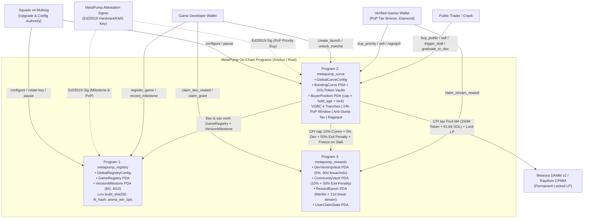

# P03-C — Thiết kế Hệ thống Solana Smart Contracts (MetaPump Protocol)

> **Tài liệu sống (Living Documentation):** `docs/04-solana-smart-contracts.md`  
> **Nền tảng & Công cụ:** Solana · Rust · Anchor `0.31+` · SPL Token-2022 · Ed25519 Native SigVerify · Meteora DAMM v2 / Raydium CPMM CPI · Squads v4 Multisig · Kiểm thử bằng `LiteSVM` & `Ackee Trident`  
> **Mục tiêu thiết kế:** Đảm bảo **tăng trưởng token khóa chặt theo mốc phiên bản game đã kiểm chứng**, **minh bạch 100% như Pump.fun**, **chặn tuyệt đối bot sniper đầu cơ xả sớm theo triết lý Notcoin**, và **bảo vệ vốn game thủ bằng cơ chế Ragequit phi tập trung** nếu dự án ngừng phát triển.

---

## 1. Kiến trúc Tổng thể 3 Anchor Programs

Tách hệ thống on-chain thành **3 Anchor Programs độc lập, trách nhiệm đơn nhất (Single Responsibility)** để dễ kiểm toán, giới hạn phạm vi ảnh hưởng (blast radius) và tái sử dụng cho cả game chỉ cần chứng thực version lẫn game có phát hành token:



---

## 2. Tokenomics Chuẩn hóa & Toán học Version-Gated Bonding Curve (VGBC)

### 2.1. Phân bổ Cố định cho mỗi Game Token (`1,000,000,000` Token, `decimals = 6`)

Mint Authority được chuyển cho `BondingCurve` PDA lúc khởi tạo, đúc đúng `1,000,000,000_000_000` base units một lần duy nhất rồi **revoke `mint_authority = None` và `freeze_authority = None` vĩnh viễn** ngay trong cùng transaction!

| Quỹ phân bổ | Tỷ lệ | Số lượng (Token) | PDA nắm giữ | Quy tắc mở khóa on-chain |
|---|---|---|---|---|
| **Bonding Curve Sale (4 Tranches)** | **70.0%** | `700,000,000` | `curve_token_vault` | Mở bán dần: **M1 `150M`** → **M2 `330M`** → **M3 `530M`** → **M4 `700M`** |
| **DEX Permanent Liquidity** | **15.0%** | `150,000,000` | `curve_token_vault` | Không bao giờ bán trên curve; chỉ ghép với `61.836953 SOL` nạp DEX khi đạt M4 & bán đủ `700M` (hoặc burn nếu game Stalled vĩnh viễn) |
| **Proof-of-Play Community Pool** | **10.0%** | `100,000,000` | `community_token_vault` | Mở theo mốc cho người chơi có `SPARK`: M1 `15M`, M2 `20M`, M3 `25M`, M4 `20M`, M5+ `20M` (**stream tuyến tính 21 ngày**/epoch) + nhận **50% SOL phí phạt Early-Exit** |
| **Developer Milestone Vesting** | **5.0%** | `50,000,000` | `dev_token_vault` | **M0–M1: `0M`**; M2 `10M`, M3 `10M`, M4 `15M`, M5+ `15M` (mỗi đợt **vest tuyến tính 90 ngày**; đóng băng ngay nếu Curve chuyển sang `Stalled`) |
| **Tổng cộng** | **100.0%** | **`1,000,000,000`** | — | **0% pre-sale ngầm · 0% team mở khóa sớm · 100% kiểm chứng được trên Solscan** |

---

### 2.2. Công thức Toán học Constant-Product chính xác tới từng Lamport (`u128`)

Sử dụng đường cong tích không đổi với dự trữ ảo (Virtual Reserves) tương tự Pump.fun nhưng khóa trần `unlocked_curve_supply` theo mốc version:

- Dự trữ SOL ảo ban đầu: $V_{\text{sol},0} = 30\text{ SOL} = 30{,}000{,}000{,}000\text{ lamports}$
- Dự trữ Token ảo ban đầu: $V_{\text{tok},0} = 965{,}000{,}000\text{ tokens} = 965{,}000{,}000{,}000{,}000\text{ units}$
- Hằng số bất biến:
  $$k = V_{\text{sol},0} \times V_{\text{tok},0} = 28{,}950{,}000{,}000{,}000{,}000{,}000{,}000{,}000 \approx 2.895 \times 10^{25} \ll u128_{\max}\ (3.4 \times 10^{38})$$

**Công thức Mua (`buy` với $\Delta s_{\text{net}}$ lamports sau khi trừ 1% phí cơ bản):**
$$\Delta t_{\text{out}} = \left\lfloor V_{\text{tok}} - \left\lceil \frac{k}{V_{\text{sol}} + \Delta s_{\text{net}}} \right\rceil \right\rfloor$$
Ràng buộc trần mốc version: `require!(net_tokens_sold + delta_t_out <= unlocked_curve_supply)`. Nếu lệnh mua vượt phần còn lại của tranche hiện tại (`remaining = unlocked_curve_supply - net_tokens_sold`), program tự động tính ngược số SOL thực cần $\Delta s_{\text{exact}} = \lceil k / (V_{\text{tok}} - \text{remaining}) \rceil - V_{\text{sol}}$ và chỉ thu đúng $\Delta s_{\text{exact}}$ + phí (không thu thừa 1 lamport của người chơi).

**Công thức Bán (`sell` với $\Delta t_{\text{in}}$ base units):**
$$\Delta s_{\text{gross}} = \left\lfloor V_{\text{sol}} - \left\lceil \frac{k}{V_{\text{tok}} + \Delta t_{\text{in}}} \right\rceil \right\rfloor$$
Luôn làm tròn có lợi cho vault (`ceil` cho dự trữ sau giao dịch, `floor` cho lượng trả ra) để **ngăn 100% tấn công bào mòn lamport bằng giao dịch bụi (rounding dust drain)**.

#### Bảng Thông số Định lượng qua 4 Tranches & Điểm Graduation M4

| Trạng thái / Mốc | Token bán lũy kế (`net_tokens_sold`) | $V_{\text{tok}}$ (Token) | $V_{\text{sol}}$ (SOL) | SOL thực trong Vault ($R_{\text{sol}}$) | Giá giao ngay (SOL / Token) | Hệ số giá vs. $P_0$ | FDV (SOL) |
|---|---|---|---|---|---|---|---|
| **Khởi tạo** | `0` | `965,000,000` | `30.0000` | `0.0000` | `3.1088e-8` | `1.00x` | `31.09` |
| **Đỉnh M1 (Playtest)** | `150,000,000` (15%) | `815,000,000` | `35.5215` | **`5.5215`** | `4.3585e-8` | `1.40x` | `43.58` |
| **Đỉnh M2 (Player Fit)** | `330,000,000` (33%) | `635,000,000` | `45.5906` | **`15.5906`** | `7.1796e-8` | `2.31x` | `71.80` |
| **Đỉnh M3 (Arena & Web Fit)** | `530,000,000` (53%) | `435,000,000` | `66.5517` | **`36.5517`** | `1.5299e-7` | `4.92x` | `152.99` |
| **Đỉnh M4 (Global Release)** | `700,000,000` (70%) | `265,000,000` | `109.2453` | **`79.2453`** | `4.1225e-7` | `13.26x` | `412.25` |

#### Tính liên tục Giá tuyệt đối khi Graduate sang DEX tại M4 (Zero-MEV Gap)
- Token nạp LP: $T_{\text{LP}} = 150{,}000{,}000\text{ tokens}$
- SOL nạp LP: $S_{\text{LP}} = \lfloor T_{\text{LP}} \times V_{\text{sol},M4} / V_{\text{tok},M4} \rfloor = 61{,}836{,}952{,}652\text{ lamports}\ (\mathbf{61.836953\text{ SOL}})$
- Giá mở cửa DEX: $P_{\text{DEX}} = 61.836952652 / 150{,}000{,}000 = \mathbf{4.12246351 \times 10^{-7}\text{ SOL/token}} = P_{M4}$ (**sai lệch `0.00000000%`**, không tạo kẽ hở cho bot arbitrage rút ruột pool lúc migrate!).
- Phân bổ thặng dư $R_{\text{sol},M4} - S_{\text{LP}} = \mathbf{17.408330\text{ SOL}}$:
  1. `10.000000 SOL` → **Developer v1.0 Milestone Grant** (tài trợ vốn phát triển LiveOps M5+, giải ngân qua `metapump_rewards`).
  2. `4.408330 SOL` + `100% penalty_floor_lamports` → **Community Season 1 Prize Vault** (thưởng cho game thủ thật của game).
  3. `1.500000 SOL` → Chi phí rent tạo pool DEX + phần thưởng `0.1 SOL` cho người gọi crank `graduate_to_dex`.
  4. `1.500000 SOL` → **Protocol Treasury** (Squads v4 Multisig).

---

### 2.3. Biểu phí Giao dịch & Công thức Phạt Xả Sớm (Anti-Dump Engine)

- **Phí cơ bản (`base_fee_bps = 100` = `1.00%` trên cả Buy & Sell):**
  - `0.50%` (`50 bps`) → Protocol Treasury
  - `0.30%` (`30 bps`) → Creator Fee Escrow (chỉ cho dev rút khi curve ở trạng thái `Active`/`Graduated`; nếu `Stalled` sẽ chuyển sang `penalty_floor_lamports` trả lại cho game thủ!)
  - `0.20%` (`20 bps`) → Community SOL Reward Vault
- **Phí phạt xả sớm (`early_exit_fee_bps`, CHỈ áp dụng khi Sell trên Curve):**  
  Trong `BuyerPosition` PDA, mỗi lần mua cập nhật thời điểm mua bình quân gia quyền `weighted_buy_ts` và mốc mua bình quân `entry_milestone`:
  $$\text{weighted\_buy\_ts}' = \frac{B_{\text{old}} \cdot \text{weighted\_buy\_ts} + \Delta t_{\text{out}} \cdot \text{now}}{B_{\text{old}} + \Delta t_{\text{out}}}$$
  Khi bán tại thời điểm `now` ở mốc `active_milestone`:
  - Nếu `active_milestone >= entry_milestone + 1` (đồng hành cùng game qua ít nhất 1 phiên bản lớn) **HOẶC** `now - weighted_buy_ts >= 7 ngày (604,800s)` → **`early_exit_fee_bps = 0`** (chỉ chịu 1% phí cơ bản).
  - Nếu `86,400s <= hold_age < 604,800s` (1–7 ngày) → **`200 bps` (2%)** (tổng phí 3%).
  - Nếu `3,600s <= hold_age < 86,400s` (1–24 giờ) → **`500 bps` (5%)** (tổng phí 6%).
  - Nếu `hold_age < 3,600s` (< 1 giờ — bot lướt sóng) → **`1,100 bps` (11%)** (tổng phí 12%).
  - **Quan trọng — Chống lách phí bằng cách chuyển ví:** Token mua trên Bonding Curve trước khi Graduate được giữ hạch toán trong `curve_custody_vault` gắn với `BuyerPosition` PDA (non-transferable giữa các ví cá nhân trong giai đoạn bonding curve, tương tự cổ phần pre-graduation, mở khóa rút 1:1 ra SPL Token-2022 ATA tự do ngay khi `Graduated`!). Thiết kế này một mũi tên trúng 3 đích:
    1. **Không thể** chuyển token sang ví khác để reset/lách `weighted_buy_ts`.
    2. **Không thể** dùng 100 ví bot mua lẻ 0.25 SOL trong Priority Window rồi gom về 1 ví hoặc tự tạo pool thanh khoản lậu trên DEX trước khi game đạt M4!
    3. Vẫn mua/bán thanh khoản tức thì 24/7 trên `metapump_curve` và `ragequit` 100% permissionless bất cứ lúc nào!

---

## 3. Bản đồ PDA & Cấu trúc Account (Rust / Anchor)

### 3.1. Bảng Tổng hợp Seeds của các PDA

| Program | Account | PDA Seeds | Ghi chú |
|---|---|---|---|
| `metapump_registry` | `RegistryConfig` | `["registry_config"]` | Singleton lưu `multisig`, `oracle_pubkey`, `paused` |
| `metapump_registry` | `GameRegistry` | `["game", game_id_bytes]` (`[u8; 16]` UUID) | Danh tính on-chain của game, `creator`, `highest_milestone` |
| `metapump_registry` | `VersionMilestone` | `["milestone", game_registry.key(), &[milestone_level]]` | Bằng chứng bất biến cho từng mốc `M1..M10` |
| `metapump_curve` | `CurveConfig` | `["curve_config"]` | Tham số mặc định cho các đợt launch mới, phí, trần Tier |
| `metapump_curve` | `BondingCurve` | `["curve", game_registry.key()]` | Trạng thái curve, dự trữ, mốc, cửa sổ ưu tiên, hạn stall |
| `metapump_curve` | `CurveSolVault` | `["sol_vault", bonding_curve.key()]` | System account PDA chỉ giữ lamports thực + penalty floor |
| `metapump_curve` | `BuyerPosition` | `["position", bonding_curve.key(), buyer.key()]` | Số dư pre-grad, `weighted_buy_ts`, số SOL đã mua ở tranche hiện tại |
| `metapump_rewards` | `DevVestingVault` | `["dev_vest", bonding_curve.key()]` | Quản lý 50M token dev vest 90 ngày theo từng mốc + 10 SOL M4 grant |
| `metapump_rewards` | `CommunityVault` | `["comm_vault", bonding_curve.key()]` | Quản lý 100M token cộng đồng + SOL từ phí phạt Early-Exit |
| `metapump_rewards` | `RewardEpoch` | `["epoch", bonding_curve.key(), &[milestone_level]]` | Merkle root phân bổ `SPARK` + thời gian stream 21 ngày |
| `metapump_rewards` | `UserClaimState` | `["claim", reward_epoch.key(), user.key()]` | Theo dõi lượng token/SOL người chơi đã rút dần từ stream |

---

### 3.2. Cấu trúc Account Cốt lõi (Anchor Rust Definitions)

```rust
// ===================== PROGRAM 1: metapump_registry =====================
#[account]
#[derive(InitSpace)]
pub struct GameRegistry {
    pub bump: u8,
    pub game_id: [u8; 16],               // UUID từ bảng public.games
    pub creator: Pubkey,                 // Ví studio đã xác minh
    pub status: GameOnchainStatus,       // Active | Suspended | Archived
    pub highest_milestone: u8,           // 1 = M1 .. 4 = M4, 5..10 = LiveOps
    pub latest_version_number: u32,
    pub latest_build_sha256: [u8; 32],   // Khớp game_versions.zip_sha256
    pub created_at: i64,
    pub updated_at: i64,
}

#[account]
#[derive(InitSpace)]
pub struct VersionMilestone {
    pub bump: u8,
    pub game_registry: Pubkey,
    pub milestone_level: u8,             // 1..=10 (tuần tự, không được nhảy cóc)
    pub version_number: u32,             // Phải > version_number của mốc trước
    pub build_sha256: [u8; 32],          // SHA-256 bản ZIP bất biến
    pub evidence_bundle_sha256: [u8; 32],// SHA-256 gói Fit Report + Arena + Build Diff
    pub fit_avg_playtime_sec: u32,       // Minh bạch chỉ số Poki Fit on-chain
    pub fit_over_3m_bps: u16,
    pub arena_win_rate_bps: u16,         // Minh bạch tỷ lệ thắng Blind Version Duel
    pub arena_bt_elo: u16,
    pub attested_by: Pubkey,             // Oracle pubkey tại thời điểm ký
    pub unlocked_at: i64,
}

// ===================== PROGRAM 2: metapump_curve =====================
#[derive(AnchorSerialize, AnchorDeserialize, Clone, Copy, PartialEq, Eq, InitSpace)]
pub enum CurveStatus {
    Active,
    Graduated,
    Stalled,
    Paused,
}

#[account]
#[derive(InitSpace)]
pub struct BondingCurve {
    pub bump: u8,
    pub sol_vault_bump: u8,
    pub status: CurveStatus,
    pub dex_target: u8,                  // 0 = MeteoraDammV2, 1 = RaydiumCpmm
    pub game_registry: Pubkey,
    pub creator: Pubkey,
    pub token_mint: Pubkey,              // Token-2022, decimals = 6, supply = 1B, mint_auth = None
    pub curve_token_vault: Pubkey,       // Giữ 700M sale + 150M LP + pre-grad custody

    // Trạng thái Version-Gated Tranches (snapshot bất biến lúc tạo launch, không đổi luật giữa chừng)
    pub active_milestone: u8,            // 1..=4
    pub tranche_caps: [u64; 4],          // [150M, 330M, 530M, 700M] * 10^6
    pub unlocked_curve_supply: u64,      // Bằng tranche_caps[active_milestone - 1]
    pub net_tokens_sold: u64,            // Tổng token đang thuộc về các BuyerPosition
    pub total_claimed_post_grad: u64,    // Đếm lượng token holder đã rút ra ATA sau M4

    // Dự trữ Constant-Product x * y = k
    pub invariant_k: u128,               // 28_950_000_000_000_000_000_000_000
    pub virtual_sol_reserves: u64,       // Bắt đầu 30 SOL
    pub virtual_token_reserves: u64,     // Bắt đầu 965M * 10^6
    pub real_sol_reserves: u64,          // SOL thực đối ứng x*y=k (bắt đầu 0, đỉnh M4 = 79.2453 SOL)
    pub penalty_floor_lamports: u64,     // 40% phí phạt Early-Exit + Creator fee bị tịch thu nếu Stalled
    pub creator_fee_accrued: u64,        // 0.30% phí giao dịch chờ dev claim (đóng băng nếu Stalled)

    // Cửa sổ chống Bot & Bảo vệ Ragequit
    pub priority_window_ends_at: i64,    // unlocked_at + 86_400 (24h Gamer Priority Window)
    pub milestone_deadline_at: i64,      // unlocked_at + 60d (M1) hoặc 90d (M2, M3, M4)
    pub max_wallet_tokens: u64,          // 20_000_000 * 10^6 (tối đa 2% tổng cung / ví trên curve)
    pub dex_pool: Pubkey,                // Điền sau khi graduate_to_dex
    pub created_at: i64,
    pub graduated_or_stalled_at: i64,
}

#[account]
#[derive(InitSpace)]
pub struct BuyerPosition {
    pub bump: u8,
    pub curve: Pubkey,
    pub buyer: Pubkey,
    pub token_balance: u64,              // Số dư token đang giữ trên curve (rút 1:1 ra ATA khi Graduated)
    pub weighted_buy_ts: i64,            // Thời điểm mua bình quân gia quyền tính Early-Exit Fee
    pub entry_milestone: u8,             // Mốc mua bình quân (giữ qua >=1 mốc mới -> miễn phí phạt!)
    pub last_priority_milestone: u8,     // Reset bộ đếm SOL ưu tiên khi sang mốc mới
    pub priority_lamports_spent: u64,    // Chống mua vượt hạn mức PoP Tier trong 24h đầu
    pub post_grad_claimed: bool,
}

// ===================== PROGRAM 3: metapump_rewards =====================
#[account]
#[derive(InitSpace)]
pub struct DevVestingVault {
    pub bump: u8,
    pub curve: Pubkey,
    pub beneficiary: Pubkey,
    pub token_mint: Pubkey,
    pub frozen: bool,                    // Bật true vĩnh viễn nếu Curve chuyển sang Stalled
    pub schedules: [VestingTranche; 4],  // M2 (10M), M3 (10M), M4 (15M), M5 (15M) — mỗi đợt vest 90 ngày
    pub grant_lamports_total: u64,       // 10 SOL khi Graduate M4 (vest 60 ngày hoặc theo M5)
    pub grant_lamports_claimed: u64,
}

#[derive(AnchorSerialize, AnchorDeserialize, Clone, Copy, Default, InitSpace)]
pub struct VestingTranche {
    pub allocation_units: u64,
    pub claimed_units: u64,
    pub start_ts: i64,                   // 0 = chưa mở khóa
    pub duration_sec: u32,               // 7_776_000 (90 ngày)
}

#[account]
#[derive(InitSpace)]
pub struct RewardEpoch {
    pub bump: u8,
    pub curve: Pubkey,
    pub milestone_level: u8,
    pub merkle_root: [u8; 32],           // Cây Merkle (wallet, token_units, penalty_lamports)
    pub total_token_units: u64,
    pub claimed_token_units: u64,
    pub total_penalty_lamports: u64,
    pub claimed_penalty_lamports: u64,
    pub start_ts: i64,
    pub stream_duration_sec: u32,        // 1_814_400 (21 ngày linear streaming chống xả airdrop)
}
```

---

## 4. Danh mục Instructions & Xác thực Chữ ký Ed25519

### 4.1. Bảng Toàn bộ Instructions

| Program | Instruction | Signer | Quyền & Kiểm tra Ràng buộc (Guards) |
|---|---|---|---|
| `registry` | `initialize_registry` | `multisig` | Khởi tạo `RegistryConfig` với `oracle_pubkey` và `multisig`. |
| `registry` | `register_game` | `creator` + Ed25519 Oracle | Tạo `GameRegistry` + `VersionMilestone(M1)` khi game đã pass M1 Playtest. |
| `registry` | `record_version_milestone` | `creator` + Ed25519 Oracle | Yêu cầu `level == highest_milestone + 1`, `version_number > latest_version_number`, `build_sha256 != latest_build_sha256`, chữ ký Oracle còn hạn. |
| `registry` | `set_game_status` | `multisig` | Tạm ngưng `Suspended` khi phát hiện mã độc/vi phạm pháp lý nghiêm trọng. |
| `curve` | `initialize_curve_config` | `multisig` | Thiết lập cấu hình đường cong, phí, trần Tier (`[0.25, 0.5, 1.0, 2.0]` SOL) và địa chỉ Treasury. |
| `curve` | `create_launch` | `creator` | Yêu cầu `GameRegistry.highest_milestone == 1`; tạo Mint Token-2022 `1B`, nạp `850M` vào `curve_token_vault`, CPI nạp `100M` vào `CommunityVault` & `50M` vào `DevVestingVault`, **revoke mint & freeze authority**, mở M1 (`cap = 150M`, `priority = +24h`, `deadline = +60d`). |
| `curve` | `unlock_milestone_tranche` | Permissionless | Đọc `VersionMilestone(active_milestone + 1)` từ `metapump_registry`; nâng `unlocked_curve_supply` lên tranche mới, đặt lại `priority_window_ends_at = now + 24h`, gia hạn `milestone_deadline_at = now + 90d`, CPI kích hoạt đợt `DevVestingVault` tương ứng. |
| `curve` | `buy_priority` | `buyer` + Ed25519 Oracle | Chỉ khi `status == Active` & `now <= priority_window_ends_at`; introspect `Instructions` sysvar xác minh chữ ký `PopBuyAttestation` (`domain = "METAPUMP_POP_V1"`, `chain_id`, `curve`, `buyer`, `milestone`, `max_cum_lamports`, `expiry_ts >= now`); kiểm tra hạn mức Tier & `token_balance <= max_wallet_tokens`. |
| `curve` | `buy_public` | `buyer` | Chỉ khi `status == Active` & `now > priority_window_ends_at`; không cần chữ ký Oracle (phi tập trung 100%); kiểm tra `net_tokens_sold <= unlocked_curve_supply`, `token_balance <= max_wallet_tokens` và `min_tokens_out` (chống slippage/sandwich). |
| `curve` | `sell` | `buyer` | Khi `status == Active`; trừ `token_balance`, tính `sol_gross`, áp `base_fee` + `early_exit_fee` theo `weighted_buy_ts` & `entry_milestone`, kiểm tra `sol_net >= min_sol_out`, chia phí phạt `50% Community / 40% PenaltyFloor / 10% Treasury`. |
| `curve` | `trigger_stall` | Permissionless | Khi `status == Active` & `now > milestone_deadline_at` & chưa bán hết M4; chuyển `status = Stalled`, gộp `creator_fee_accrued` vào `penalty_floor_lamports`, CPI đặt `DevVestingVault.frozen = true`. |
| `curve` | `ragequit` | `buyer` | Khi `status == Stalled`; rút tỷ lệ thuận `refund = floor(amount * (real_sol_reserves + penalty_floor_lamports) / net_tokens_sold)`, đốt `amount` token tương ứng trong vault, giảm `net_tokens_sold`, `real_sol_reserves` và `penalty_floor_lamports` theo đúng tỷ lệ, **0% phí**. |
| `curve` | `graduate_to_dex` | Permissionless | Khi `status == Active`, `active_milestone == 4` và `net_tokens_sold == 700M * 10^6`; chuyển `status = Graduated`, CPI tạo pool Meteora DAMM v2 / Raydium CPMM (`150M` token + `61.836953 SOL`), khóa vĩnh viễn LP NFT/token, chia `17.408330 SOL` thặng dư. |
| `curve` | `withdraw_graduated_tokens` | `buyer` | Khi `status == Graduated`; chuyển 1:1 `BuyerPosition.token_balance` từ `curve_token_vault` sang ATA Token-2022 của người chơi để tự do giao dịch trên DEX/Jupiter. |
| `curve` | `claim_creator_fees` | `creator` | Khi `status ∈ {Active, Graduated}`; rút `creator_fee_accrued` (bị chặn nếu `Stalled` hoặc `Paused`). |
| `rewards` | `publish_reward_epoch` | `oracle` / `multisig` | Yêu cầu `VersionMilestone(m)` đã tồn tại; công bố `merkle_root` cho đợt thưởng `SPARK` của mốc `m` (không vượt định mức `15M/20M/25M/20M/20M`) + chốt số dư SOL phí phạt Early-Exit tích lũy. |
| `rewards` | `claim_stream_reward` | `user` | Xác minh `merkle_proof`; SOL từ 50% phí phạt Early-Exit rút thẳng về ví ngay lập tức; Token thưởng cộng dồn và mở rút tuyến tính `vested = total * min(now - start_ts, 21d) / 21d` ra ATA Token-2022 kể từ khi Curve `Graduated` (ngăn tạo pool lậu trước M4 và chống xả cục ngày TGE; nếu `Stalled`, phần token chưa phát sẽ burn). |
| `rewards` | `claim_dev_vested` | `beneficiary` | Yêu cầu `!frozen` và `curve.status == Graduated` (M2/M3 bắt đầu tính thời gian vest 90 ngày ngay khi đạt mốc, nhưng chỉ rút ra ATA sau khi ship thành công M4 — ngăn tạo pool lậu trước M4 và đảm bảo Dev cam kết tới v1.0). |

---

### 4.2. Định dạng Thông điệp Ký Ed25519 chống Replay (`PopBuyAttestation`)

Không truyền private key lên chương trình; program đọc instruction liền trước trong cùng transaction (`sysvar::instructions::load_instruction_at_checked`) và xác minh nó được thực thi bởi `Ed25519SigVerify111111111111111111111111111` với đúng `RegistryConfig.oracle_pubkey` và không dùng cross-instruction offset giả mạo:

```text
Offset | Size | Trường dữ liệu
-------|------|------------------------------------------------------------
0..16  | 16 B | Domain separator cố định: b"METAPUMP_POP_V1\0"
16..48 | 32 B | program_id (metapump_curve) — chống replay chéo program/cluster
48..80 | 32 B | bonding_curve Pubkey
80..112| 32 B | buyer Pubkey (phải là Signer của buy_priority)
112    |  1 B | milestone_level (phải == curve.active_milestone)
113    |  1 B | pop_tier (1=Bronze, 2=Silver, 3=Gold, 4=Diamond)
114..122| 8 B | max_cum_lamports (u64 LE — giới hạn thêm bởi trần cứng trong CurveConfig!)
122..130| 8 B | expiry_unix_ts (i64 LE — tối đa now + 120s)
```

> **Nguyên tắc Zero-Trust với Oracle:** Ngay cả khi khóa `oracle_pubkey` bị lộ, kẻ tấn công **KHÔNG THỂ** rút 1 lamport SOL từ vault, **KHÔNG THỂ** cấp hạn mức mua cao hơn trần cứng on-chain (`hard_tier_cap = 2.0 SOL`), **KHÔNG THỂ** sửa `invariant_k`, **KHÔNG THỂ** mở khóa nhảy cóc mốc, và Squads v4 Multisig có thể xoay vòng `oracle_pubkey` + bật `pause` trong 1 giao dịch!

---

## 5. Bất biến Bảo mật (Security Invariants) & Kế hoạch Fuzzing (`Trident` + `LiteSVM`)

Mọi PR chạm vào `programs/*` bắt buộc vượt qua 8 bất biến toán học chạy tự động bằng **Ackee Trident** (≥ 100,000 chuỗi giao dịch ngẫu nhiên) và **LiteSVM**:

1. **INV-01 (Solvency tuyệt đối):** Tại mọi slot khi `status ∈ {Active, Stalled}`, `lamports(CurveSolVault) - rent_exempt_min >= real_sol_reserves + penalty_floor_lamports + creator_fee_accrued`.
2. **INV-02 (Bảo toàn hằng số tích):** Sau mọi `buy` và `sell`, `u128::from(virtual_sol_reserves) * u128::from(virtual_token_reserves) >= invariant_k` (chỉ được tăng nhẹ do làm tròn có lợi cho vault, không bao giờ giảm).
3. **INV-03 (Không rò rỉ giá trị vòng lặp):** Với mọi ví $u$, thực hiện `buy(X)` rồi `sell(all)` liên tiếp mà không có giao dịch xen giữa luôn trả về `sol_out < X` (ngăn tuyệt đối lỗi làm tròn rút ruột).
4. **INV-04 (Khóa cứng trần Version):** `net_tokens_sold <= unlocked_curve_supply <= 700_000_000 * 10^6`, và `active_milestone` chỉ tăng từng bậc `+1` khi tồn tại `VersionMilestone` hợp lệ.
5. **INV-05 (Bảo toàn Token Custody):** Khi chưa Graduate, `curve_token_vault.amount == 850_000_000 * 10^6` và $\sum \text{BuyerPosition.token\_balance} == \text{net\_tokens\_sold}$.
6. **INV-06 (Tính công bằng Ragequit):** Khi `status == Stalled`, mọi hoán vị thứ tự rút của $N$ holder đều cho tỷ lệ `lamports_per_token` bằng nhau (sai lệch tối đa 1 lamport do làm tròn xuống) và người rút cuối cùng luôn rút đủ không bị thiếu hụt (`InsufficientFunds`).
7. **INV-07 (Chống giả mạo Ed25519):** Từ chối 100% giao dịch `buy_priority` nếu instruction Ed25519 trỏ sai program ID, sai `oracle_pubkey`, hết hạn, đổi `buyer`, đổi `curve`, hoặc trỏ offset sang instruction khác.
8. **INV-08 (Khớp giá Graduation):** Tại `graduate_to_dex`, chênh lệch giữa giá cuối trên curve và tỷ lệ nạp ban đầu vào pool DEX `< 1 bps` (`0.01%`), và quyền mint/freeze của token chắc chắn là `None`.

---

## 6. Sự kiện On-Chain (Anchor Events cho `apps/indexer`) & Mã lỗi chính

- **Events:** `GameRegistered`, `VersionMilestoneRecorded`, `LaunchCreated`, `MilestoneTrancheUnlocked`, `TradeExecuted`, `CurveStalled`, `RagequitExecuted`, `CurveGraduated`, `GraduatedTokensWithdrawn`, `RewardEpochPublished`, `StreamRewardClaimed`, `DevVestingClaimed`.
- **Error Codes chính:** `CurveNotActive`, `PriorityWindowRequiresProofOfPlay`, `PriorityWindowClosed`, `InvalidOracleAttestation`, `AttestationExpired`, `PriorityTierCapExceeded`, `MaxWalletCapExceeded`, `MilestoneSupplyCapReached`, `SlippageExceeded`, `MilestoneSequenceInvalid`, `DuplicateBuildChecksum`, `DeadlineNotReached`, `GraduationRequirementsNotMet`, `DevVestingFrozen`, `InvalidMerkleProof`, `NothingToClaim`, `MathOverflow`.
