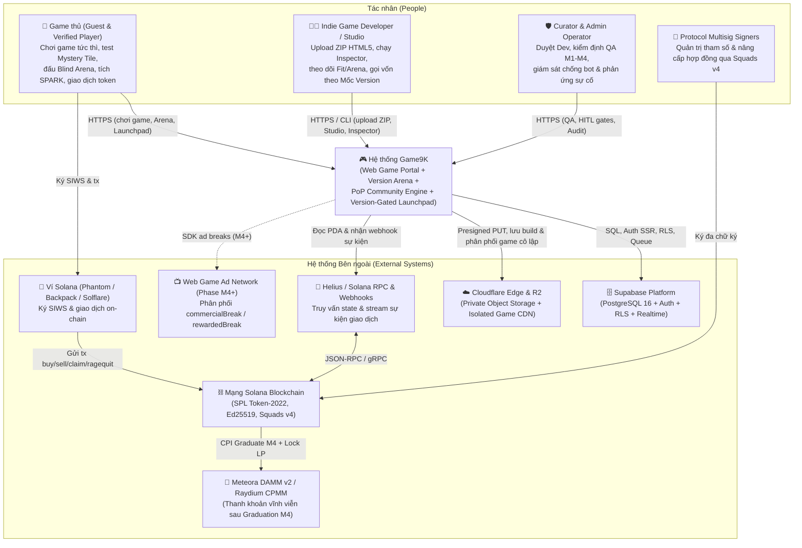
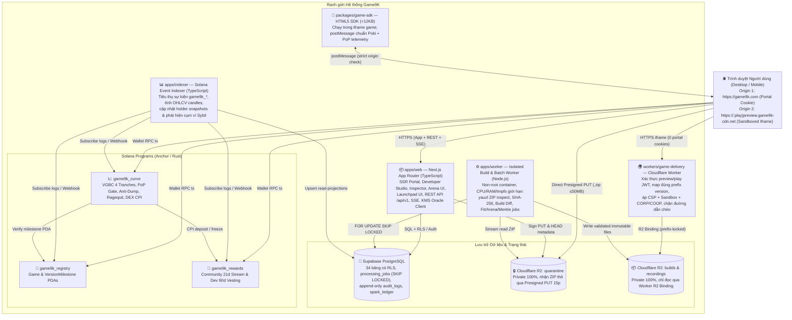
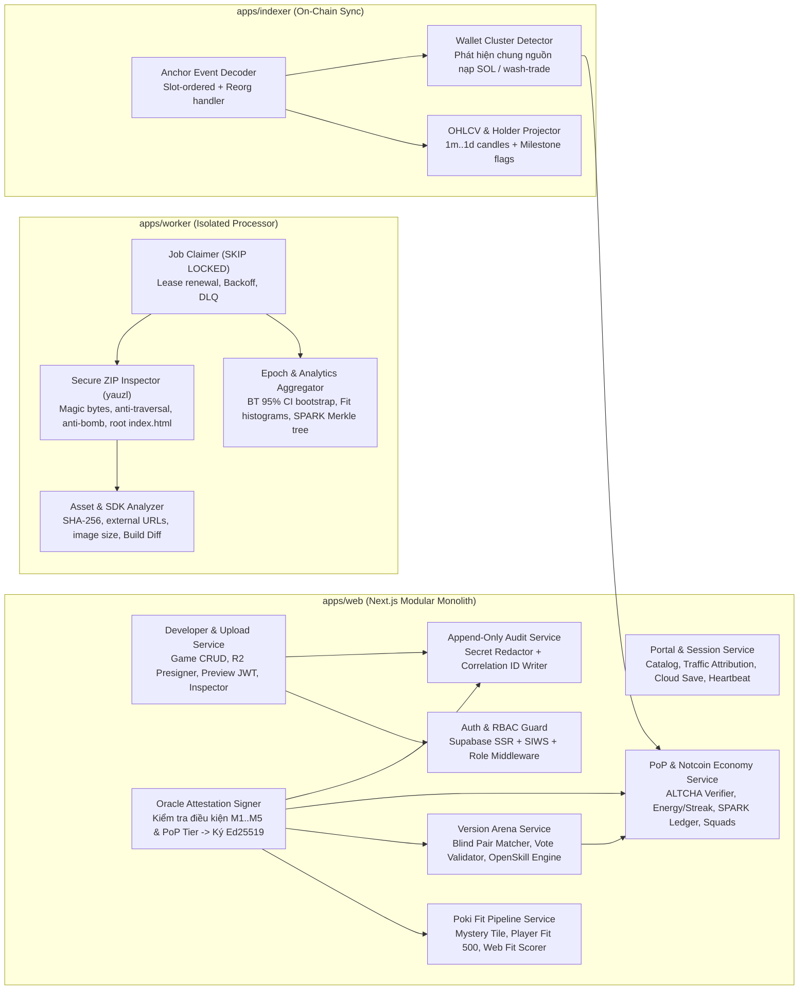
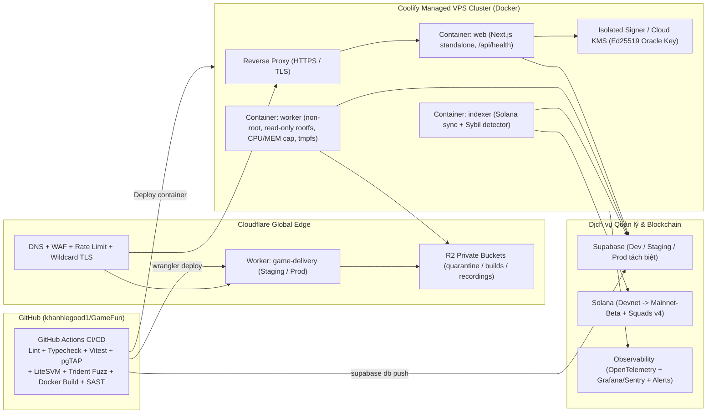

# P05 & P06 — Kiến trúc C4, ADRs, Mô hình Đe dọa STRIDE & Triển khai Cloud/On-Chain

> **Tài liệu sống (Living Documentation):** `docs/05-c4-architecture-and-nfr.md`  
> **Giai đoạn AI-Agile:** `P05 — NFR & Well-Architected Review` và `P06 — AI-Powered Cloud & On-Chain Deployment`  
> **HITL Gates:** `G5` (Principal Architect + Security Lead) & `G6` (Release Manager + PO + Multisig Signers)

---

## 1. Mô hình Kiến trúc C4 (C4 Model — Level 1 đến Level 4)

### 1.1. C4 Level 1 — System Context Diagram (Bối cảnh Hệ thống)

---

### 1.2. C4 Level 2 — Container Diagram (Các Khối Triển khai & Ranh giới Bảo mật)

---

### 1.3. C4 Level 3 — Component Diagram (Bên trong `apps/web`, `apps/worker` & `apps/indexer`)

---

### 1.4. C4 Level 4 — Mô hình Cô lập Origin & Bảo mật Trình duyệt (Runtime Isolation Detail)

- **Hai registrable domain khác nhau hoàn toàn** (không chung eTLD+1):
  - Portal: `game9k.com` (giữ cookie đăng nhập Supabase, CSRF/session, kết nối ví Solana).
  - Game Content: `<version-id>.preview.game9k-cdn.net` và `<version-id>.play.game9k-cdn.net` (nằm trong danh sách cách ly site-per-process của trình duyệt; mỗi `version_id` có `localStorage`/`IndexedDB` riêng, không bao giờ đọc chéo version khác hay portal).
- **Thuộc tính iframe mặc định:** `sandbox="allow-scripts allow-same-origin allow-pointer-lock"` (cấm `allow-top-navigation`, `allow-popups`, `allow-modals`, `allow-forms` trừ khi được cấu hình rõ), `allow="autoplay; fullscreen; gamepad"` (cấm `camera`, `microphone`, `geolocation`, `payment`, `usb`, `clipboard-read`).
- **Response headers từ `workers/game-delivery`:**
  - `Content-Security-Policy`: `default-src 'self' blob: data:; script-src 'self' 'wasm-unsafe-eval' blob:; connect-src 'self' https://api-telemetry.game9k-cdn.net; frame-ancestors https://game9k.com https://staging.game9k.com; object-src 'none'; base-uri 'none'`
  - `X-Content-Type-Options: nosniff`, `Referrer-Policy: no-referrer`, `Cross-Origin-Resource-Policy: cross-origin`
  - Cache: với `*.play.*` (bản đã duyệt bất biến): `Cache-Control: public, max-age=31536000, immutable` gắn khóa cache theo đầy đủ `<version-id>/<path>`; với `*.preview.*`: `Cache-Control: private, no-store` để thu hồi (`revoke`) có hiệu lực ngay lập tức.

---

## 2. Sơ đồ Triển khai Hạ tầng (P06 — Deployment Diagram)

---

## 3. Quyết định Kiến trúc Trọng yếu (Architecture Decision Records — ADRs)

| Mã ADR | Quyết định | Lý do chọn | Đánh đổi (Trade-off) & Giảm thiểu |
|---|---|---|---|
| **ADR-001** | **Modular Monolith + Isolated Worker** trong pnpm monorepo thay vì chia nhỏ microservices sớm | Tốc độ phát triển nhanh, chia sẻ type Zod/OpenAPI 100%, chỉ tách riêng `worker` (xử lý ZIP không tin cậy) và `indexer` (luồng on-chain liên tục). | Khi lưu lượng tăng lớn, có thể tách `arena` hoặc `telemetry` theo đúng ranh giới service đã phân chia. |
| **ADR-002** | **PostgreSQL Queue (`FOR UPDATE SKIP LOCKED`)** cho xử lý ZIP & batch jobs (`S1-04`) | Đảm bảo tính nguyên tử cùng transaction với `upload_sessions` & `game_versions`, không cần vận hành Redis/RabbitMQ ở MVP. | Không phù hợp tần suất >10k jobs/s; nếu vượt ngưỡng sẽ chuyển heartbeat sang batch buffer trước. |
| **ADR-003** | **Registrable Domain riêng + Wildcard Subdomain theo `version_id`** qua Cloudflare Worker + R2 (`S1-08`) | Cô lập tuyệt đối cookie/storage/origin cho mã JS không tin cậy của bên thứ ba; không bao giờ để ZIP bytes đi qua Next.js. | Cần cấu hình Wildcard TLS (Cloudflare Advanced Certificate Manager) cho `*.preview.<domain>` và `*.play.<domain>`. |
| **ADR-004** | **Pre-Graduation Custody trên `BuyerPosition` PDA** (mở rút 1:1 ra Token-2022 ATA khi Graduate M4) | Chặn triệt để lách phí Early-Exit bằng cách chuyển ví, chặn gom token từ 100 ví bot Priority Window, và chặn tạo LP lậu trước M4. | Trước M4 người dùng chỉ mua/bán trên `game9k_curve` (và `ragequit` nếu Stalled), sau M4 giao dịch tự do trên mọi DEX/Jupiter. |
| **ADR-005** | **Hybrid Ed25519 Oracle Attestation + On-Chain Hard Caps** | Không thể chạy video playtest hay kiểm tra ZIP trên Solana; dùng chữ ký Ed25519 ngắn hạn (`120s`) kết hợp trần cứng on-chain giúp vừa chống bot hiệu quả vừa không cho Oracle quyền chạm vào tiền. | Nếu backend tạm bảo trì trong 24h Priority Window thì mua ưu tiên bị trễ; Public Phase, Sell, Trigger Stall & Ragequit vẫn chạy 100% on-chain không cần backend. |
| **ADR-006** | **Graduation sang Meteora DAMM v2 (ưu tiên) / Raydium CPMM (dự phòng)** với công thức khớp giá 0% gap | Tránh chi phí OpenBook, hỗ trợ Token-2022, khóa vĩnh viễn thanh khoản chống rug nhưng vẫn tạo dòng phí bền vững cho cộng đồng & dev. | Cần duy trì integration test với bản binary mới nhất của DAMM v2 / CPMM trên `LiteSVM`. |
| **ADR-007** | **Đăng nhập bằng email/Google, ví Web3 ẩn dưới nền bằng passkey smart wallet** (precompile `secp256r1` / SIMD-0075), không seed phrase. Email là **danh tính**, khoá ký **không** dẫn xuất từ email. Game9K trả phí giao dịch qua paymaster có trần cứng. | Người chơi Web2 không phải nhớ 12 từ hay private key, nhưng **không ai giữ khoá hộ** — kể cả Game9K. Passkey gắn `origin` nên chống phishing bằng toán học. Khớp stack Solana sẵn có, không thêm vendor lõi. | Phải vận hành paymaster (rủi ro rút cạn SOL → 6 chốt trần trong `docs/11-auth-wallet-ux.md` §4); ví gắn thiết bị → **bắt buộc** luồng khôi phục 72h; phải dùng chương trình smart-wallet đã audit, không tự viết. Phương án dự phòng nếu trượt tiến độ: MPC của vendor (chấp nhận khoá nằm ở họ). |

---

## 4. Mô hình Đe dọa STRIDE & Đối sách Bảo mật (P05 Security Gate)

| Nhóm STRIDE | Mối đe dọa cụ thể trong Game9K | Mức độ | Biện pháp Kiểm soát Kỹ thuật |
|---|---|---|---|
| **S — Spoofing** | Giả mạo chữ ký PoP Attestation để bot mua trong 24h đầu; đánh cắp cookie portal từ game HTML5 độc hại. | Critical | Verify trực tiếp `Ed25519SigVerify` kèm domain separator, `program_id`, `curve`, `buyer`, `expiry_ts <= 120s`; cô lập game trên domain `game9k-cdn.net` tách rời `game9k.com`. |
| **T — Tampering** | ZIP Slip (`../../`), symlink, sửa đổi file build đã kiểm định, hoặc client tự sửa `role = 'admin'` / `spark_balance`. | Critical | `yauzl` từ chối tuyệt đối path traversal/symlink/encrypt; lưu `zip_sha256` bất biến trong DB (trigger cấm UPDATE) & trên Solana; Supabase RLS + negative `pgTAP` tests cấm ghi cột đặc quyền. |
| **R — Repudiation** | Admin/Curator duyệt mốc gian lận hoặc Developer chối bỏ thao tác thu hồi/cập nhật. | High | Bảng `audit_logs` append-only có `correlation_id`; mọi lần mở khóa mốc ghi vĩnh viễn `evidence_bundle_sha256` & `attested_by` lên Solana. |
| **I — Information Disclosure** | Lộ R2 secret, Supabase `service_role`, presigned PUT URL trong log, hoặc lộ phiên bản thật trong Arena trước khi vote. | High | Env validator không in giá trị; audit redactor lọc URL/token; view/API Arena không trả `slot_a_version_id`/`slot_b_version_id` khi `voted_at IS NULL`; lỗi API không trả đường dẫn filesystem. |
| **D — Denial of Service** | ZIP bomb (5 MB nén → 10 GB giải nén), spam tạo upload session, trại bot spam Arena/heartbeat. | High | Đếm byte thực khi stream giải nén (dừng cứng ở 200 MB / 5,000 files / timeout 30s) trong worker giới hạn cgroup; ALTCHA PoW + rate limit theo user/IP/ASN + Energy cap. |
| **E — Elevation of Privilege / Economic Exploit** | Sniper gom cung block 0 rồi xả; Dev upload bản cũ đổi tên để mở khóa M2–M4; Dev bỏ dự án ôm SOL; lỗi làm tròn rút cạn vault. | Critical | 24h PoP Priority Window + trần ví + Early-Exit Tax 12%→1% + pre-grad custody; `version_diffs` + 500 lượt Player Fit + 50 trận Blind Arena + Curator HITL; `trigger_stall` + `ragequit` phi tập trung; toán học `u128` làm tròn có lợi cho vault + Trident fuzzing + audit độc lập. |

---

## 5. Rà soát 5 Trụ cột Well-Architected Framework (WAF Summary)

1. **Security:** Defense-in-depth từ trình duyệt (site isolation, CSP, sandbox) → API (Zod, RBAC, ALTCHA) → DB (RLS, `pgTAP`, append-only audit) → Worker (non-root, read-only FS) → Solana (Squads v4, Ed25519 TTL, invariants, fuzzing).
2. **Reliability:** Upload trực tiếp R2 kèm retry/idempotency; worker có lease timeout tự phục hồi khi crash; indexer xử lý slot reorg và đối soát định kỳ số dư vault; Ragequit hoạt động kể cả khi toàn bộ server web ngừng chạy.
3. **Performance Efficiency:** Game tĩnh phân phối 100% từ Cloudflare Edge R2 (0 băng thông qua Next.js); biểu đồ & sổ lệnh đẩy qua SSE nhẹ; cursor pagination & partial index trên toàn bộ truy vấn nóng.
4. **Cost Optimization:** Cloudflare R2 miễn phí egress (yếu tố sống còn cho cổng game kiểu Poki có băng thông tải asset lớn!); Coolify + PostgreSQL queue tiết kiệm chi phí hạ tầng giai đoạn đầu; Token-2022 + lưu hash trên Solana tối thiểu hóa chi phí rent.
5. **Operational Excellence:** GitOps 100% qua GitHub Actions, migration có kiểm soát, `/api/health` readiness thực chất, structured JSON logs kèm `correlation_id`, runbook rõ ràng cho deploy, rollback, xoay vòng khóa Oracle và tạm dừng khẩn cấp.
