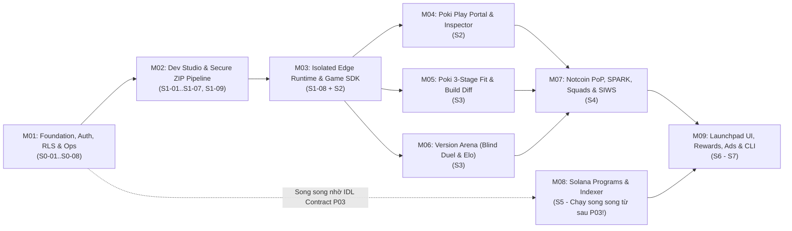

# P04 — Kế hoạch Triển khai Từng Module & Lộ trình Sprint (Implementation Roadmap)

> **Tài liệu sống (Living Documentation):** `docs/06-implementation-roadmap.md`  
> **Giai đoạn AI-Agile:** `P04 — AI-Accelerated Modular Build`  
> **Tính liên tục với Backlog hiện tại:** Giữ nguyên và tích hợp 100% **17 GitHub Issues sẵn có (`#1 [S0-01]` → `#17 [S1-09]`)** trong `khanhlegood1/GameFun` làm nền móng M01–M03, sau đó mở rộng mạch lạc từ Sprint 2 đến Sprint 7 để hoàn thiện toàn bộ **MetaPump**.

---

## 1. Sơ đồ Phụ thuộc giữa 9 Module Độc lập (`M01` → `M09`)

> **Tăng tốc theo AI-Agile Framework:** Ngay khi ký duyệt **HITL Gate G3** (chốt API + DB + Anchor IDL), nhóm/agent làm **Solana Smart Contracts (`M08`)** có thể phát triển và fuzzing độc lập 100% trên `LiteSVM` song song với Sprint 2–4 của Portal/Arena, rút ngắn gần 40% tổng thời gian ra mắt!

---

## 2. Đặc tả Triển khai Chi tiết Từng Module (Sẵn sàng Giao việc / Chạy Agent)

| Module | Thư mục chính | Đầu vào / Phụ thuộc | Hạng mục xây dựng cụ thể | Kiểm thử bắt buộc (DoD) |
|---|---|---|---|---|
| **M01 — Core Foundation, Auth, RLS & Infra** | `apps/web`, `packages/shared`, `supabase/`, `infra/`, `.github/workflows` | Issues `#1`..`#8` (`S0-01`..`S0-08`) | Khởi tạo pnpm monorepo, Next.js App Router + strict TS, `/api/health`, CI GitHub Actions, migrations (`profiles`, `developer_profiles`, `audit_logs`), Supabase Auth + controlled roles, RLS + grants, Dockerfile standalone + Coolify staging. | `pnpm lint/typecheck/test/build` pass; `supabase test db` (allow + deny) pass; secret scan sạch; container health check xanh trên staging. |
| **M02 — Developer Studio & Secure ZIP Pipeline** | `apps/web`, `apps/worker`, `packages/shared`, `supabase/` | `M01` · Issues `#9`..`#15`, `#17` (`S1-01`..`S1-07`, `S1-09`) | Bảng `games`, `upload_sessions`, `processing_jobs`, `game_versions`, `validation_reports`; R2 quarantine/builds private + presigned PUT 15p; worker non-root claim `FOR UPDATE SKIP LOCKED`; `yauzl` giải nén chống traversal/symlink/encrypt/zip-bomb; tính SHA-256; SSE trạng thái & giao diện Studio quản lý game/version. | Bộ fixture ZIP độc hại 100% bị chặn; test upload đồng thời không trùng `version_number`; retry idempotent; `live_version_id` không tự đổi. |
| **M03 — Isolated Edge Delivery & Game SDK** | `workers/game-delivery`, `packages/game-sdk` | `M02` · Issue `#16` (`S1-08`) | Cloudflare Worker phục vụ `<vid>.preview.<domain>` & `<vid>.play.<domain>` qua R2 binding; xác thực & thu hồi EdDSA token; CSP/Sandbox/CORP headers; viết `@metapump/game-sdk` (`<12KB`, 5 event Poki + Cloud Save + PoP heartbeat + adapter `PokiSDK`). | Pentest đọc chéo version path = 403/404; không đọc được cookie/localStorage portal; chạy tốt WebGL + WebAudio + Wasm trên Chrome/Safari/Mobile. |
| **M04 — Play Portal (Poki UX) & MetaPump Inspector** | `apps/web`, `apps/worker` | `M03` | Trang chủ lưới game động (hover WebM), category/search, trang chơi `/g/[slug]` desktop + mobile xoay màn hình, `play_sessions` + ghi nhận nguồn `direct_dev` vs `portal_*`, `player_cloud_saves` (AUDS), **MetaPump Inspector** (event log trực tiếp, QA checklist, scaling presets, mobile QR, cảnh báo external URL & ảnh nặng) + `version_diffs`. | Lighthouse Performance ≥ 85; TTFB p95 < 200ms; Inspector bắt chính xác 5 sự kiện SDK & lỗi console trên cả desktop và điện thoại qua QR. |
| **M05 — Poki 3-Stage Fit Testing Pipeline** | `apps/web`, `apps/worker`, `supabase/` | `M03`, `M04` | Bảng `category_benchmarks`, `fit_test_runs`, `playtest_recordings`; **Mystery Tile** có consent ghi 10 phiên (`rrweb`/canvas + phím + console); **Player Fit Test** 500 lượt + histogram playtime + so sánh 2 version cạnh nhau; **Web Fit Test** chấm điểm 0–5 (CTR, Time-on-Page, C2P) + xuất `report_sha256`. | Test tính toán histogram & điều kiện đạt (`avg ≥ 3m` & `≥ 25% > 3m`); không ghi hình khi thiếu consent; tự xóa video thô sau 30 ngày. |
| **M06 — MetaPump Version Arena** | `packages/arena-engine`, `apps/web`, `supabase/` | `M03`, `M04` | Bảng `arena_campaigns`, `arena_matches`, `version_ratings`; ghép cặp Blind Version Duel (`v(n)` vs `v(n-1)`) & Category Duel; khóa nút vote cho tới khi đủ `90s` active gameplay mỗi bản; tính điểm `openskill.js` + Bradley-Terry 95% CI + 4 tiêu chí phụ; màn hình Reveal & biểu đồ lịch sử Elo các version. | API tuyệt đối không lộ `version_id` trước khi vote; 1 user chỉ vote 1 lần/campaign; unit test hội tụ Bradley-Terry & CI trên dữ liệu mô phỏng. |
| **M07 — Notcoin Community Loop, PoP & Anti-Bot** | `apps/web`, `apps/worker`, `supabase/` | `M04`, `M05`, `M06` | Bảng `user_wallets` (SIWS + cooldown 7d), `player_pop_states`, `spark_ledger`, `squads`, `version_quests`; tích hợp **ALTCHA** PoW; cơ chế hồi Energy + Streak; tính điểm `input_entropy_score`, đồng thuận Arena, `pop_score (0–100)` & Tier (`Bronze..Diamond`); dịch vụ ký Ed25519 `PopBuyAttestation` (`ttl = 120s`). | Test mô phỏng auto-clicker/tab ẩn không nhận `SPARK`; sổ cái `spark_ledger` idempotent không âm; chữ ký SIWS & PoP chống replay 100%. |
| **M08 — Solana Smart Contracts & Indexer** | `programs/metapump-*`, `packages/solana-sdk`, `apps/indexer` | `M01` + Spec `04-solana-smart-contracts.md` | Viết 3 Anchor programs (`metapump_registry`, `metapump_curve`, `metapump_rewards`); SDK `@solana/kit` + PDA helpers; CPI graduate sang Meteora DAMM v2 & Raydium CPMM; `apps/indexer` giải mã events, tính nến OHLCV, cập nhật `holder_snapshots` & phát hiện cụm ví Sybil; tích hợp Squads v4 trên Devnet. | 100% 8 bất biến `INV-01..INV-08` pass trên `LiteSVM` + ≥100k vòng fuzz `Trident`; kiểm thử time-travel (24h Priority, Early-Exit 12%→1%, 90d Stall + Ragequit, 21d Stream, 90d Dev Vest, M4 Graduation 0% price gap); kiểm toán bảo mật trước Mainnet. |
| **M09 — Launchpad UI, Curator Console, Ads & CLI** | `apps/web`, `packages/metapump-cli` | `M07`, `M08` | Trang `/launch` & `/launch/[slug]` (`lightweight-charts` gắn cờ version, Milestone Stepper, Priority Buy/Sell + bộ báo phí Early-Exit, real-time trade feed SSE, Top Holders có nhãn cảnh báo, trang Portfolio claim stream & Ragequit); Admin/Curator HITL Console; `@metapump/cli` & module chia sẻ doanh thu quảng cáo 100% direct / 50-50 portal. | E2E đầy đủ trên Staging + Solana Devnet từ `Tạo Game → Upload v1 (M1) → Launch Token → Priority Buy → Ship v2 Pass Fit & Arena (M2) → Ship v3 (M3) → Ship v4 (M4) → DEX Graduate` + luồng nhánh `Stall → Ragequit`. |

---

## 3. Lộ trình 8 Sprint (2 Tuần / Sprint) & Ánh xạ Backlog

| Sprint | Chủ đề Sprint | Issues / Modules | Cột mốc Bàn giao (Increment) & HITL Gate |
|---|---|---|---|
| **Sprint 0** | Foundation, Security & Staging PaaS | `#1 [S0-01]` → `#8 [S0-08]` (`M01`) | Monorepo chạy chuẩn, Auth + RLS + Audit Logs pass test, web chạy HTTPS trên Coolify staging. *(Gate G1–G3 chốt song song)* |
| **Sprint 1** | Developer Upload, Safe ZIP & Isolated Preview | `#9 [S1-01]` → `#17 [S1-09]` (`M02`, phần đầu `M03`) | Developer tạo game, upload ZIP lên R2, nhận báo cáo validation JSON & mở preview cô lập theo version. |
| **Sprint 2** | Poki Game Portal, SDK, Inspector & Build Diff | `M03` (hoàn tất) + `M04` · *(Khởi động `M08` song song)* | **Alpha Portal ra mắt:** Người chơi vào chơi game HTML5 mượt trên web/mobile; Dev có SDK + Inspector + Build Diff. |
| **Sprint 3** | Poki 3-Stage Fit Pipeline & Version Arena | `M05` + `M06` · *(`M08`: xong `registry` + lõi `curve`)* | **Beta Arena ra mắt:** Chạy Mystery Tile, Player Fit 500, Web Fit và Blind Version Duel xếp hạng OpenSkill/Elo. |
| **Sprint 4** | Notcoin Community Loop, PoP Anti-Bot & SIWS | `M07` · *(`M08`: xong `rewards` + Ragequit + DEX CPI)* | Cộng đồng tích `SPARK`, lập Squad, đua Streak, phân hạng PoP Tier Bronze→Diamond và liên kết ví Solana. |
| **Sprint 5** | Solana Fuzzing, Indexer & Devnet Integration | `M08` (hoàn tất + fuzz + audit prep) | Deploy 3 programs lên Solana Devnet dưới quyền Squads v4; Indexer đồng bộ trade/candles/holders real-time. *(Gate G4)* |
| **Sprint 6** | Version Launchpad UI, Curator HITL & Security Audit | `M09` (Launchpad + Admin Console) | **Public Testnet Launchpad:** Chạy thử nghiệm toàn trình M0→M4 Graduation & Ragequit với 5–10 game đầu tiên; hoàn tất STRIDE + Smart Contract Audit. *(Gate G5)* |
| **Sprint 7** | Mainnet Cutover, Web Ad Split & Developer CLI | `M09` (Mainnet + Ads + CLI + Engine templates) | **Mainnet v1.0 Go-Live:** Mở cổng phát hành chọn lọc mỗi ngày chuẩn Poki + Version-Gated Launchpad trên Solana Mainnet. *(Gate G6)* |

---

## 4. Thứ tự Bắt đầu Ngay Hôm Nay (Actionable Next Steps trên `khanhlegood1/GameFun`)

1. **Duyệt Gate G1 (PRD & Tham số Kinh tế):** Chốt bộ tài liệu trong `docs/` qua Pull Request vào `main`.
2. **Tạo Backlog Issues cho Sprint 2–7:** Dùng đặc tả `M03`–`M09` ở trên để sinh tiếp các GitHub Issues `[S2-01]..[S7-xx]` nối tiếp ngay sau issue `#17 [S1-09]`.
3. **Bắt tay code ngay Module M01 (`[S0-01]` → `[S0-08]`):** Khởi tạo `pnpm-workspace.yaml`, `apps/web`, `packages/shared`, `packages/api-contract`, `supabase/migrations` và CI workflow đầu tiên.
4. **Khởi tạo song song nhánh thiết kế P02/P03:** Dựng prototype UI cho 5 màn hình chính (`Portal`, `Inspector`, `Arena Duel`, `SPARK Hub`, `Launchpad`) + xuất tệp `packages/api-contract/openapi.yaml` và khung Anchor `programs/metapump-*`.
