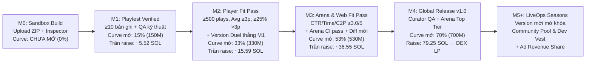

# Product Requirements Document (PRD) — Game9K Launchpad

## Game Portal & Bệ phóng Vốn Solana Khóa theo Phiên bản (theo AI-Agile Framework v1.0)

| Thuộc tính | Chi tiết |
|---|---|
| **Tên sản phẩm** | **Game9K Launchpad** — tên miền chính thức `game9k.com` (mã kho lưu trữ: `khanhlegood1/GameFun`, kế thừa nền tảng `GAME.FUN v2`) |
| **Phiên bản tài liệu** | `v1.0.0` (Living Documentation) |
| **Ngày lập** | `2026-11-18` |
| **Khung quy trình** | **AI-Agile Product Development Framework v1.0** (AI-native · HITL-governed · Cloud-native · Frontend & Contract-first) |
| **Mô hình tham chiếu** | **Poki** (Phân phối & kiểm định web game) × **Arena** (Đánh giá mù/đối kháng theo phiên bản) × **Pump.fun** (Fair launch & minh bạch giao dịch) × **Notcoin** (Vòng lặp cộng đồng Proof-of-Play chống bot đầu cơ xả sớm) |
| **Trạng thái Gate hiện tại** | `G1 — Requirement Sign-off: READY FOR REVIEW` |

### Bản đồ bộ Tài liệu Sống (Living Documentation Suite)

| Mã tài liệu | Tệp trong Repository | Giai đoạn AI-Agile | Nội dung chính |
|---|---|---|---|
| **DOC-00** | [`docs/00-open-source-landscape.md`](./00-open-source-landscape.md) | P01 / P04 | Khảo sát mã nguồn mở thực tế, ma trận Build vs. Adopt vs. CPI, kiểm soát License, cấu trúc Monorepo |
| **DOC-01 (Master)** | [`docs/PRD.md`](./PRD.md) | P01 → P06 | Tầm nhìn, OKRs, Personas, Cơ chế kinh tế lõi, Functional Requirements, User Stories, BDD, MoSCoW, HITL Gates, DORA |
| **DOC-02** | [`docs/01-user-flows-and-ux.md`](./01-user-flows-and-ux.md) | P02 | Kiến trúc thông tin (IA), Danh mục màn hình (Screen Specs) & 8 Luồng người dùng End-to-End (Mermaid) |
| **DOC-03** | [`docs/02-database-schema.md`](./02-database-schema.md) | P03-A | Sơ đồ ERD, thiết kế chi tiết 31 bảng PostgreSQL/Supabase, State Machines, RLS Policies, Indexes & đồng bộ On-chain |
| **DOC-04** | [`docs/03-api-specification.md`](./03-api-specification.md) | P03-B | Đặc tả API Contract (OpenAPI 3.1 REST, SSE, HTML5 Game SDK `postMessage`, Indexer Webhooks, RBAC, Rate Limit, Errors) |
| **DOC-05** | [`docs/04-solana-smart-contracts.md`](./04-solana-smart-contracts.md) | P03-C | Thiết kế 3 Solana Anchor Programs, PDA Map, Account Layouts, Toán học Version-Gated Bonding Curve, Anti-Bot/Anti-Dump, Ragequit & DEX Graduation |
| **DOC-06** | [`docs/05-c4-architecture-and-nfr.md`](./05-c4-architecture-and-nfr.md) | P05 / P06 | Kiến trúc C4 (Level 1–4 + Deployment), ADRs, NFR SLAs, Mô hình đe dọa STRIDE, Well-Architected Review & CI/CD Ops |
| **DOC-07** | [`docs/06-implementation-roadmap.md`](./06-implementation-roadmap.md) | P04 / P06 | Kế hoạch triển khai 9 Module độc lập, Backlog Sprint 0 → Sprint 7 (khớp 17 issue sẵn có), chiến lược TDD & Fuzzing |

---

## 0. Khung Quản trị AI-Agile & HITL Gates

Áp dụng 4 Nguyên lý Quản trị của **AI-Agile Framework**:
1. **Frontend-First, Contract-Driven:** Thống nhất luồng màn hình (P02) trước khi chốt OpenAPI + DB Schema + Anchor IDL (P03); sinh mock tự động để Frontend, Backend và Smart Contract chạy song song từ Ngày 1.
2. **AI Generates, Humans Approve (HITL):** Mọi tạo tác do AI sinh ra (spec, wireframe, schema, code, smart contract, IaC) đều phải qua cổng phê duyệt của con người (SLA < 24h) trước khi sang pha kế tiếp.
3. **Code is a Side-Effect:** Chuỗi dẫn xuất một chiều: `PRD (P01) → UX Flows (P02) → API + DB + Anchor IDL (P03) → Backend/Web/Programs (P04) → C4/STRIDE/WAF (P05) → Cloud & Mainnet Deploy (P06)`.
4. **GitHub is Single Source of Truth:** Toàn bộ Living Docs, ADRs, migrations, OpenAPI, IDL, tests và phê duyệt Gate đều nằm trong PR của `khanhlegood1/GameFun`.

### Bảng điều khiển 6 Cổng HITL (Human-in-the-Loop Gate Matrix)

| Phase | Tên giai đoạn | Đầu ra bắt buộc (Artifacts) | Người ký duyệt (Approvers) | Tiêu chí vượt cổng (Exit Criteria) |
|---|---|---|---|---|
| **P01** | Requirement Intelligence | `PRD.md`, `00-open-source-landscape.md`, Backlog ưu tiên MoSCoW, BDD Scenarios | Product Owner (PO), Game Economy Lead | Chốt tham số tokenomics, 5 mốc version M0–M4, luật chống bot & danh sách Must-have MVP |
| **P02** | Frontend UX Agreement Loop | `01-user-flows-and-ux.md`, Prototype tương tác (Portal, Studio, Inspector, Arena, Launchpad) | PO, Lead Designer | Duyệt toàn bộ màn hình desktop/mobile, luồng chơi không cần ví (Web2-first) & luồng kết nối ví |
| **P03** | API, Data Model & IDL First | `02-database-schema.md`, `03-api-specification.md`, `04-solana-smart-contracts.md`, Prism/MSW Mocks | Tech Lead, System Architect, Solana Lead | OpenAPI 3.1 lint pass, ERD + RLS pass review, toán học bonding curve chứng minh không lệch giá |
| **P04** | AI-Accelerated Build | Code `apps/*`, `workers/*`, `packages/*`, `programs/*`, Unit/Integration/Fuzz Tests | Dev Lead, Solana Reviewer | CI xanh 100%, coverage ≥ 80%, `supabase test db` pass, LiteSVM + Trident fuzz 0 lỗi bất biến |
| **P05** | NFR & Well-Architected Review | `05-c4-architecture-and-nfr.md`, ADRs, Báo cáo STRIDE, Kết quả kiểm toán Smart Contract | Principal Architect, Security Lead | Đóng 100% rủi ro Critical/High (origin isolation, ZIP bomb, Sybil, MEV/sniper, oracle signing) |
| **P06** | Cloud & On-Chain Deployment | Docker/Coolify IaC, Cloudflare Worker, GitHub Actions, Devnet→Mainnet Squads v4 Multisig, Runbook | Release Manager, PO, Multisig Signers | Staging E2E + Devnet dry-run hoàn tất, cảnh báo SLO hoạt động, upgrade authority chuyển về Squads v4 |

---

## 1. P01 — Requirement Intelligence (Tầm nhìn, Bài toán & Cơ chế cốt lõi)

### 1.1. Bối cảnh & 3 Bài toán sống còn cần giải quyết

1. **Bài toán Phân phối & Lặp phiên bản của Indie Game (Góc nhìn Poki):**  
   Hàng chục nghìn game HTML5/WebGL (Godot, Unity, Phaser, GDevelop, Three.js — đặc biệt bùng nổ nhờ AI-assisted game dev) được tạo ra mỗi tháng nhưng thiếu cổng phân phối chạm ngay người chơi thật, thiếu công cụ đo lường vòng lặp đầu tiên (loading, C2P, drop-off phút thứ 1–3) và thiếu nguồn vốn phát triển từ bản `v0.1` lên `v1.0`.
2. **Bài toán "Bơm ở v0.1 rồi bỏ hoang" của GameFi & Memecoin Launchpad (Góc nhìn Pump.fun + Arena):**  
   Mô hình Pump.fun mở bán toàn bộ bonding curve ngay phút đầu tạo token khiến vốn hóa chạy trước sản phẩm: dev tung một bản demo sơ sài, token bơm x50 trong 2 giờ rồi sập 98%, không còn động lực làm `v0.2`, còn người chơi không có công cụ khách quan nào để kiểm chứng liệu `v0.2` có thực sự hay hơn `v0.1` hay chỉ đổi màu giao diện.
3. **Bài toán Bot/Sniper đầu cơ sớm xả lên đầu Game thủ thật (Góc nhìn Notcoin):**  
   Trên các launchpad thông thường, bot MEV/Jito bundle mua gom 40–70% cung ngay block 0 ở giá đáy. Khi game thực sự viral và game thủ thật đổ vào mua ủng hộ game, bot xả thẳng (dump) rút cạn thanh khoản, biến game thủ thành "exit liquidity" và giết chết cộng đồng game.

### 1.2. Tuyên bố Tầm nhìn (Product Vision)

> **Game9K** là cổng phân phối web game tức thì (Instant-Play HTML5 Game Portal) kết hợp bệ phóng tài sản khóa theo cột mốc phiên bản (Version-Gated), nơi **mỗi bước tăng trưởng kinh tế và mở khóa thanh khoản của dự án game bắt buộc phải được chứng minh bằng một phiên bản game mới tốt hơn — được kiểm định tự động như Poki, chấm điểm đối kháng mù bởi người chơi thật như Arena, giao dịch minh bạch 100% on-chain như Pump.fun, và phân phối công bằng chống bot đầu cơ theo vòng lặp cộng đồng như Notcoin.**

### 1.3. Tổng hợp 4 Trụ cột Tham chiếu thành Kiến trúc Sản phẩm Game9K

| Nguồn tham chiếu | Cơ chế tinh hoa được học hỏi | Cách Game9K tích hợp & nâng cấp |
|---|---|---|
| **Poki** (`developers.poki.com`) | • Chơi ngay trên trình duyệt (0 cài đặt, mobile + desktop)<br>• SDK siêu nhẹ (`gameLoadingFinished`, `gameplayStart`, `gameplayStop`, `commercialBreak`, `rewardedBreak`)<br>• **Inspector** kiểm tra QA, lỗi console, tài nguyên ngoài, kích thước ảnh, QR test mobile<br>• Phễu kiểm định 4 chặng: *Mystery Tile Playtest (10 bản ghi) → Player Fit Test (500 lượt, TB ≥ 3 phút & ≥ 25% phiên > 3 phút) → Web Fit Test (CTR, Time-on-Page, C2P đạt ≥ 3/5 so với benchmark thể loại) → Curated Release*<br>• Chia sẻ doanh thu công bằng: **100% lưu lượng trực tiếp của dev, 50/50 lưu lượng từ portal** | Giữ nguyên trải nghiệm **Web2-first mượt mà** (người chơi không cần ví vẫn chơi game, chấm Arena, tích lũy `SPARK`). Biến chính 4 chặng kiểm định của Poki thành **điều kiện mở khóa khách quan (Milestone Gates M1 → M4)** cho Version Launchpad! |
| **Arena** (`arena.io` / Pairwise Arena) | • So sánh đối kháng mù (Blind A/B Side-by-Side): người chơi chơi thử Build A và Build B không biết số phiên bản/tác giả rồi bầu chọn *A thắng / B thắng / Hòa / Cả hai tệ*<br>• Xếp hạng xác suất **Bradley-Terry / OpenSkill** kèm khoảng tin cậy 95% CI<br>• Bảng xếp hạng công khai theo từng hạng mục (Gameplay Fun, Controls, Polish, Performance, Innovation) | Xây **Game9K Version Arena** với 2 chế độ:<br>1) **Intra-Game Version Duel (`v(n)` vs `v(n-1)`):** chứng minh bản cập nhật mới thực sự cải thiện game (`win_rate ≥ 55%` hoặc `Δμ > 0` có ý nghĩa thống kê) mới được mở khóa tranche token tiếp theo.<br>2) **Category League Duel (Game A vs Game B):** xếp hạng game trong cùng thể loại để phân bổ vị trí trang chủ & phần thưởng mùa. |
| **Pump.fun** | • Fair launch 0 pre-sale ẩn, 0 VC ưu đãi ngầm<br>• Bonding curve định giá tự động & minh bạch 100% on-chain<br>• Trade feed thời gian thực, biểu đồ nến, bảng Top Holders, cảnh báo tỷ trọng ví Dev, thảo luận trực tiếp<br>• Tự động chuyển thanh khoản (Graduate) sang DEX và khóa vĩnh viễn LP | Nâng cấp thành **Version-Gated Bonding Curve (VGBC)**: chia 70% nguồn cung bán trên curve thành **4 tranche M1 (15%) → M2 (18%) → M3 (20%) → M4 (17%)**; biểu đồ nến gắn trực tiếp mốc version & SHA-256 bản build; bổ sung cơ chế **Ragequit hoàn SOL** nếu dev bỏ dự án giữa chừng. |
| **Notcoin** | • Vòng lặp tương tác cực đơn giản: *Play / Explore → Tích điểm cộng đồng → Squads (Bang hội) → Leagues (Đồng/Bạc/Vàng/Kim Cương) → Energy giới hạn tốc độ farm → Streak hàng ngày*<br>• Triết lý phân phối công bằng cho người tham gia thực, trừng phạt bot farm công nghiệp | Xây vòng lặp **Proof-of-Play (`SPARK` + PoP Score)**: `SPARK` là điểm đóng góp không thể chuyển nhượng kiếm từ chơi game thật, test Mystery Tile, chấm Arena chính xác (đồng thuận với đa số hậu kiểm). PoP Tier cấp **quyền mua sớm 24h đầu mỗi tranche (Gamer Priority Window)** với trần mua mỗi ví + quyền nhận token stream 21 ngày từ **10% Community Pool** + chia sẻ **50% phí phạt bot xả sớm**. |
| **X World Games** (`xwg.games`) | • Cổng Web3 dạng **danh bạ**: catalog 203 game, mỗi game có `Stage` / `Genres` / `Platforms`; bấm *Get started* là **rời cổng** sang web studio hoặc store PC • Một token `XWG` cho toàn nền tảng • Bắt buộc ví; chưa có ví thì lưu tiến trình cục bộ • Swap/DAO/quest **thuê ngoài** (Uniswap, Snapshot, quest3) | **Chỉ dùng làm tham chiếu TRÌNH BÀY catalog**, không dùng làm mô hình kinh tế: lấy cách gắn nhãn trạng thái/thể loại/thiết bị trên thẻ game và bố cục *bảng thông số* ở trang chi tiết — nhưng điền **dữ liệu kiểm chứng** thay vì mô tả marketing (xem `docs/09-xwg-portal-teardown.md`, D1–D4). Từ chối: đẩy người chơi ra ngoài, một token toàn nền tảng, bắt buộc ví, game PC gắn nhãn Web (D5–D10) |

---

### 1.4. Cơ chế Lõi: Version-Gated Growth Engine (VGGE) & 6 Lớp Chống Bot Xả Sớm

#### A. Bảng 5 Cột mốc Tăng trưởng theo Phiên bản Game (M0 → M5+)



| Mốc | Yêu cầu Sản phẩm & Kiểm định (Poki + Arena) | Nguồn cung Curve mở lũy kế | SOL thực huy động tối đa | Vốn hóa FDV tại đỉnh mốc | Mở khóa Community Pool (10%) | Mở khóa Dev Vesting (5%, vest 90 ngày) |
|---|---|---|---|---|---|---|
| **M0 — Sandbox** | Upload ZIP hợp lệ (`S1-05`), pass validation kỹ thuật (`S1-07`), chạy ổn trên Preview cô lập (`S1-08`), pass SDK events trong Inspector | `0%` (Chưa tạo/mở bán token) | `0 SOL` | — | `0%` | `0%` |
| **M1 — Playtest Verified** | Hoàn thành ≥ 10 phiên Mystery Tile Playtest từ người chơi thật, dev đã xem & xử lý lỗi console nghiêm trọng, pass kiểm tra bản quyền/an toàn cơ bản | **`15%`** (`150M`) | **`5.52 SOL`** | `43.58 SOL` | `1.5%` (`15M`) | **`0%`** (Dev chưa nhận token) |
| **M2 — Player Fit Verified** | Ship version mới (Asset/Code delta hợp lệ) vượt **Player Fit Test** (≥ 500 phiên hợp lệ PoP, playtime TB ≥ 3.0 phút, ≥ 25% phiên > 3 phút) **VÀ** thắng Version Duel so với bản M1 (`win_rate ≥ 55%`, tối thiểu 50 trận mù) | **`33%`** (`+18%` = `330M`) | **`15.59 SOL`** | `71.80 SOL` | `+2.0%` (`35M` lũy kế) | **`1.0%`** (`10M`, vest 90 ngày) |
| **M3 — Arena & Web Fit Verified** | Ship version mới vượt **Web Fit Test** (điểm trung bình CTR, Time-on-Page, C2P ≥ 3.0/5.0 so với benchmark thể loại, tối thiểu 2,000 phiên) **VÀ** thắng Version Duel so với M2 + đạt hạng tối thiểu B-Tier trong Category Arena | **`53%`** (`+20%` = `530M`) | **`36.55 SOL`** | `152.99 SOL` | `+2.5%` (`60M` lũy kế) | **`+1.0%`** (`20M` lũy kế, vest 90 ngày) |
| **M4 — Global Release & DEX Graduation** | Ship bản `v1.0` hoàn chỉnh, pass Final QA (mobile + desktop + SDK), thắng/giữ phong độ Arena Duel, đạt duyệt Curated Release. Khi bán đủ `700M` token: tự động **Graduate sang Meteora DAMM v2 / Raydium CPMM** với `150M` token (`15%`) + `61.84 SOL` ở đúng giá khớp `4.1225e-7 SOL/token` (0% chênh lệch giá!), khóa LP vĩnh viễn + thu phí tốt nghiệp `1.50 SOL` + cấp `10 SOL` Milestone Grant cho Dev + `2.91 SOL` giải đấu Season 1 | **`70%`** (`+17%` = `700M`) + **`15%`** DEX LP | **`79.25 SOL`** | `412.25 SOL` | `+2.0%` (`80M` lũy kế) | **`+1.5%`** (`35M` lũy kế, vest 90 ngày) |
| **M5+ — LiveOps Seasons** | Các bản cập nhật nội dung lớn sau phát hành (`v1.1`, `v1.2`, `v2.0`) vượt kiểm định Arena Version Duel & giữ chân D7 retention | Giao dịch tự do trên DEX (LP vĩnh viễn) | Doanh thu Ads (Poki model) + Phí LP | Theo thị trường | `+2.0%` (`100M` đủ 10%) | **`+1.5%`** (`50M` đủ 5%, vest 90 ngày) |

> **Lưu ý cấu hình:** Tất cả ngưỡng SOL, tỷ lệ tranche, thời gian cửa sổ ưu tiên và chỉ số Fit Test đều được tham số hóa trong `GlobalConfig` (on-chain, áp dụng cho các đợt launch mới, không hồi tố đổi luật game đang chạy) và `category_benchmarks` (off-chain, ví dụ game Simulation/Management yêu cầu TB ≥ 6 phút, game Hyper-casual yêu cầu TB ≥ 3 phút).

#### B. 6 Lớp Phòng thủ Chống Bot Đầu cơ Sớm & Chống Xả lên đầu Game thủ

| Lớp phòng thủ | Cơ chế vận hành cụ thể | Nơi thực thi (Enforcement) | Kịch bản tấn công bị triệt tiêu |
|---|---|---|---|
| **Lớp 1 — Version-Gated Supply Cap** | Khóa cứng lượng token bán ra tối đa tại mỗi mốc (`150M → 330M → 530M → 700M`). Giao dịch mua vượt trần tranche hiện tại bị từ chối hoặc chỉ khớp đúng phần còn lại của tranche. | **On-chain** (`game9k-curve`) | Ngăn bơm thổi vốn hóa ảo ở bản demo v0.1 rồi xả sập dự án. |
| **Lớp 2 — 24h Gamer Priority Window + Per-Wallet Cap** | Khi một tranche `M_k` vừa mở, trong `24 giờ` đầu tiên, lệnh `buy` yêu cầu chứng thực chữ ký Ed25519 ngắn hạn (`ttl = 120s`) xác nhận ví đạt **Proof-of-Play Tier** và đã chơi chính game đó ≥ `5 phút` hợp lệ. Trần mua mỗi ví trong cửa sổ: Bronze `0.25 SOL`, Silver `0.50 SOL`, Gold `1.00 SOL`, Diamond `2.00 SOL`. Sau 24h mới mở Public Phase (vẫn áp trần tối đa `2%` cung mỗi ví trên curve). | **Hybrid:** PoP tính off-chain → verify chữ ký Ed25519 + trừ hạn mức `BuyerPosition` PDA **on-chain** | Triệt tiêu hoàn toàn sniper bot block-0, Jito bundle gom cung đầu phiên và cá voi nuốt trọn tranche rẻ. |
| **Lớp 3 — Anti-Dump Early Exit Fee (Phí xả sớm giảm dần)** | Mọi ví bán sớm trên curve chịu phí động theo thời gian nắm giữ trung bình gia quyền (`weighted_hold_age`) và số mốc version đã đồng hành (`milestones_held`):<br>• Giữ `< 1 giờ`: **12%** (1% phí sàn + 11% phí phạt chống lướt sóng)<br>• Giữ `1h – 24h`: **6%** (1% + 5% phạt)<br>• Giữ `1 – 7 ngày`: **3%** (1% + 2% phạt)<br>• Giữ `≥ 7 ngày` hoặc đã giữ qua `≥ 1` mốc version mới: **1%** (chỉ phí cơ bản, 0% phạt!)<br>**Phân bổ 100% phí phạt:** `50%` vào **Player Reward Vault**, `40%` vào **Penalty Floor Reserve** (nâng giá trị hoàn trả Ragequit/LP), `10%` Protocol Treasury. | **On-chain** (`game9k-curve` + `BuyerPosition` PDA) | Bot mua sớm rồi xả nhanh bị lỗ nặng và tự động chuyển tài sản sang thưởng cho game thủ thật + đệm thanh khoản cho holder trung thành. |
| **Lớp 4 — Anti-Transfer / Anti-Sybil Consolidation trong Priority Window** | Trong khi token chưa Graduate (hoặc đang trong 24h đầu của tranche), hoặc giữ token mua trong Priority Window ở dạng khóa tạm 24h trong `BuyerPosition` vault trước khi rút ra ATA, ngăn 100 ví bot mua lẻ 0.25 SOL rồi gom về 1 ví xả 1 lệnh lớn hoặc né tính `weighted_hold_age`. | **On-chain** (`BuyerPosition` escrow / Token-2022) | Chặn bot chia nhỏ 100 ví lách trần mua và lách bộ đếm thời gian nắm giữ. |
| **Lớp 5 — Notcoin PoP Engine + Streaming Rewards** | Người chơi chỉ tích lũy `SPARK` khi tiêu hao **Energy** (hồi phục theo giờ, giới hạn trần ngày) trong phiên chơi có **SDK Heartbeat + Input Entropy hợp lệ + ALTCHA PoW**. Phiếu Arena chỉ tính điểm cao khi khớp xu hướng đồng thuận (Bayesian truth serum / consensus score). Token đổi từ `SPARK` tại mỗi mốc **stream tuyến tính 21 ngày**, không trả cục 100% ngày 1. | **Off-chain** (PoP Engine + Anti-Sybil Graph) + **On-chain** (`game9k-rewards` Merkle + Linear Stream) | Chặn trại bot treo tab auto-click farm airdrop rồi xả đồng loạt lên game thủ mua token. |
| **Lớp 6 — Dev Alignment & Stalled-Game Ragequit** | Dev nhận 0% token ở M0–M1, không được dùng ví dev mua chui vượt hạn mức (khai báo bắt buộc ví creator, theo dõi cụm ví liên quan). Nếu dự án quá `60 ngày` (M1→M2) hoặc `90 ngày` (M2→M3, M3→M4) không vượt được mốc kế tiếp, bất kỳ ai cũng gọi được `trigger_stall()` permissionless: đóng băng phí dev và cho phép mọi holder gọi `ragequit()` đốt token nhận về **SOL thực theo tỷ lệ + phần chia từ `penalty_floor_lamports`**. | **On-chain** (`game9k-curve` permissionless crank) | Chống "soft rug" (dev thu tiền/token rồi bỏ rơi không phát triển version tiếp theo). |

---

### 1.5. Mục tiêu Sản phẩm & OKRs (6 Tháng đầu)

| Mục tiêu (Objective) | Kết quả then chốt (Key Results — KRs) | Chỉ số đo lường |
|---|---|---|
| **O1 — Xây dựng Cổng Web Game mượt chuẩn Poki** | **KR1.1:** Thời gian từ bấm vào thẻ game đến `gameLoadingFinished()` p75 `< 3.5 giây` trên desktop và `< 5.5 giây` trên mobile 4G.<br>**KR1.2:** Tỷ lệ Conversion-to-Play (C2P) trung bình toàn sàn `≥ 72%`.<br>**KR1.3:** 0 sự cố rò rỉ cookie/storage từ game build sang origin của portal. | RUM telemetry, SDK events, Security CI |
| **O2 — Biến Version Arena thành thước đo chất lượng game đáng tin cậy** | **KR2.1:** `≥ 80%` bản cập nhật xin lên mốc M2/M3 nhận đủ `50 trận Blind Version Duel` trong vòng `< 12 giờ`.<br>**KR2.2:** Tỷ lệ phiếu rác/bot lọt qua bộ lọc PoP `< 3%` (đo qua kiểm toán mẫu ngẫu nhiên hàng tuần).<br>**KR2.3:** Tương quan dương (`r ≥ 0.65`) giữa điểm Arena OpenSkill và D7 player retention. | DB `arena_matches`, Anti-bot audit |
| **O3 — Chứng minh mô hình Version-Gated Launchpad chống bơm xả** | **KR3.1:** Trong 24h đầu mỗi tranche, `≥ 85%` khối lượng mua thuộc về ví có lịch sử chơi thật đã xác minh (PoP Tier ≥ Bronze).<br>**KR3.2:** Top 10 ví ngoài curve/LP không nắm quá `18%` cung lưu hành tại M1–M3.<br>**KR3.3:** Tỷ lệ game từ M1 tiến được lên M2 `≥ 45%` và từ M2 lên M4 Graduate `≥ 20%` (cao gấp >10 lần tỷ lệ ~1% của launchpad memecoin truyền thống). | Solana Indexer, Holder analytics |
| **O4 — Tăng trưởng cộng đồng bền vững kiểu Notcoin** | **KR4.1:** Tỷ lệ giữ chân người chơi D1 `≥ 38%`, D7 `≥ 18%`, D30 `≥ 8%` nhờ Squads, Streak & Mystery Tile.<br>**KR4.2:** Tỷ lệ chuyển đổi người chơi Web2 sang liên kết ví Solana tự nguyện `≥ 25%` sau 3 ngày chơi. | Cohort analytics |

---

### 1.6. Chân dung Người dùng & Mô hình Vai trò (Personas & RBAC)

| Vai trò hệ thống | Chân dung (Persona) | Nhu cầu cốt lõi | Quyền hạn chính |
|---|---|---|---|
| `guest` | **Minh — Người chơi vãng lai (16–28t)** | Bấm là chơi ngay trên điện thoại/laptop trong 5 phút rảnh, không muốn đăng ký rườm rà hay cài ví. | Duyệt cổng game, tìm kiếm, chơi mọi game `published`, xem bảng xếp hạng Arena & biểu đồ Launchpad (không tích `SPARK`, không vote xếp hạng chính thức, không trade). |
| `player` | **Lan — Game thủ cộng đồng (Web2/Web3)** | Khám phá game mới qua Mystery Tile, so tài đánh giá version trên Arena, lập Squad cùng bạn bè tích `SPARK`, và khi thấy game cực hay thì gắn ví mua ủng hộ từ sớm mà không sợ bị bot xả vào đầu. | Chơi game có Cloud Save, tham gia Mystery Tile & Fit Test, đấu Blind Version Duel, làm quest/Squad nhận `SPARK`, xây dựng **PoP Tier (Bronze→Diamond)**, liên kết ví Solana (SIWS), mua trong Priority Window, claim phần thưởng stream, ragequit nếu game dừng. |
| `developer` (approved) | **Hùng — Indie Game Dev / AI-Game Studio** | Upload bản ZIP HTML5 trong 2 phút, kiểm tra nhanh bằng Inspector, nhận video playtest & biểu đồ giữ chân thật như Poki, gọi vốn từng chặng theo tiến độ làm game và hưởng doanh thu quảng cáo + phí giao dịch công bằng. | Tạo/quản lý game (`games`), upload ZIP bất biến (`game_versions`), dùng Game9K Inspector & Preview cô lập, yêu cầu Playtest / Player Fit / Web Fit / Arena Duel, đăng ký Version Launchpad, nhận Dev Vesting & Milestone Grant + Ad Revenue Share khi đạt mốc. |
| `curator` | **Thảo — Chuyên viên QA & Kiểm định Game** | Duyệt nội dung an toàn, chống game đạo nhái/độc hại, kiểm tra Final Review trước khi đưa game ra trang chủ & duyệt mở khóa mốc M3/M4. | Xem hàng đợi kiểm định, chạy Inspector trên mọi build chờ duyệt, xem báo cáo Asset/Code Diff & Anti-Bot, duyệt/từ chối thăng cấp trạng thái phát hành (mọi hành động ghi vào `audit_logs`). |
| `admin` | **Khoa — Vận hành hệ thống & Bảo mật** | Duyệt hồ sơ Developer, giám sát worker queue, xử lý sự cố khẩn cấp (tạm ngưng game vi phạm, thu hồi preview, điều tra cụm ví Sybil). | Duyệt `developer_profiles`, xem `audit_logs`, quản lý `processing_jobs` DLQ, tạm ngưng game/version, cấu hình hạn mức hệ thống & benchmark thể loại. |
| `multisig` (On-chain) | **Hội đồng Quản trị Giao thức (Squads v4, ví dụ 3/5)** | Bảo vệ an toàn smart contract, kho bạc và khóa ký Oracle. | Nâng cấp program, xoay vòng `oracle_authority`, cập nhật tham số `GlobalConfig` cho các đợt launch tương lai, tạm dừng khẩn cấp (`pause`) khi có sự cố bảo mật. |

---

### 1.7. Danh mục Yêu cầu Chức năng (Functional Requirements) & Ưu tiên MoSCoW

| Mã FR | Nhóm Module | Mô tả yêu cầu chức năng | MoSCoW | Value / Effort | Sprint mục tiêu |
|---|---|---|---|---|---|
| **FR-FND-01** | Foundation & Auth | Xác thực Supabase (Email/OAuth) + liên kết ví **Sign-In With Solana (SIWS)** 1-1 có chống replay; phân quyền `player`/`developer`/`curator`/`admin` kiểm soát 100% ở server + RLS; ghi `audit_logs` bất biến. | **Must** | 10 / 4 | S0, S4 |
| **FR-DEV-01** | Developer Studio | CRUD game metadata, upload trực tiếp file `.zip` (≤ 50 MB nén, ≤ 200 MB giải nén, ≤ 5,000 files) lên Cloudflare R2 quarantine bằng presigned PUT 15 phút; xử lý qua hàng đợi `processing_jobs` và worker cô lập non-root; lưu `game_versions` bất biến kèm SHA-256, changelog và báo cáo validation JSON. | **Must** | 10 / 6 | S1 |
| **FR-DEV-02** | Isolated Runtime & Preview | Phân phối mọi phiên bản game từ domain tách biệt hoàn toàn với portal (`<version-id>.preview.<game-domain>` và `<version-id>.play.<game-domain>`) qua Cloudflare Worker + R2 binding, iframe sandbox chặt, CSP chặn rò rỉ dữ liệu, token preview ngắn hạn có thể thu hồi. | **Must** | 10 / 5 | S1 |
| **FR-DEV-03** | Build Diff Analyzer | Tự động so sánh file manifest & AST/asset hash giữa `v(n)` và `v(n-1)` để tính `change_ratio` và phát hiện bản upload "bình mới rượu cũ" (chặn mở khóa mốc token nếu thay đổi thực chất dưới ngưỡng cấu hình). | **Must** | 9 / 3 | S2 |
| **FR-SDK-01** | Game9K Game SDK & Inspector | SDK JS nhẹ (`< 12 KB` gzip) giao tiếp với portal qua `postMessage` có kiểm tra origin: hỗ trợ đầy đủ sự kiện chuẩn Poki (`gameLoadingFinished`, `gameplayStart`, `gameplayStop`, `commercialBreak`, `rewardedBreak`), Cloud Save (AUDS), lỗi runtime, và tín hiệu PoP (tổng hợp tần suất/entropy tương tác, không ghi nội dung nhạy cảm). Đi kèm giao diện **Game9K Inspector** (event log trực tiếp, checklist QA, giả lập khung hình, mã QR test mobile, cảnh báo external URL & ảnh nặng). | **Must** | 10 / 5 | S2 |
| **FR-PRT-01** | Game Portal (Poki UX) | Trang chủ lưới thẻ game động (hover video preview WebM), phân loại theo thể loại/tag, tìm kiếm tức thì, trang chơi toàn màn hình desktop/mobile (xoay ngang/dọc tự động), gợi ý game tương tự, lưu game yêu thích & chơi gần đây, theo dõi nguồn truy cập (`direct` vs `portal`) để chia doanh thu 100% vs 50/50. | **Must** | 10 / 5 | S2 |
| **FR-TST-01** | Poki 3-Stage Fit Pipeline | 1) **Mystery Tile Playtest:** hiển thị ô bí ẩn cho đúng tệp thể loại, thu 10 phiên chơi có consent (video canvas/input timeline + console errors).<br>2) **Player Fit Test:** tự động phân phối đủ 500 phiên hợp lệ, vẽ histogram playtime (0–1m, 1–2m, 2–3m, 3–5m, 5m+), so sánh 2 version cạnh nhau, chấm đạt khi `avg ≥ 3.0m` & `pct_over_3m ≥ 25%`.<br>3) **Web Fit Test:** đo CTR, Avg Time-on-Page, C2P trên thang 0–5 so với benchmark thể loại. | **Must** | 9 / 6 | S3 |
| **FR-ARN-01** | Version Arena (Arena UX) | 2 chế độ: **Blind Version Duel** (chơi Build A & Build B ẩn danh số version của cùng 1 game, tối thiểu `90 giây` thực chơi mỗi bản trước khi mở nút bầu chọn *A Better / B Better / Tie / Both Bad* + 4 tiêu chí phụ Fun, Controls, Visuals, Performance) và **Category Duel** (so 2 game cùng thể loại). Tính điểm **OpenSkill + Bradley-Terry 95% CI**, bảng xếp hạng theo version & theo thể loại. | **Must** | 10 / 5 | S3 |
| **FR-POP-01** | Notcoin Community & Anti-Bot | Hệ thống **Energy** (ví dụ tối đa 100 điểm năng lượng, hồi 10/giờ), điểm không chuyển nhượng **`SPARK`**, chuỗi ngày chơi (**Streak**), **Squads** (bang hội cùng chơi & đua bảng tuần), **Quests theo version mới**, **Referral có điều kiện PoP** (người được mời phải đạt Bronze mới trả thưởng), chấm điểm **PoP Score (0–100)** & **Tier (Bronze/Silver/Gold/Diamond)**, bảo vệ bởi ALTCHA PoW + phân tích hành vi/thiết bị/cụm ví. | **Must** | 10 / 6 | S4 |
| **FR-SOL-01** | On-Chain Version Registry | Program `game9k-registry` ghi nhận bất biến `GameRecord` và từng `VersionMilestone` (`version_number`, `build_sha256`, `fit_report_hash`, `arena_rating_mu`, `arena_win_rate_bps`, `milestone_level M1..M5+`) với chữ ký đồng xác nhận của hệ thống kiểm định. | **Must** | 10 / 4 | S5 |
| **FR-SOL-02** | Version-Gated Bonding Curve | Program `game9k-curve` khởi tạo SPL Token-2022 (`1B` cung), bán theo 4 tranche gắn `M1..M4`, kiểm tra cửa sổ ưu tiên **24h Gamer Priority Window** qua chữ ký Ed25519 PoP Attestation + trần mua mỗi ví, thu **Early-Exit Anti-Dump Fee (12%→6%→3%→1%)**, hỗ trợ **Permissionless Stall & Ragequit**, và tự động **CPI Graduate** sang Meteora DAMM v2 / Raydium CPMM khi hoàn thành M4. | **Must** | 10 / 8 | S5, S6 |
| **FR-SOL-03** | Community Stream & Dev Vesting | Program `game9k-rewards` quản lý `10%` Community Pool (mở theo mốc M1–M5+, người chơi claim bằng Merkle proof từ điểm `SPARK` và nhận tuyến tính trong 21 ngày + chia SOL từ 50% Early-Exit Penalty) và `5%` Dev Vesting (mở theo mốc M2–M5+, vest tuyến tính 90 ngày, tự đóng băng nếu game bị `stalled`/`suspended`). | **Must** | 9 / 5 | S6 |
| **FR-TRD-01** | Transparent Launchpad UI | Trang chi tiết Token gắn liền trang Game: biểu đồ nến TradingView có đánh dấu mốc version, thanh tiến độ tranche hiện tại & điều kiện lên mốc kế tiếp, bảng giao dịch real-time, danh sách Top Holders (gắn nhãn `Bonding Curve`, `Dev Vesting`, `Community Vault`, `Verified Gamer`, cảnh báo cụm ví), bộ tính phí Early-Exit minh bạch trước khi bán, và bảng nhận thưởng `SPARK`/Ragequit. | **Must** | 9 / 5 | S6 |
| **FR-MON-01** | Web Ad Monetization & Split | Tích hợp quảng cáo IMA/rewarded ads tại `commercialBreak()` và `rewardedBreak()`, phân tách doanh thu 100% direct traffic / 50-50 portal traffic, tùy chọn dùng một phần doanh thu portal mua lại/thưởng cho Player Pool ở M5+. | **Should** | 7 / 5 | S7 |
| **FR-CLI-01** | `@game9k/cli` & Engine Plugins | CLI upload build từ dòng lệnh/CI và plugin mẫu cho Godot 4, Unity WebGL, Phaser 3, GDevelop. | **Should** | 7 / 4 | S7 |
| **FR-MUL-01** | Managed Multiplayer (Netlib/Colyseus) | Tích hợp signaling server WebRTC (`poki/netlib`) cho game nhiều người chơi trên trình duyệt. | **Could** | 6 / 6 | Post-MVP |
| **FR-NFT-01** | In-game NFT Marketplace phức tạp | Chợ giao dịch vật phẩm NFT riêng lẻ trong từng game. | **Won't (v1)** | 3 / 8 | Ngoài phạm vi v1 (tránh phân mảnh & đầu cơ rác) |

---

### 1.8. User Stories & Kịch bản BDD tiêu biểu (`Given / When / Then`)

#### US-01: Indie Dev tải lên bản build mới và kiểm định qua Inspector (Poki Flow)
> *Là một `developer` đã được duyệt, tôi muốn tải file ZIP HTML5 của phiên bản mới kèm changelog và kiểm tra trên Game9K Inspector mà không ảnh hưởng tới bản đang chạy live, để tự tin gửi bản build vào vòng Playtest.*

```gherkin
Scenario: Upload ZIP hợp lệ tạo phiên bản bất biến và mở Preview cô lập
  Given tài khoản "dev_hung" có vai trò "developer" trạng thái "approved" và sở hữu game "sky-drift" đang có live version là v1
  When "dev_hung" khởi tạo phiên upload cho file "sky-drift-v2.zip" (18 MB) kèm changelog "Thêm màn boss 3 và giảm thời gian tải 40%"
  And trình duyệt PUT trực tiếp file lên Cloudflare R2 quarantine và gọi API hoàn tất upload
  Then hệ thống tạo đúng 1 bản ghi "processing_jobs", giải nén an toàn, xác nhận có "index.html" ở thư mục gốc và tính SHA-256
  And tạo bản ghi bất biến "game_versions" với version_number = 2, status = "preview_ready" và change_ratio > 0.10
  And con trỏ "live_version_id" của game "sky-drift" vẫn giữ nguyên là v1
  And "dev_hung" mở được v2 tại origin "https://<v2-id>.preview.<game-content-domain>" không thể đọc cookie của portal

Scenario: Từ chối gói ZIP chứa path traversal hoặc vượt giới hạn giải nén (ZIP bomb)
  Given "dev_hung" tải lên file ZIP 5 MB nhưng chứa entry "../../etc/passwd" hoặc tổng dung lượng giải nén đạt 250 MB (> 200 MB)
  When background worker kiểm tra gói nén
  Then worker dừng giải nén ngay khi chạm ngưỡng, xóa sạch thư mục tạm
  And cập nhật trạng thái phiên bản thành "validation_failed" kèm mã lỗi an toàn "ARCHIVE_PATH_TRAVERSAL" hoặc "EXTRACTED_SIZE_LIMIT_EXCEEDED"
  And không có bất kỳ tệp nào được ghi sang bucket processed builds
```

#### US-02: Game thủ đấu giá trị phiên bản mù trên Version Arena (Arena Flow)
> *Là một `player`, tôi muốn chơi thử hai phiên bản ẩn danh của một game và bỏ phiếu đánh giá bản nào mượt và cuốn hơn, để giúp game tốt được thăng hạng và nhận điểm thưởng `SPARK` công bằng.*

```gherkin
Scenario: Bỏ phiếu Blind Version Duel hợp lệ sau khi chơi đủ thời lượng
  Given game "sky-drift" đang mở vòng Arena Version Duel giữa v1 và v2
  And người chơi "player_lan" còn ít nhất 10 Energy và nhận cặp đấu với nhãn ngẫu nhiên Slot A = v2, Slot B = v1 (ẩn số version)
  When "player_lan" chơi Slot A trong 125 giây và Slot B trong 110 giây với SDK gameplayStart và input_entropy đạt chuẩn người thật
  And "player_lan" gửi phiếu bầu "SLOT_A_WINS" kèm điểm phụ Fun/Controls/Visuals/Performance
  Then hệ thống ghi nhận kết quả thắng cho v2 trước v1 với trọng số theo PoP Tier của "player_lan"
  And cập nhật điểm OpenSkill (mu, sigma) của v1 và v2, tiết lộ danh tính Slot A = v2, Slot B = v1 sau khi khóa phiếu
  And cộng SPARK vào sổ cái "spark_ledger" và trừ 10 Energy của "player_lan"

Scenario: Chặn bot bỏ phiếu nhanh không chơi thật
  Given "bot_user" mở cặp đấu Arena nhưng chỉ treo iframe 95 giây với input_entropy thấp bất thường hoặc tổng active_gameplay_sec < 90 giây
  When "bot_user" gọi API gửi phiếu bầu
  Then API từ chối với mã "INSUFFICIENT_VERIFIED_GAMEPLAY" hoặc ghi nhận ở chế độ shadow (weight = 0) không ảnh hưởng điểm Arena và không cấp SPARK
```

#### US-03: Mua Token trong Cửa sổ Ưu tiên Game thủ & Chặn Bot Sniper (Pump.fun × Notcoin Flow)
> *Là một `player` đã thực sự chơi và đánh giá game, tôi muốn được mua token của game ở mức giá công bằng khi game vừa đạt mốc M2 mà không bị bot sniper mua vét sạch ở giây đầu tiên.*

```gherkin
Scenario: Game thủ có PoP Attestation mua thành công trong 24h Gamer Priority Window
  Given game "sky-drift" vừa được mở khóa mốc M2 trên Solana (supply cap tăng từ 150M lên 330M, priority_window_ends_at = now + 24h)
  And "player_lan" đạt PoP Tier "Gold" (hạn mức 1.0 SOL), đã chơi "sky-drift" v2 được 14 phút hợp lệ và liên kết ví "Wallet_Lan"
  When "player_lan" yêu cầu PoP Attestation và gửi giao dịch "buy" 0.8 SOL kèm Ed25519 signature instruction lên "game9k-curve"
  Then program xác minh chữ ký Oracle còn hạn (< 120s), khớp ví "Wallet_Lan", khớp game & milestone M2, và tổng mua M2 của ví <= 1.0 SOL
  And program tính số token theo hằng số tích x*y=k, khóa tạm quyền chuyển nhượng cho tới hết cửa sổ ưu tiên và cập nhật BuyerPosition
  And phát sự kiện "TradeExecuted" hiển thị ngay lập tức trên biểu đồ và sổ giao dịch công khai

Scenario: Sniper bot không có PoP Attestation bị chặn hoàn toàn ở block 0
  Given mốc M2 của "sky-drift" vừa mở được 2 giây (đang trong Gamer Priority Window)
  When ví bot "Wallet_Sniper" gửi Jito bundle gọi lệnh "buy" 5 SOL không có PoP Attestation hợp lệ
  Then program "game9k-curve" từ chối giao dịch với mã lỗi "PriorityWindowRequiresProofOfPlay"

Scenario: Đầu cơ xả sớm trong 30 phút bị thu phí Anti-Dump 12% nuôi cộng đồng
  Given một nhà giao dịch mua token ở Public Phase và bán lại sau 30 phút (weighted_hold_age = 1800s < 3600s, milestones_held = 0)
  When người đó gọi lệnh "sell" lượng token tương đương 1.00 SOL gross từ bonding curve
  Then người bán chỉ nhận 0.88 SOL (trừ 1% base fee = 0.01 SOL và 11% early_exit_penalty = 0.11 SOL)
  And 0.055 SOL (50% phạt) chuyển thẳng vào "PlayerRewardVault", 0.044 SOL (40% phạt) cộng vào "penalty_floor_lamports", và 0.011 SOL (10% phạt) vào "ProtocolTreasury"
```

#### US-04: Bảo vệ Game thủ khi Dev bỏ rơi dự án (Ragequit Flow)
> *Là một game thủ nắm giữ token của game ở mốc M2, nếu developer ngừng cập nhật và không đạt mốc M3 sau 90 ngày, tôi muốn rút lại phần SOL tương ứng từ thanh khoản khóa trên smart contract.*

```gherkin
Scenario: Kích hoạt Stall permissionless và hoàn SOL công bằng (Ragequit)
  Given game "abandoned-quest" đang dừng ở mốc M2 và thời gian hiện tại Clock.unix_timestamp > milestone_deadline_ts (quá 90 ngày)
  When bất kỳ người dùng nào gọi instruction "trigger_stall"
  Then trạng thái bonding curve chuyển sang "Stalled", đóng băng vĩnh viễn mọi khoản chưa vest của Developer
  When "player_lan" gọi "ragequit" đốt 1,000,000 token đang nắm giữ (trên tổng 300,000,000 token đang lưu hành từ curve)
  Then "player_lan" nhận lại đúng (1/300) * (real_sol_reserves + penalty_floor_lamports) bằng SOL trực tiếp về ví, không chịu phí Early-Exit
```

---

### 1.9. Nhật ký Làm rõ & Giả định Kiến trúc (Ambiguity Resolution Log cho Gate G1)

| # | Câu hỏi / Điểm cần chốt | Quyết định mặc định trong PRD v1.0 | Có thể cấu hình lại? |
|---|---|---|---|
| **A1** | Người chơi bắt buộc phải có ví Solana mới chơi được game không? | **Không.** 100% trải nghiệm chơi game, Playtest, Arena và tích `SPARK` hoạt động với tài khoản Web2 (guest chơi tự do; đăng nhập để lưu tiến trình, vote Arena & tích `SPARK`). Chỉ bắt buộc liên kết ví khi giao dịch trên Launchpad hoặc rút thưởng on-chain. | Cố định (nguyên tắc Poki UX) |
| **A2** | Có bắt buộc mọi game trên Game9K phải phát hành token không? | **Không.** Studio có thể chỉ phát hành game nhận doanh thu quảng cáo kiểu Poki (`portal_only`), hoặc bật **Version Launchpad** (`launchpad_enabled`) khi đạt tối thiểu mốc M1. | Có |
| **A3** | Tiền tệ định giá trên Bonding Curve là gì? | **Native SOL (wSOL)** chuẩn như Pump.fun để tối ưu thanh khoản và UX trên Solana. | Có thể mở rộng USDC ở v2 |
| **A4** | Đích DEX khi Graduate ở M4 là gì? | Hỗ trợ adapter CPI cho **Meteora DAMM v2** (mặc định — khóa LP vĩnh viễn nhưng vẫn claim phí giao dịch nuôi Player Pool & Dev) và **Raydium CPMM** (tùy chọn dự phòng Apache-2.0). | Có (chọn theo `dex_target` trong config) |
| **A5** | Hạ tầng deploy Web/Worker dùng Coolify hay Vercel? | Kế thừa issue `[S0-08]` dùng **Docker + Coolify** cho `web`, `worker`, `indexer` (kiểm soát chi phí tốt, chạy được background worker & indexer dài hạn), kết hợp **Vercel Preview** tùy chọn ở pha P02 duyệt UI và **Cloudflare Workers + R2** cho phân phối game build ở biên (edge). | Có |
| **A6** | Tuân thủ pháp lý khu vực (Geo/Compliance)? | Trang Portal & Arena mở toàn cầu; module Launchpad có lớp feature-flag / geo-policy theo khu vực pháp lý, điều khoản rủi ro minh bạch và cơ chế gắn nhãn token tiện ích cộng đồng game, không cam kết lợi nhuận tài chính. | Có |

---

## 2. Tóm tắt P02 → P06 & Các Chỉ tiêu Phi chức năng / DORA

### 2.1. Tổng quan liên kết sang các pha thiết kế chi tiết

- **P02 — Frontend UX Agreement Loop** (chi tiết tại [`docs/01-user-flows-and-ux.md`](./01-user-flows-and-ux.md)):
  - 5 phân khu giao diện rõ ràng trên cùng một ứng dụng Next.js App Router: **(1) Play Portal** (`/`, `/g/[slug]`, `/c/[category]`, `/mystery`), **(2) Version Arena** (`/arena`, `/arena/game/[slug]`, `/arena/leaderboard`), **(3) Community & SPARK Hub** (`/quests`, `/squads`, `/profile`), **(4) Version Launchpad** (`/launch`, `/launch/[slug]`), **(5) Developer Studio & Admin** (`/developers/*`, `/inspector/[versionId]`, `/admin/*`).
  - Luôn tách bạch rạch ròi giữa **trải nghiệm chơi game thuần túy** (sạch sẽ, nhanh, thân thiện như Poki) và **bảng giao dịch Launchpad** (tab/trang riêng có cảnh báo minh bạch, không chèn popup ép mua token đè lên màn hình chơi game).

- **P03 — API Contract, Database & Solana Smart Contracts First** (chi tiết tại [`docs/02-database-schema.md`](./02-database-schema.md), [`docs/03-api-specification.md`](./03-api-specification.md), [`docs/04-solana-smart-contracts.md`](./04-solana-smart-contracts.md)):
  - **31 bảng PostgreSQL** chia làm 6 bounded contexts: *Identity & RBAC*, *Game Catalog & Builds*, *Playtest & Telemetry*, *Version Arena*, *PoP & Notcoin Economy*, *Solana Launchpad Projection & Audit*.
  - **Nhóm REST API `/api/v1/*` + SSE + PostMessage SDK v1** thiết kế theo chuẩn OpenAPI 3.1, phân tách rõ endpoint đọc công khai (cacheable), endpoint người chơi/dev (RLS + session), endpoint cấp chữ ký PoP Attestation (rate-limited + anti-bot) và endpoint nội bộ worker/indexer.
  - **3 Anchor Programs trên Solana** (`game9k_registry`, `game9k_curve`, `game9k_rewards`) với kiến trúc PDA tất định, toán học `u128` chống tràn số, kiểm tra chữ ký Ed25519 nguyên bản của Solana (`Ed25519SigVerify111111111111111111111111111`), không lưu trữ dữ liệu nặng on-chain (chỉ lưu hash SHA-256 & chỉ số cốt lõi để tối ưu rent).

- **P04 — AI-Accelerated Modular Build** (chi tiết tại [`docs/06-implementation-roadmap.md`](./06-implementation-roadmap.md)):
  - Chia thành **9 Module độc lập (M01 → M09)** triển khai qua **8 Sprint (Sprint 0 → Sprint 7, mỗi sprint 2 tuần)**; giữ nguyên 100% tính liên tục với 17 GitHub Issues `[S0-01]..[S1-09]` đã có sẵn trong repo.

- **P05 & P06 — C4 Architecture, NFR, STRIDE, WAF & Cloud/On-Chain Ops** (chi tiết tại [`docs/05-c4-architecture-and-nfr.md`](./05-c4-architecture-and-nfr.md)):
  - Đầy đủ sơ đồ C4 Level 1 (System Context), Level 2 (Container), Level 3 (Component cho Web/API, Worker, Indexer & Solana Programs), Level 4 (State/Code model) và Deployment Diagram.

### 2.2. Chỉ tiêu Chất lượng Vận hành (NFR & DORA Metrics Targets)

| Nhóm chỉ số | Chỉ số cụ thể | Mục tiêu cam kết (Target SLA/SLO) |
|---|---|---|
| **Hiệu năng (Performance)** | TTFB trang Portal / API đọc danh mục (p95)<br>Tải asset tĩnh game từ Cloudflare R2 Edge (p95)<br>Độ trễ đồng bộ giao dịch Solana lên UI trade feed (p95)<br>Thời gian xử lý & validate gói ZIP 50 MB (p95) | `< 200 ms`<br>`< 120 ms` (cache hit)<br>`< 2.5 giây` sau khi confirmed<br>`< 45 giây` |
| **Độ sẵn sàng (Availability)** | Game Delivery Edge Worker + Portal Read<br>API Upload / Arena / Launchpad Indexer<br>Solana On-chain Trading & Ragequit | `≥ 99.9%`<br>`≥ 99.5%`<br>`100%` theo uptime mạng Solana (không phụ thuộc backend khi giao dịch ở Public Phase hoặc Ragequit) |
| **Bảo mật (Security)** | Cô lập origin game build<br>RLS trên bảng Supabase exposed<br>Kiểm thử Fuzzing + Audit Smart Contract trước Mainnet<br>Rò rỉ secret / presigned URL trong log | `100%` subdomain riêng trên registrable domain tách biệt<br>`100%` bảng có RLS + negative pgTAP tests<br>`0` lỗi Critical/High/Medium chưa xử lý<br>`0` (quét tự động trong CI) |
| **DORA Metrics (AI-Agile)** | Deployment Frequency<br>Lead Time for Changes<br>Mean Time to Recovery (MTTR)<br>Change Failure Rate<br>HITL Gate Review SLA<br>Automated Test Coverage (Core logic / Programs) | `≥ 2 lần / sprint` (staging trên mỗi PR merge)<br>`< 2 ngày`<br>`< 1 giờ`<br>`< 5%`<br>`< 24 giờ`<br>`≥ 80%` (riêng Solana programs `≥ 95%` branch coverage) |
