# METAPUMP WHITEPAPER

## MetaPump là Bệ phóng Vốn đồng bộ theo phiên bản Game đầu tiên trên Thế giới (tài trợ game phát triển thật ở cấp độ phiên bản)
### *(The World's First Version-Synced Game Capital Launchpad — Funding Real Game Development at the Version Level)*

| Thông tin tài liệu | Chi tiết |
|---|---|
| **Dự án** | **MetaPump** (`khanhlegood1/GameFun`) |
| **Phiên bản** | `v1.2 — Investor & Strategic Whitepaper (Version Standard, Unit Economics & Self-Binding Governance)` |
| **Ngày phát hành** | Tháng 11 / 2026 |
| **Phân khúc kiến tạo** | **Version-Gated Game Capital Markets** *(Poki × Arena × Pump.fun × Notcoin)* |
| **Vòng gọi vốn hiện tại** | **Pre-Seed $1.0M** *(Lộ trình kế tiếp: Seed $3.0M → Series A $12.0M → Series B $25.0M)* |
| **Hạ tầng nền tảng** | Open Web (HTML5 / WebGL / WebGPU) · Cloudflare Edge · Solana (SPL Token-2022) |
| **Tài liệu đi kèm** | [`MetaPump-Pitch-Deck.pdf`](./MetaPump-Pitch-Deck.pdf) · [`PRD.md`](./PRD.md) · [`04-solana-smart-contracts.md`](./04-solana-smart-contracts.md) · [`05-c4-architecture-and-nfr.md`](./05-c4-architecture-and-nfr.md) · [`06-implementation-roadmap.md`](./06-implementation-roadmap.md) |

> **Tuyên bố miễn trừ trách nhiệm (Disclaimer):** Tài liệu này trình bày tầm nhìn sản phẩm, mô hình kinh tế, phân tích thị trường và kiến trúc của MetaPump phục vụ mục đích nghiên cứu chiến lược, trao đổi đối tác và thẩm định đầu tư. Tài liệu không cấu thành bản cáo bạch chào bán chứng khoán hay lời khuyên đầu tư tài chính tại bất kỳ khu vực pháp lý nào. Các chỉ tiêu tài chính và phân bổ vốn ở mục cuối là mô hình kế hoạch và có thể được hiệu chỉnh theo từng vòng gọi vốn.

---

## 1. Tóm tắt Điều hành (Executive Summary)

**Thị trường game trình duyệt (Web Gaming) và thị trường gọi vốn cộng đồng trên blockchain (Token Launchpads) đều đã chứng minh quy mô hàng trăm triệu người dùng và hàng tỷ USD dòng tiền — nhưng cả hai đều đang khuyết một mắt xích sống còn.**

- Ở thế giới **Web2**, **Poki** đạt hơn **100 triệu người chơi hoạt động hàng tháng (MAU)** và **1 tỷ lượt chơi mỗi tháng** chỉ với ~65 nhân sự và ~1,500 tựa game tuyển chọn; **CrazyGames** vượt **60 triệu MAU**. Tuy nhiên, các studio độc lập (indie) không có cơ chế gọi vốn cộng đồng từ giai đoạn nguyên mẫu `v0.1` đến bản hoàn chỉnh `v1.0`, còn người chơi sớm giúp kiểm thử và lan tỏa game thì nhận **0%** giá trị tăng trưởng của trò chơi.
- Ở thế giới **Web3**, **Pump.fun** chứng minh nhu cầu khổng lồ về phát hành tài sản minh bạch tức thì (hơn **800 triệu USD** doanh thu lũy kế), và **Virtuals Protocol** thu về hơn **73 triệu USD** khi áp dụng mô hình này cho AI Agents. Thế nhưng mô hình *"mở bán 100% đường cong giá ngay từ ngày đầu mà không cần kiểm định sản phẩm"* đã dẫn tới tỷ lệ đào thải thảm khốc: dưới **2%** token trên Pump.fun tốt nghiệp lên sàn DEX (hơn **80%** ngừng giao dịch trong 24 giờ đầu), và **85%** AI agent đã tốt nghiệp trên Virtuals rơi vào trạng thái chết hoặc gần như ngừng hoạt động. Bot đầu cơ tốc độ cao (snipers) mua gom giá đáy ở giây đầu tiên rồi xả thẳng lên đầu người dùng thật.

### Lời giải Đột phá của MetaPump: *"Không có Phiên bản Tốt hơn — Không mở Thanh khoản Mới"*

**MetaPump** là nền tảng đầu tiên hợp nhất **4 nguyên tử công nghệ – kinh tế** chưa từng tồn tại cùng nhau trong bất kỳ sản phẩm thương mại hay mã nguồn mở nào:

1. **Immutable Version Registry (Sổ cái Phiên bản Bất biến):** Mỗi bản build HTML5 (`v0.1`, `v0.2`, ..., `v1.0`) được kiểm tra bảo mật, đo tỷ lệ thay đổi mã nguồn/tài nguyên thực chất (*Build Diff*), đóng dấu băm `SHA-256` bất biến lên Solana và chạy trên miền cô lập riêng.
2. **Verified Play Version Rating (Định giá Chất lượng theo Phiên bản — chuẩn Poki × Arena):** Mỗi bản cập nhật phải vượt qua phễu đo lường thời gian chơi thật của hàng trăm game thủ (*Playtest → Player Fit 500 lượt → Web Fit*) **kết hợp** đấu đối kháng mù A/B (*Blind Version Duel: `v(n)` đấu `v(n-1)`*) xếp hạng xác suất Bradley-Terry / OpenSkill.
3. **Version-Gated Bonding Curve & Fair Ragequit (Bệ phóng Khóa theo Cột mốc Phiên bản):** Thay vì bơm thổi mù quáng ở `v0.1`, 70% nguồn cung token trên đường cong giá được khóa thành **4 chặng mở bán (M1: 15% → M2: 33% → M3: 53% → M4: 70%)**. Dự án chỉ được mở chặng vốn tiếp theo khi phiên bản mới đánh bại phiên bản cũ bằng dữ liệu người chơi thật; khi hoàn tất `M4 (v1.0)`, thanh khoản tự động chuyển lên DEX với **0% chênh lệch giá** và khóa vĩnh viễn. Nếu nhà phát triển bỏ cuộc giữa chừng, hợp đồng thông minh tự động cho phép cộng đồng **đốt token rút lại SOL theo tỷ lệ (Ragequit)**.
4. **Proof-of-Play Anti-Snipe & Community Flywheel (Lá chắn Chống Bot & Vòng lặp Notcoin):** Trong **24 giờ đầu** mỗi chặng mở khóa, chỉ những ví có bằng chứng đã thực sự chơi game (*Proof-of-Play*) mới được mua với trần giới hạn rõ ràng, chặn đứng 100% bot sniper block-0. Kẻ đầu cơ mua xong xả nhanh chịu phí phạt giảm dần (**12% → 6% → 3% → 1%**), và **90% khoản tiền phạt đó chảy ngược về quỹ thưởng game thủ thật (50%) cùng quỹ nâng giá sàn thanh khoản (40%)**.

> **Luận điểm Đầu tư (Investment Thesis) trong 1 câu:**  
> *AI đã kéo chi phí sản xuất một bản game HTML5 về gần bằng 0, biến **kiểm định chất lượng theo phiên bản (Version Curation)** và **phân bổ vốn gắn với người chơi thật (Gate-First Capital Formation)** thành nút thắt cổ chai đắt giá nhất thập kỷ tới — và MetaPump sở hữu trọn vẹn nút thắt đó.*

---

## 2. Khung Chiến lược 5W1H (Toàn cảnh Dự án cho Nhà đầu tư)

| Chiều phân tích | Câu hỏi cốt lõi | Lời giải Chiến lược của MetaPump |
|---|---|---|
| **WHY** *(Tại sao dự án này phải ra đời?)* | Nỗi đau lớn nhất đang bỏ ngỏ trên thị trường là gì? | **3 thất bại thị trường cùng lúc:** 1. **Indie Game chết ở "Thung lũng v0.1 → v1.0":** Thiếu người test thật, thiếu dữ liệu cải tiến gameplay và thiếu 5,000–50,000 USD vốn mồi để hoàn thiện game. 2. **GameFi & Launchpad chết vì "Bơm trước – Bỏ sau":** Gọi hết vốn ngay lúc mới có ý tưởng/demo khiến nhà phát triển mất động lực làm tiếp, 85–98% dự án chết yểu. 3. **Game thủ thật bị biến thành "thanh khoản thoát":** Bot và cá voi mua sớm xả lên đầu người yêu game, phá nát cộng đồng ngay tuần đầu. |
| **WHAT** *(MetaPump chính xác là gì?)* | Sản phẩm cung cấp giá trị gì khác biệt? | Một nền tảng kép **Web2-First, Web3-Powered**: • **Mặt trước là Cổng Web Game chuẩn Poki + Đấu trường Arena:** Bấm là chơi ngay trên điện thoại/máy tính trong 3 giây, không cần cài đặt, không bắt buộc có ví crypto; so sánh mù từng phiên bản game và tích điểm cộng đồng `SPARK`. • **Mặt sau là Sàn Gọi vốn theo Tiến độ Phiên bản trên Solana:** Mỗi game vượt kiểm định được mở bán token theo từng chặng `M1 → M4` gắn với chất lượng sản phẩm thực, minh bạch 100% giao dịch và có bảo hiểm hoàn vốn *Ragequit*. |
| **WHO** *(Phục vụ ai?)* | Ai là khách hàng, người dùng và người trả tiền? | **4 nhóm tác nhân cộng sinh:** 1. **Game thủ phổ thông & Cộng đồng khám phá (16–32t):** Chơi game giải trí miễn phí, test game bí ẩn (*Mystery Tile*), chấm điểm Arena, lập bang hội (*Squads*), tích `SPARK` và được quyền mua sớm công bằng vào tựa game mình tin tưởng. 2. **Indie Developers & AI-Native Game Studios:** Hàng trăm nghìn nhà làm game Godot, Unity WebGL, Phaser, GDevelop, Three.js cần lưu lượng người chơi thật, công cụ kiểm định tự động, vốn phát triển theo cột mốc và doanh thu quảng cáo công bằng (100% traffic tự mang về, 50/50 traffic từ sàn). 3. **Nhà giao dịch & Nhà đầu tư sớm hệ Solana:** Tìm kiếm tài sản có **sản phẩm thật, số liệu người chơi thật, chống rug-pull và có giá sàn bảo vệ**, thay vì đánh bạc mù quáng vào memecoin vô nghĩa. 4. **Nhãn hàng & Mạng quảng cáo Web Game:** Chi trả dòng tiền doanh thu thực (fiat/stablecoin) cho hàng triệu lượt hiển thị *rewarded ads* trên các game đạt mốc `M4+`. |
| **WHERE** *(Triển khai ở đâu?)* | Chọn mặt trận phân phối và hạ tầng nào? | • **Kênh phân phối:** **Open Web (Trình duyệt Desktop & Mobile)** — tiếp cận tức thì mọi thiết bị iOS/Android/PC toàn cầu, miễn nhiễm khoản thuế 30% và quy trình duyệt kéo dài của Apple/Google App Store, chia sẻ 1 đường link trên TikTok/X/Discord/Telegram là vào chơi ngay. • **Hạ tầng thanh toán & tài sản:** **Solana** — phí giao dịch dưới $0.01, xác nhận dưới 1 giây, cộng đồng giao dịch bán lẻ sôi động nhất thế giới. • **Thị trường bàn đạp:** Cộng đồng studio indie & game thủ **Đông Nam Á (Việt Nam là cường quốc sản xuất casual/Web3 game toàn cầu)** kết hợp thanh khoản quốc tế (Mỹ, châu Âu, Hàn Quốc, LATAM). |
| **WHEN** *(Tại sao là NGAY LÚC NÀY — 2026–2027?)* | Điều kiện lịch sử nào vừa chín muồi? | **3 làn sóng hội tụ đúng năm 2026:** 1. **Bùng nổ AI Game Creation:** Công cụ AI giúp 1–2 lập trình viên tạo ra bản prototype web game trong vài ngày thay vì 6 tháng — nguồn cung game tăng gấp 100 lần, làm nhu cầu *bộ lọc chất lượng theo phiên bản* trở nên cấp bách chưa từng có. 2. **Sự vỡ mộng của Memecoin & Agent Launchpad đời 1:** Sau khi chứng kiến 98% token Pump.fun không tốt nghiệp và 85% agent Virtuals chết, dòng vốn bán lẻ đang khát khao một cơ chế launchpad **có kỷ luật, có sản phẩm thật và chống bot xả**. 3. **Thời kỳ hoàng kim của Browser Gaming:** WebGPU/WebAssembly trưởng thành, băng thông Cloudflare R2 miễn phí phí tải ra (0 egress fee), đưa web game đạt quy mô ngang ngửa mạng console lớn. |
| **HOW** *(Vận hành như thế nào?)* | Cơ chế nào biến tầm nhìn thành cỗ máy tự vận hành? | **Chu trình 5 bước khép kín:** *(1) Studio tải file ZIP bản mới lên Studio & kiểm tra qua Inspector* → *(2) Hệ thống phân phối bản build cho người chơi thật qua Mystery Tile, Player Fit (500 lượt) & đấu mù Arena với bản cũ* → *(3) Chỉ khi đạt chuẩn giữ chân & thắng bản cũ, Oracle mới ký mở khóa chặng cung tiếp theo trên Solana* → *(4) 24h đầu dành riêng cho game thủ có Proof-of-Play mua với trần chống cá voi; đầu cơ xả sớm bị phạt nuôi quỹ thưởng người chơi* → *(5) Đạt v1.0 (M4) tự động niêm yết DEX khóa thanh khoản vĩnh viễn, giải ngân tài trợ LiveOps cho studio và bật chia sẻ doanh thu quảng cáo dài hạn.* |

---

## 3. Quy mô Thị trường & Cơ hội Doanh thu (Market Opportunity)

MetaPump đứng tại giao điểm của hai thị trường tỷ đô có tốc độ luân chuyển dòng tiền nhanh nhất trên Internet:

1. **Thị trường Phân phối Web Game Toàn cầu (Browser / HTML5 Instant Games):**  
   Riêng hai cổng dẫn đầu là Poki (100M+ MAU, 1 tỷ lượt chơi/tháng) và CrazyGames (60M+ MAU, ~3 tỷ lượt chơi/năm) đã phục vụ hơn 160 triệu người chơi mỗi tháng, nằm trong thị trường game trình duyệt và instant-play toàn cầu trị giá **8–10 tỷ USD/năm** (tăng trưởng nhờ quảng cáo thưởng *rewarded video*, mua vật phẩm nhẹ và sự dịch chuyển khỏi chi phí CPI đắt đỏ trên kho ứng dụng di động).
2. **Thị trường Khởi tạo & Giao dịch Tài sản Tiêu dùng On-Chain (Consumer Crypto Capital Formation):**  
   Chỉ trong vòng chưa đầy 3 năm, riêng Pump.fun thu hơn **800 triệu USD** phí giao dịch thực, Virtuals Protocol thu hơn **73 triệu USD**, và ứng dụng giao dịch xã hội FOMO đạt tốc độ doanh thu **~10.5 triệu USD/tháng** (~33.7 triệu USD/12 tháng) chỉ nhờ phí giao dịch bán lẻ 0.5%–1.0%.

| Tầng thị trường | Phạm vi định nghĩa | Quy mô ước tính hàng năm |
|---|---|---|
| **TAM** *(Total Addressable Market)* | Thị trường Web/Instant Gaming toàn cầu + Thị trường phát hành & giao dịch tài sản tiêu dùng/GameFi on-chain | **~$18 – $22 tỷ USD / năm** |
| **SAM** *(Serviceable Available Market)* | Phân khúc Indie & AI-assisted HTML5 Games có nhu cầu kiểm định, gọi vốn sớm, phân phối quảng cáo & kinh tế cộng đồng trên Solana/Open Web | **~$2.4 tỷ USD / năm** |
| **SOM** *(Serviceable Obtainable Market — Năm 3)* | Mục tiêu 3–5 triệu MAU cổng game, 1,200+ game vượt mốc M1, ~250 game tốt nghiệp M4 mỗi năm (hỗn hợp phí Launchpad + phí DEX LP + doanh thu Ads 50/50) | **$25M – $45M doanh thu ròng / năm** |

---

## 4. Phân tích Đối thủ Cạnh tranh: "Khoảng trống Version" chưa ai sở hữu

Qua khảo sát toàn bộ cả **hệ sinh thái mã nguồn mở trên GitHub** lẫn **các nền tảng thương mại hàng đầu**, không một đối thủ nào sở hữu khái niệm **"Đánh giá chất lượng & Mở khóa vốn theo từng Phiên bản (Version-Centric Evaluation & Capital Gating)"**.

### 4.1. Mổ xẻ Trực diện 3 Mô hình Đối thủ Trọng điểm (và 2 Tham chiếu Gốc)

#### 1) FOMO (`fomo.family` — Social Trading App) → **Có Version không? KHÔNG (0%)**
- **Họ đang làm gì:** Ứng dụng giao dịch tài chính xã hội đa chuỗi (Solana, Base, BNB, Monad...; huy động $17M Series A từ Benchmark và $75M Series B từ Index Ventures, doanh thu ~$33.7M/12 tháng). Điểm mạnh là UX cực mượt (đăng ký email, nạp Apple Pay, miễn phí gas) và hiển thị giao dịch thật kèm lãi/lỗ (PnL) của các trader ngay trên dòng thời gian.
- **Tại sao không có Version:** FOMO là **trạm giao dịch ngọn (trading terminal)**, không phải nơi tạo ra hay kiểm định sản phẩm. Thứ FOMO đo lường là *lịch sử thắng thua của người buôn token*, hoàn toàn mù tịt về việc dự án đằng sau token đó có cập nhật dòng code nào hay không. Hạn chế cấu trúc của mô hình này là hiệu ứng *"đám đông làm thanh khoản cho người dẫn đầu"*: khi một tài khoản lớn mua vào, hàng trăm người theo dõi nhận thông báo mua đuổi đẩy giá lên, tạo điều kiện cho chính người mua đầu chốt lời.
- **Vị thế của MetaPump:** Thừa hưởng trải nghiệm minh bạch thời gian thực, nhưng thay vì gắn *chân dung cá voi* lên biểu đồ giá để kích thích tâm lý bầy đàn, MetaPump gắn **cột mốc phiên bản đã kiểm chứng (`v0.2 M1 → v0.5 M2 → v1.0 M4`) và chỉ số giữ chân người chơi thật** lên biểu đồ. Thậm chí sau khi game của MetaPump tốt nghiệp lên DEX ở M4, FOMO trở thành *kênh phân phối thanh khoản thứ cấp miễn phí* mang thêm nhà giao dịch tới cho token game đó!

#### 2) Virtuals Protocol / `fun.virtuals` (AI Agent Launchpad) → **Có Version không? CHỈ Ở LỚP PHỤ HẬU KỲ, KHÔNG KHÓA ĐƯỜNG CONG GIÁ**
- **Họ đang làm gì:** Bệ phóng token hóa AI Agent trên Base và Solana (tốt nghiệp khi đường cong tích lũy đủ 42,000 VIRTUAL, khóa thanh khoản 10 năm, phí giao dịch 1%).
- **Thực trạng về Version:** Trong thiết kế quản trị SubDAO ban đầu, Virtuals có đề cập quy trình validator chấm điểm 2 bản cập nhật ẩn danh khi nâng cấp mô hình/giọng nói cho agent *sau khi đã ra mắt*. Tuy nhiên, ở tầng quan trọng nhất là **Bệ phóng gọi vốn (`fun.virtuals`)**, toàn bộ đường cong giá vẫn mở bán liền một mạch ngay từ phiên bản sơ khai đầu tiên — **không hề có sổ cái build bất biến gắn với từng chặng cung, không bắt buộc agent phải có khách hàng dùng thật hay thắng bản cũ mới được gọi thêm vốn, và không có cơ chế hoàn tiền (Ragequit) khi nhà sáng lập bỏ rơi agent**.
- **Hệ quả thực tế trên chuỗi (2026):** Kiểm toán độc lập trên 1,232 agent đã tốt nghiệp cho thấy **85% đã chết hoặc gần như ngừng hoạt động** (chỉ 6 agent duy trì thanh khoản trên $1M/30 ngày); trên mạng Robinhood Chain, 64.5% trong số 25,833 token tạo ra không có nổi giao dịch thứ hai và chỉ **0.36%** tốt nghiệp.

#### 3) B3 / `BSMNT.fun` (Gaming Portal trên Base) → **Có Version không? CHỈ LÀ NHÃN CHỮ TRANG TRÍ (COSMETIC LABEL)**
- **Họ đang làm gì:** Hệ sinh thái game Layer-3 trên Base do các cựu kỹ sư Base/Coinbase sáng lập, vận hành cổng chơi web game `bsmnt.fun` (từng thu hút hơn 6 triệu ví và 140,000 DAU). Cổng này nhúng game lưu trữ ở máy chủ riêng của nhà phát triển (`yourgame.com`) và truyền mã đăng nhập JWT để kích hoạt thưởng token/NFT.
- **Thực trạng về Version:** Các trang game trên `bsmnt.fun` có hiển thị dòng chữ `Version 0.1.0`, `Version 1.1.0` nhưng đó chỉ là **ghi chú văn bản đơn thuần**:
  - **Không có kho lưu trữ phiên bản bất biến:** Nhà phát triển tự host bên ngoài nên có thể tráo đổi nội dung game bất cứ lúc nào mà không để lại dấu vết kiểm chứng.
  - **Không có đánh giá theo phiên bản:** Điểm đánh giá chỉ là sao trung bình cộng gộp cả vòng đời game (nhiều game chỉ có vài đến vài chục lượt đánh giá cảm tính), không tách được `v1.1` hay hơn hay dở hơn `v1.0`, không có đấu mù A/B kiểu Arena và không có kiểm định 500 lượt chơi chuẩn Poki.
  - **Không có Version-Gated Launchpad cho từng game:** Giá trị tài chính dồn vào token hạ tầng chung `$B3` (100 tỷ cung) và mô hình xây chuỗi riêng (*Gamechains*) vốn chỉ hợp với studio lớn, không giải quyết bài toán gọi vốn từng chặng cho hàng chục nghìn indie game.

### 4.2. Ma trận So sánh Cạnh tranh Toàn diện

| Tiêu chí Cốt lõi | **MetaPump** *(Dự án này)* | **Poki / CrazyGames** *(Web2 Portal)* | **B3 / BSMNT.fun** *(Web3 Portal)* | **Virtuals Fun** *(Agent Launchpad)* | **Pump.fun** *(Meme Launchpad)* | **FOMO App** *(Social Trading)* |
|---|---|---|---|---|---|---|
| **Chơi game tức thì trên Web (0 ví, 0 cài đặt)** | **Có (Chuẩn Poki)** | Có (100M+ MAU) | Có (thiên Web3) | Không (AI Agent) | Không | Không |
| **Sổ cái Phiên bản Bất biến (SHA-256 + Build Diff)** | **Có (DB + On-chain)** | Nội bộ đóng | Không (nhãn tĩnh) | Không trên curve | Không | Không |
| **Chấm điểm Đối kháng theo Phiên bản (Blind A/B Arena + Fit 500)** | **Có (Độc quyền)** | Chỉ Fit nội bộ (0 Arena) | Không (sao gộp) | Chỉ validator DAO phụ | Không | Không (chấm PnL trader) |
| **Launchpad Mở khóa Vốn theo Cột mốc Phiên bản** | **Có (4 chặng M1–M4)** | Không có Launchpad | Không | Không (curve phẳng) | Không (curve phẳng) | Không có Launchpad |
| **Chống Sniper bằng Bằng chứng Sử dụng Thật (PoP)** | **Có (24h Window + Tax 12%→1%)** | N/A | Không | Chỉ thuế giảm theo phút | Không | Không |
| **Bảo hiểm Hoàn vốn khi Dev Bỏ cuộc (Ragequit)** | **Có (100% On-chain)** | N/A | Không | Không | Không | Không |
| **Dòng tiền Kép (Quảng cáo Web2 + Phí Giao dịch Web3)** | **Có (Chống chu kỳ)** | Chỉ Quảng cáo Web2 | Phí hệ sinh thái/token | Chỉ phí giao dịch Web3 | Chỉ phí giao dịch Web3 | Chỉ phí giao dịch Web3 |

### 4.3. Tại sao Ngành Game Chưa từng có Chuẩn Phiên bản Cố định — Và Tiêu chuẩn 3 Lớp của MetaPump

Khác với **thư viện phần mềm** (tuân thủ nghiêm ngặt chuẩn *Semantic Versioning* `MAJOR.MINOR.PATCH` theo tương thích API), **trình duyệt web** (Chrome, Firefox phát hành đều đặn mỗi 4 tuần tăng 1 số chính `v130 → v131 → v132`), hay **hệ điều hành** (iOS/Android theo chu kỳ năm, Ubuntu theo lịch *CalVer* `24.04 → 26.04`), **ngành game toàn cầu hoàn toàn không có một quy ước đánh số phiên bản bắt buộc hay thống nhất**:

| Phân khúc Game / Nền tảng | Cách đánh số thường gặp | Vấn đề nếu dùng trực tiếp để Mở khóa Vốn |
|---|---|---|
| **Indie & Early Access** | `MAJOR.MINOR.PATCH` cảm tính (`v0.3`, `v0.12`, `v1.0`) | Ranh giới `v1.0` hoàn toàn tùy ý: có siêu phẩm ở `0.x` suốt 8–10 năm (*Factorio*), trong khi hàng nghìn bản demo lỗi tự gắn nhãn `v1.0` ngay ngày đầu. |
| **Live-Service / Online** | Mùa giải, Chương hoặc Năm (`Season 4`, `Chapter 6`, `25.S1`, nhảy từ `4.8 → 5.0`) | Số phiên bản phục vụ truyền thông & sự kiện thương mại, không phản ánh mức độ cải thiện chất lượng cốt lõi. |
| **Sản xuất Nội bộ Studio** | Mốc vòng đời (`Prototype → Vertical Slice → Alpha → Beta → RC → Gold`) | Không có thước đo định lượng chung giữa hai studio khác nhau. |
| **Cửa hàng PC / Mobile (Steam, Apple, Google)** | Tách nhãn hiển thị khỏi mã kỹ thuật (`BuildID + ManifestID` trên Steam; `versionCode` trên App Store/Play) | Chứng minh bài học sống còn: **nền tảng phân phối không bao giờ tin vào chuỗi chữ do nhà phát triển tự gõ** — nhưng mới dừng ở quản lý tệp, chưa gắn với thẩm định người chơi hay giải ngân vốn. |
| **Web / HTML5 Portals** | Ghi đè lặng lẽ tệp `index.html` trên CDN hoặc gõ tay nhãn tĩnh `Version 0.1.0` | Không thể kiểm chứng nhà phát triển vừa nâng cấp cả trò chơi hay chỉ đổi màu một nút bấm (*"Lạm phát phiên bản" — Version Inflation*). |

**Lợi thế kiến tạo tiêu chuẩn của MetaPump — Kiến trúc Phiên bản 3 Lớp (*MetaPump 3-Layer Version Standard*):**

Nếu một bệ phóng ngây thơ giải ngân vốn dựa trên việc studio đổi tên từ `v0.1` sang `v0.2`, kẻ trục lợi sẽ sửa một dòng chữ rồi gọi là `v1.0` để rút sạch thanh khoản. MetaPump triệt tiêu kẽ hở đó bằng cách tách khái niệm "Phiên bản Game" thành **3 lớp độc lập**:

1. **Lớp 1 — Nhãn Sáng tạo của Studio (`Display Label` — Tự do 100%):** Studio toàn quyền đặt tên theo phong cách riêng (`v0.4.2`, `Alpha 3`, `Season 2`, `2026.11`) để giao tiếp tự nhiên với cộng đồng game thủ.
2. **Lớp 2 — Định danh Kỹ thuật Bất biến (`Canonical Build Proof` — Chuẩn Steam Manifest neo On-Chain):** Hệ thống tự cấp số thứ tự tăng đơn điệu (`build #1, #2, #3...`), băm `SHA-256` toàn bộ gói mã nguồn/tài nguyên neo lên Solana và đo tỷ lệ thay đổi thực chất (*Build Diff*). Nhờ đó nền tảng tách bạch rõ **bản vá lỗi nhỏ (*Hotfix/Patch*)** — được cập nhật nhanh để bảo vệ trải nghiệm người chơi nhưng **không mở thêm trần vốn** — khỏi **bản nâng cấp lớn (*Milestone Candidate*)** đủ tư cách bước vào vòng kiểm định.
3. **Lớp 3 — Cấp bậc Kinh tế Đồng bộ Vốn (`M0 → M1 → M2 → M3 → M4 → M5+` — Chỉ mở bằng Giờ chơi Thật):** Đây là con số duy nhất có quyền mở két sắt thanh khoản. Một bản game tự xưng `v9.0` nhưng người chơi thoát sau 20 giây vẫn đứng yên ở `M0`; ngược lại một bản `v0.4-beta` đạt chuẩn *Giờ chơi Thật đã Xác minh (Verified Play Hours — VPH)*, vượt Player Fit 500 lượt và đánh bại bản trước trong đấu mù Arena sẽ chính thức mở khóa chặng vốn `M2/M3`.

> **Ý nghĩa chiến lược:** Cũng như `SemVer` chuẩn hóa hệ sinh thái mã nguồn mở và `BuildID/Manifest` của Steam chuẩn hóa phát hành game PC, **MetaPump định nghĩa tiêu chuẩn công nghiệp đầu tiên biến "một phiên bản game" thành một đơn vị kinh tế có thể kiểm chứng, so sánh và tài trợ minh bạch.**

---

## 5. Luận điểm Kinh doanh Cốt lõi: Tại sao "Gate-First" Thắng "Infra-First" — Và Lời Cảnh báo Đỏ về Cái bẫy Volume

*Phần này giải thích bằng ngôn ngữ kinh doanh thuần túy — không dùng thuật ngữ lập trình — vì sao bài học 85% dự án chết của Virtuals là bằng chứng vàng củng cố hướng đi của MetaPump.*

### 5.1. Bài học triệu đô từ Virtuals: "Xây thêm tầng cho Trung tâm Thương mại không cứu được việc bán hàng giả"

Hãy hình dung một sàn launchpad giống như một **Trung tâm Thương mại kết hợp Sàn gọi vốn nhượng quyền**:
- Khi làn sóng đầu cơ đầu năm 2025 hạ nhiệt và doanh thu ngày sụt giảm tới 97%, Virtuals đối mặt với thực tế là phần lớn "cửa hàng" (AI agents) trên sàn chỉ là vỏ rỗng không có khách thật.
- Thay vì **siết chặt cổng kiểm định chất lượng hàng hóa đầu vào (Gate-First)**, họ chọn chiến lược **"đắp thêm hạ tầng" (Infra-First)**: xây bộ công cụ làm agent phức tạp hơn (`GAME`), xây hệ thống thanh toán liên cửa hàng (`ACP`), mở thêm chi nhánh ở chuỗi mới (Solana, Robinhood Chain), thêm hàng loạt nút tùy chỉnh gọi vốn.
- **Kết quả kinh doanh diễn ra đúng quy luật thị trường:** Vì việc mở một "gian hàng rỗng" và gọi 100% vốn ngay ngày đầu vẫn quá dễ, kẻ cơ hội ùa vào mở hơn **44,000 agent** chỉ để săn tiền thưởng và lướt sóng token. Hơn **94%** chưa từng phục vụ nổi một đơn hàng thật; doanh thu phí thương mại thực của cả mạng lưới ACP rơi thẳng đứng từ **$345,197 (tháng 3/2026) xuống còn $5.48 (tháng 9/2026)**; và **85%** dự án dù đã "tốt nghiệp" vẫn chết lâm sàng.

Trong kinh tế học, hiện tượng này gọi là **"Thị trường Chanh chua" (*Market for Lemons* — giải Nobel Kinh tế của George Akerlof)**:
> *Khi sàn cho phép dự án tệ và dự án tốt gọi vốn dễ ngang nhau, dự án tệ luôn tràn ngập vì chi phí sản xuất bằng 0. Người mua sau vài lần mất tiền sẽ mặc định "100% hàng trên sàn này là rác" và rút ví bỏ đi vĩnh viễn. Không một hạ tầng kỹ thuật tối tân nào cứu được một cái chợ đã mất niềm tin của người mua.*

### 5.2. Triết lý "Gate-First" của MetaPump: Giải ngân y hệt Chủ đầu tư Bất động sản & Quỹ VC

Trong kinh doanh thực, **không ai trả 100% tiền xây tòa nhà khi nhà thầu mới đưa bản vẽ phối cảnh**. Người ta luôn giải ngân theo **biên bản nghiệm thu từng giai đoạn**:
1. **Xong móng (`M1 — Playtest`):** Có game chạy thật, 10 người chơi đầu tiên xác nhận chơi được không lỗi → mới mở **15%** trần vốn (tối đa ~5.5 SOL — đủ khích lệ cộng đồng hạt giống, quá nhỏ để kẻ lừa đảo bõ công làm giả!).
2. **Lên khung tầng (`M2 — Player Fit + Arena`):** 500 người chơi thật ở lại trung bình trên 3 phút và chấm bản mới hay hơn bản cũ → mở lên **33%** trần vốn (~15.6 SOL).
3. **Hoàn thiện nội thất (`M3 — Web Fit + Arena`):** Tỷ lệ nhấp chuột, thời gian chơi và xếp hạng thể loại vượt mức trung bình ngành → mở lên **53%** trần vốn (~36.6 SOL).
4. **Bàn giao khai thác (`M4 — Global Release v1.0`):** Qua kiểm định cuối cùng, đưa ra trang chủ đón lưu lượng lớn → mở đủ **70%** (~79.2 SOL), tự động niêm yết sàn DEX khóa thanh khoản vĩnh viễn, giải ngân gói tài trợ vận hành cho studio và bật máy in doanh thu quảng cáo.
5. **Nếu nhà thầu bỏ công trình giữa chừng (`Stall`):** Quá 60–90 ngày không nghiệm thu được chặng tiếp theo, két sắt tự động mở để người góp vốn **rút lại tiền còn trong quỹ (`Ragequit`)**, đồng thời cắt toàn bộ phần thưởng chưa mở của nhà thầu.

**Bằng chứng thành công của Gate-First:** Poki không cần 10 triệu tựa game; họ từ chối phần lớn game kém và chỉ giữ **~1,500 game vượt qua bài kiểm tra thời gian chơi**, nhờ đó mỗi khi người dùng mở Poki, họ **chắc chắn gặp game hay** — tạo ra 100 triệu khách hàng trung thành mỗi tháng với chi phí marketing cực thấp.

```mermaid
flowchart TB
    subgraph Bad["MÔ HÌNH CŨ: INFRA-FIRST / KHÔNG CỔNG (Virtuals, Pump.fun)"]
        B1["Mở cửa ồ ạt ở v0.1<br/>Gọi 100% đường cong ngay ngày 1"] --> B2["Bot & dự án rác tràn ngập (85%–98% chết)<br/>Volume phí tăng vọt ngắn hạn"]
        B2 --> B3["Người dùng thật thua lỗ triền miên<br/>Mất niềm tin -> Rút vốn rời sàn"]
        B3 --> B4["Đắp thêm hạ tầng tốn kém<br/>nhưng doanh thu thực sụt >95%"]
    end

    subgraph Good["MÔ HÌNH METAPUMP: GATE-FIRST / KHÓA THEO VERSION"]
        G1["Cổng Play-Gate nghiêm ngặt<br/>Mỗi phiên bản phải thắng bằng giờ chơi thật"] --> G2["Chỉ game cuốn hút mới mở được M2 -> M4<br/>Bot bị chặn 24h đầu & phạt xả sớm"]
        G2 --> G3["Tỷ lệ sống sót cao + Bảo hiểm Ragequit<br/>Game thủ & Nhà đầu tư có niềm tin tích lũy"]
        G3 --> G4["Thanh khoản & Studio chất lượng tự tìm đến<br/>Doanh thu kép (Phí + Quảng cáo) tăng lãi kép"]
    end
```

### 5.3. Rủi ro Lớn nhất Đến từ Chính Chúng tôi — Và Cơ chế "Tự Khóa Tay" trên Chuỗi

Rủi ro nguy hiểm nhất của MetaPump (mã định danh **`R11`** trong PRD) không đến từ đối thủ hay thị trường, mà là **rủi ro tự gây: nới lỏng điều kiện Play-Gate để chạy theo volume ngắn hạn**.

Tại sao nó cực kỳ nguy hiểm? Bởi vì vào tháng thứ 3–6, người đề xuất *"hạ chuẩn chơi thử từ 3 phút xuống 45 giây hoặc nới cửa cho cá voi mua sớm để tăng phí gấp 5 lần"* **sẽ ĐÚNG trong ngắn hạn**: khối lượng giao dịch tăng vọt thật, biểu đồ doanh thu tháng đẹp thật. Hậu quả phá hủy thương hiệu chỉ bộc lộ sau 2–3 quý, khi người mua thua lỗ triền miên rút ví bỏ đi và không bao giờ quay lại — đúng như kịch bản **85% agent chết** của Virtuals khi họ chọn mở rộng thay vì siết cổng.

Thứ MetaPump bán không phải là "chỗ tạo token giá $2", mà là **Chứng chỉ Niềm tin (*Trust Stamp*)**. Muốn tăng doanh thu bền vững, cách duy nhất đúng là **huấn luyện studio nhảy qua xà cao hơn** (báo cáo video playtest siêu tốc, công cụ chẩn đoán điểm rơi người chơi phút đầu, SDK 10 phút) và **kéo dài vòng đời kinh tế của các game đạt `M4+`** (quảng cáo toàn cầu, phí LP vĩnh viễn, giải đấu mùa).

#### Cách Chúng tôi Làm cho Việc "Nới Cổng" Trở nên Bất khả thi (Technical & Governance Guardrails)

Thay vì yêu cầu nhà đầu tư tin vào lời hứa đạo đức của ban điều hành, MetaPump khóa cứng kỷ luật Play-Gate vào kiến trúc kỹ thuật và quản trị:

| Cơ chế Tự Khóa Tay | Tác dụng Kinh doanh & Bảo vệ Nhà đầu tư |
|---|---|
| **1. Play-Gate thực thi On-Chain, không nằm ở giao diện (UI)** | Muốn nới điều kiện mở chặng phải nâng cấp hợp đồng thông minh đã triển khai trên Solana (mọi bằng chứng giờ chơi, tỷ lệ thắng Arena và mã băm báo cáo đều ghi công khai lên chuỗi), không thể lén sửa file cấu hình máy chủ; bộ phận Growth/BD tách biệt hoàn toàn khỏi quyền kiểm định. |
| **2. Nâng cấp qua Đa chữ ký `Squads v4 (4/7)` + `Timelock 48h`** | Mọi thay đổi bắt buộc có tối thiểu **4/7 chữ ký** độc lập và xếp hàng công khai **48 giờ** trên chuỗi trước khi có hiệu lực — không ai có thể tự ý đổi luật lúc 2 giờ sáng; đồng thời tham số của các dự án đang chạy được chụp cứng bất biến từ lúc mở `M1`. |
| **3. Đóng băng Hợp đồng (`Immutable Program`) sau 90 ngày** | Sau 90 ngày vận hành ổn định và vượt kiểm toán trên Mainnet, quyền nâng cấp hợp đồng lõi được thu hồi vĩnh viễn — **không một ai, kể cả nhà sáng lập**, còn khả năng nới Play-Gate. |
| **4. Tham số khóa bằng Bộ Mô phỏng Kiểm thử Tự động** | Mọi cấu hình kinh tế phải vượt qua trọn bộ kịch bản mô phỏng căng thẳng (bot round-trip âm, 0 chênh lệch giá trục lợi, 0 thiếu hụt tài sản đảm bảo trên ≥1,000 kịch bản ngẫu nhiên) — không bao giờ chỉnh tham số bằng cảm tính. KPI Bắc Đẩu của CEO gắn chặt với *giờ chơi & thanh khoản game sống >90 ngày*. |

> **Thước đo để nhà đầu tư đánh giá chúng tôi:**  
> *"Chúng tôi không hứa sẽ không bao giờ nới điều kiện. Chúng tôi thiết kế hệ thống để việc đó không thể làm một mình, không thể làm nhanh, và sau 90 ngày là không thể làm được nữa."*

#### Ba Rủi ro Tối trọng yếu Phải có Người Chịu Trách nhiệm & Cầu dao Ngắt mạch (Stop-the-Line)

| Mã | Rủi ro Trọng yếu | Người Chịu Trách nhiệm Trực tiếp | Điều kiện Dừng Cứng *(Circuit Breaker)* |
|---|---|---|---|
| **`R11`** | Áp lực nới lỏng Play-Gate để lấy volume ngắn hạn | **Founder + Hội đồng Multisig `4/7`** | **Không tồn tại ngoại lệ "khẩn cấp"**; khóa bất biến hợp đồng sau 90 ngày. |
| **`R1`** | Token / Version Bond bị phân loại là chứng khoán hoặc vi phạm vùng cấm | **Trưởng bộ phận Pháp lý (Legal Counsel)** | **Không phát hành Mainnet (GA)** nếu chưa có ý kiến luật sư độc lập (*Legal Opinion*) và bộ lọc khu vực hoạt động. |
| **`R2`** | Bot / Sybil (tạo nhiều danh tính giả) lách cổng đo giờ chơi thật (PoP/PoPW) | **Trưởng bộ phận Rủi ro (Risk Lead)** | Tỷ lệ gian lận đo được **`BotShare > 8%` ⇒ Tự động tạm dừng mở đợt phát hành mới** cho đến khi khắc phục triệt để. |

### 5.4. Pháp lý: Ràng buộc Cứng, Không phải Lựa chọn

Tại Việt Nam, **Nghị quyết số `05/2025/NQ-CP` ngày 09/09/2025** của Chính phủ về triển khai thí điểm thị trường tài sản mã hóa (có hiệu lực từ `09/09/2025`, thời gian thí điểm **5 năm**) quy định rõ: hoạt động tổ chức thị trường và cung cấp dịch vụ tài sản mã hóa trong cơ chế thí điểm chỉ được thực hiện bởi tổ chức được Bộ Tài chính cấp phép (vốn điều lệ đã góp tối thiểu **10.000 tỷ đồng VND**), và theo **Điều 6**, tài sản mã hóa theo cơ chế này **chỉ được chào bán, phát hành cho nhà đầu tư nước ngoài**.

MetaPump coi đây là **đường biên thiết kế bắt buộc ngay từ ngày đầu**, với 3 nguyên tắc vận hành cứng:

1. **Giai đoạn 1 — Không chào bán token cho nhà đầu tư Việt Nam:** Tách bạch tuyệt đối cổng giải trí Web Game HTML5 miễn phí với phân khu Launchpad/Version Bond; áp dụng chặn truy cập theo khu vực địa lý (*geo-fencing*) và kiểm soát tuân thủ nghiêm ngặt đối với Việt Nam cùng các khu vực pháp lý hạn chế khác.
2. **Phạm vi vận hành hợp lệ:** Cơ chế gọi vốn theo phiên bản chỉ chạy thử nghiệm không giá trị tài chính trên mạng **Solana Devnet**, và khi lên Mainnet chỉ phục vụ người tham gia tại các khu vực pháp lý cho phép ngoài phạm vi điều chỉnh hạn chế, dưới pháp nhân quốc tế độc lập đã có ý kiến tư vấn pháp lý.
3. **Phương án Dự phòng Sống sót (*Off-Chain Fallback*) đã thiết kế sẵn:** Ngay cả tại thị trường tắt hoàn toàn cấu phần token on-chain, toàn bộ lõi *Sổ cái Phiên bản + Phễu Kiểm định Poki + Đấu trường mù Arena* vẫn hoạt động độc lập 100% và chuyển sang mô hình **chia sẻ doanh thu quảng cáo & tài trợ cột mốc bằng tiền pháp định (Off-Chain Revenue-Share)** cho studio — đảm bảo sản phẩm và doanh nghiệp luôn sống khỏe trong mọi kịch bản chính sách.

---

## 6. Cơ chế Sản phẩm & Kinh tế Đơn vị (Được Thiết kế & Mô phỏng Chống Đầu cơ Sớm)

### 6.1. Cấu trúc Phân bổ Token (`1,000,000,000` Cung) — Khác biệt Đạo đức Cốt lõi so với Pump.fun

| Hạng mục Phân bổ | **Chuẩn VGBC 4 Chặng** *(Toàn vòng đời `M1–M4`)* | **Cấu hình Version Bond Đầm giá** *(Tài trợ phiên bản đơn)* | Cơ chế Bảo vệ & Điểm Khác biệt so với Pump.fun |
|---|---|---|---|
| **Đường cong Cộng đồng (Curve)** | **70%** (`700M`) | **60%** (`600M`) | Hàm tích bất biến `x * y = k` đã kiểm chứng; mở khóa theo kiểm định phiên bản, tốt nghiệp ở **`76.11 – 79.25 SOL` thực** (~`$11.4K – $11.9K` @ `$150/SOL`) — **vừa sức một cộng đồng game thủ nhỏ, không phụ thuộc cá voi**. |
| **Quỹ Thưởng Người chơi Thật (Player Reward Pool)** | **10%** (`100M`) + 50% SOL phạt | **20%** (`200M`) | Phân phối theo bằng chứng giờ chơi thật đã xác minh (*PoP / PoPW — Verified Play Hours*) và đóng góp `SPARK`, trả tuyến tính 21 ngày chống xả — **Pump.fun = 0%**. |
| **Nhà phát triển (Creator Vesting)** | **5%** (`50M`) + `10 SOL` Grant M4 | **15%** (`150M`) | **Mở khóa theo giờ chơi thật & cột mốc phiên bản đã nghiệm thu**, tuyệt đối không vest suông theo thời gian đồng hồ (`0%` ở `M0–M1`, đóng băng vĩnh viễn nếu dừng làm game) — **Pump.fun không có**. |
| **Thanh khoản DEX Khóa (Locked LP)** | **15%** (`150M` — khóa vĩnh viễn) | **5%** (`50M` — khóa ≥12 tháng) | Tự động chuyển lên Meteora DAMM v2 / Raydium CPMM ở **đúng 100% giá cuối trên đường cong** (0% chênh lệch giá cho bot trục lợi). |
| **Team / Đội ngũ Nền tảng MetaPump** | **`0%`** (`0 Token`) | **`0%`** (`0 Token`) | **Nền tảng chỉ nhận phí giao dịch & chia sẻ quảng cáo minh bạch, KHÔNG nhận bất kỳ token nào của game hay phiên bản.** |

> **Ranh giới Đạo đức Bất khả xâm phạm (`0% Platform Allocation`):** Dòng cuối cùng trong bảng trên là nền tảng đạo đức của toàn bộ giao thức. **MetaPump không sở hữu dù chỉ 1 token của bất kỳ phiên bản game nào.** Nếu nền tảng cầm token dự án, nền tảng sẽ nảy sinh xung đột lợi ích để bơm giá hoặc dễ dãi khi duyệt cổng — và mọi cơ chế kiểm định phía trước sẽ trở nên vô nghĩa.

### 6.2. Tham số Đường cong & Lá chắn Chống Bot (Khóa bằng Mô phỏng Toán học)

| Tham số Kinh tế | Cấu hình VGBC 4 Chặng *(Mặc định)* | Cấu hình Version Bond Đầm giá | Lý do Thiết kế *(Mechanism Rationale)* |
|---|---|---|---|
| **Hàm định giá & Thanh khoản ảo** | `x * y = k` · `Virtual SOL = 30 SOL` | `x * y = k` · `Virtual SOL = 60 SOL` | Đơn giản, minh bạch tuyệt đối; bể ảo `60 SOL` tạo độ sâu giúp lệnh nhỏ không gây giật giá thất thường. |
| **Ngưỡng Tốt nghiệp (Graduation)** | `79.25 SOL` qua 4 chặng (`5.52 → 15.59 → 36.55 → 79.25`) | `76.11 SOL` thực (`~$11,416` @ `$150/SOL`) | Đủ vốn thực chất cho studio indie hoàn thiện phiên bản, nhưng đủ gọn để cộng đồng vài trăm game thủ tự cán đích. |
| **Biên độ Giá trước Graduation** | Từng chặng dịu (`1.40× → 2.31× → 4.92× → 13.26×`) | **`5.15×`** toàn đường cong | Đủ hấp dẫn thưởng cho người tin tưởng sớm, không tạo bong bóng FOMO cực đoan rồi sập đổ. |
| **Phí Giao dịch Cơ bản** | `1.00%` (`0.5%` sàn · `0.3%` dev · `0.2%` game thủ) | `1.00%` | Cạnh tranh, thấp hơn tổng phí thực tế của nhiều sàn launchpad có phụ phí động (`~1.0%–1.25%`). |
| **Phí Thoát sớm (Early-Exit Fee)** | **`12%` (`<1h`) → `6%` (`<24h`) → `3%` (`<7d`) → `1%`** *(0% phạt nếu giữ qua ≥1 version)* | **`4.00%`** cố định chống lướt sóng | **Vũ khí chống bot quan trọng nhất:** biến mọi giao dịch mua-xả chớp nhoáng thành lỗ ròng chắc chắn; hoàn trả 50% phạt cho game thủ & 40% đắp quỹ giá sàn. |
| **Giới hạn Tốc độ & Trần Ví** | `24h Gamer Priority Window` (`0.25–2.0 SOL`/ví) + Trần `2%` cung/ví + Lưu ký `BuyerPosition` trước M4 | `Epoch 600s` (tối đa `10%` curve/epoch) · Trần `5%`/ví | Chặn đứng 100% bot sniper block-0, ngăn cá voi bơm vốn đột ngột làm méo giá và ngăn dùng 100 ví ảo gom token xả sập sàn. |

### 6.3. Kiểm chứng Định lượng: Bot Đầu cơ có Lãi không?

| Kịch bản Kiểm chứng | Kết quả Định lượng | Ý nghĩa Kinh tế đối với Hệ sinh thái |
|---|---|---|
| **Bot mua rồi bán ngay (Round-Trip)** | **`−8.92%`** *(cấu hình phí thoát sớm 4%)* đến **`−12.88%`** *(chuẩn VGBC `<1h`)* | **Bot lỗ chắc chắn ngay từ lệnh đầu tiên.** Đây là mục tiêu tối thượng của phí thoát sớm — biến kẻ đầu cơ chớp nhoáng thành nhà tài trợ cho quỹ thưởng game thủ. |
| **Người chơi mua sớm & giữ tới Graduation** | **`+383%`** *(cấu hình đầm `5.15×`)* đến **`+802% – +975%`** *(vào M1/M2 giữ trọn tới M4)* | Người chơi có niềm tin và đồng hành cùng sự tiến bộ thật của phiên bản game được thưởng xứng đáng (miễn phí phạt thoát sớm). |
| **Người chơi đóng góp giờ chơi thật** | Đóng góp `20%` thời gian hợp lệ nhận **`~5.0%` pool** *(có hàm chống độc quyền + stream 21 ngày)* | Thưởng công bằng theo công sức kiểm thử & gắn bó thực tế (*Proof-of-Play*), không thể dùng một tài khoản cày thâu tóm toàn bộ quỹ. |
| **Bán toàn bộ Curve / Ragequit 100%** | **`0` thiếu hụt tài sản đảm bảo** *(Zero Collateral Deficit)* | Toán học số nguyên `u128` làm tròn có lợi cho két sắt; kiểm chứng qua 8 bất biến & ≥1,000 kịch bản ngẫu nhiên đảm bảo giá tăng đơn điệu, không vượt cung và không có lỗ hổng kế toán. |

---

## 7. Mô hình Kinh doanh Đôi & Hiệu quả Đơn vị (Dual-Engine Business Model)

Khác với 99% dự án Web3 "sống nhờ thị trường tăng (bull), chết lâm sàng khi thị trường giảm (bear)", MetaPump vận hành bằng **hai động cơ doanh thu bổ trợ lẫn nhau**:

| Nguồn doanh thu | Mức thu / Cơ chế | Đặc tính dòng tiền |
|---|---|---|
| **1. Phí Giao dịch trên Đường cong (VGBC)** | `0.50%` giá trị mọi lệnh Mua/Bán (trong tổng 1% phí cơ bản) + `10%` từ quỹ phí phạt xả sớm | Dòng tiền SOL tức thì, biên lợi nhuận gộp >90%, bùng nổ mạnh trong chu kỳ sôi động. |
| **2. Phí Tốt nghiệp Cột mốc M4 (Graduation Fee)** | `1.50 SOL` cố định trên mỗi dự án hoàn tất M4 chuyển lên DEX | Thu khi dự án thành công thực sự. |
| **3. Phí Thanh khoản Vĩnh viễn Hậu tốt nghiệp (Locked LP Fees)** | Chia sẻ tỷ lệ phí giao dịch trọn đời từ vị thế LP khóa vĩnh viễn trên Meteora DAMM v2 | Dòng tiền thụ động tích lũy (compounding) mỗi khi một tựa game trở thành hit lớn. |
| **4. Doanh thu Quảng cáo Cổng Game (Poki Ad Model)** | **50/50** doanh thu *commercialBreak / rewardedBreak* từ lưu lượng do MetaPump mang lại (**0%** phí trên lưu lượng studio tự kéo về để thu hút studio giỏi nhất!) | **Dòng tiền pháp định (USD) ổn định quanh năm**, bất chấp biến động giá crypto; chi phí băng thông gần bằng 0 nhờ Cloudflare R2. |
| **5. Dịch vụ Studio & Giải đấu Tài trợ (B2B / Seasons)** | Gói phân tích playtest chuyên sâu cho studio lớn & tài trợ các mùa giải Arena/Squad | Doanh thu biên cao từ giai đoạn mở rộng (Năm 2+). |

**Sức mạnh cộng hưởng (Flywheel Economics):** Doanh thu quảng cáo USD giúp công ty sống khỏe và liên tục thu hút hàng triệu game thủ phổ thông ngay cả khi thị trường crypto trầm lắng; còn bệ phóng Launchpad trên Solana biến một tựa game indie thành hiện tượng tài chính – cộng đồng có biên lợi nhuận gấp 10–20 lần quảng cáo thuần túy khi game bứt phá.

---

## 8. Phân tích SWOT Toàn diện & Ma trận Hành động Chiến lược

### 8.1. Bảng Phân tích SWOT

| **STRENGTHS (Điểm mạnh nội tại)** | **WEAKNESSES (Điểm yếu / Thách thức nội tại cần quản trị)** |
|---|---|
| • **Vị thế tiên phong độc quyền (Category Creator):** Nền tảng đầu tiên kết hợp *Sổ cái Phiên bản + Đánh giá mù Arena + Bệ phóng khóa theo mốc + Chống bot PoP*. • **Căn chỉnh lợi ích hoàn hảo (Incentive Alignment):** Studio có vốn làm tiếp game, game thủ được thưởng công bằng và mua giá gốc, nhà đầu tư có dữ liệu thật và quyền hoàn vốn *Ragequit*. • **Kiến trúc chi phí siêu tối ưu:** Web HTML5 không tốn phí kho ứng dụng, Cloudflare R2 miễn phí băng thông tải ra, tận dụng 80% hạ tầng mã nguồn mở sạch đã kiểm chứng, phát triển tốc độ cao theo AI-Agile Framework. • **Trải nghiệm không rào cản:** Người chơi phổ thông vào chơi ngay như Poki mà không cần biết ví blockchain là gì; nhà phát triển Poki/itch.io chuyển game sang chỉ mất <10 phút nhờ SDK tương thích 1:1. • **Mô hình doanh thu kép (USD Ads + SOL Fees):** Bền vững qua mọi chu kỳ thị trường. | • **Bài toán khởi động 3 bên (Cold-Start Problem):** Cần đồng thời có *game đủ hay*, *đủ 500 người chơi thật để chấm Fit/Arena nhanh*, và *nhà giao dịch thanh khoản* trong giai đoạn đầu. • **Tốc độ tạo token chậm hơn có chủ đích:** Do siết chặt Play-Gate, số lượng token ra mắt hàng ngày sẽ ít hơn hàng trăm lần so với sàn memecoin tự do — đòi hỏi nhà đầu tư hiểu rõ chiến lược chất lượng thay vì đếm số lượng. • **Độ phức tạp vận hành chống gian lận:** Cuộc đua mèo vờn chuột liên tục với các trại bot giả lập người chơi (farm `SPARK` hoặc thao túng kết quả Arena/Player Fit). • **Phụ thuộc một phần vào lớp ký xác nhận (Oracle):** Việc đo thời gian chơi và video playtest diễn ra ngoài chuỗi trước khi ký xác nhận lên Solana, đòi hỏi quy trình bảo mật khóa và kiểm toán minh bạch cực cao. |
| **OPPORTUNITIES (Cơ hội thị trường bên ngoài)** | **THREATS (Rủi ro & Mối đe dọa bên ngoài)** |
| • **Đại bùng nổ AI-Generated Games (2026–2030):** Hàng triệu game web mới ra đời nhờ AI coding & asset tools — ai nắm bộ lọc đánh giá phiên bản người nắm vương miện phân phối. • **Khủng hoảng niềm tin vào Launchpad cũ:** Nhà đầu tư cá nhân chán ngấy cảnh 85–98% token chết trên Virtuals/Pump.fun, sẵn sàng dịch chuyển sang mô hình có bảo vệ vốn. • **Lợi thế địa lý Việt Nam & Đông Nam Á:** Tiếp cận trực tiếp một trong những cộng đồng game studio casual/HTML5 và người dùng Web3 năng động nhất thế giới với chi phí thu hút studio thấp. • **Khả năng mở rộng mô hình (Horizontal Expansion):** Sau khi thành công với Web Games, bộ giao thức *Version-Gated Launchpad + Blind Arena* có thể cấp phép/mở rộng sang ứng dụng tiêu dùng AI (AI Consumer Apps) và phần mềm sáng tạo. | • **Rủi ro sao chép từ ông lớn:** Các sàn launchpad lớn (Pump.fun, Virtuals) hoặc cổng game Web3 (B3) có thể bổ sung tính năng gắn nhãn phiên bản khi thấy MetaPump thành công. • **Rủi ro pháp lý về tài sản số (Regulatory Risk):** Quy định khác nhau giữa các quốc gia đối với việc phát hành và giao dịch token dự án game. • **Rủi ro thông đồng của nhà phát triển (Wash-Playing):** Studio xấu thuê người thật giá rẻ (click-farms) cày đủ 3 phút chơi để lách qua mốc M2. • **Biến động vĩ mô thị trường Crypto / Mạng Solana:** Sụt giảm giá SOL hoặc tắc nghẽn mạng ảnh hưởng ngắn hạn tới tâm lý giao dịch trên Launchpad. |

### 8.2. Chiến lược Chuyển hóa SWOT thành Lợi thế Thực thi (TOWS Action Plan)

- **S + O (Tấn công chiếm lĩnh):** Tổ chức các giải **"AI & Indie Version Jam"** hàng tháng phối hợp cộng đồng Godot, GDevelop, Phaser và các studio Việt Nam/SEA — nạp ngay 100–200 bản build `M0` đầu tiên, chọn lọc top 15–20 game xuất sắc nhất đưa lên `M1–M4` làm câu chuyện thành công lan tỏa toàn hệ Solana.
- **W + O (Giải bài toán Cold-Start):** Triển khai cơ chế `SPARK` + Bang hội (*Squads*) kiểu Notcoin **trước 1 tháng** khi mở bệ phóng token (tương ứng Sprint 2–4) để tích lũy sẵn tệp 20,000–50,000 game thủ thật trực chiến, đảm bảo mọi bài Player Fit 500 lượt hoàn tất trong vài giờ.
- **S + T (Khóa chặt Hào kinh tế chống sao chép & chống click-farm):** Đối thủ có thể copy hợp đồng thông minh trong 2 tuần, nhưng **không thể copy kho dữ liệu chuẩn theo thể loại, hệ thống chấm điểm đồng thuận Arena, mạng lưới game thủ đã xác minh PoP nhiều tháng, và kỷ luật thương hiệu Gate-First** (vì các sàn lớn như Pump.fun bị trói chân bởi mô hình doanh thu phụ thuộc vào hàng chục nghìn token rác mỗi ngày — *Innovator's Dilemma*). Với click-farm thuê người thật: kết hợp kiểm tra sự đa dạng lịch sử tài khoản, đồ thị dòng tiền ví, tỷ lệ đồng thuận hậu kiểm và cổng duyệt con người (Curator HITL) ở M3/M4.
- **W + T (Quản trị Pháp lý & Bảo mật):** Tách bạch hoàn toàn cổng chơi game toàn cầu với phân khu Launchpad (áp dụng bộ lọc khu vực pháp lý hạn chế, thiết kế token tiện ích cộng đồng không cam kết cổ tức), quản trị hợp đồng qua đa chữ ký Squads v4 và kiểm toán bảo mật độc lập trước khi chạy Mainnet.

---

## 9. Chiến lược Tăng trưởng, Lộ trình Gọi vốn Đa vòng & Dự phóng Tài chính

Đúng với triết lý sản phẩm **Gate-First**, chính MetaPump cũng vận hành kế hoạch huy động vốn theo **kỷ luật cột mốc (Milestone-Gated Capital Formation)**: không gọi thừa vốn gây pha loãng sớm, mỗi vòng vốn chỉ mở khi các chỉ số giữ chân người chơi, tỷ lệ sống sót game hậu `M4` và doanh thu thực của vòng trước đã được kiểm chứng.

### 9.1. Tổng quan Lộ trình Gọi vốn 4 Vòng (`$1M → $3M → $12M → $25M`)

| Vòng gọi vốn | Quy mô Gọi vốn | Định giá Mục tiêu *(Pre / Post-Money)* | Pha loãng | Công cụ Đầu tư *(Instrument)* | Thời điểm & Runway | Quy mô Đội ngũ | Cột mốc Mở khóa Vòng Kế tiếp *(Graduation Gate)* |
|---|---|---|---|---|---|---|---|
| **Pre-Seed** *(Đang mở)* | **$1,000,000** | **$9.0M / $10.0M** *(Valuation Cap)* | **10.0%** | Post-Money SAFE + Token Warrant tỷ lệ 1:1 | **M1** *(Q4/2026–Q1/2027)* Runway **15 tháng** (0-rev) / **24+ tháng** (base) | **8 FTE** *(AI-Agile Core)* | Mainnet v1.0 + 2 kiểm toán · `400K` MAU cuối Y1 · `120` game đạt `M1+` (≥45% lên `M2`) · `24` game tốt nghiệp `M4` sống >90d · ARR run-rate **`$1.2M+`** |
| **Seed** | **$3,000,000** | **$22.0M / $25.0M** *(Cap / Priced)* | **12.0%** | Priced Seed / SAFE + Token Warrant 1:1 | **M12–M15** *(Q1/2028)* Runway **18–21 tháng** *(Đạt hòa vốn trong kỳ)* | **16 FTE** *(Eng + Studio BD)* | `2.0M` MAU · `180M` lượt chơi/năm · `450` game `M1+` · `95` game tốt nghiệp `M4`/năm · D7 Retention `≥18%` · Doanh thu ròng Y2 **`$5.2M`** (EBITDA dương) |
| **Series A** | **$12,000,000** | **$68.0M / $80.0M** *(Priced Round)* | **15.0%** | Preferred Equity *(tùy chọn Protocol TGE khi đã có lãi thực)* | **M24–M27** *(Q1/2029)* Runway **24+ tháng** *(Dòng tiền tự dương)* | **36 FTE** *(Global Ops & AdTech)* | `6.5M` MAU · `750M` lượt chơi/năm · `1,200` game `M1+` · `260` game tốt nghiệp `M4`/năm · Ad-Stack trực tiếp toàn cầu · Doanh thu ròng Y3 **`$27.0M`** |
| **Series B** *(Expansion)* | **$25,000,000** | **$225.0M / $250.0M** *(Priced Round)* | **10.0%** | Growth Equity | **M36–M42** *(2030)* Tăng tốc M&A & mở rộng ngang | **65 FTE** *(Ngang quy mô Poki)* | `20.0M+` MAU (= 20% Poki nhưng ARPU cao gấp 4–6 lần) · Mở rộng giao thức sang AI Interactive Apps · Doanh thu ròng Y4 **`$72.0M`**, EBITDA **`$48.0M`** |

> **Kỷ luật Cấu trúc Sở hữu (Cap Table Discipline — tổng vốn lũy kế `$41.0M`):** Khởi điểm với `85.0%` Sáng lập & `15.0%` quỹ ESOP thu hút nhân tài, tỷ lệ sở hữu của từng nhóm qua 4 vòng lần lượt là:
> - **Sau Pre-Seed (`$1M @ $10M`):** Founders `76.50%` · ESOP `13.50%` · Pre-Seed `10.00%`.
> - **Sau Seed (`$3M @ $25M`):** Founders `67.32%` · ESOP `11.88%` · Pre-Seed `8.80%` · Seed `12.00%`.
> - **Sau Series A (`$12M @ $80M`):** Founders `57.22%` · ESOP `10.10%` · Pre-Seed `7.48%` · Seed `10.20%` · Series A `15.00%`.
> - **Sau Series B (`$25M @ $250M`):** Founders `51.50%` · ESOP `9.09%` · Pre-Seed `6.73%` (*tương đương `$16.83M` = **16.8x MOIC***) · Seed `9.18%` (*`$22.95M` = **7.7x MOIC***) · Series A `13.50%` (*`$33.75M` = **2.8x MOIC***) · Series B `10.00%` — chưa bao gồm giá trị gia tăng từ Token Warrant và định giá thoát vốn *(tham chiếu: FOMO đạt định giá ~$550M ở Series B với ~$33.7M doanh thu 12 tháng)*.

---

### 9.2. Phân bổ Vốn Chi tiết theo Từng Vòng (Detailed Use of Funds)

#### A. Vòng Pre-Seed — `$1,000,000` *(Mục tiêu: Chứng minh Product-Market Fit & Gate-First Unit Economics)*
- **Hồ sơ nhà đầu tư mục tiêu:** Quỹ hệ sinh thái Solana (Colosseum, Superteam), quỹ Pre-Seed chuyên Gaming & Consumer Crypto, và nhà đầu tư thiên thần là nhà sáng lập game studio / giao thức DeFi.
- **Tốc độ đốt tiền gộp (Gross Burn):** Trung bình `~$63,300/tháng` trong 15 tháng (cộng `$50,000` quỹ dự phòng cứng), đảm bảo đủ thời gian về đích Mainnet, vượt kiểm toán và có 6–9 tháng số liệu doanh thu thực trước khi gọi Seed ngay cả trong kịch bản thị trường xấu nhất.

| Hạng mục Phân bổ (Pre-Seed) | Tỷ trọng | Ngân sách (USD) | Chi tiết Hạng mục Giải ngân |
|---|---|---|---|
| **1. Kỹ thuật Cốt lõi, Edge Runtime & AI Anti-Bot** | **40%** | **$400,000** | 5 kỹ sư nòng cốt làm việc theo AI-Agile (Web/Portal, Sandbox/Worker, Arena Rating, Senior Solana Rust, Anti-Bot/Data) + hạ tầng Cloudflare R2/Workers, Supabase Pro, Helius RPC Dedicated. |
| **2. Thu hút Studio & Quỹ Version Jam (Nguồn cung)** | **25%** | **$250,000** | 6 kỳ *AI & Indie Version Jam* (`$120K`), 20 gói tài trợ mồi không pha loãng cho *Genesis Cohort* (`$80K`, `$4K`/studio giải ngân theo mốc M1–M2), DevRel & bộ SDK/Plugin tương thích Poki (`$50K`). |
| **3. Bảo mật, Kiểm toán Smart Contract & Pháp lý** | **15%** | **$150,000** | 2 đợt kiểm toán độc lập cho 3 Anchor programs `registry / curve / rewards` (`$90K`), quỹ thưởng phát hiện lỗi Bug Bounty (`$25K`), thành lập pháp nhân quốc tế, điều khoản sử dụng & bộ lọc tuân thủ khu vực (`$35K`). |
| **4. Tăng trưởng Cộng đồng Game thủ (Nguồn cầu)** | **15%** | **$150,000** | Mạng lưới micro-creator mảng indie/web game trên TikTok, YouTube Shorts, Discord, X (`$80K`); chiến dịch *Mystery Tile* & giải đấu Bang hội *Squads* Mùa 0–1 (`$45K`); đồng tiếp thị hệ sinh thái Solana (`$25K`). |
| **5. Quỹ Dự phòng Vận hành (Reserve)** | **5%** | **$50,000** | Đệm thanh khoản an toàn bảo vệ runway trước biến động chi phí hạ tầng hoặc pháp lý phát sinh. |
| **TỔNG CỘNG VÒNG PRE-SEED** | **100%** | **$1,000,000** | **Đưa MetaPump từ Kiến trúc Sẵn sàng → Mainnet v1.0 → `400K` MAU & `$1.2M+` ARR run-rate.** |

#### B. Vòng Seed — `$3,000,000` *(Mục tiêu: Nhân rộng Hệ sinh thái Studio Toàn cầu & Đạt Hòa vốn Bền vững)*
- **Hồ sơ nhà đầu tư mục tiêu:** Các quỹ VC Tier-1 chuyên sâu về Gaming & Consumer Crypto toàn cầu (tham chiếu nhóm BITKRAFT, Mechanism, Folius, Delphi Ventures, Framework, Animoca).
- **Tốc độ đốt tiền gộp (Gross Burn):** Trung bình `~$158,000/tháng` cho 18 tháng (cộng `$150,000` dự phòng); trên thực tế dòng tiền ròng chuyển sang **dương ngay trong nửa cuối Năm 2** nhờ doanh thu kép vượt chi phí.

| Hạng mục Phân bổ (Seed) | Tỷ trọng | Ngân sách (USD) | Chi tiết Hạng mục Giải ngân |
|---|---|---|---|
| **1. Mở rộng Nền tảng, Engine Plugins & ML Anti-Sybil** | **35%** | **$1,050,000** | Nâng đội kỹ thuật lên 10 kỹ sư: tối ưu WebGPU/Mobile Web 60fps, plugin xuất bản 1-click cho Godot/Unity/Phaser/GDevelop/AI Builders, hạ tầng multiplayer nhẹ, mô hình học máy phát hiện click-farm & đồ thị ví thông đồng. |
| **2. Quỹ Đồng Phát triển Studio Toàn cầu (Supply Fund)** | **30%** | **$900,000** | Đồng tài trợ theo cột mốc cho `100+` tựa game tiềm năng tăng tốc từ `M2 → M4`, tuyển chọn studio hàng đầu từ Poki/CrazyGames/itch.io/Steam Web chuyển game sang, tổ chức *Global Version Championship*. |
| **3. Mở rộng Người chơi Quốc tế & Ad-Tech Trực tiếp** | **20%** | **$600,000** | Mở rộng tệp người chơi sang Mỹ, EU, Hàn Quốc, Brazil & Đông Nam Á; tích hợp header-bidding & *rewarded video* trực tiếp giúp tăng gấp đôi eCPM quảng cáo; tích hợp sâu ví Solana & kênh phân phối hậu M4 (Jupiter, Phantom, FOMO). |
| **4. Kiểm toán Liên tục, Pháp lý Đa quốc gia & Vận hành** | **10%** | **$300,000** | Kiểm toán phiên bản hợp đồng v2 & kiểm chứng hình thức (*formal verification*), chuẩn hóa bảo mật SOC2, mở rộng khung pháp lý tuân thủ tại các thị trường lớn. |
| **5. Quỹ Dự phòng Chiến lược (Treasury Buffer)** | **5%** | **$150,000** | Đảm bảo công ty miễn nhiễm 100% trước chu kỳ mùa đông crypto mà không bao giờ phải nới lỏng cổng Play-Gate. |
| **TỔNG CỘNG VÒNG SEED** | **100%** | **$3,000,000** | **Tăng tốc từ `400K` → `2.0M` MAU, `95` game tốt nghiệp M4/năm & `$5.2M` doanh thu ròng (EBITDA `+$3.0M`).** |

#### C. Các Vòng Mở rộng Kế tiếp — Series A (`$12,000,000`) & Series B (`$25,000,000`)

| Vòng vốn | Cơ cấu Phân bổ Nguồn vốn (USD & %) | Mục tiêu Chiến lược Trọng tâm |
|---|---|---|
| **Series A** **`$12,000,000`** | • **30% (`$3.60M`)** Mạng phân phối toàn cầu & đội bán quảng cáo thương hiệu trực tiếp *(Direct Brand Ads)* • **30% (`$3.60M`)** Quỹ phát hành Flagship AA-Indie & hệ thống giải đấu mùa `M5+` LiveOps • **25% (`$3.00M`)** Giao thức v3, công cụ *AI Playtest Diagnostic Co-Pilot* giúp studio sửa điểm rơi người chơi tự động & hạ tầng Edge toàn cầu • **10% (`$1.20M`)** Giấy phép pháp lý quốc tế, tuân thủ & an ninh cấp định chế • **5% (`$0.60M`)** Dự phòng chiến lược | Đưa MetaPump trở thành **Top 5 cổng Web Game độc lập thế giới về doanh thu** (`6.5M` MAU, `$27.0M` doanh thu ròng/năm), sở hữu kho dữ liệu đánh giá phiên bản game lớn nhất hành tinh. |
| **Series B** **`$25,000,000`** | • **35% (`$8.75M`)** M&A chiến lược (mua lại cổng web game khu vực, công nghệ ad-tech & studio chủ lực) • **30% (`$7.50M`)** Mở rộng ngang bộ giao thức *Version-Gated Launchpad + Blind Arena* sang **AI Consumer Apps & Interactive Media** • **20% (`$5.00M`)** Thương hiệu toàn cầu chinh phục cột mốc `20M+` MAU • **10% (`$2.50M`)** R&D hạ tầng thế hệ mới (Cloud/WebGPU streaming nhẹ) • **5% (`$1.25M`)** Dự phòng ngân quỹ | Trở thành **tiêu chuẩn toàn cầu về Kiểm định Phiên bản & Khởi tạo Vốn cho Sản phẩm Số Tương tác**, đạt `$72.0M+` doanh thu ròng/năm với cơ cấu nhân sự siêu tinh gọn (~65 FTE). |

---

### 9.3. Lộ trình Thực thi & Dự phóng Tài chính 4 Năm (Base-Case Financial Model)

Mô hình kịch bản cơ sở (*Base Case*) giả định MetaPump giữ nguyên chuẩn **Play-Gate nghiêm ngặt** (chỉ ~20% game đạt `M1` đi trọn tới `M4`, nhưng tỷ lệ sống sót trên 90 ngày của game tốt nghiệp `M4` đạt `>65%` — cao gấp 4–10 lần sàn launchpad cũ) và duy trì kỷ luật nhân sự tinh gọn theo chuẩn Poki kết hợp AI-Agile:

| Chỉ số Vận hành & Tài chính | **Năm 1** *(Hậu Pre-Seed $1M)* | **Năm 2** *(Hậu Seed $3M)* | **Năm 3** *(Hậu Series A $12M)* | **Năm 4** *(Hậu Series B $25M)* |
|---|---|---|---|---|
| **Giai đoạn sản phẩm** | Phase 1–2: Portal, Arena & Genesis Launchpad | Phase 3: Engine SDKs, Global Studio Fund & Ad-Stack | Phase 4: Flagship LiveOps `M5+` & Direct Brand Ads | Phase 5: Global Scale, M&A & AI Apps Protocol |
| **MAU cuối kỳ** *(Người chơi/tháng)* | `400,000` | `2,000,000` | `6,500,000` | `20,000,000` |
| **Tổng lượt chơi trong năm** | `22M` | `180M` | `750M` | `2,400M` |
| **Số game vượt cổng `M1` trong năm** | `120` | `450` | `1,200` | `2,800` |
| **Số game tốt nghiệp `M4 (v1.0)` trong năm** | `24` | `95` | `260` | `620` |
| **1. Doanh thu Phí VGBC & Anti-Dump** *(Web3)* | `$0.42M` | `$2.10M` | `$8.50M` | `$21.00M` |
| **2. Phí Tốt nghiệp M4 & Locked DEX LP** *(Lũy kế)* | `$0.19M` | `$1.65M` | `$9.80M` | `$26.00M` |
| **3. Quảng cáo Web 50/50 & Studio B2B** *(Fiat USD)* | `$0.14M` *(18.7%)* | `$1.45M` *(27.9%)* | `$8.70M` *(32.2%)* | `$25.00M` *(34.7%)* |
| **TỔNG DOANH THU RÒNG (NET REVENUE)** | **`$0.75M`** *(Exit ARR $1.2M)* | **`$5.20M`** | **`$27.00M`** | **`$72.00M`** |
| **Chi phí Vận hành Gộp (OpEx & Grants)** | `$0.85M` *(8 FTE)* | `$2.20M` *(16 FTE)* | `$8.40M` *(36 FTE)* | `$24.00M` *(65 FTE)* |
| **Lợi nhuận Hoạt động (EBITDA)** | `-$0.10M` *(Hòa vốn Q4)* | **`+$3.00M`** *(Biên 57.7%)* | **`+$18.60M`** *(Biên 68.9%)* | **`+$48.00M`** *(Biên 66.7%)* |

**Kiểm chứng tính khả thi của mô hình (Sanity Check):**
- Ở **Năm 3 (`$27.0M` doanh thu)**, MetaPump chỉ cần đạt **6.5% quy mô MAU của Poki** (6.5M so với 100M) và chưa tới **10% doanh thu đỉnh năm của Pump.fun**, tương đương quy mô doanh thu thực tế của FOMO (`$33.7M`/12 tháng).
- Tỷ trọng **doanh thu pháp định (Quảng cáo Web + B2B)** tăng đều từ `18.7%` (Năm 1) lên `34.7%` (Năm 4 — `$25.0M`/năm), vừa đủ trang trải **hơn 100% toàn bộ chi phí vận hành công ty (`$24.0M`)** ngay cả trong kịch bản giả định khối lượng giao dịch crypto rơi về 0! Toàn bộ phí giao dịch Launchpad và phí LP khóa vĩnh viễn trở thành biên lợi nhuận ròng thuần khiết.

---

### 9.4. Lộ trình Thực thi Kỹ thuật S0–S12 & Kỷ luật Đường găng (Phase 1 Execution Gates)

Để biến `$1.0M` vốn Pre-Seed thành sản phẩm Mainnet không lỗi trọng yếu, lộ trình kỹ thuật Phase 1 được chia thành các Sprint có **cột mốc đầu ra đo đếm được (Verifiable Exit Criteria)**:

| Sprint | Hạng mục Triển khai Trọng tâm | Cột mốc Nghiệm thu Đo lường được |
|---|---|---|
| **`S0`** | Cổng phê duyệt `P01 + P02`, kiến trúc hợp đồng & prototype tương tác | Biên bản duyệt HITL Gate `P01/P02` có chữ ký xác nhận |
| **`S1 – S2`** | Hạ tầng nền tảng, Sổ cái Phiên bản (`Registry`), luồng xuất bản & Inspector | Studio đầu tiên tải lên & chạy thành công bản build cô lập |
| **`S3 – S4`** | Play Runtime tốc độ cao, hệ thống đo lường Telemetry & `PoP / PoPW v1` | Đo chính xác Giờ chơi Thật đã Xác minh (`VPH`), chặn spam cơ bản |
| **`S5`** | Cổng khám phá (Discovery), kiểm duyệt nội dung, Blind Arena & neo Merkle | Điểm xếp hạng phiên bản được neo mã băm Merkle lên chuỗi mỗi giờ |
| **`S6 – S7`** | **Smart Contracts đường cong (`Curve`), két sắt `Escrow` & bộ chỉ mục Indexer** | **Tối thiểu 3 dự án chạy trọn luồng trên Solana Devnet, giải ngân escrow chuẩn xác** |
| **`S8`** | Cơ chế Tốt nghiệp DEX (`Graduation`), Hoàn vốn (`Ragequit/Refund`) & Season Engine | Dự án đầu tiên tốt nghiệp tự động 0% chênh lệch giá & kiểm chứng hoàn vốn |
| **`S9`** | Hệ thống nhận thưởng (`Claim`), trả thưởng tuyến tính & Bảng Minh bạch Công khai | Người chơi thật rút thành công phần thưởng kiểm thử trên môi trường thực |
| **`S10`** | Chống gian lận **Sybil v2** (chặn đa danh tính ảo farm thưởng), khiếu nại & A/B Arena | Tỷ lệ gian lận đo lường độc lập đạt **`BotShare < 8%`** |
| **`S11`** | Gia cố bảo mật (Hardening), kiểm thử chịu tải, diễn tập sự cố & Kiểm toán độc lập | Vượt qua `10/10` bài diễn tập sự cố (Chaos/Incident Drills), **2 đợt Audit `0` lỗi Critical** |
| **`S12`** | Phát hành chính thức **GA Phase 1** + quỹ thời gian đệm an toàn | Đạt mốc **`40,000+` giờ chơi thật xác minh (`VPH`) / tuần** |

> **Đường găng Bất di bất dịch (Critical Path):** `P01 → P02 → P03 → S6 (Curve & Escrow) → Audit #1 → S8 (Graduation & Ragequit) → Audit #2 → Mainnet GA`.  
> **Kỷ luật tiến độ:** Nếu phát sinh chậm trễ ở `S6`, ban điều hành **bắt buộc dời ngày `GA` — tuyệt đối không cắt giảm kiểm thử, không rút ngắn kiểm toán và không hạ chuẩn `BotShare < 8%`**.

---

## 10. Kết luận: Định nghĩa lại Cách Thế giới Tài trợ và Thưởng thức Trò chơi

Suốt một thập kỷ qua, ngành game bị chia cắt thành hai thái cực cực đoan: hoặc là **những cổng game tuyệt vời nhưng đóng kín cơ hội sở hữu** (Poki, App Store), hoặc là **những sòng bạc tài chính mở toang nhưng thiếu vắng trò chơi thực thụ** (GameFi đời đầu, Memecoin & Agent Launchpads).

**MetaPump** khép lại khoảng cách đó bằng một nguyên lý giản dị nhưng không thể đảo ngược: **Đặt phiên bản sản phẩm và giờ chơi của con người thật làm chìa khóa duy nhất mở két sắt thanh khoản.** Khi nhà phát triển chỉ giàu lên nhờ làm ra bản cập nhật hay hơn, khi game thủ sớm được bảo vệ trước bot đầu cơ, và khi nhà đầu tư luôn nhìn thấy chất lượng thật cũng như lối thoát công bằng — mọi đồng vốn đầu cơ sẽ được chuyển hóa thành những trò chơi sống mãi với thời gian.

---

### Phụ lục: Nguồn Dữ liệu Thị trường & Đối chiếu Thực chứng (2025–2026)

1. **Poki & Web Gaming Scale (2026):** *The 2026 State of Web Gaming Report* (Poki / InvestGame, 06/2026) — Poki vượt 100 triệu MAU và 1 tỷ lượt chơi/tháng với hơn 600 nhà phát triển tại 89 quốc gia và ~1,500 tựa game tuyển chọn; CrazyGames đạt trên 60 triệu MAU (Q4/2026). Tài liệu quy trình kiểm định Poki: `https://developers.poki.com/guide/working-with-poki`.
2. **Virtuals Protocol On-Chain Survivorship & ACP Data (2026):** Kiểm toán sổ cái on-chain của *OwnYourMind.ai* (10/2026: 1,232 agent tốt nghiệp trên Base, 85% dead/near-dead, 6 agent giao dịch >$1M/30 ngày; doanh thu lũy kế ~$73M theo DefiLlama) và *Chainward.ai* (09/2026: 44,052 agent đăng ký ACP, 2,470 từng có job, phí ACP từ $345,197 tháng 3/2026 giảm còn $5.48 tháng 9/2026; 0.36% tỷ lệ tốt nghiệp trên Robinhood Chain); *Virtuals Capital Formation Whitepaper* (`whitepaper.virtuals.io`).
3. **Pump.fun Graduation & Post-Graduation Survival (2025–2026):** Số liệu tổng hợp từ *The Block / Dune Analytics / Solana Compass* (06/2026: >$800M doanh thu lũy kế, tỷ lệ tốt nghiệp lịch sử ~1.4%, <2%) và nghiên cứu định lượng trên các tập mẫu 655K–18.6M token (0.26%–1.71% tốt nghiệp; 80.4% ngừng giao dịch trong 24 giờ đầu).
4. **B3 / Basement (`bsmnt.fun`):** Tài liệu kỹ thuật *BSMNT Game Launcher Docs* (`docs.basement.fun`) và công bố hệ sinh thái B3 Open Gaming trên Base (6M+ ví, 140K DAU, cơ chế nhúng game qua JWT & hiển thị nhãn phiên bản tĩnh).
5. **FOMO (`fomo.family`):** Dữ liệu doanh thu giao thức trên *DefiLlama* & tổng hợp phân tích sản phẩm Q3–Q4/2026 (ứng dụng giao dịch xã hội tự quản ví đa chuỗi, Series A $17M Benchmark, Series B $75M Index Ventures, ~$33.7M doanh thu 12 tháng).
6. **Khung Pháp lý Tài sản Mã hóa tại Việt Nam (2025–2030):** *Nghị quyết số 05/2025/NQ-CP* ngày 09/09/2025 của Chính phủ về việc triển khai thí điểm thị trường tài sản mã hóa tại Việt Nam (hiệu lực thi hành từ 09/09/2025, thời gian thí điểm 5 năm; quy định điều kiện tổ chức cung cấp dịch vụ tài sản mã hóa được Bộ Tài chính cấp phép với vốn điều lệ đã góp tối thiểu 10.000 tỷ đồng VND và Điều 6 quy định tài sản mã hóa chỉ được chào bán, phát hành cho nhà đầu tư nước ngoài).
7. **Đối chiếu Quy ước Phiên bản Phần mềm & Phân phối Game:** Chuẩn *Semantic Versioning 2.0.0* (`semver.org`), mô hình phát hành theo chu kỳ cố định 4 tuần của Chromium/Firefox, *Calendar Versioning* (`calver.org`), và kiến trúc tách nhãn hiển thị khỏi mã định danh bất biến trên Steamworks (`BuildID` / `ManifestID`) và Apple App Store / Google Play (`CFBundleVersion` / `versionCode`).
