# GAME9K WHITEPAPER

## Game9K là Bệ phóng Vốn đồng bộ theo phiên bản Game đầu tiên trên Thế giới (tài trợ game phát triển thật ở cấp độ phiên bản)
### *(The World's First Version-Synced Game Capital Launchpad — Funding Real Game Development at the Version Level)*

| Thông tin tài liệu | Chi tiết |
|---|---|
| **Dự án** | **Game9K Launchpad** — `game9k.com` (`khanhlegood1/GameFun`) |
| **Phiên bản** | `v1.5 — Investor & Strategic Whitepaper (Evidence-Audited, Version-Unit Decomposed, Yellow-Paper-Traceable, Unit-Sensitivity & Epistemic Integrity)` |
| **Ngày phát hành** | Tháng 11 / 2026 |
| **Phân khúc kiến tạo** | **Version-Synced Game Capital Markets** *(Phiên bản Game là Đơn vị của Tài sản)* |
| **Vòng gọi vốn hiện tại** | **Pre-Seed $1.0M** *(Lộ trình kế tiếp: Seed $3.0M → Series A $12.0M → Series B $25.0M)* |
| **Hạ tầng nền tảng** | Open Web (HTML5 / WebGL / WebGPU) · Cloudflare Edge · Solana (SPL Token-2022) |
| **Tài liệu đi kèm** | [**`YELLOWPAPER.md`**](./YELLOWPAPER.md) *(Đặc tả toán học & mật mã)* · [`Game9K-Pitch-Deck.pdf`](./Game9K-Pitch-Deck.pdf) · [`PRD.md`](./PRD.md) · [`04-solana-smart-contracts.md`](./04-solana-smart-contracts.md) · [`../scripts/verify_protocol_math.py`](../scripts/verify_protocol_math.py) |

> **Tuyên bố miễn trừ trách nhiệm (Disclaimer):** Tài liệu này trình bày tầm nhìn sản phẩm, mô hình kinh tế, phân tích thị trường và kiến trúc của Game9K phục vụ mục đích nghiên cứu chiến lược, trao đổi đối tác và thẩm định đầu tư. Tài liệu không cấu thành bản cáo bạch chào bán chứng khoán hay lời khuyên đầu tư tài chính tại bất kỳ khu vực pháp lý nào. Các chỉ tiêu tài chính và phân bổ vốn ở mục cuối là mô hình kế hoạch và có thể được hiệu chỉnh theo từng vòng gọi vốn.

---

## 1. Tóm tắt Điều hành & Nghịch lý Cấu trúc của Ngành Game

### 1.1. Nghịch lý của Nhà phát triển Game Web: *"Làm ra Bản Cập nhật Hay hơn — Không có gì Xảy ra"*

Một studio Việt Nam phát hành tựa game HTML5 chất lượng lên cổng game lớn và đạt 4 sao. Một tháng sau, họ sửa 40 lỗi, thiết kế thêm 12 màn chơi mới — trò chơi hay hơn rõ rệt. **Nhưng không có bất kỳ điều gì thay đổi:** điểm đánh giá vẫn là 4 sao (vì chấm cho *tựa game*, không chấm cho *bản mới*), doanh thu không nhích lên, và không tồn tại cơ chế nào để cộng đồng góp vốn tài trợ riêng cho bản cập nhật tiếp theo.

Đó không phải lỗi của riêng một cổng game, mà là **lỗi cấu trúc của toàn ngành: ngành game vận hành bằng *bản cập nhật (version)*, nhưng mọi nền tảng phân phối và gọi vốn lại đo lường bằng *tựa game (title)***.

- Ở thế giới **Web2**, **Poki** phục vụ **625 triệu người chơi duy nhất trong năm 2025** (tự công bố **100M+ MAU**, đạt **1 tỷ lượt chơi/tháng** vào 06/2025, bổ sung 227 game mới với ~65 nhân sự); **CrazyGames** vượt **60M MAU** với thời lượng phiên trung bình tới **30 phút** (trên 1.74 tỷ phiên, 05/2026). Tuy nhiên, không nền tảng nào công bố số liệu tăng trưởng theo từng bản cập nhật, studio không có kênh gọi vốn từ `v0.1 → v1.0`, còn người chơi sớm nhận **0%** giá trị tăng trưởng.
- Ở thế giới **Web3**, **Pump.fun** thu hơn **800 triệu USD** doanh thu lũy kế và **Virtuals Protocol** thu hơn **73 triệu USD**, nhưng mô hình *"mở vốn không cổng ngay từ ngày đầu"* để lại hậu quả thực chứng: tỷ lệ tốt nghiệp của Pump.fun chỉ đạt **0.89%** trong năm 2025 (trên 11.6 triệu token) và **~1.4%** (tỷ lệ trọn đời, Dune/The Block); đặc biệt trong **41,470 token đã tốt nghiệp**, có tới **84.1%** sụt xuống dưới 1/3 giá chỉ trong **20 phút** sau khi lên sàn. Trên Virtuals (kiểm tra sổ cái Base 10/2026), **85%** trong số **1,232 agent đã qua cổng tốt nghiệp** rơi vào trạng thái chết hoặc gần chết, chỉ **6 agent** còn giao dịch trên `$1M/30 ngày`.
- Ở mảng **giao dịch xã hội (FOMO)**, doanh thu đạt **~$10.5M/30 ngày** (~$33.7M/12 tháng), nhưng tối ưu cho *tần suất khớp lệnh của trader*, không tạo ra bất kỳ bản cập nhật sản phẩm nào tốt hơn.

> **Câu hỏi tỷ đô chưa một sản phẩm nào trên thị trường trả lời được:**  
> ***"Bản cập nhật này có tốt hơn bản trước — và có xứng đáng được cộng đồng tài trợ tiếp không?"***

### 1.2. Lời giải của Game9K: Phiên bản là Đơn vị của Tài sản (*"Không Tốt hơn — Không Cho Mở Thanh khoản Mới"*)

```text
                              MỘT TỰA GAME TRÊN GAME9K
  ┌──────────────────────────────────────────────────────────────────────────┐
  │   v0.2 (M1)          v0.5 (M2)          v0.7 (Tụt lùi)       v1.0 (M4)   │
  │  ┌──────────┐       ┌──────────┐        ┌──────────┐        ┌──────────┐ │
  │  │  3.8 ★   │  ──▶  │  4.3 ★   │  ──▶   │  3.9 ★   │  ──▶   │  4.6 ★   │ │
  │  │ 12k VPH  │       │ 28k VPH  │        │ 19k VPH  │        │ 41k VPH  │ │
  │  └────┬─────┘       └────┬─────┘        └────┬─────┘        └────┬─────┘ │
  │  Mở chặng 15%       Mở chặng 33%        KHÔNG mở vốn        Mở 70% + DEX │
  │  (Đã nghiệm thu)    (Thắng v0.2)        (Phải sửa lại)      (LP khóa)    │
  └──────────────────────────────────────────────────────────────────────────┘
```

**Game9K** hợp nhất **4 nguyên tử công nghệ – kinh tế** xoay quanh đơn vị duy nhất là **Phiên bản (`version`)**:

1. **Immutable Version Registry (Sổ cái Phiên bản Bất biến):** Mỗi bản build HTML5 phải khai báo mã băm bản gốc cha (`base_sha256`), bị từ chối tự động nếu không tăng số phiên bản, được đo tỷ lệ thay đổi thực chất (*Build Diff*), đóng dấu `SHA-256` lên Solana và chạy trên miền cô lập riêng.
2. **Verified Play Version Rating (Định giá Chất lượng theo Phiên bản — Poki × Arena):** Chỉ người đã chơi thật (ví dụ ≥10 phút/24h với điểm *PoP/PoPW*) mới được chấm điểm có trọng số; mỗi bản cập nhật phải vượt phễu *Playtest → Player Fit 500 lượt → Web Fit* kết hợp đấu mù A/B (*Blind Version Duel: `v(n)` vs `v(n-1)`*), neo mã băm Merkle lên chuỗi mỗi giờ để không ai — kể cả cổng game — sửa được điểm.
3. **Version-Gated Bonding Curve, Version Bond & Fair Ragequit:** Vốn cộng đồng nằm trong hợp đồng/escrow on-chain và chỉ mở dần theo tỷ lệ lũy kế trên tổng cung ở từng cột mốc nghiệm thu dữ liệu thật (`M1: 15% → M2: 33% → M3: 53% → M4: 70%` — tức hoàn tất `100%` phần đường cong; `30%` tổng cung còn lại khóa cố định cho `15%` thanh khoản DEX, `10%` thưởng game thủ, `5%` nhà phát triển và `0%` nền tảng; hoặc dùng cấu hình *Version Bond* riêng cho từng bản cập nhật). Hoàn tất `M4` tự động chuyển thanh khoản lên DEX ở **0% chênh lệch giá**; nếu studio bỏ dở hoặc trượt mốc, cộng đồng được **hoàn SOL theo tỷ lệ (Ragequit, 0% phí phạt)**.
4. **On-Chain Play-Gate & Anti-Snipe Flywheel:** Điều kiện mua sớm dựa trên *dấu chân chơi thật* nằm ngay trong smart contract (không thể lách qua RPC), đi kèm giới hạn theo chu kỳ (*epoch cap*), trần ví và phí thoát sớm (`4%` đến `12%`) biến mọi giao dịch mua-bán chớp nhoáng của bot thành **lỗ ròng chắc chắn** để nuôi quỹ thưởng game thủ thật.

> **Luận điểm Đầu tư (Investment Thesis) trong 1 câu:**  
> *AI đã kéo chi phí sản xuất một bản game HTML5 về gần bằng 0, biến **kiểm định chất lượng theo phiên bản (Version Curation)** và **phân bổ vốn gắn với giờ chơi thật (Gate-First Capital Formation)** thành nút thắt cổ chai đắt giá nhất thập kỷ tới — và Game9K sở hữu trọn vẹn nút thắt đó.*

### 1.3. Bốn Nguyên tử đã được Đặc tả Hình thức & Kiểm chứng Tái lập — *Vì sao đây không phải Lý thuyết*

Bốn nguyên tử ở trên chỉ đáng tin nếu mỗi nguyên tử trả lời được **4 câu hỏi kiểm toán**: *(a)* nó là **đối tượng dữ liệu byte-exact** nào trên chuỗi; *(b)* nó là **vị từ/hàm chuyển tiếp hình thức** nào mà hai nhóm kỹ sư độc lập cài đặt ra **cùng một kết quả đến từng `lamport`**; *(c)* nó được bảo vệ bởi **bất biến/định lý** nào đã chứng minh; và *(d)* nó có **kịch bản kiểm chứng chạy lại được** bằng một lệnh duy nhất. Toàn bộ bốn câu trả lời đã được đặc tả trong [`YELLOWPAPER.md`](./YELLOWPAPER.md) `v1.0` và **tự động thực thi lại** mỗi lần chạy `python3 scripts/verify_protocol_math.py`.

> **Dành cho nhà đầu tư không chuyên game:** mỗi nguyên tử dưới đây được minh chứng bằng **toán – mật mã – lập trình**, và **ngay sau phần chứng minh** là một **case study kể bằng ngôn ngữ đời thường**, có nhân vật, có đồng tiền, có hậu quả cụ thể. Các case study là **tình huống giả định** *(nhân vật và tên game là hư cấu)* nhưng **mọi con số đều tính đúng theo tham số `VGBC-4T` đã khóa** và chạy lại được bằng bộ kiểm chứng của giao thức.

| Nguyên tử | Đối tượng On-Chain *(byte-exact)* | Đặc tả Hình thức | Bất biến / Định lý Bảo vệ | Bằng chứng Tái lập được |
|---|---|---|---|---|
| **1. Immutable Version Registry** | `MilestoneAttestation` **`162 B`** *(chứa `build_sha256`, `base_sha256`, `build_diff_bps`, `build_seq_no`)* | §2.2 *(Lớp 1–3)*, §7.1 | `INV-05`, `INV-12` | Hàm băm tất định **`100%`** *(bỏ dấu thời gian ZIP)* → cùng một gói build cho cùng một `SHA-256` trên mọi máy |
| **2. Verified Play Version Rating** | Gốc Merkle **`Root_h`** ghi mỗi **`3,600 s`** *(RFC 6962)* | §3.1–3.3, §4.1, §4.3 | `INV-11`, `RatingTrust ≥ 0.85` | `S4` **PASS** *(cá voi `20%` `VPH` → đúng `5.00%` pool)* + `S5` **PASS** *(trần ví `30M` / epoch `600 s`)* |
| **3. Version-Gated Bonding Curve & Ragequit** | `BondingCurve` PDA **`u128`**, `terms_hash` bất biến | §5 *(số học điểm cố định)*, §6, §7.1 | `INV-01`–`INV-04`, **Định lý 1–6** | `S2` **PASS** `79,245,283,019` lamports · `S6` **PASS** *0 thiếu hụt* · `S7` **PASS** *lệch `1 lamport`* |
| **4. On-Chain Play-Gate & Anti-Snipe** | `PopBuyAttestation` **`106 B`** cưỡng chế bằng nội quan lệnh `Ed25519` | §5.2–5.3, §7.1, §9 | `INV-07`, `INV-08`, **Định lý 4** | `S1` **PASS** `−12.88%` · `S8` **PASS** `0 bps` · `S9` **PASS** `−20,000` lamports · `FUZZ` **`10,000`** ops, **`0`** vi phạm |

#### Nguyên tử 1 — Phiên bản là một *đối tượng kiểm tra được bằng máy*, không phải một cái nhãn

- **Bộ 10 thành phần bất biến.** Mỗi phiên bản $v_k = (g, k, \ell_k, \nu_k, h_k, h_{\text{base},k}, \delta_k, \kappa_k, m_k, t_k)$ *(§2.2)* — nghĩa là "phiên bản" không phải chuỗi quảng cáo `"v2.0"` mà là **10 trường số/mã băm** mà hợp đồng có thể phán xử.
- **Mã băm tất định.** Gói HTML5 được giải nén, sắp xếp theo thứ tự byte của đường dẫn, **loại bỏ dấu thời gian ZIP**, rồi băm `SHA-256` trên toàn bộ manifest *(§2.2 Lớp 2)*: hai lần đóng gói lại cùng một mã nguồn **buộc phải** cho cùng một $h_k$ — nên "bản build trên chuỗi" chính là "bản build người chơi đang chơi", không thể tráo.
- **Ràng buộc phả hệ cứng (`Ancestry Guard`).** Bắt buộc $h_{\text{base},k} = h_{k-1}$ và $h_k \ne h_{k-1}$, kèm thứ tự từ điển nghiêm ngặt $\nu_k >_{\text{lex}} \nu_{k-1}$; vi phạm bị từ chối bằng mã lỗi tường minh `ERR_ORPHAN_BASE` / `ERR_IDENTICAL_BUILD` / `ERR_VERSION_OLDER` / `ERR_VERSION_SAME` — **không có "bản cập nhật ma"** không khai báo cha.
- **Đo thay đổi thực chất, không đo lời khai.** `BuildDiff` dùng khoảng cách Jaccard có trọng số dung lượng trên các khối *Content-Defined Chunking* (FastCDC, `4 KiB`), chia 3 lớp: $\delta_k = 0.50\,\delta_k^{\text{code}} + 0.30\,\delta_k^{\text{asset}} + 0.20\,\delta_k^{\text{data}}$. Với $\theta_{\text{diff}} = 0.08$, bản sửa dưới **`8%`** bị gán nhãn `HOTFIX` và **bị cấm tuyệt đối** gọi `record_version_milestone` — chặn đứng chiêu *"đổi màu một nút bấm rồi đòi mở vốn"*.
- **Không thể "đổi tên rồi làm lại".** `BuildDiff` so sánh trong **cùng một tựa game**, nên nó không tự chặn được chiêu *Rug-and-Rehash*: trượt `M2` thì đóng ZIP lại, đổi tên thành *"Bắn Cá 2"* và nộp như một dự án `M0` hoàn toàn mới để huy động lại từ đầu. Giao thức vì vậy thêm **Global Similarity Check** *(YP §2.2)*: trước khi cấp `k=1` cho một dự án mới, gói build được đối chiếu với **chỉ mục toàn cầu mọi dự án đã `Stalled`**; nếu tương đồng có trọng số **`≥ 92%`** *(tương đương `δ < 0.08`)*, giao dịch tạo dự án **thất bại nguyên tử** với `ERR_GLOBAL_SIMILARITY_FORK`. Ngưỡng này là **chính sách hiệu chỉnh được** *(băm vào `terms_hash`)*, không phải định lý — và kháng nghị đi qua HITL, nên studio dùng chung engine hợp pháp không bị chặn oan.
- **Không thể nới luật về sau.** `terms_hash` *(§7.1)* băm cứng $\Theta$, `GATE_TABLE` và lịch hạn `Stall`; không tồn tại instruction nào ghi đè được (`INV-12`). Quyền nâng cấp đi qua ôtômat `Squads 4/7` + timelock `48 h` và **tự đặt `upgrade_authority = None` sau `90 ngày`** *(§7.2)* — từ đó, việc "nới cổng" trở thành **bất khả thi ở tầng SVM**, không phụ thuộc lời hứa của đội ngũ.

##### Case study 1 — “Studio sửa 3 dòng code rồi xin mở két” *(kể bằng ngôn ngữ đời thường)*

**Tình huống giả định.** Một studio `3` người ở Đà Nẵng làm game bắn cá HTML5. Họ đã qua `M1`, két sắt mở ra `5.52 SOL` *(~`$828`)*, và `11` ngày sau gửi lên “phiên bản `v0.3`” để xin mở tiếp `M2` *(thêm `180M` token)*. Nhưng bản “`v0.3`” thật ra chỉ **đổi màu nút Play và thêm một banner quảng cáo**.

| Câu hỏi của nhà đầu tư | Launchpad thông thường | Game9K |
|---|---|---|
| **Ai xác nhận “đây là bản mới thật”?** | Không ai. Nhãn `v0.3` do studio tự gõ vào ô mô tả. | **Máy.** Gói ZIP được giải nén, sắp xếp theo đường dẫn, **bỏ dấu thời gian ZIP** rồi băm `SHA-256` — cùng một mã nguồn luôn cho **cùng một dấu vân tay**, không thể “đóng gói lại cho khác đi”. |
| **Khác bản cũ bao nhiêu? Có con số không?** | Không có. | `BuildDiff` đo phần **thực chất thay đổi**: bản `v0.3` chỉ đổi `2.1%` nội dung, dưới ngưỡng `8%` ⇒ bị xếp loại `HOTFIX`. |
| **Vậy có mở được `M2` không?** | Vẫn gọi vốn tiếp bình thường, vì chẳng có cổng nào. | **Không.** Hợp đồng **cấm** `HOTFIX` gọi `record_version_milestone`; không có chứng thực `162 B` nào được ký ⇒ **trần vốn không nhích một đồng**. Studio buộc phải làm nội dung thật vượt `8%`, rồi vượt `500` phiên chơi thật. |
| **Studio có “tráo bản” sau khi đã duyệt?** | Có — duyệt xong vẫn đẩy bản khác lên máy chủ. | Không. Bản đang chạy trên CDN phải băm ra đúng `h_k` đã ghi trong chứng thực; lệch là bị từ chối (`ERR_ORPHAN_BASE` / `ERR_IDENTICAL_BUILD`). |
| **Nhà đầu tư mất gì trong `11` ngày đó?** | Mất tiền cho một “bản cập nhật giả”. | **Không mất đồng nào** — SOL vẫn nằm trong escrow, chưa mở. |

**Hình dung đời thường:** đây là **giải ngân xây dựng theo nghiệm thu từng tầng**. Chủ thầu sơn lại cái cửa mà đòi tiền xây tầng 2 thì ngân hàng không giải ngân — chỉ khác ở chỗ “ngân hàng” ở đây là một đoạn code **không biết thương lượng, không biết uống cà phê**.

#### Nguyên tử 2 — "Tốt hơn" là một *kiểm định thống kê có cận tin cậy công bố*, không phải một tuyên bố

- **`VPH` không thể cày bằng cách treo máy.** Nhịp tim `15 s` chỉ được tính khi tab ở tiền cảnh, có sự kiện đầu vào hợp lệ **và** entropy của chuỗi khoảng thao tác $H(\Delta t_{\text{input}}) \ge H_{\min}$ *(loại bộ gõ tự động tuần hoàn $H \approx 0$)*; mỗi phiên bị chặn trần `2 giờ`, kèm suy giảm theo ngày $\omega_{\text{day}} \in \{1.0;\ 0.5;\ 0.1\}$ — nên chiến thuật "treo `24/7`" bị **vô hiệu hóa bằng toán** *(§3.1)*.
- **Lá phiếu phải trả bằng giờ chơi thật.** Chỉ được chấm điểm khi có **`≥ 600 s`** chơi xác minh trong `24 h` *(hoặc `≥ 90 s` trên **mỗi** bản trong một trận đấu mù)* — phiếu không mua được, không thuê được *(§3.1)*.
- **Cầu dao gian lận tự động.** Lấy mẫu hậu kiểm `0.5%` phiên + ước lượng hiệu chỉnh sai lệch *(difference/HT estimator)*; nếu $\widehat{\mathrm{BotShare}}_E > 0.08$ thì $\mathsf{allow\_new\_launch} \leftarrow \mathsf{false}$ **ngay trên chuỗi** (`INV-11`), chỉ mở lại sau **2 chu kỳ liên tiếp** sạch *(§3.2)* — đây là *hợp đồng tự dừng*, không phải thông cáo báo chí.
- **Ngưỡng thắng có công thức, không có "cảm nhận".** Mô hình Bradley–Terry có trọng số + tiên nghiệm Gaussian; điều kiện qua cổng là $\mathrm{LCB}_{0.95}(v_k \succ v_{\text{ref}}) > 0.50$ với $z_{0.975} = 1.959964$, kèm `RatingTrust ≥ 0.85` và co rút Bayes $\kappa = 25$ phiếu *(§4.1)*. Nghĩa là: **Game9K không thể tự tuyên bố một bản là tốt hơn** — nếu dữ liệu không đủ mạnh, cận dưới không vượt `0.50` và trần vốn **không mở**, bất kể ai muốn.
- **Điểm số không ai sửa được, kể cả cổng game.** Cuối mỗi giờ, toàn bộ điểm/VPH/phiếu được băm theo **RFC 6962 với tách miền** *(`0x00` cho lá, `0x01` cho nút — kháng tấn công tiền ảnh thứ hai)*, gốc `Root_h` ghi lên Solana *(§4.3)*. Studio và nhà đầu tư tự kiểm chứng trong $\mathcal{O}(\log_2 N)$ phép băm, không cần tin ai.

##### Case study 2 — “`500` người chơi thuê giá `$175`” *(vì sao “làm giả sự tiến bộ” là bài toán lỗ)*

**Tình huống giả định.** Một studio muốn nhảy thẳng `M2` nên thuê dịch vụ “cày chỉ số”: `500` tài khoản, mỗi tài khoản mở game `10` phút, bấm vài nút, bình chọn “bản mới hay hơn bản cũ”. Giá thị trường `~$0.35`/tài khoản ⇒ tổng **`$175`** — rẻ hơn một buổi ăn tối của cả team.

Chuyện gì xảy ra khi con số này đi qua cổng:

1. **Máy chấm “người thật” bằng hành vi, không bằng lời khai.** Nhịp tim `15 s` chỉ tính khi tab ở **tiền cảnh**, có sự kiện đầu vào thật, và **entropy** của nhịp bấm phải đủ cao. Bộ gõ tự động lặp đều có entropy `≈ 0` ⇒ **bị loại ngay từ giây đầu**.
2. **Tài khoản mới tinh không có “uy tín”.** Ví chưa có lịch sử chơi nhiều game, chưa có đồng thuận từ đấu trường chỉ được hệ số tin cậy `ρ ≤ 0.25`. Với `γ = 0.65`, muốn **bằng `1` người chơi thật** phải có **`~99` danh tính thiết bị/mạng sạch độc lập** — chi phí vận hành `99` máy sạch **vượt xa** giá trị phần thưởng.
3. **Lá phiếu phải trả bằng giờ chơi.** Cần `≥ 600 s` chơi xác minh trong `24 h` mới được chấm điểm; đấu mù cần `≥ 50` trận hợp lệ, `RatingTrust ≥ 0.85` và cận dưới `LCB₀.₉₅ > 0.50` — tức **“hay hơn” phải đúng về mặt thống kê**, không phải đa số phiếu rác.
4. **Cầu dao tự cắt.** Hệ thống lấy mẫu hậu kiểm `0.5%` số phiên bằng người thật; nếu tỷ lệ gian lận ước lượng `> 8%`, hợp đồng **tự khóa mọi đợt phát hành mới** cho tới khi có `2` chu kỳ liên tiếp sạch (`INV-11`).
5. **Cửa hậu cũng đóng.** Dù lọt được `M2`, studio nhận **`0 SOL`** giải ngân trực tiếp; phí tích lũy cả chặng chỉ `≈ 0.05–0.15 SOL` (`~$8–$25`), và **bị tịch thu 100%** nếu `90` ngày không qua `M3`.

**Hình dung đời thường:** như **thẻ tín dụng khi nhận phòng khách sạn 5 sao**. Kẻ gian luôn có thể thử, nhưng phải **trả giá cao hơn giá trị món hàng** để giả làm khách. Ở đây `$175` mua được **`0`** tiến bộ; còn `$175` trả cho `500` người chơi thật thì **mở được cổng thật**. Chi phí làm thật luôn **rẻ hơn** chi phí làm giả — đó là điều duy nhất cần nhớ.

#### Nguyên tử 3 — Cổng vốn là *một bất đẳng thức số nguyên*, không phải một cam kết

- **Chỉ số nguyên `u128`, cấm dấu phẩy động.** Mọi phép chia định nghĩa bằng `floor_div` / `ceil_div`; mọi cộng–trừ–nhân dùng `checked_*` và **hoàn tác nguyên tử** khi tràn *(§1.1)* — loại bỏ toàn bộ lớp lỗi làm tròn kiểu "mất tiền lẻ" hay "in thêm token".
- **Bộ tham số $\Theta$ chụp cứng vào `terms_hash`, không thể chỉnh giữa đường** *(§5.1)*: `VGBC-4T` có $S_{\text{tot}} = 10^{15}$ base units (`decimals = 6`, `mint_authority = None`), $X_0 = 965\text{M}$, $Y_0 = 30\text{ SOL}$, $K = X_0Y_0 = 2.895 \times 10^{25}$ *(nhỏ hơn $2^{127} \approx 1.70 \times 10^{38}$ khoảng **13 bậc độ lớn**, tức không có nguy cơ tràn `u128`)*, trần lũy kế $\{C_m\} = [150; 330; 530; 700]\text{M}$.
- **Trần vốn là bất biến `INV-04`:** $0 \le Q_n \le C_{m_{\text{act}}} \le S_{\text{curve}}$ — muốn mở quá `M1` phải có tài khoản `VersionMilestone(m_act)` hợp lệ kèm chứng thực `162 B`; **không có API nào để "bỏ qua" chặng**.
- **Sáu định lý đã chứng minh** *(§8.2)*, mỗi định lý chặn một kiểu thất bại thực tế:
  1. **Định lý 1** — làm tròn `ceil` ở dự trữ giữ $X_nY_n \ge K$ và độ trôi $< \max(X_n, Y_n)$ lamports: **không bào mòn két sắt** qua `1,000` lệnh siêu nhỏ `1,000 lamports` *(đo ở `S9`: kẻ tấn công lỗ ròng `−20,000` lamports)*.
  2. **Định lý 2** — nếu **100%** người giữ bán sạch theo **bất kỳ thứ tự nào**, $R_{\text{final}} \ge 0$: **0 thiếu hụt tài sản đảm bảo**, không cần dòng vốn ngoại sinh *(đo ở `S6` với 25 người dùng)*.
  3. **Định lý 3** — giá giao ngay đơn điệu nghiêm ngặt theo chiều lệnh: không thể tạo bậc giá ả.
  4. **Định lý 4** — bot mua–bán vòng tròn trong cùng trạng thái bị chặn trên bởi $\mathrm{PnL}_{\text{RT}} \le (1 - 1\%)(1 - 12\%) - 1 = \mathbf{-12.88\%}$ *(và $-5.95\%$ ở hồ sơ đầm)*: **không tồn tại chiến lược tự giao dịch có lãi**.
  5. **Định lý 5** — `Ragequit` bất biến theo thứ tự rút *(chênh lệch $\le 1$ lamport)*: triệt tiêu động cơ **tháo chạy hoảng loạn**; người rút sau không bao giờ bị thiệt so với người rút trước.
  6. **Định lý 6** — thanh khoản DEX **tự tài trợ 100%** từ chính két sắt: $61.836953\text{ SOL} < 79.245283\text{ SOL}$ *(thặng dư $15.908330\text{ SOL}$ sau phí tốt nghiệp $1.50\text{ SOL}$)* và $14.387943 < 76.109937$ *(thặng dư $60.221994\text{ SOL}$)*; sai lệch giá đo được **`4.27 × 10⁻¹²`** và **`4.19 × 10⁻¹¹`** — đúng cam kết **`0%` chênh lệch giá**, không cần "bơm" thêm SOL.
- **Hai hồ sơ vận hành, một bộ luật.** `VGBC-4T` *(toàn vòng đời game, graduation `79.245283 SOL`, `13.2606×` qua `1.40× → 2.31× → 4.92× → 13.26×`)* và `VBOND-LV` *(Version Bond đầm giá, `76.109937 SOL`, `5.1461×` chống FOMO)* dùng **cùng một** `terms_hash`, cùng `u128`, cùng `GATE_TABLE` — chứng minh mô hình không "đo ni đóng giày" cho một tham số duy nhất.

##### Case study 3 — “Cá voi chia `20` ví gom `28%` cung, `200` người cùng đòi rút” *(két sắt có đáy)*

**Tình huống giả định.** Một tựa game đang ở chặng `M3` *(trần `530M` token, chưa lên sàn DEX)*. Một cá voi đã gom `280M` token — tức **`28%` cung** — bằng cách chia thành `20` ví, mỗi ví đúng `14M` *(dưới trần `2%`/ví = `20M`)*. Và vì trần chu kỳ là `10%` curve = `70M` mỗi `600 s`, việc gom đủ `280M` ngốn của cá voi **tối thiểu `4` chu kỳ ≈ `40` phút**, chứ không phải `1` khối. Ngày thứ `12`, cá voi xả toàn bộ trong `40` phút. Nhóm chat hoảng loạn: `200` người chơi thật bấm bán cùng ngày, ai cũng sợ mình là người “rút cuối cùng”.

| Câu hỏi then chốt | Trả lời đã được chứng minh | Đo thực tế |
|---|---|---|
| **Vì sao cá voi phải chia `20` ví mới gom được `28%` cung?** | Trần `2%` cung/ví *(=`20M`)* cưỡng chế ngay trong lệnh mua, cộng trần `70M`/`600 s` cho cả đường cong — **không có lệnh nào mua vượt trần**, và ví đã chạm trần trong chu kỳ bị trả `ERR_CAP_REACHED`. | `S5`: ví nạp `50 SOL` vẫn bị chặn đúng ở trần *(hồ sơ Ổn định: `30M` token, `5%` curve)*; ví thứ `3` trong cùng `600 s` bị chặn ở `0`, chỉ mở lại tại `t = 1,201 s` |
| **Két có đủ tiền cho `100%` người bán không?** | **Có** — dù họ bán theo **bất kỳ thứ tự nào**, số dư cuối `R_final ≥ 0`. Két **tự tài trợ**, không cần ai “bơm giá cứu”. | `S6`: `25` người bán sạch `100%` đường cong ⇒ thiếu hụt **`0`** lamport |
| **Người bấm sau có bị thiệt hơn người bấm trước?** | **Không.** Tỷ giá hoàn vốn không bao giờ giảm; chênh lệch do làm tròn số nguyên tối đa **`1` lamport** (`~$0.00000015`). | Định lý 5 · `S7` |
| **Khi game lên sàn DEX, bot có ăn được chênh lệch giá?** | **Không.** Thanh khoản DEX `61.836953 SOL` được rót **từ chính két sắt**, giá mở cửa lệch `4.27 × 10⁻¹²` — nhỏ hơn cả sai số đo. | Định lý 6 · `S3` |
| **Nếu studio bỏ game giữa chừng?** | **`Ragequit`**: rút lại SOL còn trong két theo đúng tỷ lệ, **`0%` phí phạt**; phần thưởng chưa mở của studio bị **đóng băng vĩnh viễn**. | `S7` · `INV-09` |
| **Vậy rủi ro thật nằm ở đâu?** | Ở **giá thị trường sau tốt nghiệp** (không được toán học bảo đảm — xem `Epistemic Boundaries`), **không** ở việc két sắt thiếu tiền. | Yellow Paper §12.3 |

**Hình dung đời thường:** đây là **đặt cọc mua nhà có công chứng**. Tiền không nằm trong tay chủ thầu, mà nằm trong két do luật chơi khóa, mỗi đợt giải ngân ứng với một mốc nghiệm thu thật. Khác biệt duy nhất — và là khác biệt lớn nhất: **“công chứng viên” ở đây là toán học `u128` trên Solana**, không phải một nhân viên ngân hàng có thể bị thuyết phục ngoài giờ làm việc.

#### Nguyên tử 4 — `Play-Gate` nằm *bên trong* lệnh mua, không nằm ở tầng RPC

- **Chứng thực `106 byte` được kiểm tra bằng nội quan lệnh.** Hợp đồng không tự chạy phép nhân đường cong elliptic *(tốn Compute Units)* mà đọc lệnh liền trước và cưỡng chế **5 điều kiện an ninh** *(§7.1)*: `num_signatures == 1`; mọi trường `*_instruction_index == u16::MAX` *(chặn đứng tấn công trỏ chéo sang lệnh giả mạo)*; khóa công khai khớp `RegistryConfig.oracle_pubkey`; **tính chuẩn tắc $0 \le s < \ell$ do chính `Ed25519SigVerify` cưỡng chế** *(RFC 8032 §5.1.7 — hợp đồng cố tình **không** đặt thêm ngưỡng $s<\ell/2$ vì $s$ phân bố đều nên ngưỡng đó sẽ từ chối `≈50\%` chữ ký hợp lệ mà không tăng bảo mật)*; `expiry_ts` còn hiệu lực *(TTL $\le 300 s$)* và `cluster_id` khớp mạng.
- **Gói tin chống phát lại theo từng chặng.** `PopBuyAttestation` chứa `milestone_level`, `pop_tier`, `max_cum_lamports`, `vph_millis` — nên chứng thực cấp ở `M1` **không dùng lại được** ở `M2`, và không thể "mua một lần, xài cả đời".
- **Ba lớp chặn sniper.** *(i)* `24 h Gamer Priority Window`: `buy_public` bị khóa cứng ở tầng hợp đồng, chỉ `buy_priority` với chứng thực `VPH` thật mới qua; *(ii)* trần ví $\omega_{\text{wal}}$ và trần epoch $\eta_{\text{ep}}$ cưỡng chế qua $q_{\max} = \min(C_{m} - Q_t,\ \omega_{\text{wal}} - B_u,\ \eta_{\text{ep}} - q_{\text{ep}})$ *(§5.2)*; *(iii)* `INV-07` — `BuyerPosition` **không chuyển nhượng trước `M4`**, nên không thể gom `50` ví ảo trong `1` slot rồi xả *(§9, mục 3)*.
- **Chi phí thao túng > lợi ích rút ra.** Ràng buộc kinh tế $C_{\text{corrupt}}(m) > V^{\max}_{\text{extract}}(m)$ cho mọi $m \in \{1,2,3,4\}$ *(§9)*: kể cả lách được `M2`, nhà phát triển nhận **`0 SOL` giải ngân trực tiếp**, phí tích lũy trên chặng `M2` chỉ `≈ 0.05–0.15 SOL` và **bị tịch thu 100%** nếu `90 ngày` không qua `M3` — kỳ vọng lợi nhuận của kẻ wash-playing **âm**.
- **Phí thoát sớm chia tất định đến từng lamport** *(§5.3)*: `50%` → quỹ thưởng người chơi thật, `40%` → quỹ bảo hiểm giá sàn `F_t` *(đắp dày cho `Ragequit`)*, `10%` → `ProtocolTreasury`; không có phần dư "rơi xuống hố".

##### Case study 4 — “Bot `0.2` giây, `40` ví ảo, `1` khối” *(vì sao bot là nhà tài trợ bất đắc dĩ)*

**Tình huống giả định.** Ngày mở bán một tựa game mới, một nhóm sniper tạo `40` ví và cố mua `20 SOL`/ví **ngay khối đầu tiên**, mục tiêu ôm `30–40%` cung giá đáy rồi xả lên người chơi thật sau `2` giờ.

Từng bước trên Game9K:

1. **`24` giờ đầu mỗi chặng:** lệnh `buy_public` **bị khóa cứng ở tầng hợp đồng**. Chỉ `buy_priority` chạy được — mà nó đòi chứng thực `106 B` ký `Ed25519` gắn với **giờ chơi thật** của chính ví đó. Bot chưa chơi thì **không có chữ ký**.
2. **Trần ví & trần chu kỳ:** một ví rót `20 SOL` **không** mua được `383.7M` token như trên đường cong trơn, mà bị chặn ở **`20M` token** *(trần `2%` cung)*, và hợp đồng chỉ thu đúng **`0.6413 SOL`** — phần dư **không bị trừ** *(khớp lệnh một phần chính xác)*. Trần chu kỳ `10%` curve *(=`70M`/`600 s`)* nghĩa là `40` ví *(cần `800M`)* chỉ có **`~3.5` ví lọt mỗi `10` phút**. Gom `40` ví **không mua nhanh hơn `1` người** — chỉ nhanh hơn ở chỗ **trả nhiều phí hơn**.
3. **Không sang tay trước `M4`** (`INV-07`): token mua ở `M1` không thể chuyển cho ví khác để “gom hàng”, nên mọi đường xả đều phải đi qua phí thoát sớm.
4. **Nếu vẫn mua rồi xả ngay:** mua `1 SOL` rồi bán trong `< 1 giờ` thu về **nhiều nhất** `0.8712 SOL` ⇒ **lỗ `−12.88%`**. Với vòng vốn `1,000 SOL`, bot **mất `128.8 SOL`** (`~$19,320`).
5. **Tiền lỗ đó đi đâu?** `50%` vào **quỹ thưởng người chơi thật**, `40%` vào **quỹ bảo hiểm giá sàn** *(đắp dày cho `Ragequit`)*, `10%` vào treasury giao thức — chia **đến từng lamport**, không có phần “rơi xuống hố”.

**Hình dung đời thường:** như **vé concert gắn tên và xác thực khuôn mặt**. Mua sỉ `40` vé trong `1` giây là chuyện của hệ thống cũ; ở đây mỗi vé phải do **một người thật đã thực sự ngồi xem** nhận.

Và đây là nghịch lý đẹp nhất dành cho nhà đầu tư: **bot càng hung hăng, quỹ thưởng cho người chơi thật càng dày.** Tiền phạt của kẻ đầu cơ trở thành **học bổng** cho người chơi thật — dòng tiền chảy ngược chiều với mọi launchpad hiện có.

#### Bảng Tự vấn 4 câu hỏi của Nhà đầu tư *(mỗi câu trả lời đều kèm vị trí kiểm chứng)*

| Câu hỏi thẩm định | Trả lời | Nơi kiểm chứng |
|---|---|---|
| *"Ai giữ chìa khóa để đổi luật giữa đường?"* | **Không ai, sau `90 ngày`.** Trước đó cần `≥ 4/7` chữ ký độc lập **và** timelock `48 h` công khai on-chain; sau đó `upgrade_authority = None` ở tầng SVM. | Yellow Paper §7.2; `INV-12` |
| *"Con số có tin được không, hay chỉ là slide đẹp?"* | Mọi con số trong Whitepaper này đều **tái lập được**: `python3 scripts/verify_protocol_math.py` chạy `S1–S9` + **`10,000` phép toán ngẫu nhiên** *(seed `20261119`)*, in ra **`79,245,283,019` lamports**, `61.836953 SOL`, `−12.88%`, `1 lamport`… — không phải số làm tròn cho vừa mắt. | Yellow Paper §12.1 |
| *"Nếu dữ liệu chơi thật không đạt thì sao?"* | Cổng **không mở**. Cận dưới `LCB₀.₉₅` không vượt `0.50` ⇒ `m_act` không tăng ⇒ trần cung không tăng ⇒ phí phạt/`Ragequit` hoàn vốn theo tỷ lệ. Thiệt hại bị chặn ở mức **nhỏ hơn nhiều** so với gọi đủ vốn ngay từ ngày đầu. | Yellow Paper §4.2, §6.2 |
| *"Nếu cơ chế này bị cấm ở một thị trường?"* | **Phép chiếu Fallback $\Pi_{\text{fiat}}$** giữ nguyên `100%` sổ cái phiên bản, `VPH`, `BotShare`, xếp hạng Arena và cây Merkle; chỉ dòng giải ngân được thay bằng hợp đồng chia sẻ doanh thu USD theo đúng các vị từ $\mathcal{P}_{M1}\dots\mathcal{P}_{M4}$ — **lõi kiểm định phiên bản vẫn sống** dù đường cong bị vô hiệu hóa. | Yellow Paper §12.2; NQ `05/2025/NQ-CP` |

> **Ranh giới Trung thực (`Epistemic Boundaries` — YELLOWPAPER §12.3).** Chúng tôi phân định rõ ba tầng: *(1)* **chứng minh tất định `100%`** — bảo toàn cung, `0%` token nền tảng, khả năng thanh toán đóng, đơn điệu giá, lỗ ròng của bot, công bằng `Ragequit`, liên tục giá DEX, bất biến hợp đồng sau thu hồi quyền nâng cấp; *(2)* **phụ thuộc giả định mật mã & hạ tầng** — kháng va chạm `SHA-256`, không thể giả mạo `Ed25519`, toàn vẹn khóa Oracle *(HSM/KMS + kiểm toán công khai)*, độ sống của Solana; *(3)* **không được toán học bảo đảm** — giá thứ cấp sau tốt nghiệp, độ sâu thanh khoản khi nhu cầu thật thấp, và các mục tiêu `D7 ≥ 18–20%` hay tỷ lệ chết `< 50%` **trước khi có dữ liệu vận hành**. **Game9K tự tin làm được — nhưng tự tin dựa trên phần (1) đã chứng minh và phần (3) công bố là mục tiêu, không phải trên lời hứa.**

### 1.4. Từ điển Nhanh & Kỷ luật Đo lường Dữ liệu *(Dành cho Nhà đầu tư Ngoài ngành Game)*

Nguyên tắc xuyên suốt của tài liệu này: **mọi con số thị trường phải chỉ rõ năm đo, kích thước mẫu và cách tính; mọi con số kế hoạch của Game9K phải ghi rõ là mục tiêu/dự phóng kèm công thức kiểm tra lại** (chạy tự động bằng [`scripts/verify_protocol_math.py`](../scripts/verify_protocol_math.py)).

| Thuật ngữ | Hiểu trong 1 câu | Mốc Thực chứng Công khai *(Năm & Mẫu đo)* | Khác biệt Cấu trúc của Game9K |
|---|---|---|---|
| **`VPH`** *(Verified / View-Play-Hour)* | Số giờ chơi thật đã xác minh của người dùng thật | Phiên web game Mỹ TB **30 phút** *(CrazyGames, 05/2026, 1.74B phiên)*; mobile median **3.1–3.5 phút** *(GameAnalytics 2026, 16,262 game)* | `VPH` vừa là **thước đo mở cổng vốn**, vừa là **đơn vị hạch toán hạ tầng** (`~$2.37 / 1,000 VPH` ở mức cơ sở) & trả thưởng. |
| **`PoP / PoPW`** *(Proof of Play Work)* | Bằng chứng mật mã – hành vi xác nhận người thật đã chơi, không phải bot | Nhóm ví tạo nhiều token nhất chỉ đạt **0.52%** tốt nghiệp *(729 / 138,885 token, Arkham 2025)* do spam & bot | Không có dấu chân chơi thì không được chấm điểm hay mua sớm; bot lướt sóng lỗ ròng **`−5.95%` đến `−12.88%`**. |
| **`Graduation Rate`** *(Tỷ lệ tốt nghiệp)* | Tỷ lệ dự án vượt ngưỡng đường cong để chuyển sang sàn mở | Pump.fun: **0.89%** *(cả năm 2025, trên 11.6M token)*, **~1.4%** *(tỷ lệ trọn đời — Dune/The Block)*, ngưỡng tốt nghiệp **~85 SOL** *(≈ `$69,000` market cap; con số USD chỉ là ảnh chụp theo giá SOL, không cố định trong hợp đồng — dữ liệu on-chain 776,306 token, 07/2026)*; Virtuals: **85% chết** trên mẫu **1,232 agent đã tốt nghiệp** *(10/2026, không tính 18,000+ prototype)* | Đặt **cổng chất lượng trước khi mở vốn** (qua cổng bằng giờ chơi & retention thật, không phải bằng tiền bơm vào). Mục tiêu giảm tỷ lệ chết `<50%` *(giả thuyết kiểm chứng, xem Mục 10)*. |
| **`D1 / D7 Retention`** | % người chơi quay lại sau 1 ngày (`D1`) và sau 7 ngày (`D7`) | Ngành mobile *(GameAnalytics 2026, 16,262 game)*: `D1` median **~22%**, **`D7` median `<4%`**, top 25% đạt **6–7%**, top 10% đạt **11–12%** | Mục tiêu `D7 ≥ 18%–20%` nằm ở **nhóm top 10% tham vọng** nhờ lọc game qua phễu Fit/Arena — công bố minh bạch là mục tiêu phấn đấu, không phải mức trung bình mặc nhiên. |
| **`eCPM`** | Doanh thu quảng cáo trên mỗi `1,000` lượt hiển thị | Năm 2026: Rewarded Mỹ/CA **`$15–$28`**, EU **`$8–$15`**, Tier-3 **`$1–$3`**, pha trộn toàn cầu **`$8–$12`** (50–65% người chơi chọn xem) | Mô hình cơ sở tính cực bảo thủ ở mức `$1–$3` (traffic Đông Nam Á giai đoạn đầu) kèm bảng độ nhạy 5 bậc ở Mục 7.1. |

### 1.5. Mỗi Phiên bản có **Bốn Thứ riêng biệt** — và cả bốn đều kiểm chứng được bằng máy

Điểm khác biệt căn bản giữa Game9K và mọi bệ phóng hiện có: chúng tôi không tài trợ "một tựa game", chúng tôi tài trợ **một phiên bản cụ thể của tựa game đó**. Vì vậy mỗi phiên bản $v_k$ phải sở hữu **bốn thứ độc lập**, không dùng chung, không vay mượn của phiên bản trước:

| Thành phần | Nội dung | Vì sao phải riêng | Neo on-chain *(byte-exact)* |
|---|---|---|---|
| **① Điểm chất lượng** | Điểm Bayesian có trọng số *proof-of-play* — co rút về trung bình thể loại $\mu_{\mathcal{C}}$ khi còn ít phiếu | Để bản mới **tốt hơn** được ghi nhận **ngay**, thay vì bị hoà lẫn vào điểm trung bình cả vòng đời game | $R_{\text{Bayes}}(v_k)$ + $\mathrm{RatingTrust}(v_k)$ → lá Merkle → gốc `Root_h` ghi mỗi **`3,600 s`** *(RFC 6962)* |
| **② Dữ liệu thật** | `VPH`, `D1/D7 retention`, `crash_rate` — **đo theo từng phiên bản**, không gộp | Để nhà đầu tư có **mốc so sánh giữa hai bản**, chứ không chỉ một con số sao mờ nghĩa | `VPH` theo cửa sổ epoch; `D7`, `crash_rate` là **vị từ nghiệm thu** trong `GATE_TABLE` |
| **③ Version Bond** | Đợt tài trợ cộng đồng **riêng cho bản đó**, đường cong riêng | Để cộng đồng đặt tiền đúng vào **bản họ tin**, không bị khoá vào một "tựa game" mờ | Một `BondingCurve` PDA mới: **`368 B`** · rent **`3,452,160` lamports** (`0.003452 SOL`) |
| **④ Escrow theo milestone** | Vốn giải ngân **từng phần** khi mốc nghiệm thu thật được ghi nhận | Để **không ai rút hết rồi bỏ đi** — đây là hàng rào chống *soft-rug* duy nhất có hiệu lực | Mỗi mốc neo bằng `MilestoneAttestation` **`162 B`**; tài khoản `VersionMilestone` **`158 B`** · rent **`1,990,560` lamports** |

> **Kiểm chứng được, không phải khẩu hiệu:** cả bốn dòng trên đều là **đối tượng dữ liệu byte-exact** đã đặc tả trong [`YELLOWPAPER.md`](./YELLOWPAPER.md) — kích thước tài khoản, mức rent-exempt `rent_min(L) = (128 + L) × 6,960` và cấu trúc trường đều được kiểm tự động mỗi lần chạy `python3 scripts/verify_protocol_math.py`.

### 1.5b. Ngành game **KHÔNG** có quy ước version cố định — và đó chính là lỗ hổng

Câu hỏi đáng hỏi nhất về mô hình của Game9K là: *nếu trình duyệt và hệ điều hành đã có quy ước số phiên bản cố định, sao ngành game không có?* Trả lời trung thực: **ngành game cố ý không có**, và chính khoảng trống đó là thứ Game9K khai thác.

**Bốn hệ thống có quy ước thật, để so sánh:**

| Hệ thống | Quy ước | Ai cưỡng chế | Có ngữ nghĩa **chất lượng**? |
|---|---|---|---|
| **Trình duyệt** (Chrome/Chromium) | `MAJOR.MINOR.BUILD.PATCH` — 4 phần, ví dụ `137.0.7151.56` | Google, theo lịch phát hành **`~4 tuần`** *(trước 2021 là `6 tuần`; kênh *Extended Stable* `8 tuần`)* | **Không.** `MAJOR` là *lịch phát hành*, không phải mức độ thay đổi |
| **Hệ điều hành** (Windows, macOS, iOS, Android) | `MAJOR.MINOR` + số build nội bộ | Nhà sản xuất | **Không.** macOS `10.15 → 11.0` là đổi tên thương mại, không phải đổi kiến trúc |
| **Google Play / App Store** | `versionName` tự do + `versionCode` **số nguyên tăng nghiêm ngặt** | **Có — cửa hàng từ chối upload** | **Không.** `versionCode` chỉ cần *lớn hơn*, không cần *tốt hơn* |
| **Ngành game (PC/console)** | Mỗi studio một kiểu. `1.0` = gold master, patch `1.1`, `1.2`… | **Không ai** | **Không.** Không có tổ chức nào định nghĩa "`1.0` nghĩa là gì" |

**Ba điểm quan trọng nhất từ bảng trên:**

**① Ngay cả nơi có luật cứng nhất, luật đó cũng không nói gì về chất lượng.** Google Play là nơi duy nhất *cưỡng chế* bằng cách từ chối upload — nhưng nó chỉ kiểm `versionCode` có **tăng** hay không. Một bản cập nhật làm game tệ đi vẫn được chấp nhận, miễn số lớn hơn số cũ. Đây là điểm khác biệt cốt lõi: **luật hiện có bảo đảm "mới hơn", Game9K bảo đảm "tốt hơn".** Hai thứ đó không liên quan.

**② Ngành game cố ý không chuẩn hoá, vì chuẩn hoá sẽ bất lợi cho họ.** Nếu có một chuẩn quốc tế định nghĩa `v2.0` là "thay đổi lớn về cơ chế", thì một studio phát hành bản sửa lỗi rồi dán nhãn `v2.0` để marketing sẽ bị bắt lỗi công khai. Giữ mờ nghĩa là **giữ quyền tự định nghĩa**. Với người mua, sự mờ này là bất lợi thuần tuý.

**③ Poki cũng không ngoại lệ — và đây là chỗ gần nhất với mô hình của chúng tôi.** Poki có khái niệm "Version" trong bảng điều khiển nhà phát triển: studio bấm *Upload New Version* để nộp bản mới, và bản mới **phải qua lại đúng quy trình QA như lần đầu**. Đó là **cổng chất lượng thật**, không phải nhãn trang trí. Nhưng Poki dừng ở đó: các bản đã qua cổng **không có số liệu so sánh công khai** giữa bản trước và bản sau, và **không có vốn gắn vào từng bản**. Nói cách khác, Poki có *cổng* nhưng không có *thị trường* cho kết quả của cổng đó.

**Vậy Game9K thêm đúng ba thứ còn thiếu:**

| Thiếu gì | Ai đã có | Game9K thêm |
|---|---|---|
| Số version **bất biến, kiểm chứng được** | Google Play (`versionCode` tăng) | Băm `SHA-256` của cả gói build, ghi on-chain ⇒ không chỉ "mới hơn" mà **chứng minh được đúng bản nào đã chạy** |
| **Ngữ nghĩa chất lượng** cho số version | Không ai | `v(n)` phải **thắng `v(n-1)`** bằng đấu mù trên người chơi thật (`LCB₀.₉₅ > 0.50`), nếu không thì không mở được chặng vốn tiếp theo |
| **Hệ quả kinh tế** gắn với số version | Không ai | Mỗi version có bond riêng; bản tệ hơn **không huy động được** vốn mới |

> **Cách nói chính xác nhất, và chúng tôi giữ đúng câu này:** Game9K **không phát minh ra cách đánh số phiên bản** — chúng tôi dùng lại quy ước `MAJOR.MINOR.PATCH` mà ngành đã quen. Cái mới là **gắn ngữ nghĩa chất lượng và hệ quả kinh tế vào con số đó**, và **cưỡng chế nó bằng hợp đồng** thay vì bằng niềm tin.

**Hệ quả trực tiếp lên sản phẩm** — cổng nộp bài của portal hiện đã cưỡng chế đúng nguyên tắc này ở tầng mã: bản nộp bị **từ chối** nếu bộ ba thứ tự $\nu_k$ không tăng từ điển nghiêm ngặt so với bản đang có (`ERR_VERSION_OLDER`, `ERR_VERSION_SAME`), và mỗi bản nộp phải khai **đúng bản gốc nó phát triển từ đó** (`base_sha256` phải bằng `latest_build_sha256`, nếu không thì `ERR_ORPHAN_BASE`). Không khai được thì không nộp được.

### 1.6. Ba cơ chế tạo nên hào kinh tế

**① Proof-of-Play (PoPW)** — *không chơi thì không được chấm*

- Phải chơi **`≥ 600 s` (`10 phút`) trong `24 giờ`** mới được gửi phiếu đánh giá; riêng một trận *Blind Version Duel* cần **`≥ 90 s` trên mỗi bản A và B** để phiếu không bị vô hiệu.
- Trọng số mỗi đánh giá $\tilde{\rho}_u$ tính từ **giờ chơi thật + lịch sử tài khoản + mẫu thiết bị**, rồi đưa vào điểm Bayesian co rút $R_{\text{Bayes}}(v_k)$.
- Kết quả neo on-chain bằng gốc Merkle **mỗi `3,600 s`** ⇒ studio không thể nói *"portal sửa điểm của tôi"*.

*Cơ chế kinh tế:* muốn thao túng điểm, phải **chơi thật hàng nghìn giờ**. Chi phí thao túng cao hơn giá trị thao túng.

**② Play-gate on-chain** — *không chơi thì không được mua*

- Điều kiện mua token của một phiên bản nằm **trong smart contract**, không ở giao diện; chứng thực `PopBuyAttestation` **`106 B`** được kiểm bằng *nội quan lệnh* (`Ed25519SigVerify`) nên **không thể lách qua RPC**.
- Kèm hai trần độc lập trong cùng một cơ chế: **`10%` lượng curve mỗi epoch `600 s`** *(toàn cục)* và **trần ví phân theo hồ sơ** — `2%` tổng cung (`20M` token) với `VGBC-4T`, `5%` lượng curve (`30M` token) với `VBOND-LV` — cộng `24h Gamer Priority Window` (`0.25–2.0 SOL`/ví) trước khi mở công khai. *(Con số `2%`/`5%` này là **duy nhất** trong toàn bộ tài liệu; mọi chương khác dẫn chiếu về đây.)*

*Cơ chế kinh tế:* bot sniper không thể vào trước vì **chưa có "dấu chân chơi"**. Muốn có, phải chơi thật.

**③ Escrow theo milestone** — *không đạt thì không có tiền*

- Vốn nằm trong escrow on-chain, giải ngân theo **`M1 → M2 → M3 → M4`** (`15% → 33% → 53% → 70%` cung curve, lũy kế) — chi tiết phân bổ ở **§6.1**, tham số đường cong ở **§6.2**.
- Trượt hạn mốc ⇒ `Stall` ⇒ **`Ragequit`, hoàn SOL theo tỷ lệ, `0%` phí phạt** (hạn `+60 ngày` cho `M1 → M2`, `+90 ngày` cho các mốc sau). Không có thiếu hụt tài sản đảm bảo: kịch bản `S6` cho `0 lamports` thiếu hụt.
- Sau **`90 ngày`** vận hành ổn định và vượt kiểm toán độc lập, quyền nâng cấp **tự đặt về `None`** (`immutable`) — không ai sửa được luật giữa đường.

*Cơ chế kinh tế:* biến "lời hứa của studio" thành **điều kiện có thể cưỡng chế**.

### 1.7. Kết quả kỳ vọng — và ranh giới giữa *đo được* và *giả thuyết*

| Chỉ số | Không có Game9K | Có Game9K | Cơ chế tạo ra | Trạng thái bằng chứng |
|---|---|---|---|---|
| Studio cải thiện được ghi nhận | Không | **Ngay, bằng điểm + `VPH`** | Rating theo version | Cơ chế đã đặc tả *(§4.1 YP)* |
| Nhà đầu tư có mốc đánh giá | Không | **Có, bằng dữ liệu version** | `VPH` + retention công khai | Cơ chế đã đặc tả *(§3.1, §4.2 YP)* |
| Bot sniper chiếm giá đáy | Có | **Không** | Play-gate on-chain | **Đo được**: bot lỗ ròng `−5.95%` đến `−12.88%` *(`S1`, `S9` PASS)* |
| Người chơi đóng góp được cho game họ thích | Không | **Có** | Version Bond | Cơ chế đã đặc tả *(§5 YP)* |
| Tỷ lệ dự án chết | **85%** *(Virtuals, mẫu `1,232` agent)* | **Mục tiêu `< 50%`** | Gate trước khi mở vốn | ⚠️ **Giả thuyết cần kiểm chứng** — không phải cam kết |

> **Ranh giới trung thực:** mục tiêu `< 50%` là **giả thuyết cần kiểm chứng**, không phải cam kết — chúng tôi ghi rõ ở **§10 (Điều Chúng tôi KHÔNG Hứa)**. Chỉ hai dòng "đo được" ở trên là có bằng chứng tái lập bằng một lệnh duy nhất; ba dòng còn lại là **cơ chế đã đặc tả hình thức**, chưa phải kết quả thị trường.

---

## 2. Khung Chiến lược 5W1H (Toàn cảnh Dự án cho Nhà đầu tư)

| Chiều phân tích | Câu hỏi cốt lõi | Lời giải Chiến lược của Game9K |
|---|---|---|
| **WHY**<br>*(Tại sao dự án này phải ra đời?)* | Nỗi đau lớn nhất đang bỏ ngỏ trên thị trường là gì? | **3 thất bại thị trường cùng lúc:**<br>1. **Indie Game chết ở "Thung lũng v0.1 → v1.0":** Thiếu người test thật, thiếu dữ liệu cải tiến gameplay và thiếu 5,000–50,000 USD vốn mồi để hoàn thiện game.<br>2. **GameFi & Launchpad chết vì "Bơm trước – Bỏ sau":** Gọi hết vốn ngay lúc mới có ý tưởng/demo khiến nhà phát triển mất động lực làm tiếp, 85–98% dự án chết yểu.<br>3. **Game thủ thật bị biến thành "thanh khoản thoát":** Bot và cá voi mua sớm xả lên đầu người yêu game, phá nát cộng đồng ngay tuần đầu. |
| **WHAT**<br>*(Game9K chính xác là gì?)* | Sản phẩm cung cấp giá trị gì khác biệt? | Một nền tảng kép **Web2-First, Web3-Powered**:<br>• **Mặt trước là Cổng Web Game chuẩn Poki + Đấu trường Arena:** Bấm là chơi ngay trên điện thoại/máy tính trong 3 giây, không cần cài đặt, không bắt buộc có ví crypto; so sánh mù từng phiên bản game và tích điểm cộng đồng `SPARK`.<br>• **Mặt sau là Sàn Gọi vốn theo Tiến độ Phiên bản trên Solana:** Mỗi game vượt kiểm định được mở bán token theo từng chặng `M1 → M4` gắn với chất lượng sản phẩm thực, minh bạch 100% giao dịch và có bảo hiểm hoàn vốn *Ragequit*. |
| **WHO**<br>*(Phục vụ ai?)* | Ai là khách hàng, người dùng và người trả tiền? | **4 nhóm tác nhân cộng sinh:**<br>1. **Game thủ phổ thông & Cộng đồng khám phá (16–32t):** Chơi game giải trí miễn phí, test game bí ẩn (*Mystery Tile*), chấm điểm Arena, lập bang hội (*Squads*), tích `SPARK` và được quyền mua sớm công bằng vào tựa game mình tin tưởng.<br>2. **Indie Developers & AI-Native Game Studios:** Hàng trăm nghìn nhà làm game Godot, Unity WebGL, Phaser, GDevelop, Three.js cần lưu lượng người chơi thật, công cụ kiểm định tự động, vốn phát triển theo cột mốc và doanh thu quảng cáo công bằng (100% traffic tự mang về, 50/50 traffic từ sàn).<br>3. **Nhà giao dịch & Nhà đầu tư sớm hệ Solana:** Tìm kiếm tài sản có **sản phẩm thật, số liệu người chơi thật, chống rug-pull và có giá sàn bảo vệ**, thay vì đánh bạc mù quáng vào memecoin vô nghĩa.<br>4. **Nhãn hàng & Mạng quảng cáo Web Game:** Chi trả dòng tiền doanh thu thực (fiat/stablecoin) cho hàng triệu lượt hiển thị *rewarded ads* trên các game đạt mốc `M4+`. |
| **WHERE**<br>*(Triển khai ở đâu?)* | Chọn mặt trận phân phối và hạ tầng nào? | • **Kênh phân phối:** **Open Web (Trình duyệt Desktop & Mobile)** — tiếp cận tức thì mọi thiết bị iOS/Android/PC toàn cầu, miễn nhiễm khoản thuế 30% và quy trình duyệt kéo dài của Apple/Google App Store, chia sẻ 1 đường link trên TikTok/X/Discord/Telegram là vào chơi ngay.<br>• **Hạ tầng thanh toán & tài sản:** **Solana** — phí giao dịch dưới $0.01, xác nhận dưới 1 giây, cộng đồng giao dịch bán lẻ sôi động nhất thế giới.<br>• **Thị trường bàn đạp — Chiến lược Tách Cầu/Cung:** **Đông Nam Á (trọng tâm Việt Nam)** cung cấp *dữ liệu giờ chơi & nguồn game* qua cổng Web2 miễn phí; **thanh khoản (cầu vốn)** đến từ nhà đầu tư bán lẻ quốc tế (Mỹ, EU, Hàn Quốc, LATAM). Hai mặt trận **tách tuyệt đối về mặt pháp lý** — xem hộp dưới và §5.4. |
| **WHEN**<br>*(Tại sao là NGAY LÚC NÀY — 2026–2027?)* | Điều kiện lịch sử nào vừa chín muồi? | **3 làn sóng hội tụ đúng năm 2026:**<br>1. **Bùng nổ AI Game Creation:** Công cụ AI giúp 1–2 lập trình viên tạo ra bản prototype web game trong vài ngày thay vì 6 tháng — nguồn cung game tăng gấp 100 lần, làm nhu cầu *bộ lọc chất lượng theo phiên bản* trở nên cấp bách chưa từng có.<br>2. **Sự vỡ mộng của Memecoin & Agent Launchpad đời 1:** Sau khi chứng kiến 98% token Pump.fun không tốt nghiệp và 85% agent Virtuals chết, dòng vốn bán lẻ đang khát khao một cơ chế launchpad **có kỷ luật, có sản phẩm thật và chống bot xả**.<br>3. **Thời kỳ hoàng kim của Browser Gaming:** WebGPU/WebAssembly trưởng thành, băng thông Cloudflare R2 miễn phí phí tải ra (0 egress fee), đưa web game đạt quy mô ngang ngửa mạng console lớn. |
| **HOW**<br>*(Vận hành như thế nào?)* | Cơ chế nào biến tầm nhìn thành cỗ máy tự vận hành? | **Chu trình 5 bước + Kỷ luật Thứ tự & Điều kiện Dừng (*Kill Criteria*):**<br>• *(1) Studio nộp ZIP kèm `base_sha256` & kiểm tra qua Inspector* → *(2) Đo `VPH`, Player Fit (500 lượt) & đấu mù Arena (tách riêng đường ống Telemetry xử lý 90% tải đo lường)* → *(3) Đạt chuẩn mới ký mở chặng trên Solana, tích lũy kho dữ liệu độc quyền `(rating, VPH, D1/D7, crash_rate)` về "cái gì làm game hay hơn"* → *(4) On-chain Play-Gate + phí thoát sớm bảo vệ game thủ* → *(5) Đạt `M4` tự động lên DEX khóa LP & bật quảng cáo.*<br>• **3 điều chủ đích KHÔNG làm:** Không tự làm game cạnh tranh studio · Không giữ khóa ví người dùng · Không kiếm tiền từ việc người chơi thua lỗ.<br>• **Điều kiện dừng ghi trước (không thương lượng sau):** Không mở Launchpad trước khi cổng game có tối thiểu **`500` người chơi thật/tuần**; nếu hết giai đoạn Launchpad thử nghiệm (`S6–S8`) không có tối thiểu **`3` đợt tài trợ phiên bản hoàn thành milestone đúng hạn**, công khai chuyển hướng (*pivot*) sang mô hình **chia sẻ doanh thu quảng cáo thuần off-chain**. |

> **Chiến lược Tách Cầu/Cung — *Web2 cho Dữ liệu, Web3 cho Vốn* (giải đáp trực tiếp Nghị quyết `05/2025/NQ-CP`):** Game9K vận hành **hai mặt trận tách tuyệt đối**, vì một nền tảng duy nhất không thể vừa phục vụ người chơi Việt Nam vừa huy động vốn từ họ một cách hợp pháp.

| Mặt trận | Khu vực | Người tham gia | Dòng tiền | Ràng buộc pháp lý |
|---|---|---|---|---|
| **Cung — Dữ liệu & Sản phẩm (Web2)** | Việt Nam & Đông Nam Á | Game thủ phổ thông, studio indie | Quảng cáo USD, chia sẻ doanh thu **bằng tiền pháp định** | Không có token nào được chào bán — chỉ là cổng game HTML5 miễn phí |
| **Cầu — Huy động vốn (Web3)** | Mỹ, EU, LATAM, Hàn Quốc… *(chặn IP **và** KYC với Việt Nam)* | Nhà đầu tư bán lẻ quốc tế | SOL/stablecoin vào đường cong | Tuân thủ `100%` Nghị quyết `05/2025/NQ-CP`, pháp nhân quốc tế độc lập |

**Ba hệ quả vận hành cứng:**

1. **Người chơi Việt Nam vẫn là "công dân hạng nhất" của sản phẩm** — họ tạo ra `VPH`, chấm điểm Arena, quyết định game nào sống. Họ **không** mua token, và **không cần** mua token để được thưởng: quỹ thưởng người chơi thật (`10–20%` cung) trả cho **giờ chơi đã xác minh**, không phải cho việc nắm giữ đầu cơ.
2. **Studio Việt Nam nhận vốn bằng tiền pháp định, không bằng token** — khi tốt nghiệp `M4`, phần tài trợ được giải ngân qua pháp nhân Game9K quốc tế dưới dạng **chia sẻ doanh thu ngoài chuỗi** (*Off-Chain Revenue-Share*, §5.4 nguyên tắc 3). Đây là lý do mô hình **không sụp** nếu cấu phần token bị tắt hoàn toàn ở một thị trường.
3. **Câu "Game thủ thật = Nhà tài trợ sớm" được viết lại cho đúng:** người chơi thật đóng góp **dữ liệu và sự chú ý** — hai tài sản mà nhà đầu tư không thể mua bằng tiền; còn tài trợ vốn là việc của nhà đầu tư quốc tế. Gộp hai vai này lại là **sai về pháp lý**, không phải chỉ sai về truyền thông.

---

## 3. Quy mô Thị trường & Cơ hội Doanh thu (Market Opportunity)

Game9K đứng tại giao điểm của hai thị trường tỷ đô có tốc độ luân chuyển dòng tiền nhanh nhất trên Internet:

1. **Thị trường Phân phối Web Game Toàn cầu (Browser / HTML5 Instant Games):**  
   Riêng hai cổng dẫn đầu là Poki (100M+ MAU, 1 tỷ lượt chơi/tháng) và CrazyGames (60M+ MAU, ~3 tỷ lượt chơi/năm) đã phục vụ hơn 160 triệu người chơi mỗi tháng, nằm trong thị trường game trình duyệt và instant-play toàn cầu trị giá **8–10 tỷ USD/năm** (tăng trưởng nhờ quảng cáo thưởng *rewarded video*, mua vật phẩm nhẹ và sự dịch chuyển khỏi chi phí CPI đắt đỏ trên kho ứng dụng di động).
2. **Thị trường Khởi tạo & Giao dịch Tài sản Tiêu dùng On-Chain (Consumer Crypto Capital Formation):**  
   Chỉ trong vòng chưa đầy 3 năm, riêng Pump.fun thu hơn **800 triệu USD** phí giao dịch thực, Virtuals Protocol thu hơn **73 triệu USD**, và ứng dụng giao dịch xã hội FOMO đạt **~33.7 triệu USD/12 tháng** (≈ `$2.8` triệu USD/tháng) chỉ nhờ phí giao dịch bán lẻ 0.5%–1.0%.

| Tầng thị trường | Phạm vi định nghĩa | Quy mô ước tính hàng năm |
|---|---|---|
| **TAM** *(Total Addressable Market)* | Thị trường Web/Instant Gaming toàn cầu + Thị trường phát hành & giao dịch tài sản tiêu dùng/GameFi on-chain | **~$18 – $22 tỷ USD / năm** |
| **SAM** *(Serviceable Available Market)* | Phân khúc Indie & AI-assisted HTML5 Games có nhu cầu kiểm định, gọi vốn sớm, phân phối quảng cáo & kinh tế cộng đồng trên Solana/Open Web | **~$2.4 tỷ USD / năm** |
| **SOM** *(Serviceable Obtainable Market — Năm 3)* | Mục tiêu 3–5 triệu MAU cổng game, 1,200+ game vượt mốc M1, ~250 game tốt nghiệp M4 mỗi năm (hỗn hợp phí Launchpad + phí DEX LP + doanh thu Ads 50/50) | **$25M – $45M doanh thu ròng / năm** |

---

## 4. Phân tích Đối thủ Cạnh tranh: "Khoảng trống Version" chưa ai sở hữu

Qua khảo sát toàn bộ cả **hệ sinh thái mã nguồn mở trên GitHub** lẫn **các nền tảng thương mại hàng đầu**, không một đối thủ nào sở hữu khái niệm **"Đánh giá chất lượng & Mở khóa vốn theo từng Phiên bản (Version-Centric Evaluation & Capital Gating)"**.

### 4.1. Mổ xẻ Trực diện 3 Mô hình Đối thủ Trọng điểm (và 2 Tham chiếu Gốc)

#### 1) FOMO (`fomo.family` — Social Trading App) → **Có Version không? KHÔNG (0%)**
- **Họ đang làm gì:** Ứng dụng giao dịch tài chính xã hội đa chuỗi (Solana, Base, BNB, Monad...; huy động $17M Series A từ Benchmark và $75M Series B từ Index Ventures, doanh thu ~$33.7M/12 tháng). Điểm mạnh là UX cực mượt (đăng ký email, nạp Apple Pay, miễn phí gas) và hiển thị giao dịch thật kèm lãi/lỗ (PnL) của các trader ngay trên dòng thời gian.
- **Tại sao không có Version:** FOMO là **trạm giao dịch ngọn (trading terminal)**, không phải nơi tạo ra hay kiểm định sản phẩm. Thứ FOMO đo lường là *lịch sử thắng thua của người buôn token*, hoàn toàn mù tịt về việc dự án đằng sau token đó có cập nhật dòng code nào hay không. Hạn chế cấu trúc của mô hình này là hiệu ứng *"đám đông làm thanh khoản cho người dẫn đầu"*: khi một tài khoản lớn mua vào, hàng trăm người theo dõi nhận thông báo mua đuổi đẩy giá lên, tạo điều kiện cho chính người mua đầu chốt lời.
- **Vị thế của Game9K:** Thừa hưởng trải nghiệm minh bạch thời gian thực, nhưng thay vì gắn *chân dung cá voi* lên biểu đồ giá để kích thích tâm lý bầy đàn, Game9K gắn **cột mốc phiên bản đã kiểm chứng (`v0.2 M1 → v0.5 M2 → v1.0 M4`) và chỉ số giữ chân người chơi thật** lên biểu đồ. Thậm chí sau khi game của Game9K tốt nghiệp lên DEX ở M4, FOMO trở thành *kênh phân phối thanh khoản thứ cấp miễn phí* mang thêm nhà giao dịch tới cho token game đó!

#### 2) Virtuals Protocol / `fun.virtuals` (AI Agent Launchpad) → **Có Version không? CHỈ Ở LỚP PHỤ HẬU KỲ, KHÔNG KHÓA ĐƯỜNG CONG GIÁ**
- **Họ đang làm gì:** Bệ phóng token hóa AI Agent trên Base và Solana (tốt nghiệp khi đường cong tích lũy đủ 42,000 VIRTUAL, khóa thanh khoản 10 năm, phí giao dịch 1%).
- **Thực trạng về Version:** Trong thiết kế quản trị SubDAO ban đầu, Virtuals có đề cập quy trình validator chấm điểm 2 bản cập nhật ẩn danh khi nâng cấp mô hình/giọng nói cho agent *sau khi đã ra mắt*. Tuy nhiên, ở tầng quan trọng nhất là **Bệ phóng gọi vốn (`fun.virtuals`)**, toàn bộ đường cong giá vẫn mở bán liền một mạch ngay từ phiên bản sơ khai đầu tiên — **không hề có sổ cái build bất biến gắn với từng chặng cung, không bắt buộc agent phải có khách hàng dùng thật hay thắng bản cũ mới được gọi thêm vốn, và không có cơ chế hoàn tiền (Ragequit) khi nhà sáng lập bỏ rơi agent**.
- **Hệ quả thực tế trên chuỗi (2026):** Kiểm toán độc lập trên 1,232 agent đã tốt nghiệp cho thấy **85% đã chết hoặc gần như ngừng hoạt động** (chỉ 6 agent duy trì thanh khoản trên $1M/30 ngày); trên mạng Robinhood Chain, 64.5% trong số 25,833 token tạo ra không có nổi giao dịch thứ hai và chỉ **0.36%** tốt nghiệp.

#### 3) B3 / `BSMNT.fun` (Gaming Portal trên Base) → **Có Version không? CHỈ LÀ NHÃN CHỮ TRANG TRÍ (COSMETIC LABEL)**
- **Họ đang làm gì:** Hệ sinh thái game Layer-3 trên Base do các cựu kỹ sư Base/Coinbase sáng lập, vận hành cổng chơi web game `bsmnt.fun` (từng thu hút hơn 6 triệu ví và 140,000 DAU). Cổng này nhúng game lưu trữ ở máy chủ riêng của nhà phát triển (`yourgame.com`) và truyền mã đăng nhập JWT để kích hoạt thưởng token/NFT.
- **Thực trạng về Version:** Các trang game trên `bsmnt.fun` có hiển thị dòng chữ `Version 0.1.0`, `Version 1.1.0` nhưng đó chỉ là **ghi chú văn bản đơn thuần**:
  - **Không có kho lưu trữ phiên bản bất biến:** Nhà phát triển tự host bên ngoài nên có thể tráo đổi nội dung game bất cứ lúc nào mà không để lại dấu vết kiểm chứng.
  - **Không có đánh giá theo phiên bản:** Điểm đánh giá chỉ là sao trung bình cộng gộp cả vòng đời game (nhiều game chỉ có vài đến vài chục lượt đánh giá cảm tính), không tách được `v1.1` hay hơn hay dở hơn `v1.0`, không có đấu mù A/B kiểu Arena và không có kiểm định 500 lượt chơi chuẩn Poki.
  - **Không có Version-Gated Launchpad cho từng game:** Giá trị tài chính dồn vào token hạ tầng chung `$B3` (100 tỷ cung) và mô hình xây chuỗi riêng (*Gamechains*) vốn chỉ hợp với studio lớn, không giải quyết bài toán gọi vốn từng chặng cho hàng chục nghìn indie game.

### 4.2. Ma trận So sánh Cạnh tranh Toàn diện

| Tiêu chí Cốt lõi | **Game9K** *(Dự án này)* | **Poki / CrazyGames** *(Web2 Portal)* | **B3 / BSMNT.fun** *(Web3 Portal)* | **Virtuals Fun** *(Agent Launchpad)* | **Pump.fun** *(Meme Launchpad)* | **FOMO App** *(Social Trading)* |
|---|---|---|---|---|---|---|
| **Chơi game tức thì trên Web (0 ví, 0 cài đặt)** | **Có (Chuẩn Poki)** | Có (100M+ MAU) | Có (thiên Web3) | Không (AI Agent) | Không | Không |
| **Sổ cái Phiên bản Bất biến (SHA-256 + Build Diff)** | **Có (DB + On-chain)** | Nội bộ đóng | Không (nhãn tĩnh) | Không trên curve | Không | Không |
| **Chấm điểm Đối kháng theo Phiên bản (Blind A/B Arena + Fit 500)** | **Có (Độc quyền)** | Chỉ Fit nội bộ (0 Arena) | Không (sao gộp) | Chỉ validator DAO phụ | Không | Không (chấm PnL trader) |
| **Launchpad Mở khóa Vốn theo Cột mốc Phiên bản** | **Có (4 chặng M1–M4)** | Không có Launchpad | Không | Không (curve phẳng) | Không (curve phẳng) | Không có Launchpad |
| **Chống Sniper bằng Bằng chứng Sử dụng Thật (PoP)** | **Có (24h Window + Tax 12%→1%)** | N/A | Không | Chỉ thuế giảm theo phút | Không | Không |
| **Bảo hiểm Hoàn vốn khi Dev Bỏ cuộc (Ragequit)** | **Có (100% On-chain)** | N/A | Không | Không | Không | Không |
| **Dòng tiền Kép (Quảng cáo Web2 + Phí Giao dịch Web3)** | **Có (Chống chu kỳ)** | Chỉ Quảng cáo Web2 | Phí hệ sinh thái/token | Chỉ phí giao dịch Web3 | Chỉ phí giao dịch Web3 | Chỉ phí giao dịch Web3 |

### 4.3. Tại sao Ngành Game Chưa từng có Chuẩn Phiên bản Cố định — Và Tiêu chuẩn 3 Lớp của Game9K

Khác với **thư viện phần mềm** (tuân thủ nghiêm ngặt chuẩn *Semantic Versioning* `MAJOR.MINOR.PATCH` theo tương thích API), **trình duyệt web** (Chrome phát hành đều đặn mỗi **`~4 tuần`** tăng 1 số chính `v130 → v131 → v132` — *trước 2021 là `6 tuần`*), hay **hệ điều hành** (iOS/Android theo chu kỳ năm, Ubuntu theo lịch *CalVer* `24.04 → 26.04`), **ngành game toàn cầu hoàn toàn không có một quy ước đánh số phiên bản bắt buộc hay thống nhất**:

| Phân khúc Game / Nền tảng | Cách đánh số thường gặp | Vấn đề nếu dùng trực tiếp để Mở khóa Vốn |
|---|---|---|
| **Indie & Early Access** | `MAJOR.MINOR.PATCH` cảm tính (`v0.3`, `v0.12`, `v1.0`) | Ranh giới `v1.0` hoàn toàn tùy ý: có siêu phẩm ở `0.x` suốt 8–10 năm (*Factorio*), trong khi hàng nghìn bản demo lỗi tự gắn nhãn `v1.0` ngay ngày đầu. |
| **Live-Service / Online** | Mùa giải, Chương hoặc Năm (`Season 4`, `Chapter 6`, `25.S1`, nhảy từ `4.8 → 5.0`) | Số phiên bản phục vụ truyền thông & sự kiện thương mại, không phản ánh mức độ cải thiện chất lượng cốt lõi. |
| **Sản xuất Nội bộ Studio** | Mốc vòng đời (`Prototype → Vertical Slice → Alpha → Beta → RC → Gold`) | Không có thước đo định lượng chung giữa hai studio khác nhau. |
| **Cửa hàng PC / Mobile (Steam, Apple, Google)** | Tách nhãn hiển thị khỏi mã kỹ thuật (`BuildID + ManifestID` trên Steam; `versionCode` trên App Store/Play) | Chứng minh bài học sống còn: **nền tảng phân phối không bao giờ tin vào chuỗi chữ do nhà phát triển tự gõ** — nhưng mới dừng ở quản lý tệp, chưa gắn với thẩm định người chơi hay giải ngân vốn. |
| **Web / HTML5 Portals** | Ghi đè lặng lẽ tệp `index.html` trên CDN hoặc gõ tay nhãn tĩnh `Version 0.1.0` | Không thể kiểm chứng nhà phát triển vừa nâng cấp cả trò chơi hay chỉ đổi màu một nút bấm (*"Lạm phát phiên bản" — Version Inflation*). |

**Lợi thế kiến tạo tiêu chuẩn của Game9K — Kiến trúc Phiên bản 3 Lớp (*Game9K 3-Layer Version Standard*):**

Nếu một bệ phóng ngây thơ giải ngân vốn dựa trên việc studio đổi tên từ `v0.1` sang `v0.2`, kẻ trục lợi sẽ sửa một dòng chữ rồi gọi là `v1.0` để rút sạch thanh khoản. Game9K triệt tiêu kẽ hở đó bằng cách tách khái niệm "Phiên bản Game" thành **3 lớp độc lập**:

1. **Lớp 1 — Nhãn Sáng tạo của Studio (`Display Label` — Tự do 100%):** Studio toàn quyền đặt tên theo phong cách riêng (`v0.4.2`, `Alpha 3`, `Season 2`, `2026.11`) để giao tiếp tự nhiên với cộng đồng game thủ.
2. **Lớp 2 — Định danh Kỹ thuật Bất biến (`Canonical Build Proof` — Chuẩn Steam Manifest neo On-Chain):** Hệ thống tự cấp số thứ tự tăng đơn điệu (`build #1, #2, #3...`), băm `SHA-256` toàn bộ gói mã nguồn/tài nguyên neo lên Solana và đo tỷ lệ thay đổi thực chất (*Build Diff*). Nhờ đó nền tảng tách bạch rõ **bản vá lỗi nhỏ (*Hotfix/Patch*)** — được cập nhật nhanh để bảo vệ trải nghiệm người chơi nhưng **không mở thêm trần vốn** — khỏi **bản nâng cấp lớn (*Milestone Candidate*)** đủ tư cách bước vào vòng kiểm định.
3. **Lớp 3 — Cấp bậc Kinh tế Đồng bộ Vốn (`M0 → M1 → M2 → M3 → M4 → M5+` — Chỉ mở bằng Giờ chơi Thật):** Đây là con số duy nhất có quyền mở két sắt thanh khoản. Một bản game tự xưng `v9.0` nhưng người chơi thoát sau 20 giây vẫn đứng yên ở `M0`; ngược lại một bản `v0.4-beta` đạt chuẩn *Giờ chơi Thật đã Xác minh (Verified Play Hours — VPH)*, vượt Player Fit 500 lượt và đánh bại bản trước trong đấu mù Arena sẽ chính thức mở khóa chặng vốn `M2/M3`.

> **Ý nghĩa chiến lược — Từ "Mới hơn" sang "Tốt hơn":**
> 1. Ngay cả nơi cưỡng chế chặt nhất hiện nay (Google Play từ chối bản nộp nếu `versionCode` không tăng) cũng chỉ bảo đảm bản sau **"mới hơn"**, không bảo đảm **"tốt hơn"**; trong khi ngành game cố ý giữ mập mờ để dễ dán nhãn `v2.0` phục vụ marketing.
> 2. Poki có nút *Upload New Version* bắt qua lại QA (có *cổng chất lượng thật*), nhưng không công bố độ chênh chất lượng giữa hai bản và không gắn *thị trường vốn* vào kết quả cổng; ngược lại Pump.fun/Virtuals có *thị trường* nhưng không có *cổng*.
> 3. Game9K **không phát minh lại cách đánh số** — chúng tôi cưỡng chế ở tầng mã việc từ chối `ERR_VERSION_OLDER` / `ERR_VERSION_SAME`, bắt buộc khai báo bản gốc cha (`base_sha256` phải bằng `latest_build_sha256`), và lần đầu tiên **gắn ngữ nghĩa chất lượng (`v(n)` phải thắng `v(n-1)`) cùng hệ quả kinh tế trực tiếp vào từng phiên bản bằng hợp đồng thông minh**.
>
> *Bảng đối chiếu đầy đủ 4 hệ thống đánh số (trình duyệt, hệ điều hành, app store, ngành game) và "ba thứ còn thiếu" nằm ở **§1.5b**.*

### 4.4. Sự Trung thực Công nghệ: Bốn Điều Mới Cụ thể — Và Bốn Điều Chúng tôi Thừa nhận KHÔNG Mới

Chúng tôi đứng trên vai những mô hình đã kiểm chứng và phân định rạch ròi:
- **4 thành phần KHÔNG mới (kế thừa có chọn lọc để giảm rủi ro kỹ thuật):** *(1)* Hàm đường cong `x * y = k` (học từ Pump.fun, hiệu chỉnh lại tham số bằng mô phỏng); *(2)* SDK 5 sự kiện cốt lõi (tương thích 1:1 Poki để studio chuyển game trong `<10 phút`); *(3)* Phân phối thưởng bằng cây Merkle (chuẩn mật mã phổ biến); *(4)* Trải nghiệm *Guest-First* không ép nối ví (Notcoin & Poki đã chứng minh giúp giữ lại >70% người chơi phổ thông).
- **4 đột phá MỚI chưa đối thủ nào có:** *(1)* **Tài trợ cấp độ Phiên bản (VGBC / Version Bond)** gắn escrow, milestone dữ liệu và hoàn vốn nếu trượt — tài trợ *"bản `v1.5` với mục tiêu đo được"* chứ không bơm mù cả dự án; *(2)* **Play-Gate thực thi trong Smart Contract** ràng buộc quyền mua bằng giờ chơi thật; *(3)* **Điểm phiên bản có trọng số PoP/PoPW neo Merkle mỗi giờ** khiến chi phí cày hàng nghìn giờ thật để thao túng đắt hơn lợi ích thu về; *(4)* **Phát thải thưởng (Emission) khóa theo Traction Milestone thật** — không thưởng một đồng nào cho việc "chỉ tồn tại".

---

## 5. Luận điểm Kinh doanh Cốt lõi: Tại sao "Gate-First" Thắng "Infra-First" — Và Lời Cảnh báo Đỏ về Cái bẫy Volume

*Phần này giải thích bằng ngôn ngữ kinh doanh thuần túy — không dùng thuật ngữ lập trình — vì sao bài học 85% dự án chết của Virtuals là bằng chứng vàng củng cố hướng đi của Game9K.*

### 5.1. Bài học triệu đô từ Virtuals: "Xây thêm tầng cho Trung tâm Thương mại không cứu được việc bán hàng giả"

Hãy hình dung một sàn launchpad giống như một **Trung tâm Thương mại kết hợp Sàn gọi vốn nhượng quyền**:
- Khi làn sóng đầu cơ đầu năm 2025 hạ nhiệt và doanh thu ngày sụt giảm tới 97%, Virtuals đối mặt với thực tế là phần lớn "cửa hàng" (AI agents) trên sàn chỉ là vỏ rỗng không có khách thật.
- Thay vì **siết chặt cổng kiểm định chất lượng hàng hóa đầu vào (Gate-First)**, họ chọn chiến lược **"đắp thêm hạ tầng" (Infra-First)**: xây bộ công cụ làm agent phức tạp hơn (`GAME`), xây hệ thống thanh toán liên cửa hàng (`ACP`), mở thêm chi nhánh ở chuỗi mới (Solana, Robinhood Chain), thêm hàng loạt nút tùy chỉnh gọi vốn.
- **Kết quả kinh doanh diễn ra đúng quy luật thị trường:** Vì việc mở một "gian hàng rỗng" và gọi 100% vốn ngay ngày đầu vẫn quá dễ, kẻ cơ hội ùa vào mở hơn **44,000 agent** chỉ để săn tiền thưởng và lướt sóng token. Hơn **94%** chưa từng phục vụ nổi một đơn hàng thật; doanh thu phí thương mại thực của cả mạng lưới ACP rơi thẳng đứng từ **$345,197 (tháng 3/2026) xuống còn $5.48 (tháng 9/2026)**; và **85%** dự án dù đã "tốt nghiệp" vẫn chết lâm sàng.

Trong kinh tế học, hiện tượng này gọi là **"Thị trường Chanh chua" (*Market for Lemons* — giải Nobel Kinh tế của George Akerlof)**:
> *Khi sàn cho phép dự án tệ và dự án tốt gọi vốn dễ ngang nhau, dự án tệ luôn tràn ngập vì chi phí sản xuất bằng 0. Người mua sau vài lần mất tiền sẽ mặc định "100% hàng trên sàn này là rác" và rút ví bỏ đi vĩnh viễn. Không một hạ tầng kỹ thuật tối tân nào cứu được một cái chợ đã mất niềm tin của người mua.*

### 5.2. Triết lý "Gate-First" của Game9K: Giải ngân y hệt Chủ đầu tư Bất động sản & Quỹ VC

Trong kinh doanh thực, **không ai trả 100% tiền xây tòa nhà khi nhà thầu mới đưa bản vẽ phối cảnh**. Người ta luôn giải ngân theo **biên bản nghiệm thu từng giai đoạn**:
1. **Xong móng (`M1 — Playtest`):** Có game chạy thật, 10 người chơi đầu tiên xác nhận chơi được không lỗi → mới mở **15%** trần vốn (tối đa ~5.5 SOL — đủ khích lệ cộng đồng hạt giống, quá nhỏ để kẻ lừa đảo bõ công làm giả!).
2. **Lên khung tầng (`M2 — Player Fit + Arena`):** 500 người chơi thật ở lại trung bình trên 3 phút và chấm bản mới hay hơn bản cũ → mở lên **33%** trần vốn (~15.6 SOL).
3. **Hoàn thiện nội thất (`M3 — Web Fit + Arena`):** Tỷ lệ nhấp chuột, thời gian chơi và xếp hạng thể loại vượt mức trung bình ngành → mở lên **53%** trần vốn (~36.6 SOL).
4. **Bàn giao khai thác (`M4 — Global Release v1.0`):** Qua kiểm định cuối cùng, đưa ra trang chủ đón lưu lượng lớn → mở lũy kế đủ **70% tổng cung** (= `100%` phần đường cong, ~79.25 SOL; `30%` tổng cung còn lại khóa cố định cho `15%` LP DEX, `10%` thưởng game thủ, `5%` dev, `0%` sàn), tự động niêm yết sàn DEX khóa thanh khoản vĩnh viễn, giải ngân gói tài trợ vận hành cho studio và bật máy in doanh thu quảng cáo.
5. **Nếu nhà thầu bỏ công trình giữa chừng (`Stall`):** Quá 60–90 ngày không nghiệm thu được chặng tiếp theo, két sắt tự động mở để người góp vốn **rút lại tiền còn trong quỹ (`Ragequit`)**, đồng thời cắt toàn bộ phần thưởng chưa mở của nhà thầu.

**Bằng chứng thành công của Gate-First:** Poki không cần 10 triệu tựa game; họ từ chối phần lớn game kém và chỉ giữ **~1,500 game vượt qua bài kiểm tra thời gian chơi**, nhờ đó mỗi khi người dùng mở Poki, họ **chắc chắn gặp game hay** — tạo ra 100 triệu khách hàng trung thành mỗi tháng với chi phí marketing cực thấp.

```mermaid
flowchart TB
    subgraph Bad["MÔ HÌNH CŨ: INFRA-FIRST / KHÔNG CỔNG (Virtuals, Pump.fun)"]
        B1["Mở cửa ồ ạt ở v0.1<br/>Gọi 100% đường cong ngay ngày 1"] --> B2["Bot & dự án rác tràn ngập (85%–98% chết)<br/>Volume phí tăng vọt ngắn hạn"]
        B2 --> B3["Người dùng thật thua lỗ triền miên<br/>Mất niềm tin -> Rút vốn rời sàn"]
        B3 --> B4["Đắp thêm hạ tầng tốn kém<br/>nhưng doanh thu thực sụt >95%"]
    end

    subgraph Good["MÔ HÌNH GAME9K: GATE-FIRST / KHÓA THEO VERSION"]
        G1["Cổng Play-Gate nghiêm ngặt<br/>Mỗi phiên bản phải thắng bằng giờ chơi thật"] --> G2["Chỉ game cuốn hút mới mở được M2 -> M4<br/>Bot bị chặn 24h đầu & phạt xả sớm"]
        G2 --> G3["Tỷ lệ sống sót cao + Bảo hiểm Ragequit<br/>Game thủ & Nhà đầu tư có niềm tin tích lũy"]
        G3 --> G4["Thanh khoản & Studio chất lượng tự tìm đến<br/>Doanh thu kép (Phí + Quảng cáo) tăng lãi kép"]
    end
```



### 5.3. Rủi ro Lớn nhất Đến từ Chính Chúng tôi — Và Cơ chế "Tự Khóa Tay" trên Chuỗi

Rủi ro nguy hiểm nhất của Game9K (mã định danh **`R11`** trong PRD) không đến từ đối thủ hay thị trường, mà là **rủi ro tự gây: nới lỏng điều kiện Play-Gate để chạy theo volume ngắn hạn**.

Tại sao nó cực kỳ nguy hiểm? Bởi vì vào tháng thứ 3–6, người đề xuất *"hạ chuẩn chơi thử từ 3 phút xuống 45 giây hoặc nới cửa cho cá voi mua sớm để tăng phí gấp 5 lần"* **sẽ ĐÚNG trong ngắn hạn**: khối lượng giao dịch tăng vọt thật, biểu đồ doanh thu tháng đẹp thật. Hậu quả phá hủy thương hiệu chỉ bộc lộ sau 2–3 quý, khi người mua thua lỗ triền miên rút ví bỏ đi và không bao giờ quay lại — đúng như kịch bản **85% agent chết** của Virtuals khi họ chọn mở rộng thay vì siết cổng.

Thứ Game9K bán không phải là "chỗ tạo token giá $2", mà là **Chứng chỉ Niềm tin (*Trust Stamp*)**. Muốn tăng doanh thu bền vững, cách duy nhất đúng là **huấn luyện studio nhảy qua xà cao hơn** (báo cáo video playtest siêu tốc, công cụ chẩn đoán điểm rơi người chơi phút đầu, SDK 10 phút) và **kéo dài vòng đời kinh tế của các game đạt `M4+`** (quảng cáo toàn cầu, phí LP vĩnh viễn, giải đấu mùa).

#### Cách Chúng tôi Làm cho Việc "Nới Cổng" Trở nên Bất khả thi (Technical & Governance Guardrails)

Thay vì yêu cầu nhà đầu tư tin vào lời hứa đạo đức của ban điều hành, Game9K khóa cứng kỷ luật Play-Gate vào kiến trúc kỹ thuật và quản trị:

| Cơ chế Tự Khóa Tay | Tác dụng Kinh doanh & Bảo vệ Nhà đầu tư |
|---|---|
| **1. Play-Gate thực thi On-Chain & `GATE_TABLE` khóa bằng CI** | Muốn nới điều kiện mở chặng phải nâng cấp hợp đồng đã triển khai trên Solana (không phải sửa biến môi trường `.env`); ngưỡng kiểm định nằm trong `GATE_TABLE` có phiên bản và kiểm thử tự động chặn sửa; bộ phận Growth/BD tách hoàn toàn khỏi quyền kiểm định (như tách ban biên tập khỏi phòng quảng cáo). |
| **2. `Squads v4 (4/7)` + `Timelock 48h` + Chốt `terms_hash`** | Nâng cấp hệ thống cần tối thiểu **4/7 chữ ký** độc lập và chờ công khai **48 giờ** trên chuỗi; riêng tham số đường cong, trần mua và hạn hoàn vốn của từng dự án đang chạy được băm cứng thành `terms_hash` trên Solana lúc mở — không ai đổi được luật giữa đường. |
| **3. Đóng băng Hợp đồng (`Immutable Program`) sau 90 ngày** | Sau 90 ngày vận hành ổn định và vượt kiểm toán trên Mainnet, quyền nâng cấp hợp đồng lõi được thu hồi vĩnh viễn — **không một ai, kể cả nhà sáng lập**, còn khả năng nới Play-Gate. |
| **4. Minh bạch Bằng chứng & Khóa Tham số bằng Mô phỏng** | Mọi lần mở chặng ghi công khai `VPH`, retention, tỷ lệ thắng Arena và hash báo cáo để bên ngoài tự kiểm toán lại; mọi tham số phải vượt qua bộ kiểm chứng toán học & mô phỏng tự động ([`scripts/verify_protocol_math.py`](../scripts/verify_protocol_math.py)). KPI Bắc Đẩu duy nhất của CEO là *giờ chơi & thanh khoản game sống >90 ngày* (tuyệt đối không đếm số token tạo ra). |

> **Thước đo để nhà đầu tư đánh giá chúng tôi (Kiểm toán Hiến pháp mỗi quý):**  
> *"Chúng tôi không hứa sẽ không bao giờ nới điều kiện. Chúng tôi thiết kế hệ thống để việc đó không thể làm một mình, không thể làm nhanh, và sau 90 ngày là không thể làm được nữa."*  
> Bốn câu hỏi rà soát hàng quý — chỉ cần **một câu trả lời KHÔNG** nghĩa là mô hình đã bị xâm phạm: *(1) Người sửa ngưỡng Gate có độc lập hoàn toàn với người hưởng KPI doanh thu không? · (2) `terms_hash` của mọi dự án đang chạy có giữ nguyên bất biến không? · (3) Dữ liệu thô & hash của mọi lần mở chặng có kiểm chứng công khai từ bên ngoài được không? · (4) KPI điều hành có đang đo "số phiên bản sống khỏe >90 ngày" thay vì "số token đã tạo" không?*

#### Ba Rủi ro Tối trọng yếu Phải có Người Chịu Trách nhiệm & Cầu dao Ngắt mạch (Stop-the-Line)

| Mã | Rủi ro Trọng yếu | Người Chịu Trách nhiệm Trực tiếp | Điều kiện Dừng Cứng *(Circuit Breaker)* |
|---|---|---|---|
| **`R11`** | Áp lực nới lỏng Play-Gate để lấy volume ngắn hạn | **Founder + Hội đồng Multisig `4/7`** | **Không tồn tại ngoại lệ "khẩn cấp"**; khóa bất biến hợp đồng sau 90 ngày. |
| **`R1`** | Token / Version Bond bị phân loại là chứng khoán hoặc vi phạm vùng cấm | **Trưởng bộ phận Pháp lý (Legal Counsel)** | **Không phát hành Mainnet (GA)** nếu chưa có ý kiến luật sư độc lập (*Legal Opinion*) và bộ lọc khu vực hoạt động. |
| **`R2`** | Bot / Sybil (tạo nhiều danh tính giả) lách cổng đo giờ chơi thật (PoP/PoPW) | **Trưởng bộ phận Rủi ro (Risk Lead)** | Tỷ lệ gian lận đo được **`BotShare > 8%` ⇒ Tự động tạm dừng mở đợt phát hành mới** cho đến khi khắc phục triệt để. |

### 5.4. Pháp lý: Ràng buộc Cứng, Không phải Lựa chọn

Tại Việt Nam, **Nghị quyết số `05/2025/NQ-CP` ngày 09/09/2025** của Chính phủ về triển khai thí điểm thị trường tài sản mã hóa (có hiệu lực từ `09/09/2025`, thời gian thí điểm **5 năm**) quy định rõ: hoạt động tổ chức thị trường và cung cấp dịch vụ tài sản mã hóa trong cơ chế thí điểm chỉ được thực hiện bởi tổ chức được Bộ Tài chính cấp phép (vốn điều lệ đã góp tối thiểu **10.000 tỷ đồng VND**), và theo **Điều 6**, tài sản mã hóa theo cơ chế này **chỉ được chào bán, phát hành cho nhà đầu tư nước ngoài**.

Game9K coi đây là **đường biên thiết kế bắt buộc ngay từ ngày đầu**, với 4 nguyên tắc vận hành cứng:

1. **Giai đoạn 1 — Tách Cầu/Cung thay vì "Geo-Fencing" đơn thuần:** đây không phải một bức tường chặn người dùng, mà là **hai sản phẩm khác nhau cho hai nhóm khách hàng khác nhau**. *Mặt Cung* là cổng Web Game HTML5 miễn phí — mở toàn cầu, **không có ví, không có token, không có rào cản nào với Việt Nam**; người chơi Việt Nam tạo `VPH`, chấm điểm Arena, nhận thưởng theo giờ chơi. *Mặt Cầu* là phân khu Launchpad/Version Bond — **chặn đồng thời IP và KYC** với Việt Nam cùng các khu vực hạn chế, chỉ phục vụ nhà đầu tư quốc tế. Việc chặn nằm ở **tầng sản phẩm tài chính**, không nằm ở tầng trải nghiệm game.
2. **Phạm vi vận hành hợp lệ:** Cơ chế gọi vốn theo phiên bản chỉ chạy thử nghiệm không giá trị tài chính trên mạng **Solana Devnet**, và khi lên Mainnet chỉ phục vụ người tham gia tại các khu vực pháp lý cho phép ngoài phạm vi điều chỉnh hạn chế, dưới pháp nhân quốc tế độc lập đã có ý kiến tư vấn pháp lý.
3. **Dòng vốn về Studio Việt Nam là tiền pháp định, không phải token:** phần tài trợ `M4` được giải ngân qua pháp nhân Game9K quốc tế dưới dạng **chia sẻ doanh thu ngoài chuỗi** (*Off-Chain Revenue-Share*) bằng USD/vốn tài trợ cột mốc — không có bước nào studio Việt Nam phải *nhận* hay *bán* token để có tiền làm game. Đây là điểm then chốt khiến chiến lược "lấy Việt Nam làm thị trường bàn đạp" **không mâu thuẫn** với việc "không chào bán token cho nhà đầu tư Việt Nam".
4. **Phương án Dự phòng Sống sót (*Off-Chain Fallback*) đã thiết kế sẵn:** Ngay cả tại thị trường tắt hoàn toàn cấu phần token on-chain, toàn bộ lõi *Sổ cái Phiên bản + Phễu Kiểm định Poki + Đấu trường mù Arena* vẫn hoạt động độc lập 100% và chuyển sang mô hình **chia sẻ doanh thu quảng cáo & tài trợ cột mốc bằng tiền pháp định (Off-Chain Revenue-Share)** cho studio — đảm bảo sản phẩm và doanh nghiệp luôn sống khỏe trong mọi kịch bản chính sách.

---

## 6. Cơ chế Sản phẩm & Kinh tế Đơn vị (Được Thiết kế & Mô phỏng Chống Đầu cơ Sớm)

### 6.1. Cấu trúc Phân bổ Token (`1,000,000,000` Cung) — Khác biệt Đạo đức Cốt lõi so với Pump.fun

| Hạng mục Phân bổ | **Chuẩn VGBC 4 Chặng**<br>*(Toàn vòng đời `M1–M4`)* | **Cấu hình Version Bond Đầm giá**<br>*(Tài trợ phiên bản đơn)* | Cơ chế Bảo vệ & Điểm Khác biệt so với Pump.fun |
|---|---|---|---|
| **Đường cong Cộng đồng (Curve)** | **70%** (`700M`) | **60%** (`600M`) | Hàm tích bất biến `x * y = k` đã kiểm chứng; mở khóa theo kiểm định phiên bản, tốt nghiệp ở **`76.11 – 79.25 SOL` thực** (~`$11.4K – $11.9K` @ `$150/SOL`) — **vừa sức một cộng đồng game thủ nhỏ, không phụ thuộc cá voi**. |
| **Quỹ Thưởng Người chơi Thật (Player Reward Pool)** | **10%** (`100M`) + 50% SOL phạt | **20%** (`200M`) | Phân phối theo bằng chứng giờ chơi thật đã xác minh (*PoP / PoPW — Verified Play Hours*) và đóng góp `SPARK`, trả tuyến tính 21 ngày chống xả — **Pump.fun = 0%**. |
| **Nhà phát triển (Creator Vesting)** | **5%** (`50M`) + `10 SOL` Grant M4 | **15%** (`150M`) | **Mở khóa theo giờ chơi thật & cột mốc phiên bản đã nghiệm thu**, tuyệt đối không vest suông theo thời gian đồng hồ (`0%` ở `M0–M1`, đóng băng vĩnh viễn nếu dừng làm game) — **Pump.fun không có**. |
| **Thanh khoản DEX Khóa (Locked LP)** | **15%** (`150M` — khóa vĩnh viễn) | **5%** (`50M` — khóa ≥12 tháng) | Tự động chuyển lên Meteora DAMM v2 / Raydium CPMM ở **đúng 100% giá cuối trên đường cong** (0% chênh lệch giá cho bot trục lợi). |
| **Team / Đội ngũ Nền tảng Game9K** | **`0%`** (`0 Token`) | **`0%`** (`0 Token`) | **Nền tảng chỉ nhận phí giao dịch & chia sẻ quảng cáo minh bạch, KHÔNG nhận bất kỳ token nào của game hay phiên bản.** |

#### 6.1b. Kỷ luật Giải ngân SOL — Hai Đường Dòng tiền, Không Đường Nào Mù mờ *(Vá lỗi thẩm định: "Studio nhận 0 SOL trước v1.0")*

Điểm nghẽn của mọi mô hình GameFi cũ nằm ở chỗ: hoặc nhà phát triển **nhận hết tiền trước khi làm game** (rồi bỏ đi), hoặc **không có một đồng vốn lưu động nào** trong suốt quá trình phát triển. Game9K tách bạch hai mục tiêu bằng **hai hồ sơ hợp đồng**, để mỗi studio chọn đúng loại vốn mình cần — và để nhà đầu tư nhìn thấy chính xác từng lamport đi đâu:

> **Hai hồ sơ này là hai chế độ vận hành của cùng một giao thức, không phải hai phiên bản sản phẩm.** **Hồ sơ Ổn định (`VBOND-LV`) là mặc định** cho mọi game mới. **Hồ sơ Tăng trưởng (`VGBC-4T`)** là lựa chọn do studio bật khi cần bùng nổ ở một phiên bản duy nhất, với rủi ro cao hơn — và chính nó áp mức bảo vệ chống bot mạnh nhất về phía những người bán sớm.

| Hạng mục Phân bổ SOL *(ở mức trần, `@ $150/SOL`)* | **Hồ sơ Tăng trưởng — `VGBC-4T`**<br>*Tối ưu thanh khoản DEX* | **Hồ sơ Ổn định — `VBOND-LV`**<br>*Tối ưu vốn phát triển Studio* | Mục đích Kinh tế |
|---|---|---|---|
| **Tổng SOL thực tích lũy khi tốt nghiệp** ($R_{\text{end}}$) | `79.245283 SOL` | `76.109937 SOL` | Trần huy động của một đường cong — **không phải doanh thu**, là tiền của người mua |
| **Khóa Thanh khoản DEX (Locked LP)** | **`61.836953 SOL`** *(`78.0%`)* | **`14.387943 SOL`** *(`18.9%`)* | Độ sâu thanh khoản mở sàn; A dồn tiền vào đây để chịu được lệnh lớn |
| **Phí Tốt nghiệp Nền tảng** (`1.50 SOL`) | `1.50 SOL` | `1.50 SOL` | Phí cố định thu khi pool DEX tạo thành công *(§7, dòng 2)* |
| **Ngân sách Phát triển Thực tế cho Studio** | **`15.908330 SOL`** *(~`$2,386`)*<br>*`10 SOL` Dev Grant giải ngân ở `M4` + `2.908330 SOL` về Season 1 Prize Vault* | **`60.221994 SOL`** *(~`$9,033`)*<br>*giải ngân theo 4 mốc `M1 → M4`* | Đây mới là **vốn mồi thật** để trả lương team, thuê máy chủ và mua asset |

**Lộ trình giải ngân của `VBOND-LV` — `60.221994 SOL` chia đúng bốn mốc** *(escrow không mở sớm hơn một lamport)*:

| Cột mốc nghiệm thu | Giải ngân | Quy đổi `@ $150/SOL` | Dùng để làm gì |
|---|---|---|---|
| **Hoàn tất `M1`** *(Playtest & Base Retention)* | **`5.00 SOL`** | ~`$750` | Bù chi phí prototype & máy chủ cơ sở |
| **Hoàn tất `M2`** *(Player Fit + Arena)* | **`15.00 SOL`** | ~`$2,250` | Khi game chứng minh sức hút bằng dữ liệu thật |
| **Hoàn tất `M3`** *(Web Fit + Category)* | **`20.00 SOL`** | ~`$3,000` | Marketing nội dung & mở rộng máy chủ |
| **Hoàn tất `M4`** *(Global Release v1.0)* | **`20.221994 SOL`** | ~`$3,033` | Giải ngân cùng lúc đẩy thanh khoản lên DEX |
| **TỔNG** | **`60.221994 SOL`** | **~`$9,033`** | Khớp **đến từng lamport** với `ΔR_surplus` ở YP §6.1, khóa bằng test `S3` |

> **Nếu studio bỏ cuộc:** trượt hạn mốc kế tiếp quá `90 ngày` ⇒ `Stall` ⇒ toàn bộ SOL **chưa giải ngân** trong escrow mở cho người góp vốn rút theo tỷ lệ (`Ragequit`, `0%` phí phạt). Tiền **đã** giải ngân cho mốc đã nghiệm thu thì không thu hồi — đúng nguyên tắc "nghiệm thu rồi mới trả".

> **Trả lời thẳng câu hỏi thẩm định khó nhất:** *"Nếu `VGBC-4T` chỉ rót `15.91 SOL` ở `M4`, tại sao gọi là 'tài trợ phát triển game'?"* — Vì `VGBC-4T` **không phải** hồ sơ tài trợ; nó là **hồ sơ bệ phóng thanh khoản** cho game đã có studio tự chủ vốn, nơi `78%` SOL phải nằm lại làm thanh khoản DEX. Studio cần vốn lưu động để sống qua `M1–M3` **bắt buộc chọn `VBOND-LV`** — nơi `79.1%` SOL vào thẳng escrow của họ. Whitepaper này không hứa một cơ chế làm được cả hai việc; nó cung cấp hai cơ chế và nói rõ cơ chế nào làm việc gì.

> **Ranh giới Đạo đức Bất khả xâm phạm (`0% Platform Allocation`):** Dòng cuối cùng trong bảng trên là nền tảng đạo đức của toàn bộ giao thức. **Game9K không sở hữu dù chỉ 1 token của bất kỳ phiên bản game nào.** Nếu nền tảng cầm token dự án, nền tảng sẽ nảy sinh xung đột lợi ích để bơm giá hoặc dễ dãi khi duyệt cổng — và mọi cơ chế kiểm định phía trước sẽ trở nên vô nghĩa.

### 6.2. Tham số Đường cong & Lá chắn Chống Bot (Khóa bằng Mô phỏng Toán học)

| Tham số Kinh tế | Cấu hình VGBC 4 Chặng *(Mặc định)* | Cấu hình Version Bond Đầm giá | Lý do Thiết kế *(Mechanism Rationale)* |
|---|---|---|---|
| **Hàm định giá & Thanh khoản ảo** | `x * y = k` · `Virtual SOL = 30 SOL` | `x * y = k` · `Virtual SOL = 60 SOL` | Đơn giản, minh bạch tuyệt đối; bể ảo `60 SOL` tạo độ sâu giúp lệnh nhỏ không gây giật giá thất thường. |
| **Ngưỡng Tốt nghiệp (Graduation)** | `79.25 SOL` qua 4 chặng (`5.52 → 15.59 → 36.55 → 79.25`) | `76.11 SOL` thực (`~$11,416` @ `$150/SOL`) | Đủ vốn thực chất cho studio indie hoàn thiện phiên bản, nhưng đủ gọn để cộng đồng vài trăm game thủ tự cán đích. |
| **Biên độ Giá trước Graduation** | Từng chặng dịu (`1.40× → 2.31× → 4.92× → 13.26×`) | **`5.15×`** toàn đường cong | Đủ hấp dẫn thưởng cho người tin tưởng sớm, không tạo bong bóng FOMO cực đoan rồi sập đổ. |
| **Phí Giao dịch Cơ bản** | `1.00%` (`0.5%` sàn · `0.3%` dev · `0.2%` game thủ) | `1.00%` | Thấp hơn biểu phí curve `1.25%/lệnh` của Pump.fun *(Project Ascend 09/2025; PumpSwap `0.25%`)*; tuy nhiên phí đối thủ biến động thường xuyên — **lợi thế bền vững của Game9K nằm ở cấu trúc phí thoát sớm dưới đây, thứ Pump.fun không có**. |
| **Phí Thoát sớm (Early-Exit Fee)** | **`12%` (`<1h`) → `6%` (`<24h`) → `3%` (`<7d`) → `1%`** *(**Miễn phụ phí thoát sớm — chỉ còn thu phí cơ bản `1.00%` — nếu đồng hành qua ≥ 1 version**)* | **`4.00%`** phụ phí bán sớm *(tổng phí bán `= 1.00%` cơ bản `+ 4.00%` = `5.00%`)* | **Khác biệt cấu trúc chống bot quan trọng nhất:** biến mọi giao dịch mua-xả chớp nhoáng thành lỗ ròng chắc chắn; hoàn trả 50% phạt cho game thủ & 40% đắp quỹ giá sàn. |
| **Giới hạn Tốc độ & Trần Ví** | `24h Gamer Priority Window` (`0.25–2.0 SOL`/ví) + Trần `2%` cung/ví + Lưu ký `BuyerPosition` trước M4 | `Epoch 600s` (tối đa `10%` curve/epoch) · Trần `5%`/ví | Chặn đứng 100% bot sniper block-0, ngăn cá voi bơm vốn đột ngột làm méo giá và ngăn dùng 100 ví ảo gom token xả sập sàn. |

> **Ba con số phí — đọc tách bạch, không cộng dồn nhầm (điểm khiếu nại phổ biến nhất):** *Phí cơ bản* `1.00%` thu ở **cả hai chiều** mua và bán; *phụ phí thoát sớm* chỉ thu ở **chiều bán**; **tổng phí bán = cơ bản + phụ phí**. Vì vậy câu "miễn phí phạt nếu giữ qua ≥ 1 version" **không có nghĩa là bán miễn phí** — người bán vẫn chịu đúng `1.00%` phí cơ bản, và mức `+380.6%` ở §6.3 đã được tính **sau khi trừ `1%` phí bán đó**. Với `VBOND-LV`: `1.00%` + `4.00%` = `5.00%` tổng phí bán ⇒ bot lướt sóng lỗ ròng **`−5.95%`**, không phải `−4%` hay `−8.92%`.

### 6.3. Kiểm chứng Định lượng: Bot Đầu cơ có Lãi không? *(Chạy kiểm chứng tại `scripts/verify_protocol_math.py`)*

| Kịch bản Kiểm chứng | Kết quả Định lượng | Ý nghĩa Kinh tế đối với Hệ sinh thái |
|---|---|---|
| **Bot mua rồi bán ngay (Round-Trip)** | **`−5.95%`** *(hồ sơ Ổn định: `1%` + `4%`)* · **`−3.97%`** *(giữ `1–7d`)* · **`−6.94%`** *(giữ `1–24h`)* · **`−12.88%`** *(hồ sơ Tăng trưởng, `<1h`)* | **Bot lỗ chắc chắn ngay từ lệnh đầu tiên** (`0.99 × 0.95 − 1 = −5.95%`; `0.99 × 0.88 − 1 = −12.88%`) — biến kẻ lướt sóng thành nhà tài trợ cho quỹ thưởng game thủ. |
| **Người chơi mua sớm & giữ tới Graduation** | **`+380.6%`** *(cấu hình đầm `5.15×`, đã trừ `1%` phí bán)* đến **`+801.9%`** *(mua ở `M2`)* / **`+1,158.2%`** *(mua ở `M1`)* — giữ trọn tới `M4` | Người chơi có niềm tin và đồng hành cùng sự tiến bộ thật của phiên bản game được thưởng xứng đáng (miễn phí phạt thoát sớm). |
| **Người chơi đóng góp giờ chơi thật** | Đóng góp `20%` thời gian hợp lệ nhận **`5.00%` pool** *(hàm lõm mũ `γ = 0.65` + trần `5%` + stream 21 ngày)* | Thưởng công bằng theo công sức kiểm thử (*PoPW*), ngăn một tài khoản cày thâu tóm toàn bộ quỹ; kèm giữ chậm 7 ngày, hậu kiểm người thật `0.5%` và quyền thu hồi (*clawback*) nếu gian lận. |
| **Bán toàn bộ Curve / Ragequit 100%** | **`0` thiếu hụt tài sản đảm bảo** · Chênh giá DEX `< 5 × 10⁻¹¹` · Lệch thứ tự Ragequit `≤ 1 lamport` | Kiểm chứng bằng toán học số nguyên `u128` qua 9 kịch bản `S1–S9` và **10,000 phép toán ngẫu nhiên** (xem chứng minh hình thức tại [`YELLOWPAPER.md`](./YELLOWPAPER.md)): 0 arbitrage, giá đơn điệu nghiêm ngặt, 0 bào mòn bụi. |

---

## 7. Mô hình Kinh doanh Đôi & Hiệu quả Đơn vị (Dual-Engine Business Model)

Khác với 99% dự án Web3 "sống nhờ thị trường tăng (bull), chết lâm sàng khi thị trường giảm (bear)", Game9K vận hành bằng **hai động cơ doanh thu bổ trợ lẫn nhau**:

| Nguồn doanh thu | Mức thu / Cơ chế | Đặc tính dòng tiền |
|---|---|---|
| **1. Phí Giao dịch trên Đường cong (VGBC)** | `0.50%` giá trị mọi lệnh Mua/Bán (trong tổng 1% phí cơ bản) + `10%` từ quỹ phí phạt xả sớm | Dòng tiền SOL tức thì, biên lợi nhuận gộp >90%, bùng nổ mạnh trong chu kỳ sôi động. |
| **2. Phí Tốt nghiệp Cột mốc M4 (Graduation Fee)** | `1.50 SOL` cố định trên mỗi dự án hoàn tất M4 chuyển lên DEX | Thu khi dự án thành công thực sự. |
| **3. Phí Thanh khoản Vĩnh viễn Hậu tốt nghiệp (Locked LP Fees)** | Chia sẻ tỷ lệ phí giao dịch trọn đời từ vị thế LP khóa vĩnh viễn trên Meteora DAMM v2 | Dòng tiền thụ động tích lũy (compounding) mỗi khi một tựa game trở thành hit lớn. |
| **4. Doanh thu Quảng cáo Cổng Game (Poki Ad Model)** | **50/50** doanh thu *commercialBreak / rewardedBreak* từ lưu lượng do Game9K mang lại (**0%** phí trên lưu lượng studio tự kéo về để thu hút studio giỏi nhất!) | **Dòng tiền pháp định (USD) ổn định quanh năm**, bất chấp biến động giá crypto; chi phí băng thông gần bằng 0 nhờ Cloudflare R2. |
| **5. Dịch vụ Studio & Giải đấu Tài trợ (B2B / Seasons)** | Gói phân tích playtest chuyên sâu cho studio lớn & tài trợ các mùa giải Arena/Squad | Doanh thu biên cao từ giai đoạn mở rộng (Năm 2+). |

**Sức mạnh cộng hưởng & Ranh giới doanh thu sạch:** Game9K **không có bất kỳ nguồn thu nào** từ việc người chơi thua lỗ, phí ẩn hay bán dữ liệu cá nhân. Doanh thu quảng cáo USD giúp công ty sống khỏe qua mùa đông crypto; bệ phóng Solana tạo biên lợi nhuận đột biến khi một phiên bản game bứt phá.

### 7.1. Kinh tế Đơn vị Hạ tầng trên `1,000 VPH` & Bảng Độ nhạy Quảng cáo *(Nhà đầu tư Tự chọn Giả định)*

Để tránh mọi ảo giác "biên lợi nhuận gộp" thổi phồng, chúng tôi tách bạch hoàn toàn **chi phí hạ tầng máy chủ** khỏi **chi phí nhân sự/vận hành (Mục 9)** và viết tường minh mọi phép tính:

- **Chi phí hạ tầng cơ sở (GA Phase 1 — công suất chịu tải `120,000 VPH/tuần`):** `$1,230/tháng ÷ (120,000 × 4.33 tuần/tháng) × 1,000` = **`$2.37 / 1,000 VPH`** *(chỉ tính hạ tầng Cloud/Edge/DB/Telemetry, chưa gồm lương đội ngũ; giảm dần theo quy mô)*.

> **Ba con số `VPH` khác nhau — và chúng không mâu thuẫn, vì đo ba thứ khác nhau:** **`120,000 VPH/tuần`** là **công suất chịu tải tối đa** của hạ tầng GA Phase 1 *(dùng để tính đơn giá `$2.37`)*; **`40,000 VPH/tuần`** là **ngưỡng tối thiểu để kích hoạt Mainnet** *(điều kiện nghiệm thu `S12`, §9.4)*; **`~56,000 VPH/tuần`** là **mức trung bình của kịch bản tài chính cơ sở Năm 1** *(suy ra từ `2,933,333 VPH/năm` ở §9.3)*. Con số thứ ba mới là con số **cam kết trong mô hình kinh doanh**; hai con số kia là **biên an toàn kỹ thuật** — và mọi bảng trong tài liệu này đều dùng `~56,000`.
- **Công thức doanh thu quảng cáo gộp trên `1,000 VPH`** *(giả định thận trọng `8 phút/phiên` = `7.5 phiên/VPH`, thấp hơn nhiều mức TB `30 phút` của CrazyGames vì giai đoạn đầu tập trung game arcade ngắn)*:  
  `Doanh thu / 1,000 VPH = (Lượt hiển thị / phiên) × (60 ÷ 8) × eCPM pha trộn`.

| Kịch bản Giả định `eCPM` *(Đối chiếu Mốc 2026)* | Lượt hiển thị / phiên | Doanh thu gộp / `1,000 VPH` | Chênh lệch so với `$2.37` hạ tầng | Ý nghĩa Thẩm định cho Nhà đầu tư |
|---|---|---|---|---|
| **`$1.00`** *(Tier-3 ĐNA, chỉ interstitial, fill thấp)* | **`0.32`** *(~1 ad / 3 phiên)* | **`$2.40`** | **`+$0.03`** *(≈ hòa hạ tầng)* | **Đáy thận trọng nhất (P0):** Traffic ĐNA mới mở vừa đủ tự trả tiền máy chủ, không lỗ băng thông. |
| `$3.00` *(Interstitial pha trộn thấp)* | `0.107` *(~1 ad / 9 phiên)* | `$2.41` | `+$0.04` *(≈ hòa hạ tầng)* | Giữ trải nghiệm gần như không quảng cáo ở giai đoạn tích lũy người chơi. |
| `$3.00` *(Interstitial chuẩn)* | `1.00` *(1 ad / phiên)* | `$22.50` | `+$20.13` *(hạ tầng chỉ chiếm 11%)* | Bắt đầu tạo dòng tiền dư đáng kể để chia sẻ cho studio & bù đắp OpEx. |
| `$8.00` *(Rewarded pha trộn thấp)* | `0.60` *(60% opt-in)* | `$36.00` | `+$33.63` *(hạ tầng chiếm 7%)* | Khớp tỷ lệ người chơi tự nguyện xem quảng cáo thưởng ngành 2026 (`50–65%`). |
| `$10.00` *(Rewarded trung vị toàn cầu `$8–$12`)* | `1.00` *(1 ad / phiên)* | `$75.00` | `+$72.63` *(hạ tầng chiếm 3%)* | **Kịch bản mở rộng Mỹ/EU (Series A+)** — không dùng làm giả định cơ sở ở Năm 1. |

> *Lưu ý minh bạch:* Cột "Chênh lệch" chỉ trừ chi phí hạ tầng máy chủ (`$2.37`), không phải lợi nhuận ròng của công ty; toàn bộ chi phí đội ngũ, kiểm toán, pháp lý và marketing được hạch toán đầy đủ trong bảng P&L ở Mục 9.3. Ngay khi có số đo telemetry thực tế, các giả định trên sẽ được thay thế bằng số đo thực kèm ngày ghi nhận.

---

## 8. Phân tích SWOT Toàn diện & Ma trận Hành động Chiến lược

### 8.1. Bảng Phân tích SWOT

| **STRENGTHS (Điểm mạnh nội tại)** | **WEAKNESSES (Điểm yếu / Thách thức nội tại cần quản trị)** |
|---|---|
| • **Vị thế tiên phong độc quyền (Category Creator):** Nền tảng đầu tiên kết hợp *Sổ cái Phiên bản + Đánh giá mù Arena + Bệ phóng khóa theo mốc + Chống bot PoP*.<br>• **Căn chỉnh lợi ích hoàn hảo (Incentive Alignment):** Studio có vốn làm tiếp game, game thủ được thưởng công bằng và mua giá gốc, nhà đầu tư có dữ liệu thật và quyền hoàn vốn *Ragequit*.<br>• **Kiến trúc chi phí siêu tối ưu:** Web HTML5 không tốn phí kho ứng dụng, Cloudflare R2 miễn phí băng thông tải ra, tận dụng 80% hạ tầng mã nguồn mở sạch đã kiểm chứng, phát triển tốc độ cao theo AI-Agile Framework.<br>• **Trải nghiệm không rào cản:** Người chơi phổ thông vào chơi ngay như Poki mà không cần biết ví blockchain là gì; nhà phát triển Poki/itch.io chuyển game sang chỉ mất <10 phút nhờ SDK tương thích 1:1.<br>• **Mô hình doanh thu kép (USD Ads + SOL Fees):** Bền vững qua mọi chu kỳ thị trường. | • **Bài toán khởi động 3 bên (Cold-Start Problem):** Cần đồng thời có *game đủ hay*, *đủ 500 người chơi thật để chấm Fit/Arena nhanh*, và *nhà giao dịch thanh khoản* trong giai đoạn đầu.<br>• **Tốc độ tạo token chậm hơn có chủ đích:** Do siết chặt Play-Gate, số lượng token ra mắt hàng ngày sẽ ít hơn hàng trăm lần so với sàn memecoin tự do — đòi hỏi nhà đầu tư hiểu rõ chiến lược chất lượng thay vì đếm số lượng.<br>• **Độ phức tạp vận hành chống gian lận:** Cuộc đua mèo vờn chuột liên tục với các trại bot giả lập người chơi (farm `SPARK` hoặc thao túng kết quả Arena/Player Fit).<br>• **Phụ thuộc một phần vào lớp ký xác nhận (Oracle):** Việc đo thời gian chơi và video playtest diễn ra ngoài chuỗi trước khi ký xác nhận lên Solana, đòi hỏi quy trình bảo mật khóa và kiểm toán minh bạch cực cao. |
| **OPPORTUNITIES (Cơ hội thị trường bên ngoài)** | **THREATS (Rủi ro & Mối đe dọa bên ngoài)** |
| • **Đại bùng nổ AI-Generated Games (2026–2030):** Hàng triệu game web mới ra đời nhờ AI coding & asset tools — ai nắm bộ lọc đánh giá phiên bản người nắm vương miện phân phối.<br>• **Khủng hoảng niềm tin vào Launchpad cũ:** Nhà đầu tư cá nhân chán ngấy cảnh 85–98% token chết trên Virtuals/Pump.fun, sẵn sàng dịch chuyển sang mô hình có bảo vệ vốn.<br>• **Lợi thế địa lý Việt Nam & Đông Nam Á:** Tiếp cận trực tiếp một trong những cộng đồng game studio casual/HTML5 và người dùng Web3 năng động nhất thế giới với chi phí thu hút studio thấp.<br>• **Khả năng mở rộng mô hình (Horizontal Expansion):** Sau khi thành công với Web Games, bộ giao thức *Version-Gated Launchpad + Blind Arena* có thể cấp phép/mở rộng sang ứng dụng tiêu dùng AI (AI Consumer Apps) và phần mềm sáng tạo. | • **Rủi ro sao chép từ ông lớn:** Các sàn launchpad lớn (Pump.fun, Virtuals) hoặc cổng game Web3 (B3) có thể bổ sung tính năng gắn nhãn phiên bản khi thấy Game9K thành công.<br>• **Rủi ro pháp lý về tài sản số (Regulatory Risk):** Quy định khác nhau giữa các quốc gia đối với việc phát hành và giao dịch token dự án game.<br>• **Rủi ro thông đồng của nhà phát triển (Wash-Playing):** Studio xấu thuê người thật giá rẻ (click-farms) cày đủ 3 phút chơi để lách qua mốc M2.<br>• **Biến động vĩ mô thị trường Crypto / Mạng Solana:** Sụt giảm giá SOL hoặc tắc nghẽn mạng ảnh hưởng ngắn hạn tới tâm lý giao dịch trên Launchpad. |

### 8.2. Chiến lược Chuyển hóa SWOT thành Lợi thế Thực thi (TOWS Action Plan)

- **S + O (Tấn công chiếm lĩnh):** Tổ chức các giải **"AI & Indie Version Jam"** hàng tháng phối hợp cộng đồng Godot, GDevelop, Phaser và các studio Việt Nam/SEA — nạp ngay 100–200 bản build `M0` đầu tiên, chọn lọc top 15–20 game xuất sắc nhất đưa lên `M1–M4` làm câu chuyện thành công lan tỏa toàn hệ Solana.
- **W + O (Giải bài toán Cold-Start):** Triển khai cơ chế `SPARK` + Bang hội (*Squads*) kiểu Notcoin **trước 1 tháng** khi mở bệ phóng token (tương ứng Sprint 2–4) để tích lũy sẵn tệp 20,000–50,000 game thủ thật trực chiến, đảm bảo mọi bài Player Fit 500 lượt hoàn tất trong vài giờ.
- **S + T (Khóa chặt Hào kinh tế chống sao chép & chống click-farm):** Đối thủ có thể copy hợp đồng thông minh trong 2 tuần, nhưng **không thể copy kho dữ liệu chuẩn theo thể loại, hệ thống chấm điểm đồng thuận Arena, mạng lưới game thủ đã xác minh PoP nhiều tháng, và kỷ luật thương hiệu Gate-First** (vì các sàn lớn như Pump.fun bị trói chân bởi mô hình doanh thu phụ thuộc vào hàng chục nghìn token rác mỗi ngày — *Innovator's Dilemma*). Với click-farm thuê người thật: kết hợp kiểm tra sự đa dạng lịch sử tài khoản, đồ thị dòng tiền ví, tỷ lệ đồng thuận hậu kiểm và cổng duyệt con người (Curator HITL) ở M3/M4.
- **W + T (Tránh vùng chết — Thứ tự quan trọng hơn Tính năng):** **Tuyệt đối không mở Launchpad/Bond trước khi cổng game đạt tối thiểu `500` người chơi thật/tuần** (mở bệ phóng tài chính trước khi có người chơi chính là tử huyệt 85% của Virtuals). Tách bạch hoàn toàn cổng game với phân khu Launchpad (geo-fencing, ý kiến luật sư chặn trước GA, quản trị Squads v4 `4/7` + bất biến sau 90 ngày, 2 đợt kiểm toán độc lập và sẵn sàng Fallback sang revenue-share off-chain).
- **Chống Bot tinh vi ở tầng vận hành:** Kết hợp đa tín hiệu độc lập + lấy mẫu hậu kiểm người thật `0.5%` + giữ chậm thanh toán thưởng `7 ngày` (trước khi stream `21 ngày`) + cơ chế thu hồi (*clawback*) nếu phát hiện gian lận + mục tiêu độ tin cậy đánh giá `RatingTrust ≥ 85%`.

---

## 9. Chiến lược Tăng trưởng, Lộ trình Gọi vốn Đa vòng & Dự phóng Tài chính

Đúng với triết lý sản phẩm **Gate-First**, chính Game9K cũng vận hành kế hoạch huy động vốn theo **kỷ luật cột mốc (Milestone-Gated Capital Formation)**: không gọi thừa vốn gây pha loãng sớm, mỗi vòng vốn chỉ mở khi các chỉ số giữ chân người chơi, tỷ lệ sống sót game hậu `M4` và doanh thu thực của vòng trước đã được kiểm chứng.

### 9.1. Tổng quan Lộ trình Gọi vốn 4 Vòng (`$1M → $3M → $12M → $25M`)

| Vòng gọi vốn | Quy mô Gọi vốn | Định giá Mục tiêu *(Pre / Post-Money)* | Pha loãng | Công cụ Đầu tư *(Instrument)* | Thời điểm & Runway | Quy mô Đội ngũ | Cột mốc Mở khóa Vòng Kế tiếp *(Graduation Gate)* |
|---|---|---|---|---|---|---|---|
| **Pre-Seed**<br>*(Đang mở)* | **$1,000,000** | **$9.0M / $10.0M**<br>*(Valuation Cap)* | **10.0%** | Post-Money SAFE + Token Warrant tỷ lệ 1:1 | **M1** *(Q4/2026–Q1/2027)*<br>Runway **15 tháng** (0-rev) / **24+ tháng** (base) | **8 FTE**<br>*(AI-Agile Core)* | Mainnet v1.0 + 2 kiểm toán · `400K` MAU cuối Y1 · `120` game đạt `M1+` (≥45% lên `M2`) · `24` game tốt nghiệp `M4` sống >90d · ARR run-rate **`$1.2M+`** |
| **Seed** | **$3,000,000** | **$22.0M / $25.0M**<br>*(Cap / Priced)* | **12.0%** | Priced Seed / SAFE + Token Warrant 1:1 | **M12–M15** *(Q1/2028)*<br>Runway **18–21 tháng**<br>*(Chưa hòa vốn — xem J-Curve §9.1b)* | **16 FTE**<br>*(Eng + Studio BD)* | `2.0M` MAU · `180M` lượt chơi/năm · `450` game `M1+` · `95` game tốt nghiệp `M4`/năm · D7 Retention `≥18%` · Doanh thu ròng Y2 **`$1.126M`** (EBITDA **`−$974K`**) |
| **Series A** | **$12,000,000** | **$68.0M / $80.0M**<br>*(Priced Round)* | **15.0%** | Preferred Equity *(tùy chọn Protocol TGE khi đã có lãi thực)* | **M24–M27** *(Q1/2029)*<br>Runway **24+ tháng**<br>*(EBITDA vẫn âm `−$642K`)* | **36 FTE**<br>*(Global Ops & AdTech)* | `6.5M` MAU · `750M` lượt chơi/năm · `1,200` game `M1+` · `260` game tốt nghiệp `M4`/năm · Ad-Stack trực tiếp toàn cầu · Doanh thu ròng Y3 **`$5.158M`** |
| **Series B**<br>*(Expansion)* | **$25,000,000** | **$225.0M / $250.0M**<br>*(Priced Round)* | **10.0%** | Growth Equity | **M36–M42** *(2030)*<br>Tăng tốc M&A & mở rộng ngang | **65 FTE**<br>*(Ngang quy mô Poki)* | `20.0M+` MAU (= 20% Poki nhưng ARPU cao gấp 4–6 lần) · Mở rộng giao thức sang AI Interactive Apps · Doanh thu ròng Y4 **`$18.46M`**, EBITDA **`+$3.96M`** *(hòa vốn Năm 4)* |

> **Ai thực sự phát hành Token Warrant — (*Obligor Disclosure*):** Mọi vòng có Token Warrant đều ghi rõ **nghĩa vụ thuộc về ai**, vì một warrant do pháp nhân không sở hữu token phát hành là một cam kết không tự thực hiện được:
> - **Bên phát hành (obligor):** pháp nhân **phi Hoa Kỳ** nắm giữ và phát hành token giao thức *(Cayman foundation hoặc Marshall Islands DAO LLC — chốt trước khi ký SAFE đầu tiên)*.
> - **Bên bảo lãnh thực thi:** **`9K Holdings, Inc.`** (Delaware C-Corp — pháp nhân gọi vốn) ký **Token Rights Agreement** với bên phát hành. Thoả thuận này trao cho `9K Holdings, Inc.` quyền **yêu cầu thực hiện cụ thể** (*specific performance*) buộc phân bổ token, kèm **uỷ quyền không huỷ ngang** (*irrevocable proxy*) để tự chuyển token nếu bên phát hành từ chối.
> - **Định nghĩa "token" bao gồm hậu duệ:** mọi lần đổi tên, migrate, fork hay thay thế mint (bao gồm nâng cấp `Token-2022`), warrant theo đúng tỷ lệ — **không** gắn cứng vào một địa chỉ mint duy nhất.
> - **Chống pha loãng chéo:** nếu phát hành thêm token ở vòng sau, tỷ lệ `1:1` của nhà đầu tư sớm được bảo toàn.
> - **Trạng thái hiện tại — Known Gap:** pháp nhân phát hành **chưa được thành lập**. Đây là điều kiện tiên quyết phải đóng **trước khi** ký SAFE Pre-Seed; hồ sơ này công bố thẳng khoảng trống đó thay vì mô tả warrant như một tài sản đã tồn tại.

> **Kỷ luật Cấu trúc Sở hữu (Cap Table Discipline — tổng vốn lũy kế `$41.0M`):** Khởi điểm với `85.0%` Sáng lập & `15.0%` quỹ ESOP thu hút nhân tài, tỷ lệ sở hữu của từng nhóm qua 4 vòng lần lượt là:
> - **Sau Pre-Seed (`$1M @ $10M`):** Founders `76.50%` · ESOP `13.50%` · Pre-Seed `10.00%`.
> - **Sau Seed (`$3M @ $25M`):** Founders `67.32%` · ESOP `11.88%` · Pre-Seed `8.80%` · Seed `12.00%`.
> - **Sau Series A (`$12M @ $80M`):** Founders `57.22%` · ESOP `10.10%` · Pre-Seed `7.48%` · Seed `10.20%` · Series A `15.00%`.
> - **Sau Series B (`$25M @ $250M`):** Founders `51.50%` · ESOP `9.09%` · Pre-Seed `6.73%` (*tương đương `$16.83M` = **16.8x MOIC***) · Seed `9.18%` (*`$22.95M` = **7.7x MOIC***) · Series A `13.50%` (*`$33.75M` = **2.8x MOIC***) · Series B `10.00%` — chưa bao gồm giá trị gia tăng từ Token Warrant và định giá thoát vốn *(tham chiếu: FOMO đạt định giá ~$550M ở Series B với ~$33.7M doanh thu 12 tháng)*.

### 9.1b. Vì sao ba năm đầu chấp nhận lỗ — *J-Curve Infrastructure Play*

**Không giấu nhà đầu tư một sự thật khó nghe:** mô hình cơ sở của Game9K **không hòa vốn ở Năm 2**. Điểm hòa vốn rơi vào **Năm 4** *(doanh thu `$18.46M`, EBITDA `+$3.96M`)*, sau ba năm EBITDA âm *(bảng §9.3)*. Đây là lựa chọn có chủ đích, không phải dự phóng lạc quan bị hạ xuống cho khớp.

Nếu chỉ bán "bệ phóng token", Game9K sẽ có lãi sớm rồi chết chậm: doanh thu phí giao dịch tỷ lệ thuận với **khối lượng đầu cơ**, mà khối lượng đầu cơ tỷ lệ nghịch với **chất lượng cổng** — đúng cái bẫy đã giết 85% agent của Virtuals. Ba năm lỗ là cái giá để mua về **hai tài sản không thể mua bằng tiền marketing**:

| Trụ cột đốt tiền *(Năm 1–3)* | Mua về cái gì | Vì sao đối thủ sau này không copy được |
|---|---|---|
| **Trợ giá phía Cung** *(quỹ Version Jam, grant mồi, escrow `M1–M4`)* | **Nguồn game đã qua cổng** — hàng trăm studio đã biết cách vượt `M2/M3` và coi Game9K là kênh phân phối chính | Đối thủ phải trả lại **toàn bộ** chi phí tuyển studio từ đầu, cộng rủi ro chất lượng chưa kiểm chứng |
| **Trợ giá phía Cầu** *(thưởng giờ chơi, giải đấu, micro-creator)* | **Hào kinh tế dữ liệu (*Data Moat*):** `VPH`, retention theo **từng phiên bản**, tỷ lệ thắng Arena — bộ dữ liệu không launchpad nào khác thu được vì không ai đo theo version | Dữ liệu này chỉ tích lũy **theo thời gian lịch**; không thể mua lại quá khứ bằng tiền |
| **Hạ tầng & kiểm toán sớm** *(engine plugin, SDK ads, formal verification)* | **Chi phí biên giảm dần theo quy mô** — `$2.37/1,000 VPH` ở Năm 1 giảm mạnh khi `VPH` tăng `~100×` | Người đến sau trả giá hạ tầng của **Năm 1** trong khi giá thị trường là của Năm 4 |

**Đường cong chữ J đọc đúng cách:** ba năm lỗ **không phải** ba năm mất tiền — đó là ba năm **mua tài sản bằng chi phí vận hành**. `$760,000` OpEx Năm 1 mua về `~56,000` giờ chơi xác minh/tuần; `$14.5M` OpEx Năm 4 tạo ra `$18.46M` doanh thu trên **cùng một bộ máy**, với chi phí biên gần như bằng 0 ở mọi đồng doanh thu cộng thêm.

**Ba điều kiện để J-Curve không thành chữ L — phần nhà đầu tư phải theo dõi hàng quý:**

1. **Doanh thu pháp định phải tăng nhanh hơn doanh thu crypto** *(Năm 1: `$133K` ads+B2B trên `$214K` = `62%`; Năm 4: `$15.2M` trên `$18.46M` = `82%`)* — nếu không, mô hình vẫn chỉ là một sòng bạc đội lốt cổng game.
2. **`VPH` phải tăng nhanh hơn `MAU`** — nếu người dùng vào rồi bỏ đi trong `8` phút, Data Moat không tồn tại và quảng cáo không bao giờ đạt eCPM mục tiêu.
3. **Mỗi vòng vốn chỉ mở khi cột mốc trước đã đạt** *(§9.1, §9.2)* — J-Curve chỉ an toàn khi độ sâu của đáy được **đo**, không phải **đoán**.

---

### 9.2. Phân bổ Vốn Chi tiết theo Từng Vòng (Detailed Use of Funds)

#### A. Vòng Pre-Seed — `$1,000,000` *(Mục tiêu: Chứng minh Product-Market Fit & Gate-First Unit Economics)*
- **Hồ sơ nhà đầu tư mục tiêu:** Quỹ hệ sinh thái Solana (Colosseum, Superteam), quỹ Pre-Seed chuyên Gaming & Consumer Crypto, và nhà đầu tư thiên thần là nhà sáng lập game studio / giao thức DeFi.
- **Tốc độ đốt tiền gộp (Gross Burn):** Trung bình `~$63,300/tháng` trong 15 tháng (cộng `$50,000` quỹ dự phòng cứng), đảm bảo đủ thời gian về đích Mainnet, vượt kiểm toán và có 6–9 tháng số liệu doanh thu thực trước khi gọi Seed ngay cả trong kịch bản thị trường xấu nhất.

| Hạng mục Phân bổ (Pre-Seed) | Tỷ trọng | Ngân sách (USD) | Chi tiết Hạng mục Giải ngân |
|---|---|---|---|
| **1. Kỹ thuật Cốt lõi, Edge Runtime & AI Anti-Bot** | **40%** | **$400,000** | 5 kỹ sư nòng cốt làm việc theo AI-Agile (Web/Portal, Sandbox/Worker, Arena Rating, Senior Solana Rust, Anti-Bot/Data) + hạ tầng Cloudflare R2/Workers, Supabase Pro, Helius RPC Dedicated. |
| **2. Thu hút Studio & Quỹ Version Jam (Nguồn cung)** | **25%** | **$250,000** | 6 kỳ *AI & Indie Version Jam* (`$120K`), 20 gói tài trợ mồi không pha loãng cho *Genesis Cohort* (`$80K`, `$4K`/studio giải ngân theo mốc M1–M2), DevRel & bộ SDK/Plugin tương thích Poki (`$50K`). |
| **3. Bảo mật, Kiểm toán Smart Contract & Pháp lý** | **15%** | **$150,000** | 2 đợt kiểm toán độc lập cho 3 Anchor programs `registry / curve / rewards` (`$90K`), quỹ thưởng phát hiện lỗi Bug Bounty (`$25K`), thành lập pháp nhân quốc tế, điều khoản sử dụng & bộ lọc tuân thủ khu vực (`$35K`). |
| **4. Tăng trưởng Cộng đồng Game thủ (Nguồn cầu)** | **15%** | **$150,000** | Mạng lưới micro-creator mảng indie/web game trên TikTok, YouTube Shorts, Discord, X (`$80K`); chiến dịch *Mystery Tile* & giải đấu Bang hội *Squads* Mùa 0–1 (`$45K`); đồng tiếp thị hệ sinh thái Solana (`$25K`). |
| **5. Quỹ Dự phòng Vận hành (Reserve)** | **5%** | **$50,000** | Đệm thanh khoản an toàn bảo vệ runway trước biến động chi phí hạ tầng hoặc pháp lý phát sinh. |
| **TỔNG CỘNG VÒNG PRE-SEED** | **100%** | **$1,000,000** | **Đưa Game9K từ Kiến trúc Sẵn sàng → Mainnet v1.0 → `400K` MAU & `$1.2M+` ARR run-rate.** |

> **Cam kết 3 KHÔNG khi sử dụng vốn nhà đầu tư:** Không đốt tiền mua người dùng ảo (bot/incentivized farm) · Không trả thưởng giả để làm đẹp biểu đồ retention/VPH · Không thuê tạo lập khối lượng giao dịch giả (wash-trading) trên đường cong.

#### B. Vòng Seed — `$3,000,000` *(Mục tiêu: Nhân rộng Hệ sinh thái Studio Toàn cầu & Đạt Độ sâu J-Curve có kiểm soát)*
- **Hồ sơ nhà đầu tư mục tiêu:** Các quỹ VC Tier-1 chuyên sâu về Gaming & Consumer Crypto toàn cầu (tham chiếu nhóm BITKRAFT, Mechanism, Folius, Delphi Ventures, Framework, Animoca).
- **Tốc độ đốt tiền gộp (Gross Burn):** Trung bình `~$158,000/tháng` cho 18 tháng (cộng `$150,000` dự phòng); trên thực tế dòng tiền ròng chuyển sang **dương ngay trong nửa cuối Năm 2** nhờ doanh thu kép vượt chi phí.

| Hạng mục Phân bổ (Seed) | Tỷ trọng | Ngân sách (USD) | Chi tiết Hạng mục Giải ngân |
|---|---|---|---|
| **1. Mở rộng Nền tảng, Engine Plugins & ML Anti-Sybil** | **35%** | **$1,050,000** | Nâng đội kỹ thuật lên 10 kỹ sư: tối ưu WebGPU/Mobile Web 60fps, plugin xuất bản 1-click cho Godot/Unity/Phaser/GDevelop/AI Builders, hạ tầng multiplayer nhẹ, mô hình học máy phát hiện click-farm & đồ thị ví thông đồng. |
| **2. Quỹ Đồng Phát triển Studio Toàn cầu (Supply Fund)** | **30%** | **$900,000** | Đồng tài trợ theo cột mốc cho `100+` tựa game tiềm năng tăng tốc từ `M2 → M4`, tuyển chọn studio hàng đầu từ Poki/CrazyGames/itch.io/Steam Web chuyển game sang, tổ chức *Global Version Championship*. |
| **3. Mở rộng Người chơi Quốc tế & Ad-Tech Trực tiếp** | **20%** | **$600,000** | Mở rộng tệp người chơi sang Mỹ, EU, Hàn Quốc, Brazil & Đông Nam Á; tích hợp header-bidding & *rewarded video* trực tiếp giúp tăng gấp đôi eCPM quảng cáo; tích hợp sâu ví Solana & kênh phân phối hậu M4 (Jupiter, Phantom, FOMO). |
| **4. Kiểm toán Liên tục, Pháp lý Đa quốc gia & Vận hành** | **10%** | **$300,000** | Kiểm toán phiên bản hợp đồng v2 & kiểm chứng hình thức (*formal verification*), chuẩn hóa bảo mật SOC2, mở rộng khung pháp lý tuân thủ tại các thị trường lớn. |
| **5. Quỹ Dự phòng Chiến lược (Treasury Buffer)** | **5%** | **$150,000** | Đảm bảo công ty miễn nhiễm 100% trước chu kỳ mùa đông crypto mà không bao giờ phải nới lỏng cổng Play-Gate. |
| **TỔNG CỘNG VÒNG SEED** | **100%** | **$3,000,000** | **Tăng tốc từ `400K` → `2.0M` MAU, `95` game tốt nghiệp M4/năm & `$1.126M` doanh thu ròng (EBITDA `−$974K` — vẫn trong giai đoạn J-Curve, §9.1b).** |

#### C. Các Vòng Mở rộng Kế tiếp — Series A (`$12,000,000`) & Series B (`$25,000,000`)

| Vòng vốn | Cơ cấu Phân bổ Nguồn vốn (USD & %) | Mục tiêu Chiến lược Trọng tâm |
|---|---|---|
| **Series A**<br>**`$12,000,000`** | • **30% (`$3.60M`)** Mạng phân phối toàn cầu & đội bán quảng cáo thương hiệu trực tiếp *(Direct Brand Ads)*<br>• **30% (`$3.60M`)** Quỹ phát hành Flagship AA-Indie & hệ thống giải đấu mùa `M5+` LiveOps<br>• **25% (`$3.00M`)** Giao thức v3, công cụ *AI Playtest Diagnostic Co-Pilot* giúp studio sửa điểm rơi người chơi tự động & hạ tầng Edge toàn cầu<br>• **10% (`$1.20M`)** Giấy phép pháp lý quốc tế, tuân thủ & an ninh cấp định chế<br>• **5% (`$0.60M`)** Dự phòng chiến lược | Đưa Game9K trở thành **Top 5 cổng Web Game độc lập thế giới về doanh thu** (`6.5M` MAU, `$5.158M` doanh thu ròng/năm — vẫn trong J-Curve, EBITDA `−$642K`), sở hữu kho dữ liệu đánh giá phiên bản game lớn nhất hành tinh. |
| **Series B**<br>**`$25,000,000`** | • **35% (`$8.75M`)** M&A chiến lược (mua lại cổng web game khu vực, công nghệ ad-tech & studio chủ lực)<br>• **30% (`$7.50M`)** Mở rộng ngang bộ giao thức *Version-Gated Launchpad + Blind Arena* sang **AI Consumer Apps & Interactive Media**<br>• **20% (`$5.00M`)** Thương hiệu toàn cầu chinh phục cột mốc `20M+` MAU<br>• **10% (`$2.50M`)** R&D hạ tầng thế hệ mới (Cloud/WebGPU streaming nhẹ)<br>• **5% (`$1.25M`)** Dự phòng ngân quỹ | Trở thành **tiêu chuẩn toàn cầu về Kiểm định Phiên bản & Khởi tạo Vốn cho Sản phẩm Số Tương tác**, đạt `$18.46M` doanh thu ròng/năm — **điểm hòa vốn đầu tiên** (EBITDA `+$3.96M`) — với cơ cấu nhân sự siêu tinh gọn (~65 FTE). |

---

### 9.3. Dự phóng Tài chính 4 Năm — Mô hình *Bottom-Up* Khóa theo Trần Đường cong & eCPM Đông Nam Á (Base-Case Financial Model)

**Bảng dưới đây thay thế hoàn toàn phiên bản trước của §9.3.** Bản cũ dự phóng `$0.75M → $72.0M` doanh thu và hòa vốn ngay Q4 Năm 1; khi kiểm toán lại, nó **vi phạm hai trần cứng của chính tài liệu này**: (i) phí VGBC `$0.42M` ở Năm 1 đòi hỏi `$84.0M` khối lượng giao dịch *trước tốt nghiệp* — gấp **`59×`** trần huy động `$11,888`/game; đến Năm 4 (`$21.0M` phí) thì cần `$4.20 tỷ` = **`126×`** trần; (ii) doanh thu "quảng cáo + B2B" `$0.14M`/Năm 1 tương đương **`$47.73 / 1,000 VPH`** — vượt cả trần `$11.25` ròng của thị trường Đông Nam Á ở §7.1. Một con số không thể đồng thời đúng với "chống đầu cơ" và "phí từ vòng quay khổng lồ"; bảng mới chọn **chống đầu cơ**.

Ba ràng buộc cứng mà mọi dòng của bảng phải thỏa *(được khóa bằng test trong `scripts/verify_protocol_math.py`)*:

1. **Trần đường cong `VGBC-4T`:** tối đa `$11,888` huy động/game và `$9,276` thanh khoản DEX/game ⇒ phí launchpad là **nguồn thu phụ trợ**, không phải động cơ chính.
2. **eCPM Đông Nam Á `$1–$3`:** Năm 1 không được vượt **`$11.25` ròng / `1,000 VPH`**; chỉ từ Năm 2 mới mở rộng sang Mỹ/EU (`$15 → $25 → $35`).
3. **Kỷ luật đốt tiền Pre-Seed `$63,300/tháng`:** OpEx Năm 1 khóa ở **`$760,000`** = `12 × $63,300` *(làm tròn)*.

| Chỉ số Vận hành & Tài chính | **Năm 1**<br>*(Hậu Pre-Seed `$1M`)* | **Năm 2**<br>*(Hậu Seed `$3M`)* | **Năm 3**<br>*(Hậu Series A `$12M`)* | **Năm 4**<br>*(Hậu Series B `$25M`)* |
|---|---|---|---|---|
| **Giai đoạn sản phẩm** | Phase 1–2: Portal, Arena & Genesis Launchpad | Phase 3: Engine SDKs, Studio Fund & Ad-Stack | Phase 4: Flagship LiveOps `M5+` & Direct Brand Ads | Phase 5: Global Scale, M&A & AI Apps Protocol |
| **MAU cuối kỳ** *(Người chơi/tháng)* | `400,000` | `2,000,000` | `6,500,000` | `20,000,000` |
| **Tổng lượt chơi trong năm** | `22M` | `180M` | `750M` | `2,400M` |
| **Giờ chơi Xác minh (`VPH`)** *(`8` phút/phiên)* | `2,933,333` *(`~56,000`/tuần)* | `24,000,000` | `100,000,000` | `320,000,000` |
| **Số game vượt cổng `M1` trong năm** | `120` | `450` | `1,200` | `2,800` |
| **Số game tốt nghiệp `M4 (v1.0)` trong năm** | `24` | `95` | `260` | `620` |
| **1. Phí Đường cong VGBC & Anti-Dump** *(Web3)* | `$22,000` | `$122,000` | `$432,000` | `$1,340,000` |
| **2. Phí Tốt nghiệp `M4` & Locked DEX LP** *(Web3)* | `$59,000` | `$244,000` | `$726,000` | `$1,920,000` |
| **3. Quảng cáo Web** *(Net `50%`, Fiat USD)* | `$33,000` | `$360,000` | `$2,500,000` | `$11,200,000` |
| **4. B2B, Tài trợ Giải đấu & Grants** *(Fiat USD)* | `$100,000` | `$400,000` | `$1,500,000` | `$4,000,000` |
| **TỔNG DOANH THU RÒNG (NET REVENUE)** | **`$214,000`** | **`$1,126,000`** | **`$5,158,000`** | **`$18,460,000`** |
| **Chi phí Vận hành Gộp (OpEx & Grants)** | `$760,000` *(8 FTE)* | `$2,100,000` *(16 FTE)* | `$5,800,000` *(36 FTE)* | `$14,500,000` *(65 FTE)* |
| **Lợi nhuận Hoạt động (EBITDA)** | **`−$546,000`** | **`−$974,000`** | **`−$642,000`** | **`+$3,960,000`** *(Biên `21.45%`)* |

**Cơ sở tính từng dòng (Unit Economics) — để nhà đầu tư tự bấm lại máy tính:**

- **(1) Phí VGBC & Anti-Dump:** mỗi game có trần huy động `$11,888`, nên khối lượng giao dịch bình quân/game giả định `$30,000` *(Năm 1)* → `$80,000` *(Năm 4)*; phí thực thu `0.6%` *(0.50% nền tảng + 0.10% chia sẻ quỹ phạt chống bot)*. Kiểm tra trần: `120 × $11,888 × 6% ≈ $85,600` là **cận trên tuyệt đối** của Năm 1 — dự phóng `$22,000` nằm dưới cận trên đó **`3.9×`**.
- **(2) Phí Tốt nghiệp & DEX LP:** `$225` phí tốt nghiệp/game + `1%` phí swap trên pool `$9,276`. Năm 1: `24 × $225 = $5,400` phí cứng, phần còn lại `$53,600` là phí LP ⇒ vòng quay `~24×` TVL/năm *(≈ `2×`/tháng — thông thường với micro-cap có cộng đồng thật, và **không** phải `41.5×` như bảng cũ)*. Toàn bộ `$76.11–79.25 SOL` huy động được **không** hạch toán vào doanh thu — đó là tiền của người mua, nằm trong LP và escrow.
- **(3) Quảng cáo Web:** Năm 1 đúng bảng §7.1 với eCPM ĐNA `$1–$3` ⇒ `$11.25` ròng/`1,000 VPH` × `2,933` = **`$33,000`**. Từ Năm 2 mở rộng tệp sang Mỹ/EU nên mức thu ròng tăng `$15 / $25 / $35` per `1,000 VPH`.
- **(4) B2B, Giải đấu & Grants:** Năm 1 chủ yếu là **quỹ hệ sinh thái** *(Solana Foundation, Superteam)* và `6` kỳ Version Jam có nhà tài trợ; từ Năm 2 chuyển sang **Playtest Analytics B2B** và tài trợ giải đấu Arena. Đây là dòng **không phụ thuộc giá token** — và là lý do doanh thu pháp định chiếm `62%` ngay Năm 1.
- **(5) OpEx:** `$760,000` Năm 1 = `$63,300/tháng × 12`, khớp **chính xác** tốc độ đốt gộp của vòng Pre-Seed (§9.2). Vòng Pre-Seed `$1M` gánh được khoản lỗ `$546K` của Năm 1 và để lại đệm cho `6–9` tháng runway.

**Kiểm chứng tính khả thi (Sanity Check):**
- **Điểm hòa vốn: Năm 4** — không sớm hơn. Năm 4 cần `20M` MAU *(= `20%` quy mô Poki)* và `$18.46M` doanh thu *(≈ `55%` doanh thu 12 tháng của FOMO `$33.7M`)*. Đây là mục tiêu **tham vọng nhưng không viển vông**; nó chỉ đạt được nếu cả ba điều kiện J-Curve ở §9.1b đều đúng.
- **Năm 1 `$214,000` doanh thu là con số nhỏ — và đó là điểm mạnh thẩm định:** nó suy ra trực tiếp từ `24` game tốt nghiệp, `120` game qua `M1`, `~56,000 VPH/tuần` và eCPM ĐNA. Một nhà đầu tư có thể kiểm tra từng biến số và thay bằng giả định riêng của mình; bảng cũ thì không thể.
- **Rủi ro được nêu thẳng:** nếu eCPM ĐNA chỉ đạt `$1` *(đáy §7.1)* thay vì `$3`, doanh thu quảng cáo Năm 3 giảm `~2/3` và điểm hòa vốn lùi sang **Năm 5**. Mô hình **không** có kịch bản nào hòa vốn trước Năm 3, và chúng tôi không trình bày một kịch bản như vậy.

---

### 9.4. Lộ trình Thực thi Kỹ thuật S0–S12 & Kỷ luật Đường găng (Phase 1 Execution Gates)

Để biến `$1.0M` vốn Pre-Seed thành sản phẩm Mainnet không lỗi trọng yếu, lộ trình kỹ thuật Phase 1 được chia thành các Sprint có **cột mốc đầu ra đo đếm được (Verifiable Exit Criteria)**:

| Sprint | Hạng mục Triển khai Trọng tâm | Cột mốc Nghiệm thu Đo lường được |
|---|---|---|
| **`S0`** | Cổng phê duyệt `P01 + P02`, kiến trúc hợp đồng & prototype tương tác | Biên bản duyệt HITL Gate `P01/P02` có chữ ký xác nhận |
| **`S1 – S2`** | Hạ tầng nền tảng, Sổ cái Phiên bản (`Registry`), luồng xuất bản & Inspector | Studio đầu tiên tải lên & chạy thành công bản build cô lập |
| **`S3 – S4`** | Play Runtime tốc độ cao, hệ thống đo lường Telemetry & `PoP / PoPW v1` | Đo chính xác Giờ chơi Thật đã Xác minh (`VPH`), chặn spam cơ bản |
| **`S5`** | Cổng khám phá (Discovery), kiểm duyệt nội dung, Blind Arena & neo Merkle | Điểm xếp hạng phiên bản được neo mã băm Merkle lên chuỗi mỗi giờ |
| **`S6 – S7`** | **Smart Contracts đường cong (`Curve`), két sắt `Escrow` & bộ chỉ mục Indexer** | **Tối thiểu 3 dự án chạy trọn luồng trên Solana Devnet, giải ngân escrow chuẩn xác** |
| **`S8`** | Cơ chế Tốt nghiệp DEX (`Graduation`), Hoàn vốn (`Ragequit/Refund`) & Season Engine | Dự án đầu tiên tốt nghiệp tự động 0% chênh lệch giá & kiểm chứng hoàn vốn |
| **`S9`** | Hệ thống nhận thưởng (`Claim`), trả thưởng tuyến tính & Bảng Minh bạch Công khai | Người chơi thật rút thành công phần thưởng kiểm thử trên môi trường thực |
| **`S10`** | Chống gian lận **Sybil v2** (chặn đa danh tính ảo farm thưởng), khiếu nại & A/B Arena | Tỷ lệ gian lận đo lường độc lập đạt **`BotShare < 8%`** |
| **`S11`** | Gia cố bảo mật (Hardening), kiểm thử chịu tải, diễn tập sự cố & Kiểm toán độc lập | Vượt qua `10/10` bài diễn tập sự cố (Chaos/Incident Drills), **2 đợt Audit `0` lỗi Critical** |
| **`S12`** | Phát hành chính thức **GA Phase 1** + quỹ thời gian đệm an toàn | Đạt mốc **`40,000+` giờ chơi thật xác minh (`VPH`) / tuần** *(ngưỡng tối thiểu để mở Mainnet — kịch bản cơ sở hướng tới `~56,000`/tuần, xem §7.1)* |

> **Đường găng Bất di bất dịch (Critical Path):** `P01 → P02 → P03 → S6 (Curve & Escrow) → Audit #1 → S8 (Graduation & Ragequit) → Audit #2 → Mainnet GA`.  
> **Kỷ luật tiến độ:** Nếu phát sinh chậm trễ ở `S6`, ban điều hành **bắt buộc dời ngày `GA` — tuyệt đối không cắt giảm kiểm thử, không rút ngắn kiểm toán và không hạ chuẩn `BotShare < 8%`**.

---

## 10. Điều Chúng tôi KHÔNG Hứa — Và 4 Điều Chúng tôi Dám Cam kết

Mục này tồn tại vì hầu hết các dự án Web3 cố tình né tránh nó — và sự né tránh đó chính là tín hiệu rủi ro lớn nhất đối với nhà đầu tư nghiêm túc.

| Điều Chúng tôi **KHÔNG** Hứa | Lý do Công bố Thẳng thắn |
|---|---|
| **Không hứa lợi nhuận, APY hay "x100"** | Bất hợp pháp tại nhiều khu vực pháp lý và không ai biết trước kết quả thị trường. |
| **Không hứa giá token chỉ tăng** | Giá phản ánh mức độ sử dụng và niềm tin thực tế vào từng phiên bản game, không phải cam kết của nền tảng. |
| **Không hứa tỷ lệ dự án chết `< 50%` hay `D7 ≥ 20%` như điều chắc chắn** | Đó là các **mục tiêu/giả thuyết tham vọng** cần kiểm chứng bằng dữ liệu thật sau khi chạy, không phải cam kết bảo đảm. |
| **Không hứa thanh khoản sâu vô hạn hậu tốt nghiệp** | Đợt tài trợ nhỏ có thanh khoản mỏng vẫn có thể biến động mạnh — chúng tôi khóa LP và hiển thị cảnh báo rủi ro công khai. |
| **Không hứa rào cản pháp lý đã biến mất** | Khung pháp lý tài sản mã hóa đang hoàn thiện; ý kiến luật sư độc lập là điều kiện cứng chặn trước GA (Mục 5.4). |
| **Không hứa suông "chúng tôi sẽ không bao giờ nới cổng"** | Thay cho lời hứa miệng, chúng tôi khóa bằng hợp đồng on-chain, đa chữ ký `4/7 + 48h timelock` và đóng băng bất biến sau 90 ngày. |
| **Không hứa đánh bại ngay các gã khổng lồ 10 năm tuổi** | Poki có hơn một thập kỷ tích lũy; lợi thế của Game9K là đi trước 12–24 tháng ở đúng ngách *phiên bản làm đơn vị tài sản*. |

**Bốn điều chúng tôi DÁM cam kết và chịu trách nhiệm kiểm chứng:**
1. **Mọi con số đều kiểm tra lại được:** Có nguồn, có năm đo, có mẫu đo, và mọi phép tính nội bộ đều có script chạy kiểm chứng tự động ([`scripts/verify_protocol_math.py`](../scripts/verify_protocol_math.py)).
2. **Mọi tham số kinh tế đều khóa bằng mô phỏng toán học:** Đặc tả hình thức đầy đủ trong [**Game9K Yellow Paper (`docs/YELLOWPAPER.md`)**](./YELLOWPAPER.md), vượt qua 9 kịch bản căng thẳng `S1–S9` và `10,000` phép thử ngẫu nhiên không vi phạm bất biến.
3. **Mọi quyết định kiến trúc đều có hồ sơ ADR & cổng HITL con người ký duyệt:** Không đánh đổi bảo mật hay kiểm toán để chạy theo ngày ra mắt.
4. **Nếu giả thuyết sai, chuyển hướng (*pivot*) công khai theo Kill Criteria đã viết trước:** Bảo vệ tối đa vốn của nhà đầu tư, uy tín của studio và quyền lợi của người chơi.

---

## 11. Kết luận: Định nghĩa lại Cách Thế giới Tài trợ và Thưởng thức Trò chơi

Suốt một thập kỷ qua, ngành game bị chia cắt thành hai thái cực cực đoan: hoặc là **những cổng game tuyệt vời nhưng không ghi nhận và không mở vốn cho từng bản cập nhật** (Poki, App Store), hoặc là **những sòng bạc tài chính mở toang nhưng thiếu vắng cổng kiểm định sản phẩm thực thụ** (GameFi đời đầu, Memecoin & Agent Launchpads).

**Game9K** khép lại khoảng cách đó bằng một nguyên lý giản dị nhưng không thể đảo ngược: **Biến phiên bản game thành đơn vị của tài sản, và đặt giờ chơi của con người thật làm chìa khóa duy nhất mở két sắt thanh khoản.** Khi nhà phát triển chỉ được giải ngân nhờ làm ra bản cập nhật hay hơn bản trước, khi game thủ sớm được bảo vệ ở tầng hợp đồng thông minh, khi nền tảng giữ `0%` token dự án, và khi nhà đầu tư luôn nhìn thấy dữ liệu thật cùng lối thoát công bằng — mọi đồng vốn cộng đồng sẽ được chuyển hóa thành những trò chơi sống mãi với thời gian.

---

### Phụ lục: Nguồn Dữ liệu Thị trường & Đối chiếu Thực chứng (2025–2026)

1. **Poki, CrazyGames & Benchmark Ngành Game (2025–2026):** *The 2026 State of Web Gaming Report* (Poki / InvestGame, 06/2026) & công bố đồng sáng lập Poki (02/2026: 625M người chơi duy nhất năm 2025, 1B lượt chơi tháng 06/2025, 227 game mới, ~65 FTE; 100M+ MAU tự công bố, ~1,500 tựa game, 600+ studio; tài liệu *Upload New Version & QA*: `developers.poki.com` / `sdk.poki.com`). *CrazyGames* (05/2026: 60M+ MAU, thời lượng phiên web game Mỹ TB 30 phút trên mẫu 1.74 tỷ phiên 05/2025–05/2026). *GameAnalytics 2026 Mobile & PC Benchmarks* (mẫu 16,262 game dữ liệu 2025: phiên median 3.1–3.5 phút, D1 median ~22%, D7 median <4%, D7 top 25% 6–7%). Benchmark eCPM HTML5 2026 (*PixelGameCraft*, *Playgama*: rewarded Mỹ/CA $15–$28, EU $8–$15, Tier-3 $1–$3, pha trộn toàn cầu $8–$12, opt-in 50–65%).
2. **Virtuals Protocol On-Chain Survivorship & ACP Data (2026):** Census sổ cái on-chain của *OwnYourMind.ai* (10/2026: 1,232 agent đã tốt nghiệp trên Base, 85% dead/near-dead, 6 agent giao dịch >$1M/30 ngày; doanh thu lũy kế ~$73M theo DefiLlama) và *Chainward.ai* (09/2026: 44,052 agent đăng ký ACP, 2,470 từng có job, phí ACP từ $345,197 tháng 3/2026 giảm còn $5.48 tháng 9/2026; 0.36% tỷ lệ tốt nghiệp trên Robinhood Chain).
3. **Pump.fun Graduation, Post-Graduation Dump & Fee Structure (2025–2026):** *Dune Analytics / The Block / Solana Compass* (doanh thu lũy kế >$800M; tỷ lệ tốt nghiệp 0.89% năm 2025 trên 11.6M token, ~1.4% tỷ lệ trọn đời (dao động 0.198%–1.6% tuỳ cửa sổ đo); 80.4% ngừng giao dịch trong 24h); nghiên cứu 41,470 token đã tốt nghiệp (*Pegasus/BotDoctor*, 2026: 84.1% tụt dưới 1/3 giá trong 20 phút); phân tích on-chain 776,306 token (*ScorpLabs*, 07/2026: ngưỡng tốt nghiệp thực ~85 SOL); phân tích *Arkham* (2025: 0.52% tốt nghiệp trên 138,885 token của nhóm ví tạo nhiều nhất); biểu phí *Project Ascend* (09/2025: 1.25%/lệnh trên curve, 0.25% PumpSwap) và các đợt điều chỉnh phí 01–07/2026.
4. **B3 / Basement (`bsmnt.fun`):** Tài liệu kỹ thuật *BSMNT Game Launcher Docs* (`docs.basement.fun`) và công bố hệ sinh thái B3 Open Gaming trên Base (6M+ ví, 140K DAU, cơ chế nhúng game qua JWT & hiển thị nhãn phiên bản tĩnh).
5. **FOMO (`fomo.family`):** Dữ liệu doanh thu giao thức trên *DefiLlama* & tổng hợp phân tích sản phẩm Q3–Q4/2026 (ứng dụng giao dịch xã hội tự quản ví đa chuỗi, Series A $17M Benchmark, Series B $75M Index Ventures, ~$33.7M doanh thu 12 tháng).
6. **Khung Pháp lý Tài sản Mã hóa tại Việt Nam (2025–2030):** *Nghị quyết số 05/2025/NQ-CP* ngày 09/09/2025 của Chính phủ về việc triển khai thí điểm thị trường tài sản mã hóa tại Việt Nam (hiệu lực thi hành từ 09/09/2025, thời gian thí điểm 5 năm; quy định điều kiện tổ chức cung cấp dịch vụ tài sản mã hóa được Bộ Tài chính cấp phép với vốn điều lệ đã góp tối thiểu 10.000 tỷ đồng VND và Điều 6 quy định tài sản mã hóa chỉ được chào bán, phát hành cho nhà đầu tư nước ngoài).
7. **Đối chiếu Quy ước Phiên bản Phần mềm & Phân phối Game:** Chuẩn *Semantic Versioning 2.0.0* (`semver.org`), mô hình phát hành theo chu kỳ cố định 4 tuần của Chromium/Firefox, *Calendar Versioning* (`calver.org`), và kiến trúc tách nhãn hiển thị khỏi mã định danh bất biến trên Steamworks (`BuildID` / `ManifestID`) và Apple App Store / Google Play (`CFBundleVersion` / `versionCode`).
