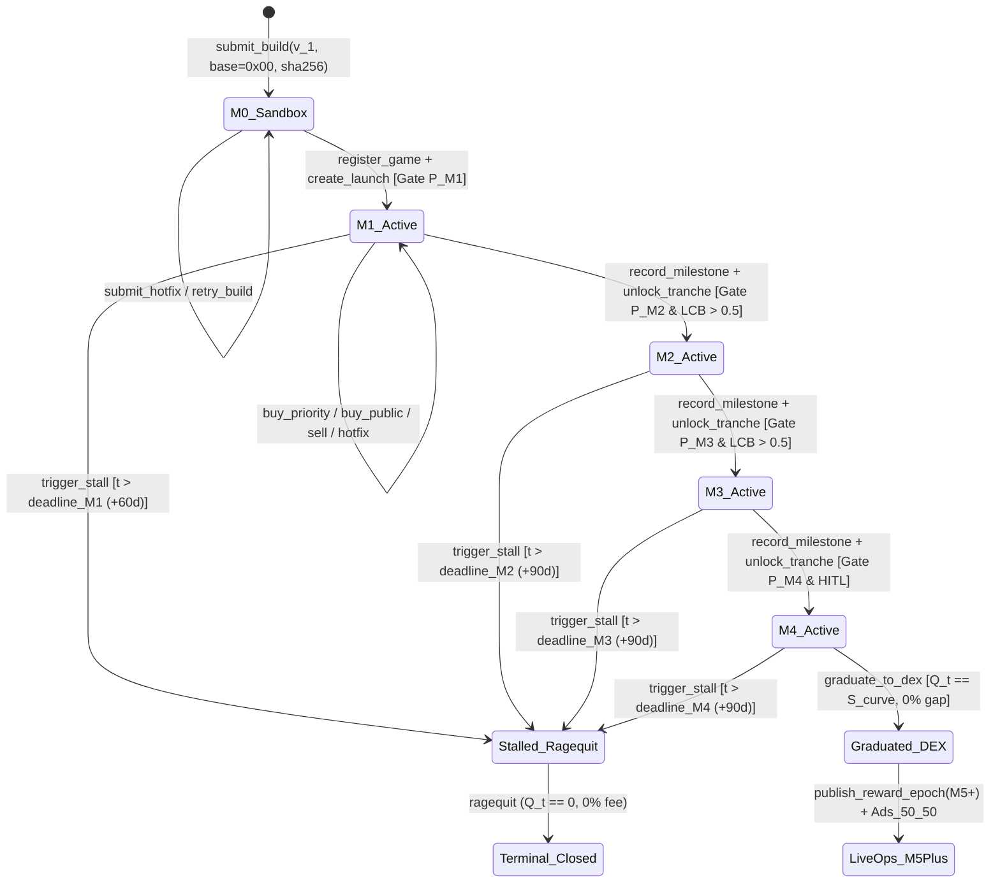
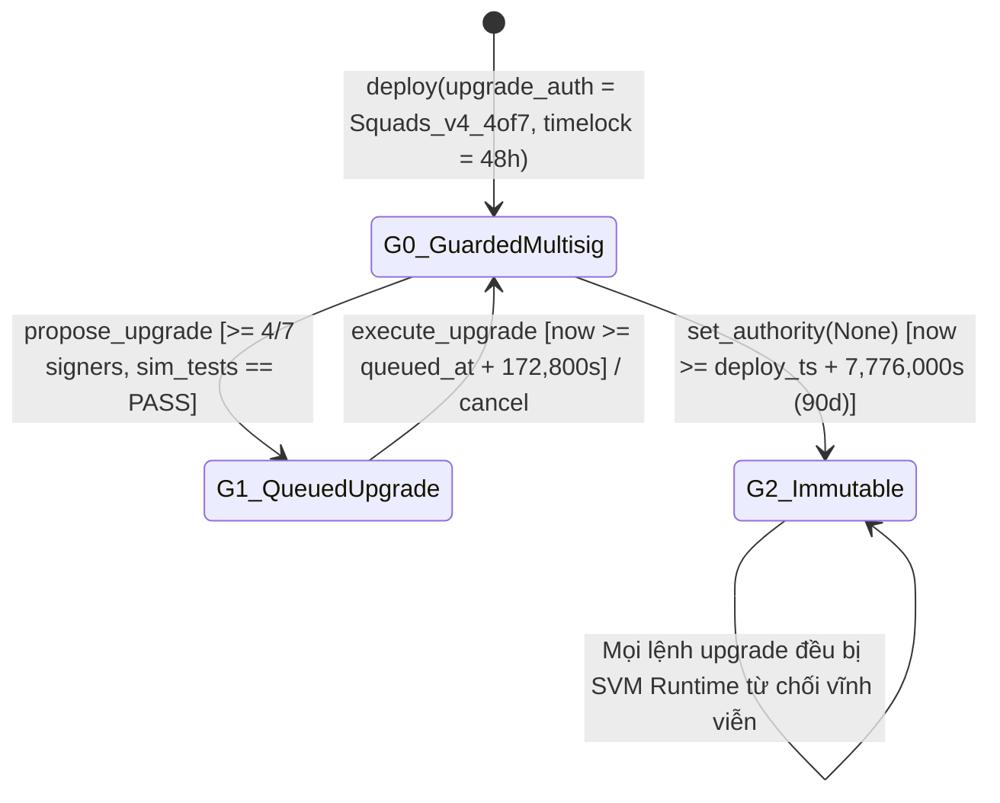

# GAME9K YELLOW PAPER

## Đặc tả Hình thức Giao thức Bệ phóng Vốn Đồng bộ theo Phiên bản Game
### *(A Formal Specification of Version-Synced Game Capital Formation, Proof-of-Play-Work & Self-Binding On-Chain Governance)*

| Thuộc tính Đặc tả | Chi tiết |
|---|---|
| **Định danh Giao thức** | `GAME9K-YP-1.0` (`khanhlegood1/GameFun`) |
| **Phiên bản** | `v1.0 — Formal Mathematical, Cryptographic & Mechanism Specification` |
| **Ngày công bố** | Tháng 11 / 2026 |
| **Môi trường Thực thi Đích** | Solana SVM (Runtime `BPF/SBF`, Anchor `0.30–0.32`, SPL Token-2022, `Ed25519SigVerify`) + Open Web Sandbox |
| **Phân biệt với Whitepaper** | [`WHITEPAPER.md` (`v1.5`)](./WHITEPAPER.md) trình bày *luận điểm chiến lược, thị trường, đối thủ và gọi vốn* *(đã bổ sung §1.3 ánh xạ 4 nguyên tử ↔ đặc tả hình thức trong tài liệu này)*; **Yellow Paper** này định nghĩa *hệ tiên đề, máy trạng thái, số học điểm cố định `u128`, cấu trúc mật mã, định lý bất biến và chứng minh an toàn kinh tế* đủ chính xác để hai nhóm kỹ sư hoặc kiểm toán viên độc lập cài đặt ra cùng một kết quả đến từng `lamport`. |
| **Bộ Kiểm chứng Thực thi** | [`scripts/verify_protocol_math.py`](../scripts/verify_protocol_math.py) *(Python 3 chuẩn, 0 phụ thuộc ngoài — kiểm chứng tự động `S1–S9` + `10,000` phép toán ngẫu nhiên `u128`)* |
| **Tài liệu Kỹ thuật Liên kết** | [`04-solana-smart-contracts.md`](./04-solana-smart-contracts.md) · [`02-database-schema.md`](./02-database-schema.md) · [`03-api-specification.md`](./03-api-specification.md) · [`05-c4-architecture-and-nfr.md`](./05-c4-architecture-and-nfr.md) |

> **Tóm tắt Học thuật (Abstract).** Chúng tôi định nghĩa hình thức giao thức **Game9K** — một máy trạng thái lai (*hybrid replicated state machine*) biến mỗi **phiên bản trò chơi web** $v_k$ thành một đơn vị tài sản có thể kiểm chứng mật mã, xếp hạng xác suất và giải ngân vốn có điều kiện. Giao thức giải quyết đồng thời ba bài toán mở của thị trường khởi tạo vốn phi tập trung: *(i)* **lạm phát phiên bản** (*version inflation*), thông qua cấu trúc đồ thị có hướng phi chu trình (DAG) neo mã băm `SHA-256` kèm hàm khoảng cách thay đổi $\delta(v_k, v_{k-1})$; *(ii)* **lựa chọn bất lợi Akerlof** (*Market for Lemons*), thông qua vị từ `Play-Gate` cưỡng chế trên chuỗi kết hợp kiểm định giữ chân, chỉ số giờ chơi thật đã xác minh ($\mathrm{VPH}$), giới hạn gian lận $\widehat{\mathrm{BotShare}} \le 0.08$, và cận dưới khoảng tin cậy $95\%$ của mô hình đối kháng mù Bradley–Terry $\mathrm{LCB}_{0.95}(\Pr[v_k \succ v_{k-1}]) > 0.5$; và *(iii)* **trục lợi đầu cơ chớp nhoáng & rủi ro bỏ dự án**, thông qua đường cong tích bất biến số nguyên `u128` có làm tròn định hướng có lợi cho két sắt, phí thoát sớm làm âm tuyệt đối lợi nhuận mua-bán vòng tròn ($\mathrm{PnL}_{\text{RT}} \in [-12.88\%, -5.95\%]$), di chuyển thanh khoản DEX với sai lệch giá tương đối $< 5 \times 10^{-11}$, hoàn vốn tỷ lệ `Ragequit` bất biến theo thứ tự rút (sai lệch $\le 1\text{ lamport}$), và ôtômat quản trị tự khóa tay (`Squads 4/7` + `48h timelock` $\to$ bất biến vĩnh viễn sau $7{,}776{,}000\text{ giây}$). Toàn bộ giao thức tuân thủ tiên đề phân bổ `0%` token cho nền tảng ($\alpha_{\text{plat}} \equiv 0$) và tồn tại một phép chiếu bảo toàn trạng thái $\Pi_{\text{fiat}}$ sang mô hình chia sẻ doanh thu ngoài chuỗi khi gặp ràng buộc pháp lý khu vực.

---

## Mục lục

1. [Quy ước Ký hiệu, Hằng số Độ chính xác & Hệ Tiên đề (§1)](#1-quy-ước-ký-hiệu-hằng-số-độ-chính-xác--hệ-tiên-đề)
2. [Mô hình Máy Trạng thái Toàn cục & Tiêu chuẩn Phiên bản 3 Lớp (§2)](#2-mô-hình-máy-trạng-thái-toàn-cục--tiêu-chuẩn-phiên-bản-3-lớp)
3. [Hình thức hóa `PoPW`, `VPH`, Ước lượng `BotShare` & Hàm Thưởng Lõm Chống Độc quyền (§3)](#3-hình-thức-hóa-popw-vph-ước-lượng-botshare--hàm-thưởng-lõm-chống-độc-quyền)
4. [Thống kê Xếp hạng Phiên bản, Đấu mù Bradley–Terry & Neo Merkle Hàng giờ (§4)](#4-thống-kê-xếp-hạng-phiên-bản-đấu-mù-bradleyterry--neo-merkle-hàng-giờ)
5. [Số học Điểm Cố định `u128` của Đường cong Đồng bộ Phiên bản (§5)](#5-số-học-điểm-cố-định-u128-của-đường-cong-đồng-bộ-phiên-bản)
6. [Chuyển đổi Tốt nghiệp DEX: sai lệch ≤ 1 lamport & Cơ chế `Stall / Ragequit` (§6)](#6-chuyển-đổi-tốt-nghiệp-dex-không-chênh-giá--cơ-chế-stall--ragequit)
7. [Đặc tả Mật mã, Định dạng Byte On-Chain & Ôtômat Quản trị Tự Khóa Tay (§7)](#7-đặc-tả-mật-mã-định-dạng-byte-on-chain--ôtômat-quản-trị-tự-khóa-tay)
8. [Hệ 12 Bất biến Hình thức (`INV-01..INV-12`) & Chứng minh 6 Định lý Cốt lõi (§8)](#8-hệ-12-bất-biến-hình-thức-inv-01inv-12--chứng-minh-6-định-lý-cốt-lõi)
9. [Phân tích An toàn Kinh tế & Cận Dưới Chi phí Thao túng (§9)](#9-phân-tích-an-toàn-kinh-tế--cận-dưới-chi-phí-thao-túng)
10. [Mô hình Vi mô Hạ tầng `VPH`, Độ nhạy Quảng cáo & Điều kiện Sống sót Xuyên Chu kỳ (§10)](#10-mô-hình-vi-mô-hạ-tầng-vph-độ-nhạy-quảng-cáo--điều-kiện-sống-sót-xuyên-chu-kỳ)
11. [Ngân sách Compute Units (`CU`), Phí Thuê Bộ nhớ (`Rent`) & Đường ống Telemetry (§11)](#11-ngân-sách-compute-units-cu-phí-thuê-bộ-nhớ-rent--đường-ống-telemetry)
12. [Kiểm chứng Mô phỏng Tái lập (`S1–S9` + `10,000` Fuzz Ops), Vị từ Pháp lý & Phép chiếu Fallback (§12)](#12-kiểm-chứng-mô-phỏng-tái-lập-s1s9--10000-fuzz-ops-vị-từ-pháp-lý--phép-chiếu-fallback)

---

## 1. Quy ước Ký hiệu, Hằng số Độ chính xác & Hệ Tiên đề

### 1.1. Toán tử Số nguyên & Hằng số Chuẩn hóa

Mọi phép toán hạch toán tài sản trên chuỗi **cấm tuyệt đối** số thực dấu phẩy động (`f32`/`f64`). Với mọi $a \in \mathbb{N}_0$ và $b \in \mathbb{N}^+$, hai toán tử chia số nguyên không dấu trên miền $\mathbb{U}_{128} = [0, 2^{128} - 1]$ được định nghĩa:

$$\mathrm{floor\_div}(a, b) \triangleq \left\lfloor \frac{a}{b} \right\rfloor, \qquad \mathrm{ceil\_div}(a, b) \triangleq \left\lceil \frac{a}{b} \right\rceil = \left\lfloor \frac{a + b - 1}{b} \right\rfloor$$

Toàn bộ phép cộng, trừ, nhân trên hợp đồng thực thi dưới dạng kiểm tra tràn (`checked_add`, `checked_sub`, `checked_mul`); mọi tràn số đều hoàn tác nguyên tử (*atomic revert*) toàn bộ giao dịch.

| Ký hiệu | Giá trị Hằng số | Kiểu Dữ liệu | Định nghĩa Hình thức |
|---|---|---|---|
| $L_{\text{SOL}}$ | $10^9$ | `u64` | Số `lamports` trong `1 SOL`. |
| $D_{\text{tok}}$ | $10^6$ | `u64` | Hệ số thập phân của mọi SPL Token-2022 (`decimals = 6`). |
| $B_{\text{bps}}$ | $10^4$ | `u64` | Mẫu số điểm cơ bản (`1 bps = 0.01%`, `10,000 bps = 100%`). |
| $S_{\text{tot}}$ | $10^9 \cdot D_{\text{tok}} = 10^{15}$ | `u64` | Tổng cung cố định bất biến của mỗi token dự án/phiên bản (`mint_authority = None`). |
| $X_0, Y_0$ | Tùy hồ sơ $\Theta$ | `u64` | Dự trữ token ảo ban đầu (base units) và dự trữ SOL ảo ban đầu (`lamports`). |
| $K$ | $X_0 \cdot Y_0$ | `u128` | Tích bất biến khởi tạo ($K \approx 2.895 \times 10^{25}$ ở hồ sơ Tăng trưởng, $6.438 \times 10^{25}$ ở hồ sơ Ổn định — nhỏ hơn $2^{127} \approx 1.70 \times 10^{38}$ khoảng **13 bậc độ lớn**, nên không có nguy cơ tràn `u128`). |
| $X_t, Y_t$ | Trạng thái tại bước $t$ | `u64` | Dự trữ ảo hiện hành của token và SOL trên đường cong. |
| $R_t$ | $Y_t - Y_0$ | `u64` | Dự trữ SOL thực đối ứng đường cong trong `CurveSolVault` (`lamports`). |
| $Q_t$ | $X_0 - X_t$ | `u64` | Lượng token ròng đang lưu hành trong các `BuyerPosition` (base units). |
| $F_t$ | $\ge 0$ | `u64` | Quỹ bảo hiểm giá sàn (`penalty_floor_lamports`) tích lũy từ phí phạt xả sớm & phí dev bị tịch thu khi `Stalled`. |
| $\beta_{\max}$ | $0.08$ (`800 bps`) | `u16` | Ngưỡng cầu dao ngắt mạch tỷ lệ gian lận tối đa cho phép ($\widehat{\mathrm{BotShare}} \le \beta_{\max}$). |
| $T_{\text{tl}}$ | $172{,}800\text{ s}$ (`48h`) | `i64` | Thời gian khóa trễ tối thiểu của mọi lệnh nâng cấp qua đa chữ ký `Squads 4/7`. |
| $T_{\text{imm}}$ | $7{,}776{,}000\text{ s}$ (`90d`) | `i64` | Thời hạn tối đa trước khi thu hồi vĩnh viễn `upgrade_authority` của hợp đồng lõi. |
| $\mathrm{H}(\cdot)$ | $\mathrm{SHA\text{-}256}(\cdot)$ | `[u8; 32]` | Hàm băm mật mã chuẩn FIPS 180-4 đầu ra 256-bit. |

### 1.2. Năm Tiên đề Thiết kế Bất khả Xâm phạm (Protocol Axioms)

- **Tiên đề A1 (Tính Nguyên tử của Phiên bản — *Version Atomicity*):** Đơn vị gốc của kiểm định, xếp hạng và giải ngân vốn là bộ phiên bản bất biến $v_k \in \mathcal{V}_g$, không phải định danh tựa game $g \in \mathcal{G}$.
- **Tiên đề A2 (Tính Đơn điệu Chất lượng — *"Không Tốt hơn — Không Cho Mở Thanh khoản Mới"*):** Thứ tự tăng của chỉ số phiên bản ($k > k-1$) chỉ là điều kiện cần để lưu trữ; điều kiện đủ để cho phép mở trần thanh khoản/cung mới $C_m > C_{m-1}$ là bằng chứng thống kê $v_k$ đạt ngưỡng giữ chân tối thiểu và thắng $v_{k-1}$ trên tập người chơi thật.
- **Tiên đề A3 (Trung lập Đạo đức Tuyệt đối — *Zero Platform Token Allocation*):** Tỷ lệ phân bổ token dự án/phiên bản cho nền tảng Game9K hằng bằng không với mọi đợt phát hành: $\forall g \in \mathcal{G},\ \alpha_{\text{plat}}(g) \equiv 0$.
- **Tiên đề A4 (Bảo toàn & Khả năng Thanh toán Đóng — *Closed Solvency*):** Mọi trạng thái khả đạt $\Sigma_t$ phải có đủ tài sản thực trong két sắt để tất toán 100% nghĩa vụ bán lại hoặc hoàn vốn `Ragequit` mà không cần bất kỳ dòng vốn ngoại sinh nào.
- **Tiên đề A5 (Tự Khóa Tay Không Đảo ngược — *Irreversible Self-Binding*):** Tập quyền quản trị $\mathcal{P}_{\text{gov}}(t)$ là hàm giảm đơn điệu theo thời gian và hội tụ về tập rỗng đối với lô-gic `Play-Gate` khi $t \ge t_0 + T_{\text{imm}}$.

---

## 2. Mô hình Máy Trạng thái Toàn cục & Tiêu chuẩn Phiên bản 3 Lớp

### 2.1. Bộ Trạng thái Toàn cục & Hàm Chuyển tiếp

Trạng thái giao thức tại thời điểm khối (*Unix timestamp*) $t \in \mathbb{Z}$ là bộ 5 thành phần:

$$\Sigma_t = \left(\Sigma_t^{\text{reg}},\ \Sigma_t^{\text{gate}},\ \Sigma_t^{\text{curve}},\ \Sigma_t^{\text{rew}},\ \Sigma_t^{\text{gov}}\right)$$

Một giao dịch hợp lệ $\mathsf{tx}$ có chữ ký mật mã hợp lệ biến đổi trạng thái theo hàm chuyển tiếp tất định $\Upsilon(\Sigma_t, \mathsf{tx}) = \Sigma_{t'}$ nếu và chỉ nếu mọi tiền điều kiện (*guards*) thỏa mãn; ngược lại $\Upsilon(\Sigma_t, \mathsf{tx}) = \bot$ và $\Sigma_{t'} = \Sigma_t$.



### 2.2. Đặc tả Hình thức Tiêu chuẩn Phiên bản 3 Lớp (*3-Layer Version Standard*)

Mỗi phiên bản thứ $k \in \mathbb{N}^+$ của tựa game $g \in \mathcal{G}$ là một bộ bất biến:

$$v_k = \left(g,\ k,\ \ell_k,\ \nu_k,\ h_k,\ h_{\text{base},k},\ \delta_k,\ \kappa_k,\ m_k,\ t_k\right)$$

1. **Lớp 1 — Nhãn Sáng tạo & Bộ Ba Thứ tự ($\ell_k, \nu_k$):**
   - $\ell_k \in \Sigma_{\text{UTF8}}^{\le 32}$ là chuỗi hiển thị tự do của studio (ví dụ `"v0.5.0-beta"`, `"Season 2"`).
   - $\nu_k = (\text{maj}_k, \text{min}_k, \text{pat}_k) \in \mathbb{N}_0^3$ là bộ chỉ số thứ tự chuẩn hóa, bị cưỡng chế tăng từ điển nghiêm ngặt (*strict lexicographic order*):
     $$\nu_k \le_{\text{lex}} \nu_{k-1} \implies \text{REJECT}(\texttt{ERR\_VERSION\_OLDER} \lor \texttt{ERR\_VERSION\_SAME})$$

2. **Lớp 2 — Cam kết Mật mã Tất định & Hàm Khoảng cách `BuildDiff` ($h_k, h_{\text{base},k}, \delta_k, \kappa_k$):**
   - Gói HTML5 được giải nén thành tập hữu hạn các tệp hợp lệ $\mathcal{F}_k = \{(p_i, b_i)\}_{i=1}^{N_k}$, sắp xếp tăng dần theo thứ tự byte UTF-8 của đường dẫn chuẩn hóa $p_i$ (loại bỏ dấu thời gian ZIP để đảm bảo tái tạo tất định 100%). Mã băm gói build được tính:
     $$h_k \triangleq \mathrm{H}\Big(\texttt{"GAME9K\_BUILD\_V1"} \,\|\, \Vert_{i=1}^{N_k} \big(\mathrm{len}(p_i) \,\|\, p_i \,\|\, \mathrm{len}(b_i) \,\|\, \mathrm{H}(b_i)\big)\Big)$$
   - **Ràng buộc phả hệ (`Ancestry Guard`):** Với $k = 1$, yêu cầu $h_{\text{base},1} = 0^{32}$. Với mọi $k \ge 2$, bắt buộc $h_{\text{base},k} = h_{k-1}$ và $h_k \ne h_{k-1}$; nếu sai, từ chối với $\texttt{ERR\_ORPHAN\_BASE}$ hoặc $\texttt{ERR\_IDENTICAL\_BUILD}$.
   - **Hàm khoảng cách thay đổi thực chất (`BuildDiff`):** Phân hoạch $\mathcal{F}_k$ thành ba lớp tệp: mã thực thi $\mathcal{F}_k^{\text{code}}$ (`.js`, `.wasm`), tài nguyên $\mathcal{F}_k^{\text{asset}}$ (`.png`, `.webp`, `.ktx2`, `.ogg`, `.glb`) và cấu hình/dữ liệu màn chơi $\mathcal{F}_k^{\text{data}}$ (`.json`, `.bin`). Trên mỗi lớp $c \in \{\text{code}, \text{asset}, \text{data}\}$, dùng khoảng cách Jaccard có trọng số dung lượng trên tập các khối nội dung *Content-Defined Chunking* (Rabin/FastCDC, kích thước trung bình $4\text{ KiB}$) $S_k^{(c)}$:
     $$\delta_k^{(c)} = 1 - \frac{\sum_{x \in S_k^{(c)} \cap S_{k-1}^{(c)}} \mathrm{size}(x)}{\sum_{x \in S_k^{(c)} \cup S_{k-1}^{(c)}} \mathrm{size}(x)} \in [0, 1], \qquad \delta_k = 0.50\,\delta_k^{\text{code}} + 0.30\,\delta_k^{\text{asset}} + 0.20\,\delta_k^{\text{data}}$$
   - **Phân loại tự động $\kappa_k \in \{\texttt{HOTFIX}, \texttt{CANDIDATE}\}$:** Với ngưỡng cấu hình $\theta_{\text{diff}} = 0.08$ (`8%`):
     - Nếu $0 < \delta_k < \theta_{\text{diff}}$: gán $\kappa_k = \texttt{HOTFIX}$ — được triển khai sửa lỗi nhanh sau khi qua quét CSP/malware nhưng **cấm tuyệt đối** gọi `record_version_milestone` (chặn đứng tấn công "đổi màu 1 nút bấm đòi mở vốn").
     - Nếu $\delta_k \ge \theta_{\text{diff}}$ (hoặc có thay đổi cấu trúc màn chơi được kiểm chứng bởi Curator tại `M3/M4`): gán $\kappa_k = \texttt{CANDIDATE}$ — đủ điều kiện bước vào phễu đo lường Lớp 3.
    - **Global Similarity Check (chống tái sinh xuyên tựa game — *Cross-Game Anti-Forking*):** `BuildDiff` không chỉ so $v_k$ với $v_{k-1}$ **trong cùng** $g$. Trước khi cấp $k=1$ cho một $g$ mới *(tức trước khi tạo `BondingCurve` PDA đầu tiên)*, giao thức tính **hàm tương đồng xuyên dự án** của gói build mới với **toàn bộ chỉ mục toàn cầu** $\mathcal{G}_{\text{stalled}}$ — tập mọi phiên bản đã bị chuyển $\mathsf{status} \to \texttt{Stalled}$ trên mọi tựa game:
      $$\sigma_{\text{glob}} = \max_{v \in \mathcal{G}_{\text{stalled}}} \big( 0.50\,\sigma^{\text{code}} + 0.30\,\sigma^{\text{asset}} + 0.20\,\sigma^{\text{data}} \big), \qquad \sigma^{(c)} = 1 - \delta^{(c)}$$
      trong đó $\delta^{(c)}$ dùng **đúng** khoảng cách Jaccard có trọng số dung lượng trên khối FastCDC như trên. Nếu $\sigma_{\text{glob}} \ge \theta_{\text{fork}} = 0.92$ *(tương đương $\delta < 0.08$, cùng ngưỡng $\theta_{\text{diff}}$)*: **REJECT** với $\texttt{ERR\_GLOBAL\_SIMILARITY\_FORK}$ — không tạo đường cong, không cấp $k=1$, giao dịch tạo dự án thất bại nguyên tử.
      - *Vì sao đây là lỗ hổng thật:* `Ancestry Guard` chỉ bảo vệ **phả hệ trong một tựa game**. Không có bước này, một studio trượt `M2` chỉ cần đóng ZIP lại, đổi tên game thành *\"Bắn Cá 2\"* và nộp như một dự án $M_0$ hoàn toàn mới để huy động lại từ đầu — đúng hành vi *Rug-and-Rehash* mà toàn bộ cơ chế cổng sinh ra để chặn.
      - *Chi phí & tính khả thi:* chỉ mục $\mathcal{G}_{\text{stalled}}$ lưu dưới dạng tập hash khối CDC *(không lưu mã nguồn thô)*, tra cứu bằng Merkle set; phép so khớp chạy **off-chain trong bước Inspector** và kết quả `attestation` được ký bởi cùng bộ khóa HITL, nên **không tốn thêm CU on-chain** cho `record_version_milestone`.
      - *Ranh giới trung thực:* ngưỡng `≥ 92%` là **ngưỡng chính sách có thể hiệu chỉnh** *(tham số hóa trong `GATE_TABLE`, băm vào `terms_hash`)*, không phải một định lý toán học; nó đánh đổi giữa *chặn tái sinh rác* và *rủi ro từ chối nhầm studio dùng chung engine/asset pack hợp pháp* (kháng nghị đi qua HITL, không qua tự động).

3. **Lớp 3 — Cấp bậc Kinh tế Đồng bộ Vốn ($m_k \in \{0, 1, 2, 3, 4, 5, \dots\}$):**
   - Khởi tạo $m_k = 0$. Chỉ nâng lên $m^* = m_{\max}(g) + 1$ khi và chỉ khi $\kappa_k = \texttt{CANDIDATE} \land \mathcal{P}_{m^*}(v_k, v_{\text{ref}}) = \mathsf{true}$ (§4.1), trong đó $v_{\text{ref}}$ là phiên bản đang giữ mốc $m_{\max}(g)$.

---

## 3. Hình thức hóa `PoPW`, `VPH`, Ước lượng `BotShare` & Hàm Thưởng Lõm Chống Độc quyền

### 3.1. Phiên Chơi Hợp lệ & Giờ chơi Thật Xác minh (`VPH`)

Một phiên chơi $s = (u, v_k, t_{\text{start}}, t_{\text{end}}, \{e_j\}_{j=1}^{M}, \mathbf{z}_s)$ gồm chuỗi nhịp tim tương tác $e_j$ (mỗi $\Delta\tau = 15\text{ s}$) và vector tín hiệu môi trường $\mathbf{z}_s$ (dấu vân tay WebGL/AudioContext không định danh cá nhân, phân phối khoảng cách phím/chạm $\Delta t_{\text{input}}$, tốc độ khung hình, ASN mạng).

Khoảng tương tác thứ $j$ được tính là **hoạt động thật** ($\mathbb{I}_{\text{act}}(e_j) = 1$) khi tab trình duyệt ở tiền cảnh (`visibilityState == visible`), có ít nhất một sự kiện đầu vào hợp lệ và entropy Shannon của chuỗi khoảng cách thao tác $H(\Delta t_{\text{input}}) \ge H_{\min}$ (loại bỏ bộ gõ tự động tuần hoàn $H \approx 0$). Thời lượng chơi hoạt động của phiên $s$ là:

$$d_{\text{act}}(s) = \min\left(d_{\max},\ \sum_{j=1}^{M} \Delta\tau \cdot \mathbb{I}_{\text{act}}(e_j)\right), \qquad d_{\max} = 7{,}200\text{ s}\ (2\text{ giờ/phiên})$$

Gọi $p_{\text{bot}}(s) \in [0, 1]$ là xác suất phiên $s$ là bot/Sybil do bộ phân loại đa tín hiệu ước lượng (kết hợp entropy thao tác, độ tập trung cụm thiết bị/IP, tuổi tài khoản và đồ thị đồng tài trợ ví trên chuỗi). Với ngưỡng chấp nhận phiên $\theta_{\text{bot}} = 0.35$ và hàm suy giảm tích lũy ngày $\omega_{\text{day}}(\cdot) \in \{1.0, 0.5, 0.1\}$ (tương ứng $0\text{–}2\text{h}$, $2\text{–}4\text{h}$, $>4\text{h}$ mỗi ngày để triệt tiêu lợi thế treo máy 24/7), **Giờ chơi Thật Xác minh (`VPH`)** của người chơi $u$ trên phiên bản $v_k$ trong chu kỳ $E$ là:

$$\mathrm{VPH}(u, v_k, E) \triangleq \frac{1}{3{,}600} \sum_{s \in \mathcal{S}(u, v_k, E)} d_{\text{act}}(s) \cdot \mathbb{I}\big[p_{\text{bot}}(s) < \theta_{\text{bot}}\big] \cdot \big(1 - p_{\text{bot}}(s)\big) \cdot \omega_{\text{day}}(s)$$

**Điều kiện đủ quyền chấm điểm (`PoPW Rating Eligibility`):** Người chơi $u$ chỉ được gửi phiếu đánh giá hoặc phiếu đấu mù Arena cho $v_k$ khi tổng thời gian chơi xác minh trong $24\text{ giờ}$ gần nhất đạt $\ge 600\text{ s}$ ($10\text{ phút}$) đối với chấm điểm phiên bản (hoặc $\ge 90\text{ s}$ trên *mỗi* bản A và B trong cùng một trận *Blind Version Duel*).

### 3.2. Ước lượng Không Chệch `BotShare` & Cầu dao Ngắt mạch `8%` (`R2`)

Trong mỗi chu kỳ kiểm toán $E$, ngoài điểm mô hình $p_{\text{bot}}(s)$, hệ thống lấy mẫu ngẫu nhiên phân tầng tỷ lệ $\pi_{\text{audit}} = 0.005$ (`0.5%` tổng số phiên, ưu tiên phân tầng nhóm có điểm biên $p_{\text{bot}} \in [0.15, 0.50]$) để kiểm định viên con người gán nhãn thực $y_s \in \{0, 1\}$. Ước lượng hiệu chỉnh sai lệch (*difference/Horvitz–Thompson estimator*) của tỷ lệ gian lận là:

$$\widehat{\mathrm{BotShare}}_E = \frac{1}{\sum_{s \in \mathcal{S}_E} d_{\text{act}}(s)} \left[ \sum_{s \in \mathcal{S}_E} d_{\text{act}}(s)\,p_{\text{bot}}(s) + \sum_{s \in \mathcal{S}_E^{\text{audit}}} \frac{d_{\text{act}}(s)}{\pi_s}\big(y_s - p_{\text{bot}}(s)\big) \right]$$

**Luật ngắt mạch tự động (`Stop-the-Line R2`):**

$$\widehat{\mathrm{BotShare}}_E > \beta_{\max} = 0.08 \implies \mathsf{allow\_new\_launch} \leftarrow \mathsf{false}$$

Mọi đợt phát hành mới bị tạm dừng tự động cho đến khi hai chu kỳ liên tiếp ghi nhận $\widehat{\mathrm{BotShare}} \le 0.08$.

### 3.3. Hàm Phân bổ Thưởng `PoPW` Lõm Có Trần (*Water-Filling Anti-Monopoly*) & Chống Sybil

Gọi $\mathcal{U}_E$ là tập người chơi hợp lệ trong kỳ thưởng $E$ với tổng quỹ $P_E$ (token), $h_u = \mathrm{VPH}(u, v_k, E)$ là giờ chơi xác minh, và $\rho_u \in [0.1, 1.0]$ là hệ số tin cậy danh tính (*Identity & History Trust Score* — tài khoản mới chưa có lịch sử đa game và chưa đạt đồng thuận Arena có $\rho_u \le 0.25$). Trọng số thô được tính bằng hàm lũy thừa lõm nghiêm ngặt với $\gamma = 0.65 \in (0.5, 1)$:

$$w_u = \rho_u \cdot (h_u)^{\gamma}$$

Tỷ phần thưởng $s_u \in [0, \phi_{\max}]$ với trần chống độc quyền $\phi_{\max} = 0.05$ (`5.00%` tổng quỹ/người) được xác định duy nhất bởi nghiệm thuật toán *water-filling*:

$$s_u = \min\left(\phi_{\max},\ \lambda \cdot w_u\right), \qquad \text{sao cho } \begin{cases} \sum_{u \in \mathcal{U}_E} s_u = 1 & \text{nếu } |\mathcal{U}_E| \ge \lceil 1 / \phi_{\max} \rceil = 20 \\ s_u = \phi_{\max}\ \forall u & \text{nếu } |\mathcal{U}_E| < 20\ (\text{phần dư chuyển kỳ sau}) \end{cases}$$

- **Hệ quả 1 (Chống cá voi cày giờ):** Một người chơi chiếm tới $20\%$ tổng `VPH` toàn game ($h_0 / \sum_u h_u = 0.20$) nhận chính xác $s_0 = \phi_{\max} = 0.05$ (**`5.00%` pool**); phần dư $15\%$ được phân phối lại cho cộng đồng người chơi thật còn lại *(đã kiểm chứng ở kịch bản `S4`)*.
- **Hệ quả 2 (Chống tách tài khoản Sybil):** Nếu kẻ tấn công tách $H$ giờ chơi thành $n$ tài khoản giả mới có hệ số tin cậy $\rho_{\text{sybil}} \le 0.20$ so với tài khoản thật $\rho_{\text{real}} = 1.0$, tổng trọng số của $n$ tài khoản giả là $n \cdot \rho_{\text{sybil}} \cdot (H/n)^\gamma = \rho_{\text{sybil}} \cdot n^{1-\gamma} \cdot H^\gamma$. Với $\gamma = 0.65$ và $\rho_{\text{sybil}} = 0.20$, kẻ tấn công phải duy trì đồng thời $n > (1/0.20)^{1/0.35} \approx 99$ danh tính thiết bị/mạng độc lập không bị phát hiện mới chỉ hòa vốn trọng số của 1 người chơi thật — trong khi chi phí vận hành 99 thiết bị sạch vượt xa giá trị phần thưởng (§9.2).
- **Lịch giải ngân có cửa sổ thu hồi (`Clawback` + `Linear Stream`):** Với thời điểm chốt kỳ $t_E$, cửa sổ hậu kiểm/thu hồi $T_{\text{delay}} = 604{,}800\text{ s}$ (`7 ngày`) và thời gian chảy tuyến tính $T_{\text{stream}} = 1{,}814{,}400\text{ s}$ (`21 ngày`), lượng token người chơi $u$ được rút tại thời điểm $t$ (nếu không bị đánh dấu gian lận $\mathsf{clawed}_u = \mathsf{false}$) là:
  $$\mathrm{Claimable}_u(t) = \begin{cases} 0 & \text{nếu } t < t_E + T_{\text{delay}} \lor \mathsf{clawed}_u = \mathsf{true} \\ \left\lfloor u_{\text{alloc}} \cdot \min\left(1,\ \dfrac{t - (t_E + T_{\text{delay}})}{T_{\text{stream}}}\right) \right\rfloor - u_{\text{claimed}} & \text{ngược lại} \end{cases}$$

### 3.4. Công thức Vesting của Nhà phát triển theo Giờ chơi Thật (`VPH-Gated Creator Vesting`)

Khác với vesting tuyến tính thuần thời gian truyền thống (nhà phát triển ngồi yên chờ hết hạn vẫn nhận đủ token), phần phân bổ Creator $A_{\text{dev}}$ chỉ mở khóa theo **hàm tích lũy giờ chơi thật đã xác minh**:

- **Trên Hồ sơ Ổn định (`VBOND-LV`, $A_{\text{dev}} = 15\% = 150\text{M}$):** Đặt mục tiêu giờ chơi xác minh lũy kế của phiên bản là $V_{\text{target}} > 0$ (chốt trong `terms_hash`). Tỷ lệ mở khóa tại thời điểm $t$ hoàn toàn độc lập với đồng hồ nếu không có người chơi:
  $$\mathrm{DevUnlocked}(t) = \mathbb{I}[\mathsf{status} \ne \texttt{Stalled}] \cdot \left\lfloor A_{\text{dev}} \cdot \min\left(1,\ \frac{\mathrm{VPH}_{\text{cum}}(v_k, t)}{V_{\text{target}}}\right) \right\rfloor$$
- **Trên Hồ sơ Tăng trưởng (`VGBC-4T`, $A_{\text{dev}} = 5\% = 50\text{M}$):** Chia 4 đợt $[10\text{M}, 10\text{M}, 15\text{M}, 15\text{M}]$ gắn với nghiệm thu `M2, M3, M4, M5+` (`0%` ở `M0/M1`), mỗi đợt chảy trong $90\text{ ngày}$ sau khi vượt mốc VPH/Arena, chỉ được rút ra ví sau khi hoàn tất `M4` và đóng băng vĩnh viễn ($\mathsf{frozen} \leftarrow \mathsf{true}$) nếu dự án rơi vào `Stalled`.

---

## 4. Thống kê Xếp hạng Phiên bản, Đấu mù Bradley–Terry & Neo Merkle Hàng giờ

### 4.1. Mô hình Đối kháng Mù Bradley–Terry / OpenSkill & Điều kiện Thắng `95% LCB`

Khi phiên bản ứng viên $v_k$ thi đấu mù với phiên bản đương nhiệm $v_{\text{ref}}$ (ẩn toàn bộ số phiên bản, tên bản cập nhật và thứ tự trái/phải ngẫu nhiên hóa 50/50), mỗi người chơi hợp lệ $u$ có trọng số tin cậy $\tilde{\rho}_u \in (0, 1]$ cho kết quả $o_u \in \{1\ (v_k\text{ thắng}),\ 0\ (v_{\text{ref}}\text{ thắng}),\ 0.5\ (\text{hòa})\}$.

Gọi $\theta_k, \theta_{\text{ref}} \in \mathbb{R}$ là năng lực tiềm ẩn (*latent quality*) của hai phiên bản trong mô hình Bradley–Terry:

$$\Pr[v_k \succ v_{\text{ref}}] = \sigma(\theta_k - \theta_{\text{ref}}) = \frac{1}{1 + \exp\big(-(\theta_k - \theta_{\text{ref}})\big)}$$

Đặt $\Delta = \theta_k - \theta_{\text{ref}}$. Ước lượng hợp lý cực đại có trọng số (WMLE) với tiên nghiệm chính quy hóa Gaussian yếu $\Delta \sim \mathcal{N}(0, \tau_0^2)$ cực đại hóa hàm log-hậu nghiệm lõm nghiêm ngặt:

$$\mathcal{L}(\Delta) = \sum_{u \in \mathcal{D}(v_k, v_{\text{ref}})} \tilde{\rho}_u \Big[ o_u \ln \sigma(\Delta) + (1 - o_u)\ln\big(1 - \sigma(\Delta)\big) \Big] - \frac{\Delta^2}{2\tau_0^2}$$

Nghiệm duy nhất $\hat{\Delta}$ và sai số chuẩn tiệm cận từ thông tin Fisher quan sát $\mathcal{I}(\hat{\Delta}) = \sum_u \tilde{\rho}_u\,\sigma(\hat{\Delta})(1 - \sigma(\hat{\Delta})) + \tau_0^{-2}$ cho cận dưới khoảng tin cậy $95\%$ một phía/hai phía:

$$\mathrm{LCB}_{0.95}\big(\Pr[v_k \succ v_{\text{ref}}]\big) = \sigma\!\left(\hat{\Delta} - z_{0.975} \cdot \mathcal{I}(\hat{\Delta})^{-1/2}\right), \qquad z_{0.975} = 1.959964$$

Đối với bảng xếp hạng toàn thể loại $\mathcal{C}$, giao thức đồng thời duy trì điểm Bayesian co rút về trung bình thể loại $\mu_{\mathcal{C}}$ với hằng số làm trơn $\kappa = 25$ phiếu quy đổi:

$$R_{\text{Bayes}}(v_k) = \frac{\kappa \cdot \mu_{\mathcal{C}} + \sum_{u} \tilde{\rho}_u r_{u,k}}{\kappa + \sum_{u} \tilde{\rho}_u}, \qquad \mathrm{RatingTrust}(v_k) = 1 - \frac{\sum_u \tilde{\rho}_u p_{\text{bot}}(u)}{\sum_u \tilde{\rho}_u}$$

### 4.2. Bảng Vị từ Cổng Bất biến `GATE_TABLE` (`M1 → M4`)

Bảng `GATE_TABLE` được phiên bản hóa trong mã nguồn, khóa bằng kiểm thử CI và băm vào `terms_hash`.

**Ngoại lệ Genesis cho phiên bản đầu tiên ($k=1$) — *Vị từ Tiến bộ Phiên bản* $\Phi_{\text{prog}}$.**

Khi $k=1$ ta có $h_{\text{base},1} = 0^{32}$ *(§2.2)*: **không tồn tại phiên bản đương nhiệm $v_{\text{ref}}$ để đấu mù**, nên vị từ $\mathrm{LCB}_{0.95}(v_k \succ v_{\text{ref}}) > 0.50$ và ngưỡng $N_{\text{duel}} \ge 50$ là **không thể thỏa mãn về mặt cú pháp** — áp dụng nguyên trạng sẽ gây *kẹt cổng vĩnh viễn* (deadlock) tại `M2` cho mọi dự án Genesis. Giao thức thay thế **toàn bộ cụm vị từ đấu trường** bằng vị từ tiến bộ:

$$\Phi_{\text{prog}}(v_k, v_{\text{ref}}) \;\triangleq\; \big(k = 1\big) \;\lor\; \Big(\delta_k \ge 0.08 \;\land\; N_{\text{duel}} \ge 50 \;\land\; \mathrm{LCB}_{0.95}(v_k \succ v_{\text{ref}}) > 0.50\Big)$$

Ngữ nghĩa thực thi:

- **$k=1$:** $\Phi_{\text{prog}} \equiv \mathsf{true}$ *(đoạn hội thoại đấu trường trong $\mathcal{P}_m$ bị bỏ qua theo luật, không phải bị bỏ qua theo ngoại lệ hành chính)*. Bản $v_1$ vẫn phải vượt **toàn bộ** bài kiểm định độc lập còn lại của từng chặng — $N_{\text{sess}} \ge 500$, $\bar{d}_{\text{act}} \ge 180\text{ s}$, $\Pr[d_{\text{act}} > 180\text{ s}] \ge 0.25$, $\mathrm{RatingTrust} \ge 0.85$ ở `M2`; ba điểm CTR/Time/C2P, $\mathrm{percentile}_{\mathcal{C}} \ge 0.60$ và $\mathrm{HITL}_{\text{curator}}$ ở `M3`; $D_7$, $\mathrm{crash\_rate}$, $\mathrm{SDK\_ads\_verified}$, $\mathrm{HITL}_{\text{release}}$ ở `M4`. Nói cách khác: **bản $v_1$ chỉ được miễn phần "phải thắng chính mình của quá khứ", không được miễn bất kỳ ngưỡng chất lượng nào.**
- **$k \ge 2$:** cụm vị từ đấu trường giữ nguyên $100\%$ — mọi bản cập nhật vẫn phải chứng minh **thắng phiên bản đương nhiệm** với cận tin cậy $95\%$, không có ngoại lệ nào khác.
- **Bất biến chống lạm dụng:** $\Phi_{\text{prog}}$ chỉ phụ thuộc vào **chỉ số phiên bản $k$** đọc từ `Registry` *(không phải cờ do studio tự đặt)*, nên không thể "tự nhận mình là bản Genesis" cho một dự án thứ hai: $k$ được cấp tuần tự bởi chương trình, và $k=1$ chỉ tồn tại đúng một lần cho mỗi $g \in \mathcal{G}$.
- **Kiểm chứng:** `scripts/verify_protocol_math.py` kiểm tra $\Phi_{\text{prog}}$ bằng bảng chân trị cho $k \in \{1, 2\}$ và bắt buộc $\Phi_{\text{prog}}(v_1, \bot) = \mathsf{true}$, $\Phi_{\text{prog}}(v_2, v_1) = \mathsf{false}$ khi $N_{\text{duel}} < 50$.

| Cột mốc $m$ | Vị từ Nghiệm thu Hình thức $\mathcal{P}_m(v_k, v_{\text{ref}})$ | Trần Mở Cung (`VGBC-4T`) | Hạn `Stall` kế tiếp |
|---|---|---|---|
| **`M1` *(Playtest)*** | $N_{\text{test}} \ge 10 \land \mathrm{crash\_rate}(v_k) = 0 \land \mathrm{CSP\_clean}(v_k) \land \widehat{\mathrm{BotShare}} \le 0.08$ | $C_1 = 150\text{M}$ (`15%`) | $+60\text{ ngày}$ ($5{,}184{,}000\text{ s}$) |
| **`M2` *(Player Fit + Duel)*** | **$\Phi_{\text{prog}}(v_k, v_{\text{ref}})$** $\land N_{\text{sess}} \ge 500 \land \bar{d}_{\text{act}} \ge 180\text{ s} \land \Pr[d_{\text{act}} > 180\text{ s}] \ge 0.25 \land \mathrm{RatingTrust} \ge 0.85$ | $C_2 = 330\text{M}$ (`33%`) | $+90\text{ ngày}$ ($7{,}776{,}000\text{ s}$) |
| **`M3` *(Web Fit + Category)*** | **$\Phi_{\text{prog}}(v_k, v_{\text{ref}})$** $\land \mathrm{score}_{\text{CTR}}, \mathrm{score}_{\text{Time}}, \mathrm{score}_{\text{C2P}} \ge 3/5 \land \mathrm{percentile}_{\mathcal{C}}(v_k) \ge 0.60 \land \mathrm{HITL}_{\text{curator}} = \mathsf{true}$ | $C_3 = 530\text{M}$ (`53%`) | $+90\text{ ngày}$ ($7{,}776{,}000\text{ s}$) |
| **`M4` *(Global Release v1.0)*** | **$\Phi_{\text{prog}}(v_k, v_{\text{ref}})$** $\land D_7(v_k) \ge \theta_{D7,\mathcal{C}} \land \mathrm{crash\_rate}(v_k) < 0.005 \land \mathrm{SDK\_ads\_verified} \land \mathrm{HITL}_{\text{release}} = \mathsf{true}$ | $C_4 = 700\text{M}$ (`70%` tổng cung $= 100\%$ curve; `30%` khóa cố định: `15%` LP + `10%` PoPW + `5%` Dev + `0%` Sàn) | $+90\text{ ngày}$ $\to$ `Graduate` |

### 4.3. Lược đồ Neo Cây Merkle Hàng giờ (Chống Thao túng Điểm từ Phía Cổng)

Cuối mỗi cửa sổ giờ $h = \lfloor t / 3{,}600 \rfloor$, toàn bộ bản ghi điểm phiên bản và phiếu đã ẩn danh hóa được sắp xếp tất định và băm theo chuẩn tách miền RFC 6962 (chống tấn công tiền ảnh thứ hai *second-preimage attack*):

$$\mathrm{Leaf}_i = \mathrm{H}\big(\texttt{0x00} \,\|\, g_i \,\|\, h_{v_i} \,\|\, \mathrm{VPH}_i \,\|\, R_{\text{Bayes},i} \,\|\, \hat{\Delta}_i \,\|\, N_{\text{duel},i}\big), \qquad \mathrm{Node}(L, R) = \mathrm{H}\big(\texttt{0x01} \,\|\, L \,\|\, R\big)$$

Gốc $\mathrm{Root}_h \in \{0,1\}^{256}$ được ghi lên Solana kèm URI dữ liệu kiểm toán công khai; bất kỳ studio hay nhà đầu tư nào cũng có thể kiểm chứng sự tồn tại và tính toàn vẹn của điểm số trong thời gian $\mathcal{O}(\log_2 N)$ phép băm.

---

## 5. Số học Điểm Cố định `u128` của Đường cong Đồng bộ Phiên bản

### 5.1. Hai Hồ sơ Tham số Đã Khóa bằng Mô phỏng — Tăng trưởng (`VGBC-4T`) & Ổn định (`VBOND-LV`)

Hợp đồng `game9k_curve` tổng quát hóa cả hai chế độ vận hành dưới cùng một bộ tham số bất biến $\Theta$ chụp cứng vào `terms_hash` khi khởi tạo:

| Tham số Hình thức | Ký hiệu | **Hồ sơ Tăng trưởng: `VGBC-4T`** *(Toàn vòng đời Game)* | **Hồ sơ Ổn định: `VBOND-LV`** *(Version Bond Đầm giá)* |
|---|---|---|---|
| **Tổng cung cố định** | $S_{\text{tot}}$ | $1{,}000{,}000{,}000 \cdot 10^6$ | $1{,}000{,}000{,}000 \cdot 10^6$ |
| **Cung mở bán trên đường cong** | $S_{\text{curve}}$ | $700{,}000{,}000 \cdot 10^6$ (`70%`) | $600{,}000{,}000 \cdot 10^6$ (`60%`) |
| **Trần cung lũy kế các chặng** | $\{C_m\}$ | $[150\text{M}, 330\text{M}, 530\text{M}, 700\text{M}] \cdot 10^6$ | $[600\text{M}] \cdot 10^6$ *(1 bản cập nhật)* |
| **Thanh khoản DEX khóa** | $S_{\text{LP}}$ | $150{,}000{,}000 \cdot 10^6$ (`15%`, khóa vĩnh viễn) | $50{,}000{,}000 \cdot 10^6$ (`5%`, khóa $\ge 12\text{ tháng}$) |
| **Quỹ thưởng người chơi (`PoPW`)** | $S_{\text{play}}$ | $100{,}000{,}000 \cdot 10^6$ (`10%`) + `50%` SOL phạt | $200{,}000{,}000 \cdot 10^6$ (`20%`) + `50%` SOL phạt |
| **Quỹ Creator (`VPH-vested`)** | $S_{\text{dev}}$ | $50{,}000{,}000 \cdot 10^6$ (`5%`) + `10 SOL` Grant M4 | $150{,}000{,}000 \cdot 10^6$ (`15%`, vest theo `VPH`) |
| **Phân bổ đội ngũ nền tảng** | $S_{\text{plat}}$ | **`0`** (`0.00%` — Tiên đề A3) | **`0`** (`0.00%` — Tiên đề A3) |
| **Dự trữ SOL ảo khởi tạo** | $Y_0$ | $30{,}000{,}000{,}000\text{ lamports}$ (`30 SOL`) | $60{,}000{,}000{,}000\text{ lamports}$ (`60 SOL`) |
| **Dự trữ Token ảo khởi tạo** | $X_0$ | $965{,}000{,}000 \cdot 10^6$ | $1{,}073{,}000{,}000 \cdot 10^6$ |
| **Hằng số bất biến `u128`** | $K = X_0 Y_0$ | $28{,}950{,}000{,}000{,}000{,}000{,}000{,}000{,}000$ | $64{,}380{,}000{,}000{,}000{,}000{,}000{,}000{,}000$ |
| **SOL thực tại Graduation** (đã trừ Phí Tốt nghiệp $F_{\text{grad}} = 1.50$ SOL, §6.1) | $R_{\text{net}}$ | $77{,}745{,}283{,}019\text{ lamports}$ (**`77.745283 SOL`**) | $74{,}609{,}936{,}576\text{ lamports}$ (**`74.609937 SOL`**) |
| **Hệ số tăng giá $P_{\text{grad}} / P_0$** | $(X_0 / X_{\text{end}})^2$ | $13.2606\times$ *(qua 4 chặng: $1.40\times, 2.31\times, 4.92\times, 13.26\times$)* | **$5.1461\times \approx 5.15\times$** *(đầm giá, chống FOMO)* |
| **Phí giao dịch cơ bản** | $b_{\text{base}}$ | `100 bps` (`1.00%`: `50` sàn / `30` dev / `20` cộng đồng) | `100 bps` (`1.00%`: `50` sàn / `30` dev / `20` cộng đồng) |
| **Phụ phí thoát sớm khi bán** | $b_{\text{exit}}(\Delta t, \Delta m)$ | `<1h`: `1,100 bps` · `<24h`: `500 bps` · `<7d`: `200 bps` · `≥7d` hoặc $\Delta m \ge 1$: `0 bps` | `<7d`: **`400 bps`** (`4.00%`, tổng phí bán `5.00%`) · `≥7d`: `0 bps` |
| **Nhịp giới hạn Epoch & Trần ví** | $(E_{\text{len}}, \eta_{\text{ep}}, \omega_{\text{wal}})$ | `24h PoP` (`0.25–2.0 SOL`) + `600s` / `10%` curve / `2%` tổng cung | **`600s`** / tối đa **`10%` curve** (`60M`) / trần ví **`5%` curve** (`30M`) |

> **Quy ước phí — ba đại lượng phải đọc tách bạch, không bao giờ cộng dồn nhầm:** $b_{\text{base}}$ là **phí giao dịch cơ bản** *(thu cả hai chiều mua và bán)*; $b_{\text{exit}}$ là **phụ phí thoát sớm** *(chỉ thu ở chiều bán)*; **tổng phí bán** $= b_{\text{base}} + b_{\text{exit}}$. Vì vậy với `VBOND-LV`: $b_{\text{base}} = 1.00\%$, $b_{\text{exit}} = 4.00\%$ $\Rightarrow$ tổng phí bán $= 5.00\%$, và bot lướt sóng lỗ ròng **`−5.95%`** *(Định lý 4, §8.2)*. Bộ kiểm chứng `scripts/verify_protocol_math.py` khóa cứng cặp `(100 bps, 400 bps)` này trong test fuzz — mọi thay đổi tham số làm lệch `−5.95%` đều khiến CI thất bại.

### 5.2. Hàm Chuyển tiếp Mua ($\Upsilon_{\text{buy}}$) với Làm tròn Có lợi cho Két sắt

Giả sử đường cong đang ở trạng thái `Active`, người mua $u$ gửi lệnh mua tối đa $G \in \mathbb{N}^+$ (`lamports`) tại thời điểm $t$ với trượt giá bảo vệ $T_{\min}$:

1. **Cập nhật cửa sổ Epoch:** Đặt $e = \lfloor t / E_{\text{len}} \rfloor$. Nếu $e > e_{\text{cur}}$, đặt lại $(e_{\text{cur}}, q_{\text{ep}}) \leftarrow (e, 0)$.
2. **Kiểm tra `Play-Gate` trên chuỗi:** Nếu $t \le t_{\text{prio\_end}}$, bắt buộc xác minh chữ ký `Ed25519` của chứng thực `PopBuyAttestation` (§7.1) và hạn mức hạng `PoP` của ví $u$.
3. **Tính hạn mức token tối đa được phép hấp thụ:**
   $$q_{\max} = \min\Big(C_{m_{\text{act}}} - Q_t,\ \omega_{\text{wal}} - B_u,\ \eta_{\text{ep}} - q_{\text{ep}}\Big)$$
   Nếu $q_{\max} = 0$, hoàn tác với `ERR_CAP_REACHED`.
4. **Tách phí cơ bản (làm tròn lên) và tính lượng token nhận được (làm tròn xuống qua `ceil_div` trên dự trữ):**
   $$f_{\text{base}} = \mathrm{ceil\_div}(G \cdot b_{\text{base}},\ B_{\text{bps}}), \qquad \Delta s = G - f_{\text{base}}$$
   $$Y' = Y_t + \Delta s, \qquad X' = \mathrm{ceil\_div}(K,\ Y'), \qquad \Delta q = X_t - X'$$
5. **Khớp lệnh một phần chính xác (*Exact Partial Fill*) nếu $\Delta q > q_{\max}$:** Thay vì thu thừa tiền của người chơi, hợp đồng tính ngược lượng SOL thực tối thiểu cần nạp:
   $$\Delta q \leftarrow q_{\max}, \qquad X' \leftarrow X_t - \Delta q, \qquad Y' \leftarrow \mathrm{ceil\_div}(K,\ X'), \qquad \Delta s \leftarrow Y' - Y_t$$
   $$G_{\text{charged}} = \mathrm{ceil\_div}\big(\Delta s \cdot B_{\text{bps}},\ B_{\text{bps}} - b_{\text{base}}\big), \qquad f_{\text{base}} = G_{\text{charged}} - \Delta s$$
6. **Kiểm tra trượt giá & cập nhật thời điểm mua bình quân gia quyền (an toàn trên `u128`):** Yêu cầu $\Delta q \ge T_{\min}$ và cập nhật `BuyerPosition` của $u$:
   $$\bar{t}_u' = \begin{cases} t & \text{nếu } B_u = 0 \\ \left\lfloor \dfrac{B_u \cdot \bar{t}_u + \Delta q \cdot t}{B_u + \Delta q} \right\rfloor & \text{nếu } B_u > 0 \end{cases}, \qquad B_u' = B_u + \Delta q$$
7. **Cập nhật dự trữ & phân luồng phí:** $(X_{t+1}, Y_{t+1}, R_{t+1}, Q_{t+1}, q_{\text{ep}}') \leftarrow (X', Y', R_t + \Delta s, Q_t + \Delta q, q_{\text{ep}} + \Delta q)$; phí $f_{\text{base}}$ chia `50%` Treasury, `30%` Creator Fee Escrow (đóng băng nếu `Stalled`), `20%` Community Reward Vault.

### 5.3. Hàm Chuyển tiếp Bán ($\Upsilon_{\text{sell}}$) & Phân phối Lại Phí Thoát sớm

Người chơi $u$ bán lượng $0 < \Delta q \le B_u$ tại thời điểm $t$ với bảo vệ đầu ra tối thiểu $S_{\min}$:

$$X' = X_t + \Delta q, \qquad Y' = \mathrm{ceil\_div}(K,\ X'), \qquad \Delta s_{\text{gross}} = Y_t - Y'$$

$$f_{\text{base}} = \mathrm{ceil\_div}\big(\Delta s_{\text{gross}} \cdot b_{\text{base}},\ B_{\text{bps}}\big), \qquad f_{\text{exit}} = \mathrm{ceil\_div}\big(\Delta s_{\text{gross}} \cdot b_{\text{exit}}(t - \bar{t}_u,\ m_{\text{act}} - m_u),\ B_{\text{bps}}\big)$$

$$\Delta s_{\text{net}} = \Delta s_{\text{gross}} - f_{\text{base}} - f_{\text{exit}} \ge S_{\min}$$

Phụ phí thoát sớm $f_{\text{exit}}$ được phân chia tất định không để sót 1 `lamport`:
- $f_{\text{exit}}^{\text{comm}} = \lfloor 0.50\,f_{\text{exit}} \rfloor$ (`50%`) $\to$ `CommunityVault` (thưởng SOL trực tiếp cho người chơi thật).
- $f_{\text{exit}}^{\text{floor}} = \lfloor 0.40\,f_{\text{exit}} \rfloor$ (`40%`) $\to$ $F_{t+1} = F_t + f_{\text{exit}}^{\text{floor}}$ (đắp dày két sắt bảo hiểm giá sàn khi `Ragequit` hoặc thưởng mùa 1 khi `Graduated`).
- $f_{\text{exit}}^{\text{proto}} = f_{\text{exit}} - f_{\text{exit}}^{\text{comm}} - f_{\text{exit}}^{\text{floor}}$ (`10%`) $\to$ `ProtocolTreasury`.

---

## 6. Chuyển đổi Tốt nghiệp DEX: sai lệch ≤ 1 lamport & Cơ chế `Stall / Ragequit`

### 6.1. Điều kiện & Phương trình Di chuyển Thanh khoản DEX (`Zero-MEV Gap`)

Lệnh không cần cấp phép (*permissionless crank*) `graduate_to_dex` thực thi khi và chỉ khi $\mathsf{status} = \texttt{Active} \land m_{\text{act}} = M_{\text{final}} \land Q_t = S_{\text{curve}}$. Để triệt tiêu hoàn toàn chênh lệch giá giữa lệnh cuối cùng trên đường cong và khối đầu tiên trên Meteora DAMM v2 / Raydium CPMM, lượng SOL ghép với $S_{\text{LP}}$ token được tính chính xác:

$$S_{\text{LP}}^{\text{sol}} = \mathrm{floor\_div}\big(S_{\text{LP}} \cdot Y_{\text{end}},\ X_{\text{end}}\big), \qquad \Delta R_{\text{surplus}} = R_{\text{end}} - S_{\text{LP}}^{\text{sol}} - F_{\text{grad}}$$

với $F_{\text{grad}} = 1{,}500{,}000{,}000$ lamports (`1.50 SOL`) là **Phí Tốt nghiệp Nền tảng** *(bảng §6.1)*. Thứ tự tất toán là **bắt buộc và không thể đảo**: (1) trích $S_{\text{LP}}^{\text{sol}}$ vào pool DEX, (2) thu $F_{\text{grad}}$ về `ProtocolTreasury`, (3) phần còn lại $\Delta R_{\text{surplus}}$ mới được nạp vào `CreatorMilestoneEscrow`. Vì vậy **`60.221994 SOL`** *(không phải `61.721994 SOL`)* là con số duy nhất escrow nhìn thấy ở hồ sơ Ổn định — và là con số Whitepaper §6.1 dùng để chia bốn mốc `5 / 15 / 20 / 20.221994 SOL`.

Vì $S_{\text{LP}}^{\text{sol}}$ được **làm tròn xuống** *(tối đa mất `1 lamport`)*, sai lệch giá tương đối giữa sàn DEX và đường cong bị chặn trên bởi **đúng `1 lamport` quy đổi ra tỷ lệ**:

$$0 \le \frac{P_{\text{curve}}^{\text{end}} - P_{\text{DEX}}^{\text{open}}}{P_{\text{curve}}^{\text{end}}} = 1 - \frac{S_{\text{LP}}^{\text{sol}} \cdot X_{\text{end}}}{S_{\text{LP}} \cdot Y_{\text{end}}} < \frac{X_{\text{end}}}{S_{\text{LP}} \cdot Y_{\text{end}}} = \frac{1}{S_{\text{LP}}^{\text{sol}}}$$

| Đại lượng Tất toán khi Tốt nghiệp | **Hồ sơ Tăng trưởng: `VGBC-4T`** | **Hồ sơ Ổn định: `VBOND-LV`** |
|---|---|---|
| Tổng SOL thực tích lũy ($R_{\text{end}}$) | `79,245,283,019 lamports` (`79.245283 SOL`) | `76,109,936,576 lamports` (`76.109937 SOL`) |
| Token đưa vào Pool DEX ($S_{\text{LP}}$) | `150,000,000` token (`15%`, khóa vĩnh viễn) | `50,000,000` token (`5%`, khóa $\ge 12\text{ tháng}$) |
| SOL đưa vào Pool DEX ($S_{\text{LP}}^{\text{sol}}$) | `61,836,952,652 lamports` (**`61.836953 SOL`**) | `14,387,942,555 lamports` (**`14.387943 SOL`**) |
| Sai lệch giá tương đối $\lvert P_{\text{DEX}} - P_{\text{curve}} \rvert / P_{\text{curve}}$ | **`4.27 × 10⁻¹²`** (`0.0000000004%`) | **`4.19 × 10⁻¹¹`** (`0.0000000042%`) |
| **Phí Tốt nghiệp Nền tảng** ($F_{\text{grad}}$) | **`1.50 SOL`** cố định *(thu khi tạo pool DEX thành công)* | **`1.50 SOL`** cố định |
| Thặng dư giải ngân theo Cột mốc ($\Delta R_{\text{surplus}} = R_{\text{end}} - S_{\text{LP}}^{\text{sol}} - F_{\text{grad}}$) | **`15.908330 SOL`** (`10.0` Dev Grant · `2.908330 + F_t` Season 1 · `1.5` Pool/Crank · `1.5` Treasury) | **`60.221994 SOL`** (`74.609937 - 14.387943 = 60.221994` — nạp **100%** vào **Creator Milestone Escrow**, giải ngân theo mốc nghiệm thu; đây là con số `60.22 SOL` dẫn chiếu ở Whitepaper §6.1) |

### 6.2. Kích hoạt Đình trệ (`trigger_stall`) & Hoàn vốn Tỷ lệ (`ragequit`)

Nếu $\mathsf{status} = \texttt{Active}$, $Q_t < S_{\text{curve}}$ và $t > t_{\text{deadline}}$, bất kỳ tài khoản nào cũng được gọi `trigger_stall`:
1. Chuyển $\mathsf{status} \leftarrow \texttt{Stalled}$ (không thể đảo ngược).
2. Tịch thu toàn bộ phí giao dịch chưa rút của nhà phát triển cộng thẳng vào quỹ hoàn trả cho người chơi: $F_t \leftarrow F_t + C_{\text{dev\_fee}}$, $C_{\text{dev\_fee}} \leftarrow 0$.
3. Gọi CPI đóng băng vĩnh viễn `DevVestingVault.frozen = true` và đốt toàn bộ token chưa phát hành.

Sau đó, mọi người nắm giữ $u$ với số dư $\Delta q \le B_u$ gọi `ragequit` với **`0 bps` phí** để nhận:

$$r_u = \mathrm{floor\_div}\Big(\Delta q \cdot (R_t + F_t),\ Q_t\Big)$$

Đồng thời giảm tương ứng $(Q_{t+1}, B_u') \leftarrow (Q_t - \Delta q, B_u - \Delta q)$ và trừ đúng $r_u$ từ tổng $(R_t + F_t)$. Nhờ cộng thêm quỹ phạt $F_t$ và phí dev bị tịch thu, tỷ lệ hoàn vốn bình quân trên mỗi token khi `Stalled` luôn **lớn hơn hoặc bằng** giá trị dự trữ thuần trên đường cong: $(R_t + F_t) / Q_t \ge R_t / Q_t$.

---

## 7. Đặc tả Mật mã, Định dạng Byte On-Chain & Ôtômat Quản trị Tự Khóa Tay

### 7.1. Định dạng Byte của Chứng thực `Ed25519` & Cam kết `TermsHash`

Hợp đồng không tự thực thi phép nhân đường cong elliptic tốn Compute Units mà kiểm tra nội quan (*sysvar instruction introspection*) lệnh liền trước $I_{\text{idx}-1}$ thuộc chương trình gốc `Ed25519SigVerify111111111111111111111111111`, cưỡng chế đồng thời 5 điều kiện an ninh: *(1)* `num_signatures == 1`; *(2)* mọi trường `*_instruction_index == u16::MAX` (dữ liệu nằm trọn trong chính $I_{\text{idx}-1}$, chặn đứng tấn công trỏ chéo sang lệnh giả mạo); *(3)* khóa công khai khớp đúng `RegistryConfig.oracle_pubkey`; *(4)* **tính chuẩn tắc của chữ ký do chính chương trình `Ed25519SigVerify` cưỡng chế:** chữ ký phải thỏa $0 \le s < \ell$ (chuẩn RFC 8032 §5.1.7) — hợp đồng **không** tự thêm một ngưỡng riêng như $s < \ell/2$, vì $s$ phân bố đều trên $[0, \ell)$ nên ngưỡng đó sẽ **từ chối ≈ 50\% chữ ký hợp lệ** (lỗi liveness) mà **không** tăng thêm bảo mật nào; *(5)* `expiry_ts >= Clock::get().unix_timestamp` và `cluster_id` khớp mạng hiện hành.

```text
[1] PopBuyAttestation (106 bytes, little-endian)
  0..16  (16 B) : domain          = b"GAME9K_POP_V1\0\0\0" (zero-pad 16 B)
 16..17  ( 1 B) : cluster_id      = 1 (Mainnet) | 2 (Devnet) | 3 (Localnet)
 17..49  (32 B) : curve_pubkey    = Pubkey của BondingCurve PDA
 49..81  (32 B) : buyer_pubkey    = Pubkey ví người chơi ký giao dịch
 81..82  ( 1 B) : milestone_level = m_act (chống phát lại sang chặng khác)
 82..83  ( 1 B) : pop_tier        = 1..=4 (xác định hạn mức ưu tiên)
 83..91  ( 8 B) : max_cum_lamports= Trần SOL lũy kế tối đa trong 24h Window
 91..99  ( 8 B) : vph_millis      = VPH xác minh của ví (đơn vị 0.001 giờ)
 99..106 ( 7 B) : expiry_ts_u56   = Hạn hiệu lực chữ ký (TTL <= 300 giây)

[2] MilestoneAttestation (162 bytes, little-endian)
  0..16  (16 B) : domain          = b"GAME9K_MILE_V1\0\0" (zero-pad 16 B)
 16..17  ( 1 B) : cluster_id      = 1 | 2 | 3
 17..49  (32 B) : game_registry   = Pubkey của GameRegistry PDA
 49..50  ( 1 B) : milestone_level = m* = highest_milestone + 1
 50..54  ( 4 B) : build_seq_no    = k > latest_seq_no
 54..86  (32 B) : build_sha256    = h_k (khác h_{k-1})
 86..118 (32 B) : base_sha256     = h_{k-1} (khớp đúng latest_build_sha256)
118..150 (32 B) : report_hash     = SHA-256 báo cáo thô (VPH, Fit, Arena, BotShare)
150..152 ( 2 B) : build_diff_bps  = delta_k * 10,000 (>= 800 bps)
152..154 ( 2 B) : arena_lcb_bps   = LCB_0.95 * 10,000 (> 5,000 bps cho M2+; floor ⇒ >= 5,001 bps, tức > 0.50)
154..162 ( 8 B) : expiry_ts       = Unix timestamp hết hạn
```

**Mã băm Điều khoản Bất biến (`TermsHash` — Nguyên tắc Hiến pháp ②):** Ngay tại lệnh `create_launch`, hợp đồng tính và ghi vĩnh viễn:

$$\mathsf{terms\_hash} = \mathrm{H}\Big(\texttt{"GAME9K\_TERMS\_V1"} \,\|\, \mathsf{program\_id} \,\|\, \mathrm{borsh}(\Theta) \,\|\, \mathrm{H}(\texttt{GATE\_TABLE}) \,\|\, \mathsf{deadline\_schedule}\Big)$$

Không tồn tại bất kỳ instruction nào trong hợp đồng cho phép ghi đè các trường thuộc $\Theta$ hoặc $\mathsf{terms\_hash}$ sau khi tài khoản `BondingCurve` được khởi tạo.

### 7.2. Ôtômat Quản trị Tự Khóa Tay (*Self-Binding Governance Automaton*)

Quyền nâng cấp `BPFLoaderUpgradeable` của các chương trình lõi tuân theo ôtômat hữu hạn 3 trạng thái không chu trình:



- Ở trạng thái `G0/G1` ($t < t_0 + 90\text{ ngày}$): Không cá nhân nào tự nâng cấp được (cần $\ge 4/7$ thành viên độc lập), không thể thực thi bí mật (hàng đợi công khai $48\text{ giờ}$ trên chuỗi), và không thể sửa `terms_hash` của các bond đang hoạt động.
- Ở trạng thái `G2` ($t \ge t_0 + 90\text{ ngày}$): Lệnh `solana program set-upgrade-authority --final` đặt `upgrade_authority = None` ở chính tầng máy ảo Solana SVM — làm cho rủi ro `R11` (*nới Play-Gate trên hợp đồng **sau khi** triển khai*) trở nên **bất khả thi về mặt toán học và mật mã**.

---

## 8. Hệ 12 Bất biến Hình thức (`INV-01..INV-12`) & Chứng minh 6 Định lý Cốt lõi

### 8.1. Danh mục 12 Bất biến Toàn cục

Với mọi dãy giao dịch hợp lệ $(\mathsf{tx}_1, \dots, \mathsf{tx}_n)$ đưa $\Sigma_0 \to \Sigma_n$:

- **`INV-01` (Bảo toàn Cung & `0%` Nền tảng):** $S_{\text{curve}} + S_{\text{LP}} + S_{\text{play}} + S_{\text{dev}} = S_{\text{tot}} = 10^{15}$ và $S_{\text{plat}} \equiv 0$; `mint_authority == None` ngay sau `create_launch`.
- **`INV-02` (Không Suy giảm Tích Bất biến):** Khi $\mathsf{status} = \texttt{Active}$, luôn có $X_n \cdot Y_n \ge K = X_0 \cdot Y_0$.
- **`INV-03` (Khả năng Thanh toán Dự trữ Thực):** Khi $\mathsf{status} = \texttt{Active}$, số dư `CurveSolVault` thỏa $\mathrm{lamports}(\mathsf{vault}) \ge \mathrm{rent}_{\min} + R_n + F_n$ với $R_n = Y_n - Y_0 \ge 0$ và $F_n \ge 0$.
- **`INV-04` (Đồng nhất Hạch toán Token & Khóa Chặng):** $Q_n = X_0 - X_n = \sum_u B_u$ và $0 \le Q_n \le C_{m_{\text{act}}} \le S_{\text{curve}}$.
- **`INV-05` (Phả hệ Phiên bản Đơn điệu):** Với mọi $v_k$ ghi nhận on-chain, $k > k-1$, $\nu_k >_{\text{lex}} \nu_{k-1}$, $h_{\text{base},k} = h_{k-1}$, $h_k \ne h_{k-1}$ và $\delta_k \ge \theta_{\text{diff}}$.
- **`INV-06` (Thứ tự Cột mốc Tuần tự):** $m_{\text{act}}$ chỉ tăng từng bước $+1$ khi tồn tại `VersionMilestone(m_act)` hợp lệ kèm $\mathrm{LCB}_{0.95} > 0.50$ (với $m \ge 2$).
- **`INV-07` (Cô lập Lưu ký Tiền Tốt nghiệp):** Trước khi $\mathsf{status} = \texttt{Graduated}$, không tồn tại bất kỳ token dự án nào trong ví cá nhân bên ngoài các PDA vault (không thể lách phí thoát sớm hay mở pool lậu).
- **`INV-08` (Giới hạn Hấp thụ Epoch & Trần Ví):** Với mọi ví $u$, $B_u \le \omega_{\text{wal}}$; trong mọi cửa sổ $e = \lfloor t / E_{\text{len}} \rfloor$, tổng lượng mua ròng không vượt $\eta_{\text{ep}}$.
- **`INV-09` (Đóng băng Trừng phạt khi Đình trệ):** $\mathsf{status} = \texttt{Stalled} \implies \mathsf{DevVestingVault.frozen} = \mathsf{true} \land C_{\text{dev\_fee}} = 0$.
- **`INV-10` (Liên tục Giá khi Tốt nghiệp DEX):** $|P_{\text{DEX}}^{\text{open}} - P_{\text{curve}}^{\text{end}}| / P_{\text{curve}}^{\text{end}} < 1 / S_{\text{LP}}^{\text{sol}}$.
- **`INV-11` (Giới hạn Gian lận Hệ thống):** Không lệnh `create_launch` mới nào được ký khi $\widehat{\mathrm{BotShare}}_E > 0.08$.
- **`INV-12` (Tính Bất biến Điều khoản & Quản trị):** $\mathsf{terms\_hash}$ không đổi suốt vòng đời dự án; `upgrade_authority == None` với mọi $t \ge t_0 + T_{\text{imm}}$.

### 8.2. Chứng minh Toán học cho 6 Định lý Cốt lõi

#### Định lý 1 (Không Suy giảm $K$ & Chống Bào mòn Bụi — `INV-02`)
*Mọi lệnh $\Upsilon_{\text{buy}}$ và $\Upsilon_{\text{sell}}$ đều bảo toàn $X_{t+1} Y_{t+1} \ge K$ và $X_{t+1} Y_{t+1} - K < \max(X_{t+1}, Y_{t+1})$.*

**Chứng minh.** Khởi tạo $X_0 Y_0 = K$. Giả sử $X_t Y_t \ge K$.
- Với $\Upsilon_{\text{buy}}$ (khớp đủ): $Y' = Y_t + \Delta s > Y_t$ và $X' = \lceil K / Y' \rceil \ge K / Y'$, suy ra $X' Y' \ge K$ và $X' - 1 < K / Y' \implies X' Y' - K < Y'$. (Trường hợp khớp một phần hoàn toàn đối xứng với $Y' = \lceil K / X' \rceil \implies X' Y' \ge K$.)
- Với $\Upsilon_{\text{sell}}$: $X' = X_t + \Delta q > X_t$ và $Y' = \lceil K / X' \rceil \ge K / X'$, suy ra $X' Y' \ge K$. Đồng thời do $X' > X_t$ và $X_t Y_t \ge K$, ta có $K / X' < K / X_t \le Y_t$; vì $Y_t \in \mathbb{Z}$ nên $Y' = \lceil K / X' \rceil \le Y_t$, tức $\Delta s_{\text{gross}} = Y_t - Y' \ge 0$. $\blacksquare$

#### Định lý 2 (Khả năng Thanh toán Tuyệt đối — *Zero Collateral Deficit*, `INV-03`)
*Ở mọi bước $t$ khi `Active`, nếu toàn bộ người nắm giữ bán sạch $100\%$ số dư ($\sum_i \Delta q_i = Q_t$) theo bất kỳ thứ tự nào, két sắt luôn đủ `lamports` chi trả và số dư còn lại sau khi $Q_{\text{final}} = 0$ thỏa $R_{\text{final}} \ge 0$.*

**Chứng minh.** Bằng quy nạp, $R_t = Y_t - Y_0$ và $Q_t = X_0 - X_t$. Với bất kỳ lệnh bán $0 < \Delta q \le Q_t$, ta có $X' = X_t + \Delta q \le X_0$. Từ đó:

$$Y' = \left\lceil \frac{K}{X'} \right\rceil \ge \left\lceil \frac{X_0 Y_0}{X_0} \right\rceil = Y_0 \implies \Delta s_{\text{gross}} = Y_t - Y' \le Y_t - Y_0 = R_t$$

Hơn nữa số tiền thực trả cho người bán thỏa $\Delta s_{\text{net}} = \Delta s_{\text{gross}} - f_{\text{base}} - f_{\text{exit}} \le \Delta s_{\text{gross}} \le R_t$, nên không lệnh bán nào có thể làm âm $R_t$. Khi toàn bộ $Q_t$ được bán hết ($X_{\text{final}} = X_0$), do làm tròn lên ở các bước trung gian có thể giữ lại $Y_{\text{final}} \ge Y_0$, ta luôn có $R_{\text{final}} = Y_{\text{final}} - Y_0 \ge 0$ (**0 thiếu hụt tài sản đảm bảo**). $\blacksquare$

#### Định lý 3 (Tính Đơn điệu Giá Nghiêm ngặt)
*Định nghĩa giá giao ngay $P_t = Y_t / X_t$. Mọi lệnh mua có $\Delta q > 0$ làm tăng nghiêm ngặt $P_{t+1} > P_t$; mọi lệnh bán có $\Delta q > 0$ và $\Delta s_{\text{gross}} > 0$ làm giảm nghiêm ngặt $P_{t+1} < P_t$.*

**Chứng minh.** Trong lệnh mua với $\Delta q > 0$, ta có $\Delta s > 0 \implies Y_{t+1} > Y_t > 0$ và $X_{t+1} = X_t - \Delta q < X_t$, suy ra $Y_{t+1}/X_{t+1} > Y_t/X_t$. Ngược lại trong lệnh bán với $\Delta q > 0$ và $\Delta s_{\text{gross}} > 0$, ta có $Y_{t+1} < Y_t$ và $X_{t+1} > X_t$, suy ra $Y_{t+1}/X_{t+1} < Y_t/X_t$. $\blacksquare$

#### Định lý 4 (Lợi nhuận Âm Tuyệt đối của Bot Mua-Bán Vòng tròn — *Negative Bot Round-Trip*)
*Giả sử một tác nhân thực hiện lệnh mua tốn $G$ `lamports` nhận $\Delta q$ token tại trạng thái $(X_t, Y_t)$ rồi bán ngay lập tức $\Delta q$ token trong cùng trạng thái (không có người mua khác chen giữa). Tỷ suất lợi nhuận ròng bị chặn trên chặt bởi:*

$$\mathrm{PnL}_{\text{RT}} = \frac{\Delta s_{\text{net}} - G}{G} \le \left(1 - \frac{b_{\text{base}}}{B_{\text{bps}}}\right)\left(1 - \frac{b_{\text{base}} + b_{\text{exit}}(0, 0)}{B_{\text{bps}}}\right) - 1 < 0$$

**Chứng minh.** Ở chiều mua: $\Delta s = G - \lceil G b_{\text{base}} / B_{\text{bps}} \rceil \le G(1 - b_{\text{base}}/B_{\text{bps}})$, $Y_1 = Y_t + \Delta s$, $X_1 = \lceil K / Y_1 \rceil$, $\Delta q = X_t - X_1$. Ở chiều bán ngay lập tức: $X_2 = X_1 + \Delta q = X_t$ và $Y_2 = \lceil K / X_t \rceil$. Tuy nhiên theo Định lý 1, tại bước $t$ ta đã có $Y_t = \lceil K / X_t \rceil$ (hoặc $Y_t \ge \lceil K / X_t \rceil$ do tích lũy làm tròn; cụ thể $\Delta s_{\text{gross}} = Y_1 - Y_2 \le Y_1 - Y_t = \Delta s$ với mọi trạng thái khởi tạo từ $X_t Y_t \in [K, K + X_t)$). Do $f_{\text{base}} + f_{\text{exit}} \ge \Delta s_{\text{gross}}(b_{\text{base}} + b_{\text{exit}})/B_{\text{bps}}$, ta có:

$$\Delta s_{\text{net}} \le \Delta s \left(1 - \frac{b_{\text{base}} + b_{\text{exit}}}{B_{\text{bps}}}\right) \le G\left(1 - \frac{b_{\text{base}}}{B_{\text{bps}}}\right)\left(1 - \frac{b_{\text{base}} + b_{\text{exit}}}{B_{\text{bps}}}\right)$$

Thay số:
- Với **Hồ sơ Ổn định (`VBOND-LV`)** ($b_{\text{base}} = 1\%$, $b_{\text{exit}} = 4\%$): $\mathrm{PnL}_{\text{RT}} \le 0.99 \times 0.95 - 1 = \mathbf{-5.95\%}$ (đây là **cận trên** — trượt giá tranh chấp khối hay phí hai chiều chỉ làm khoản lỗ **sâu thêm**, không bao giờ đưa bot về hòa vốn).
- Với **Hồ sơ Tăng trưởng (`VGBC-4T`)** trong $< 1\text{ giờ}$ ($b_{\text{base}} = 1\%$, $b_{\text{exit}} = 11\%$): $\mathrm{PnL}_{\text{RT}} \le 0.99 \times 0.88 - 1 = \mathbf{-12.88\%}$; trong $1\text{–}24\text{h}$: $\mathbf{-6.94\%}$; trong $1\text{–}7\text{d}$: $\mathbf{-3.97\%}$. Bot không tồn tại chiến lược tự giao dịch có lãi. $\blacksquare$

#### Định lý 5 (Tính Bất biến theo Thứ tự Rút khi `Ragequit` — *Bank-Run Immunity*)
*Khi $\mathsf{status} = \texttt{Stalled}$ với tổng quỹ $W_0 = R_0 + F_0$ và tổng cung lưu hành $Q_0$, với bất kỳ người nắm giữ nào rút trước một lượng $q_1$ nhận $r_1 = \lfloor q_1 W_0 / Q_0 \rfloor$, tỷ giá hoàn vốn dành cho người rút sau **không bao giờ giảm** (và chênh lệch do làm tròn số nguyên tối đa $1\text{ lamport}$).*

**Chứng minh.** Vì $r_1 = \lfloor q_1 W_0 / Q_0 \rfloor \le q_1 W_0 / Q_0$, tổng quỹ còn lại $W_1 = W_0 - r_1$ trên cung còn lại $Q_1 = Q_0 - q_1 > 0$ thỏa:

$$\frac{W_1}{Q_1} = \frac{W_0 - r_1}{Q_0 - q_1} \ge \frac{W_0 - q_1 W_0 / Q_0}{Q_0 - q_1} = \frac{W_0}{Q_0}$$

Đồng thời do $r_1 > q_1 W_0 / Q_0 - 1$, người thứ hai có số dư $q_2$ nhận $r_2 = \lfloor q_2 W_1 / Q_1 \rfloor \ge \lfloor q_2 W_0 / Q_0 \rfloor$ và $r_2 < q_2 W_0 / Q_0 + q_2 / Q_1 \le q_2 W_0 / Q_0 + 1$. Như vậy người rút chậm không bao giờ bị thiệt so với người rút sớm — triệt tiêu hoàn toàn động cơ tháo chạy hoảng loạn (*bank-run*). $\blacksquare$

#### Định lý 6 (Khả năng Thanh toán & Liên tục Giá khi Tốt nghiệp DEX — `INV-10`)
*Tại điểm tốt nghiệp ($Q_{\text{end}} = S_{\text{curve}}$), cả hai hồ sơ `VGBC-4T` và `VBOND-LV` đều thỏa $S_{\text{LP}}^{\text{sol}} < R_{\text{end}}$ (tự tài trợ $100\%$ thanh khoản DEX từ chính két sắt mà không cần nạp thêm SOL) và sai lệch giá $< 5 \times 10^{-11}$.*

**Chứng minh.** Điều kiện $S_{\text{LP}}^{\text{sol}} \le R_{\text{end}}$ tương đương $S_{\text{LP}} \cdot Y_{\text{end}} / X_{\text{end}} \le Y_{\text{end}} - Y_0$, hay $\frac{S_{\text{LP}}}{X_0 - S_{\text{curve}}} \le 1 - \frac{X_0 - S_{\text{curve}}}{X_0} = \frac{S_{\text{curve}}}{X_0}$:
- Với `VGBC-4T`: $\frac{150}{965 - 700} = \frac{150}{265} \approx 0.5660 < \frac{700}{965} \approx 0.7254 \implies S_{\text{LP}}^{\text{sol}} = 61.836953\text{ SOL} < 79.245283\text{ SOL}$ ($\Delta R_{\text{surplus}} = 79.245283 - 61.836953 - 1.50 = 15.908330\text{ SOL} > 0$).
- Với `VBOND-LV`: $\frac{50}{1073 - 600} = \frac{50}{473} \approx 0.1057 < \frac{600}{1073} \approx 0.5592 \implies S_{\text{LP}}^{\text{sol}} = 14.387943\text{ SOL} < 76.109937\text{ SOL}$ ($\Delta R_{\text{surplus}} = 76.109937 - 14.387943 - 1.50 = 60.221994\text{ SOL} > 0$). $\blacksquare$

---

## 9. Phân tích An toàn Kinh tế & Cận Dưới Chi phí Thao túng

Một cơ chế mở khóa theo phiên bản chỉ an toàn kinh tế (*incentive-compatible*) khi chi phí làm giả điều kiện vượt cổng lớn hơn lợi ích tối đa kẻ tấn công có thể rút ra:

$$C_{\text{corrupt}}(m) > V_{\text{extract}}^{\max}(m), \qquad \forall m \in \{1, 2, 3, 4\}$$

1. **Tấn công Thuê Trại Nhấp chuột (*Human Click-Farm Wash-Playing*) để Mở `M2`:**
   - Để vượt `M2`, studio gian lận cần $\ge 500$ phiên người thật từ các tài khoản có lịch sử đa game sạch ($\rho_u$ cao, $\widehat{\mathrm{BotShare}} \le 0.08$, $\mathrm{RatingTrust} \ge 0.85$) chơi tích cực $> 3\text{ phút}$ cộng $\ge 50$ trận đấu mù Arena thắng với $\mathrm{LCB}_{0.95} > 0.50$, đồng thời vượt qua lấy mẫu hậu kiểm `0.5%`.
   - Ngay cả nếu lách qua `M2`, nhà phát triển nhận được **`0 SOL` giải ngân trực tiếp** (`DevVestingVault` chỉ rút được sau khi hoàn tất `M4` và qua duyệt con người `HITL` tại `M3/M4`!), và phí giao dịch tối đa tích lũy trên chặng `M2` (`15.59 SOL` dự trữ) chỉ đạt $\approx 0.05\text{–}0.15\text{ SOL}$ (`~$8–$25`) — đồng thời bị **tịch thu 100%** nếu sau $90\text{ ngày}$ không vượt được `M3`! Suy ra $\mathbb{E}[\Pi_{\text{wash}}] = V_{\text{extract}}^{\max}(M_2) - C_{\text{corrupt}}(M_2) < 0$.
2. **Tấn công Tự Mua Đẩy Tốt nghiệp (*Self-Pumping to Graduation*):**
   - Khác với sàn không cổng (nơi kẻ tấn công tạo token giả, tự mua đủ đường cong rồi xả trên DEX), trên Game9K kẻ tấn công *(a)* không thể tự chuyển chặng `M1 → M4` bằng tiền vì cổng kiểm tra `VPH` & `Arena` chứ không kiểm tra số SOL nạp vào; *(b)* chịu phí giao dịch trên toàn bộ vòng vốn tự quay; và *(c)* phần $S_{\text{LP}}$ bị khóa cứng nên không thể rút ruột thanh khoản (*LP rug-pull*).
3. **Tấn công Mua Chặn Đầu Khối 0 (*Block-0 Sniper & Multi-Wallet Bundling*):**
   - Trong $24\text{ giờ}$ đầu mỗi chặng, lệnh `buy_public` bị khóa cứng ở tầng hợp đồng; lệnh `buy_priority` đòi hỏi `PopBuyAttestation` gắn với `VPH` thật. Nhờ `INV-07` (`BuyerPosition` không chuyển nhượng trước `M4`) và giới hạn Epoch `600s`, bot không thể dùng Jito bundle gom 50 ví ảo trong 1 slot để thâu tóm cung giá đáy.

---

## 10. Mô hình Vi mô Hạ tầng `VPH`, Độ nhạy Quảng cáo & Điều kiện Sống sót Xuyên Chu kỳ

Gọi $V_w$ là tổng `VPH` xác minh mỗi tuần, $\alpha_m = 52 / 12 \approx 4.33$ số tuần trung bình mỗi tháng ($V_m = \alpha_m V_w$), $C_{\text{infra}}(V_m) = C_0 + c_{\text{var}} V_m$ là chi phí hạ tầng máy chủ hàng tháng (nhờ Cloudflare R2 miễn phí băng thông tải ra, $c_{\text{var}}$ tiến sát chi phí ghi telemetry). Tại điểm chuẩn GA Phase 1 ($V_w = 120{,}000$, $C_{\text{infra}} = \$1{,}230/\text{tháng}$):

$$c_{\text{infra}}^{(1000)} = \frac{1{,}000 \cdot C_{\text{infra}}}{\alpha_m V_w} = \frac{1{,}000 \times 1{,}230}{519{,}600} = \$2.3672 \approx \mathbf{\$2.37\ /\ 1{,}000\ VPH}$$

Với thời lượng phiên trung bình $d_{\text{sess}}$ (phút), tần suất quảng cáo thực lấp $i_{\text{sess}} = n_{\text{slot}} \cdot p_{\text{opt}} \cdot f_{\text{fill}}$ (lượt hiển thị/phiên), giá `eCPM` pha trộn (USD) và tỷ lệ giữ lại của cổng $\sigma_{\text{portal}} \in [0.30, 0.50]$ (với $\sigma_{\text{direct}} = 0$ cho traffic studio tự mang về), doanh thu quảng cáo gộp và ròng trên mỗi `1,000 VPH` là:

$$r_{\text{ad,gross}}^{(1000)} = i_{\text{sess}} \cdot \frac{60}{d_{\text{sess}}} \cdot \mathrm{eCPM}, \qquad r_{\text{ad,net}}^{(1000)} = \sigma_{\text{portal}} \cdot (1 - \omega_{\text{direct}}) \cdot r_{\text{ad,gross}}^{(1000)}$$

Kiểm tra với $d_{\text{sess}} = 8\text{ phút}$ ($60/8 = 7.5\text{ phiên/VPH}$): tại đáy thận trọng $(i_{\text{sess}} = 0.32,\ \mathrm{eCPM} = \$1.00) \implies r_{\text{ad,gross}}^{(1000)} = \$2.40$ (chênh lệch trên hạ tầng $+\$0.03$); tại mức trung vị toàn cầu $(i_{\text{sess}} = 1.00,\ \mathrm{eCPM} = \$10.00) \implies r_{\text{ad,gross}}^{(1000)} = \$75.00$ (chênh lệch trên hạ tầng $+\$72.63$).

**Điều kiện Sống sót Mùa đông Crypto (*Zero-Crypto-Volume Survival Condition*):** Công ty miễn nhiễm hoàn toàn với chu kỳ suy thoái tài sản số khi dòng tiền pháp định tự trang trải toàn bộ chi phí vận hành cố định lẫn biến đổi ($C_{\text{infra}} + C_{\text{OpEx}}$) ngay cả khi khối lượng giao dịch on-chain $V_{\text{chain}} \to 0$:

$$R_{\text{fiat}}(t) = \frac{V_m(t)}{1{,}000}\,r_{\text{ad,net}}^{(1000)} + R_{\text{B2B}}(t) \ge C_{\text{infra}}(t) + C_{\text{OpEx}}(t)$$

Trong mô hình 4 năm của Game9K, bất đẳng thức này đạt được toàn phần ở Năm 4 ($R_{\text{fiat}} = \$25.0\text{M} > C_{\text{total}} = \$24.0\text{M}$).

---

## 11. Ngân sách Compute Units (`CU`), Phí Thuê Bộ nhớ (`Rent`) & Đường ống Telemetry

### 11.1. Kích thước Tài khoản PDA & Tiền Ký quỹ Miễn Thuê (`Rent-Exempt Minimum`)

Theo công thức chuẩn của Solana Runtime $\mathrm{rent}_{\min}(L) = (128 + L) \times 6{,}960\text{ lamports}$:

| Tài khoản PDA | Chương trình | Kích thước $L$ (Bytes, gồm `8 B` discriminator) | Ký quỹ `Rent-Exempt` (`lamports`) | Quy đổi (`SOL`) |
|---|---|---|---|---|
| `RegistryConfig` | `game9k_registry` | `74 B` | `1,405,920` | `0.001406 SOL` |
| `GameRegistry` | `game9k_registry` | `103 B` | `1,607,760` | `0.001608 SOL` |
| `VersionMilestone` | `game9k_registry` | `158 B` | `1,990,560` | `0.001991 SOL` |
| `CurveConfig` | `game9k_curve` | `128 B` | `1,781,760` | `0.001782 SOL` |
| `BondingCurve` | `game9k_curve` | `368 B` | `3,452,160` | `0.003452 SOL` |
| `BuyerPosition` | `game9k_curve` | `100 B` | `1,586,880` | `0.001587 SOL` |
| `DevVestingVault` | `game9k_rewards` | `234 B` | `2,519,520` | `0.002520 SOL` |
| `RewardEpoch` | `game9k_rewards` | `118 B` | `1,712,160` | `0.001712 SOL` |
| `UserClaimState` | `game9k_rewards` | `89 B` | `1,510,320` | `0.001510 SOL` |

Tổng tiền ký quỹ cho **toàn bộ 9 loại PDA** của một dự án chỉ là **`17,567,040 lamports` (`0.017567 SOL` $\approx \$2.64$ @ `$150/SOL`)**; riêng **4 PDA lõi** *(`RegistryConfig` + `GameRegistry` + `BondingCurve` + `BuyerPosition`)* là **`8,052,720 lamports` (`0.008053 SOL` $\approx \$1.21$)** — *kiểm tra: `rent_min(L) = (128 + L) × 6,960` lamports, đúng cho cả 9 dòng trong bảng* — làm cho các đợt tài trợ phiên bản quy mô nhỏ của studio indie hoàn toàn khả thi về mặt kinh tế.

### 11.2. Ngân sách Compute Units (`CU`) & Giới hạn Gói tin `1,232 Bytes`

| Lệnh Thực thi | Cận trên `CU` Ước tính | Kích thước Transaction | Ghi chú Kỹ thuật |
|---|---|---|---|
| `Ed25519SigVerify` + `buy_priority` | $\le 48{,}000\text{ CU}$ | $\approx 690\text{ B} \le 1{,}232\text{ B}$ | Chữ ký `64 B` + khóa `32 B` + thông điệp `106 B` nằm gọn trong 1 gói UDP không cần ALT. |
| `buy_public` / `sell` | $\le 28{,}000\text{ CU}$ | $\approx 380\text{ B} \le 1{,}232\text{ B}$ | Thuần số học `u128` + 1–3 lệnh chuyển lamports hệ thống, phí mạng $< \$0.002$. |
| `trigger_stall` / `ragequit` | $\le 42{,}000\text{ CU}$ | $\approx 440\text{ B} \le 1{,}232\text{ B}$ | Kèm 1 CPI đóng băng `DevVestingVault` hoặc đốt token SPL Token-2022. |
| `graduate_to_dex` | $\le 220{,}000\text{ CU}$ | Dùng Versioned Tx `v0` + ALT | CPI khởi tạo pool Meteora DAMM v2 / Raydium CPMM + khóa vĩnh viễn LP NFT. |
| `claim_stream_reward` | $\le 38{,}000\text{ CU}$ | $\approx 780\text{ B}$ *(cây $2^{16}$ lá)* | Xác minh nhánh Merkle độ sâu $\le 16$ (`512 B` proof) + 1 CPI chuyển Token-2022. |

### 11.3. Phân tách Đường ống Telemetry (`90%` Lưu lượng)

Với $N_{\text{ccu}}$ người chơi đồng thời và chu kỳ nhịp tim $\Delta\tau = 15\text{ s}$, lưu lượng sự kiện đo lường đạt $\lambda_{\text{tel}} = N_{\text{ccu}} / 15$ sự kiện/giây (ở $N_{\text{ccu}} = 30{,}000 \implies \lambda_{\text{tel}} = 2{,}000\text{ req/s}$, chiếm $>90\%$ tổng lưu lượng ghi). Để không bao giờ làm nghẽn cơ sở dữ liệu giao dịch PostgreSQL, toàn bộ nhịp tim được đẩy vào hàng đợi bộ nhớ đệm kiểu luồng (*Redis/Valkey Streams*) và ghi theo lô (*batch insert* mỗi $1\text{–}5\text{ s}$) sang kho phân tích cột (*ClickHouse / partitioned OLAP*), chỉ xuất bản các tổng hợp `VPH` và gốc Merkle hàng giờ sang lớp giao dịch.

---

## 12. Kiểm chứng Mô phỏng Tái lập (`S1–S9` + `10,000` Fuzz Ops), Vị từ Pháp lý & Phép chiếu Fallback

### 12.1. Kết quả Thực thi Bộ Kiểm chứng Hình thức (`python3 scripts/verify_protocol_math.py`)

Mọi độc giả và kiểm toán viên có thể tái lập chính xác 100% kết quả dưới đây bằng lệnh `python3 scripts/verify_protocol_math.py` (hạt giống ngẫu nhiên tất định `seed = 20261119`):

| Mã Kịch bản | Mục tiêu Kiểm chứng | Kết quả Đo Chính xác trên Số nguyên `u128` | Trạng thái |
|---|---|---|---|
| **`S1`** | Bot mua `1 SOL` rồi bán ngay cùng khối ($\Delta t = 0$) | `VGBC-4T`: **`−12.88%`** (`<1h`) · `VBOND-LV`: **`−5.95%`** (phí bán `1%+4%`) | **PASS** |
| **`S2`** | Người chơi mua sớm & giữ tới điểm tốt nghiệp | `VGBC-4T`: $R_{\text{grad}} = 79{,}245{,}283{,}019$ (`13.26×`, `+1,158.2%`) · `VBOND-LV`: $R_{\text{grad}} = 76{,}109{,}936{,}576$ (**`5.15×`**, **`+380.6%`** *(đã trừ `1%` phí bán; mua ở `M1`)*) | **PASS** |
| **`S3`** | Di chuyển thanh khoản DEX `0%` chênh giá | `VGBC-4T`: sai lệch **`4.27 × 10⁻¹²`** · `VBOND-LV`: sai lệch **`4.19 × 10⁻¹¹`** ($S_{\text{LP}}^{\text{sol}} = 14.387943\text{ SOL}$; Escrow $= 60.221994\text{ SOL}$, $15.908330\text{ SOL}$ ở hồ sơ Tăng trưởng — đã trừ $F_{\text{grad}}$) | **PASS** |
| **`S4`** | Hàm thưởng lõm `PoPW` chống độc quyền ($\gamma = 0.65, \phi_{\max} = 0.05$) | Cá voi chiếm `20.0%` tổng `VPH` nhận đúng **`5.00%` pool**; tổng phân bổ $\sum_u s_u = 1.000000$ | **PASS** |
| **`S5`** | Cưỡng chế trần ví `5%` & giới hạn Epoch `600s / 10%` | Cá voi nạp `50 SOL` bị chặn đúng ở `30M` token; ví thứ 3 trong cùng `600s` bị chặn ở `0`, mở lại tại $t = 1{,}201\text{ s}$ | **PASS** |
| **`S6`** | Thanh lý sạch `100%` đường cong bởi 25 người dùng | $Q_{\text{final}} = 0$, $R_{\text{final}} \ge 0\text{ lamports}$ — **0 thiếu hụt tài sản thế chấp** | **PASS** |
| **`S7`** | `Stall`, đóng băng Creator & `Ragequit` đảo thứ tự rút | `creator_vest_frozen == true`, `creator_fee == 0`; chênh lệch đảo thứ tự Alice/Bob đúng **`1 lamport`** | **PASS** |
| **`S8`** | Miễn phí thoát sớm khi đồng hành qua phiên bản mới | Mua ở `M1`, bán sau khi mở `M2` ($60\text{ s}$): phụ phí phạt = **`0 bps`** | **PASS** |
| **`S9`** | Tấn công bào mòn bụi `1,000` lệnh siêu nhỏ (`1,000 lamports`) | Lợi nhuận lũy kế kẻ tấn công = **`−20,000 lamports` $< 0$** (két sắt không mất 1 `lamport`) | **PASS** |
| **`DOC`** | **Đối chiếu tài liệu ↔ mô hình** (mọi hằng số in trong Whitepaper/Yellow Paper) | `K = 2.895 × 10²⁵` / `6.438 × 10²⁵` lamport·unit · rent 9 PDA = `17,567,040` lamports (`17,567,040 = Σ(128+L)·6,960`) · `$2.3672 / 1,000 VPH` · thang lỗ bot `−12.88 / −6.94 / −3.97 / −1.99 / −5.95%` · ROI `+1,158.2 / +801.9 / +450.8 / +380.6%` | **PASS** |
| **`FUZZ`** | **`10,000` phép toán ngẫu nhiên** (mua/bán/mở mốc/stall/ragequit) | **`0` vi phạm** trên các bất biến mô hình có mã kiểm (`INV-01..INV-04`, `INV-06`, `INV-08..INV-10` — 8/12 mã, xem `docs/38` §3) · `0` cơ hội arbitrage · giá đơn điệu `100%` | **PASS** |

### 12.2. Vị từ Tuân thủ Pháp lý (`05/2025/NQ-CP`) & Phép chiếu Bảo toàn `Off-Chain Fallback`

Gọi $\mathcal{J}_{\text{restricted}}$ là tập các khu vực pháp lý hạn chế chào bán tài sản mã hóa bán lẻ — trong Giai đoạn 1 bắt buộc chứa $\texttt{VN} \in \mathcal{J}_{\text{restricted}}$ để tuân thủ tuyệt đối Điều 6 **Nghị quyết số `05/2025/NQ-CP`** (hiệu lực `09/09/2025`, thí điểm 5 năm). Mọi giao dịch tương tác với $\Sigma^{\text{curve}}$ trên Mainnet chịu vị từ cổng tuân thủ:

$$\Phi_{\text{comp}}(u, j_{\text{ip}}, j_{\text{decl}}) \triangleq (j_{\text{ip}} \notin \mathcal{J}_{\text{restricted}}) \land (j_{\text{decl}} \notin \mathcal{J}_{\text{restricted}}) \land (\neg \mathrm{sanctioned}(u)) \land (\mathsf{legal\_opinion\_signed} = \mathsf{true})$$

Trong khi đó, cổng chơi game và đấu trường phiên bản ($\Sigma^{\text{reg}}, \Sigma^{\text{gate}}$) không yêu cầu $\Phi_{\text{comp}}$ vì hoàn toàn không phát hành hay giao dịch tài sản mã hóa. Tại bất kỳ khu vực pháp lý hoặc kịch bản chính sách nào vô hiệu hóa $\Sigma^{\text{curve}}$, giao thức áp dụng **phép chiếu đồng cấu trạng thái (*Fallback Projection*)** $\Pi_{\text{fiat}}$:

$$\Pi_{\text{fiat}}\big(\Sigma_t^{\text{reg}}, \Sigma_t^{\text{gate}}, \Sigma_t^{\text{curve}}, \Sigma_t^{\text{rew}}, \Sigma_t^{\text{gov}}\big) = \big(\Sigma_t^{\text{reg}},\ \Sigma_t^{\text{gate}},\ \bot,\ \Sigma_t^{\text{rev\_share\_usd}},\ \Sigma_t^{\text{gov}}\big)$$

Trong đó toàn bộ sổ cái phiên bản `SHA-256`, phễu đo `VPH`, `BotShare`, xếp hạng đối kháng Bradley–Terry và cây Merkle kiểm chứng giữ nguyên bất biến `100%`, còn dòng giải ngân cột mốc cho studio được thay bằng hợp đồng chia sẻ doanh thu quảng cáo & tài trợ pháp định (USD) dựa trên chính các vị từ $\mathcal{P}_{M1} \dots \mathcal{P}_{M4}$.

### 12.3. Ranh giới Nhận thức & Giới hạn Hình thức của Đặc tả (*Epistemic Boundaries*)

Một Yellow Paper chuẩn mực phải chỉ rõ ranh giới giữa những gì **được chứng minh toán học** và những gì là **giả định ngoại sinh**:
1. **Được chứng minh tất định (`100%`):** Bảo toàn cung (`INV-01`), `0%` phân bổ nền tảng, khả năng thanh toán đóng không thiếu hụt (`Định lý 2`), tính đơn điệu giá (`Định lý 3`), lợi nhuận âm của bot mua-bán vòng tròn đơn lẻ (`Định lý 4`), tính công bằng thứ tự `Ragequit` (`Định lý 5`), liên tục giá DEX $< 5 \times 10^{-11}$ (`Định lý 6`), và tính bất biến hợp đồng sau khi thu hồi `upgrade_authority`.
2. **Phụ thuộc giả định mật mã & phần cứng mạng:** Tính kháng va chạm của `SHA-256`, tính không thể giả mạo chữ ký `Ed25519`, tính toàn vẹn của khóa ký Oracle (bảo vệ bằng HSM/KMS tách quyền + kiểm toán công khai qua `report_hash` & cây Merkle hàng giờ), và tính sống (*liveness*) của mạng Solana.
3. **Không được bảo đảm bởi toán học (rủi ro thị trường thực):** Toán học hợp đồng **không** bảo đảm giá thị trường thứ cấp sau tốt nghiệp sẽ tăng, **không** bảo đảm thanh khoản sâu nếu nhu cầu tự nhiên thấp, và **không** bảo đảm tỷ lệ sống sót `< 50%` hay `D7 ≥ 20%` trước khi có dữ liệu vận hành thực tế.

---

### Tài liệu Tham chiếu Kỹ thuật & Tiêu chuẩn

1. Wood, G. (2014–2025). *Ethereum: A Secure Decentralised Generalised Transaction Ledger (Yellow Paper)*.
2. Adams, H., Zinsmeister, N., & Robinson, D. (2020–2021). *Uniswap v2 / v3 Core Formal AMM Specification*.
3. Bradley, R. A., & Terry, M. E. (1952). *Rank Analysis of Incomplete Block Designs: I. The Method of Paired Comparisons*. Biometrika, 39(3/4), 324–345; Weng, R. C., & Lin, C. J. (2011). *A Bayesian Approximation Method for Online Ranking (OpenSkill / Plackett–Luce)*. JMLR, 12, 267–300.
4. Akerlof, G. A. (1970). *The Market for "Lemons": Quality Uncertainty and the Market Mechanism*. Quarterly Journal of Economics, 84(3), 488–500.
5. Laurie, B., Langley, A., & Kasper, E. (2013). *RFC 6962: Certificate Transparency (Domain-Separated Merkle Hash Trees)*; Josefsson, S., & Liusvaara, I. (2017). *RFC 8032: Edwards-Curve Digital Signature Algorithm (EdDSA)*.
6. Chính phủ nước CHXHCN Việt Nam (09/09/2025). *Nghị quyết số 05/2025/NQ-CP về việc triển khai thí điểm thị trường tài sản mã hóa tại Việt Nam*.
